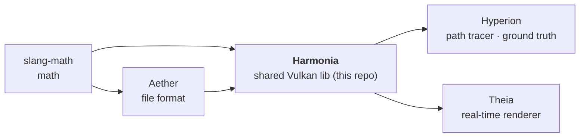

# AGENTS.md — Harmonia

Orientation for coding agents. [README.md](README.md) is the complete reference for
people; this file lists what needs to be known before changing code and points to the
section that explains it.

## What this repo is

Harmonia is the shared Vulkan library under the two path tracers of the family.
Hyperion is the offline path tracer whose renders are the ground truth; Theia is the
real-time path tracer that must converge to the same image. Both applications are thin
subclasses of `harmonia::app::App` that inject an `IRenderer`.



| Topic | Read |
|-------|------|
| What the library contains, repository layout, how a frame is rendered | [README: Scope](README.md#scope), [Repository layout](README.md#repository-layout), [How a frame is rendered](README.md#how-a-frame-is-rendered) |
| Command-line flags, environment variables, offscreen capture | [README: Command-line flags](README.md#command-line-flags) |
| Scene loading and path resolution | [README: Scene loading](README.md#scene-loading) |
| OpenPBR material model, shared shaders, denoiser contract | [README: Material model](README.md#material-model--openpbr-surface-v112), [Shared shaders](README.md#shared-shaders), [Denoiser stage](README.md#presentation-stages-and-the-two-tier-output-contract) |
| Distance haze and lens glare | [README: Lens glare](README.md#lens-glare); the haze is `shaders/haze.slang` and the `[haze]` section of Aether |
| Vulkan features and extensions, pipeline binary cache | [README: Device layer](README.md#device-layer) |
| How Theia is compared with Hyperion | [README: Parity methodology](README.md#parity-methodology), [tools/README.md](tools/README.md) |
| Build, test, lint, coverage | [README: Testing](README.md#testing), [README: Building](README.md#building) |
| Layer contract (checked by `tools/check_arch.py`) | [ARCHITECTURE.md](ARCHITECTURE.md) |
| Outstanding work, measured baselines, release history | [PLAN.md](PLAN.md) |
| Every tool: purpose, call, output, exit codes | [tools/README.md](tools/README.md) |

The file format of scenes, materials and presets belongs to Aether; its description is
in [Aether/AGENTS.md](https://github.com/McNopper/Aether/blob/main/AGENTS.md). The
renderers are described in
[Hyperion/AGENTS.md](https://github.com/McNopper/Hyperion/blob/main/AGENTS.md) and
[Theia/AGENTS.md](https://github.com/McNopper/Theia/blob/main/AGENTS.md).

## Rules that hold everywhere

- **Shared or renderer-specific.** Code that both renderers use in the same form lives
  here. A renderer's GPU scene layout (instances, meshlets, index buffers) does not.
  Nothing renderer-specific goes into `harmonia::`, and nothing here includes `theia/`
  or `hyperion/`: the two renderers are siblings.
- **No hacks.** A defect is fixed in the code that owns it. A failure is never covered
  by a looser tolerance, a special case, a clamp or scene-specific behavior.
- **Parameter driven.** Behavior is selected through parameters (feature and ownership
  bits, light and material parameters, configuration structures, `HARMONIA_*`
  environment variables, command-line flags). A fix extends these surfaces instead of
  hard-coding a path, and every parameter is documented where it lives.
- **Validation stays on.** Context creation enables `VK_LAYER_KHRONOS_validation` by
  default and fails when the layer is missing. The test fixtures and every tool keep
  it on. A validation message is a defect to fix, not noise.
- **Post-processing stages are presentation.** The denoiser is never applied to a
  capture (`--output`) or with `--no-postfx`, and it does not converge with the sample
  count. Do not put it on the capture path and do not describe it as converging. The
  lens glare (`--glare`) does not converge either, because it estimates nothing: it is
  added by the tone mapper, so it is in the PNG of a capture and in the window and never
  in the EXR; `--no-postfx` turns it off. Distance haze is not a post-process: it is part
  of the estimator, declared by the scene (`[haze]`) and applied by both renderers
  through `shaders/haze.slang`.
- **GPU-driven.** Dispatch and draw counts are GPU-resident. The host reads back only
  the completion and error status of a frame, through `IFrameCompletion`. Work that
  needs several submissions is published only when it is complete.
- **One animation clock.** `App::animationClock` supplies animation time and its change
  key to scene state, deformation, TLAS updates and the scripted camera. Consumers do
  not derive time on their own.
- **Camera assembly is shared.** `harmonia::renderer::CameraAssembly` interprets the
  scene camera for both renderers, and `SceneLoader` refuses a scene without a camera
  placement. No renderer keeps a private default view or a private fallback value.
- **Dielectric sidedness.** A hit carries the geometric normal from the triangle
  winding, pointing outward; it is never turned to face the ray. Shading flips a local
  copy, and the side test selects the exiting branch (inverted relative index of
  refraction, real total internal reflection). `geometry_thin_walled` is exempt.
- **Media.** Transmission tint follows the MaterialX rule (tinted at
  `transmission_depth` 0, white beyond, the color realized by the walk). A pure
  absorber gets the exact deterministic Beer–Lambert transmittance, never a stochastic
  walk. The estimator math of the medium walk lives once, in `medium_walk.slang`.
- **Material model.** OpenPBR Surface 1.1.2 is the standard and MaterialX (`mx_*`
  functions) its reference implementation. Parameter names follow OpenPBR; the
  shadow-terminator factor is applied at every next-event-estimation site and at the
  BSDF continuation, in the shared integrator, in the SMS compute source and in Theia's
  mirrors; keep the sites in sync. Vertices fetched with position fetch are in object
  space and are transformed by the instance matrix.
- **Acceleration structures.** Builds run on the device only
  (`vkCmdBuildAccelerationStructuresKHR`); structures are created with
  `vkCreateAccelerationStructure2KHR` from a device address. Neither host-side builds
  nor the legacy creation function is used.
- **Vulkan.** Core features plus `KHR`/`EXT` extensions only; no vendor extension. A
  newer API replaces the older one and the old path is deleted. A required feature
  that is missing stops at device selection instead of selecting a fallback. An
  optional capability follows the probe-then-enable pattern in
  `src/harmonia/vulkan_init/Capabilities.cpp` and is enabled only when its absence
  gives the same image.
- **Parity.** A change that can alter the image is compared against Hyperion with
  scene-referred EXR captures, never with PNG files. The comparison passes only when all
  four limits hold, at the budget of `tools/validation_manifest.toml`; the limits belong
  to that budget and are not loosened to pass.
- **Errors.** When a wait or a frame fails, the device is brought to rest before
  resources are destroyed (`waitDeviceQuiescent`). A partial image is never exported.
- **When a change is done.** The build is free of warnings, `ctest` is green in each
  changed repository, and a representative headless render produces no validation
  message. The release checks are in [PLAN.md](PLAN.md), section 8.

## Layers

Each directory under `src/harmonia/` is a module with its own namespace, from the bottom
up: the root vocabulary (`harmonia::`, `DeviceContext` and `GpuTypes`), `utils`, `core`,
`vulkan_init`, `rt`, `scene`, `scene_rt`, then the siblings `renderer`, `pipeline` and
`presentation`, and on top `app`. An include goes only to a lower layer and only along
a declared dependency; headers open the namespace of their module. `rt` is a separable
capability: `scene` does not depend on it, so a rasterizer can use a scene without ray
tracing. [ARCHITECTURE.md](ARCHITECTURE.md) holds the contract; a source file of 1000
lines or more fails the check and is split.

## Command-line flags

`harmonia::app::CliParser` parses the flags of both renderers. The complete table with
defaults is in [README: Command-line flags](README.md#command-line-flags).

- `--output <file>` switches to the headless capture; there is no `--offscreen` flag.
  A capture writes a scene-referred EXR and a tone-mapped PNG.
- Validation layers are on by default (`--no-validation` disables them for
  interactive use only).
- `--scene` takes an existing path, a path into a subdirectory of the assets directory,
  or the bare name of a scene in the assets root. Relative paths inside a scene resolve
  against the scene file's directory first and then against the assets directory.
- `--sequence-frames`, `--frame`, `--capture-every-ms`, `--start-seconds`, `--shutter`
  and `--time-samples` control animated captures; the denoiser flags affect the
  interactive window only; `--glare` and `--glare-threshold` control the lens glare
  ([README: Lens glare](README.md#lens-glare)), which is in the PNG of a capture and in
  the window, never in the EXR.
- Environment variables: `HARMONIA_PIPELINE_BINARY_CACHE`, `HARMONIA_FRAME_TIMING`,
  `HARMONIA_PRESENT_TIMING`.

## Parity check

Reference: Hyperion EXR. Candidate: Theia EXR. Both scene-referred linear, same
resolution, same working color space, captured with `--output`. Budget: 320 × 240,
Hyperion 256 samples per pixel, Theia 256 frames. Limits (all must hold): `mean_diff`
≤ 120 (1/255 units), Rel-MSE ≤ 250, SSIM ≥ 0.6, luminance-histogram correlation ≥ 0.8
over the 14 manifest scenes. Render the Hyperion reference with enough samples
(`--spp 256`): a noisy reference measures noise, not a difference.

```text
python tools/render_and_validate.py <hyperion.exe> <theia.exe> <output_root>   # render and compare the manifest
python tools/compare_renders.py <reference.exr> <candidate.exr>                 # compare two images
python tools/compare_sequences.py <reference_dir> <candidate_dir>              # compare two sequences
python tools/check_vulkan_validation.py                                        # no validation message, no application error
python tools/check_consistency.py <theia.exe> <hyperion.exe> <out_dir> --scene <name>   # noise or bias
```

A difference that shrinks with more samples is variance; what remains at convergence
is bias and is fixed in the code that causes it.

## Device layer

Required, without fallback: Vulkan 1.4 with `bufferDeviceAddress`, descriptor
indexing, `timelineSemaphore`, `synchronization2`, `dynamicRendering`, `maintenance4`,
`maintenance5`, `pushDescriptor`, `hostImageCopy`, `shaderDemoteToHelperInvocation`;
`VK_KHR_acceleration_structure`, `VK_KHR_ray_tracing_pipeline`, `VK_KHR_ray_query`,
`VK_KHR_deferred_host_operations`, `VK_KHR_ray_tracing_maintenance1`,
`VK_KHR_device_address_commands`, `VK_KHR_robustness2` (`nullDescriptor` only),
`VK_EXT_descriptor_buffer`.

Optional, each probed and enabled when advertised (`DeviceContext` flag in
parentheses): `VK_EXT_ray_tracing_invocation_reorder` (`serSupported`),
`VK_KHR_ray_tracing_position_fetch` (`positionFetchSupported`), `VK_EXT_mesh_shader`
(no flag), `VK_EXT_device_generated_commands` (`dgcSupported`),
`VK_KHR_opacity_micromap` (`opacityMicromapSupported`),
`VK_EXT_pageable_device_local_memory` with `VK_EXT_memory_priority`
(`pageableMemorySupported`), `VK_KHR_calibrated_timestamps`
(`calibratedTimestampsSupported`), `VK_KHR_present_id` with `VK_KHR_present_id2`
(`presentIdSupported`), `VK_KHR_present_wait` with `VK_KHR_present_wait2`
(`presentWaitSupported`), `VK_KHR_present_mode_fifo_latest_ready`
(`fifoLatestReadySupported`), `VK_EXT_device_fault` (`deviceFaultSupported`),
`VK_EXT_device_address_binding_report` (`addressBindingReportSupported`),
`VK_KHR_swapchain_maintenance1` (`swapchainMaintenance1Supported`),
`VK_EXT_memory_budget` (`memoryBudgetSupported`), `VK_EXT_present_timing`
(`presentTimingSupported`), `VK_KHR_shader_subgroup_rotate`
(`subgroupRotateSupported`), `VK_KHR_shader_maximal_reconvergence`
(`shaderMaximalReconvergenceSupported`), `VK_KHR_shader_subgroup_uniform_control_flow`
(`shaderSubgroupUniformControlFlowSupported`), `VK_KHR_shader_quad_control`
(`shaderQuadControlSupported`), `VK_KHR_pipeline_binary` (`pipelineBinarySupported`).

The pipeline binary cache (`core::PipelineBinaryCache`) is on by default in
`pipeline-cache` next to the executable. Its entries are named after the driver's
pipeline key and a hash of the pipeline's debug name; a changed driver global key
deletes every entry. Details: [README: Device layer](README.md#device-layer).

## Build & test

```powershell
cmake -S . -B build -G Ninja -DCMAKE_BUILD_TYPE=Release `
      -DCMAKE_C_COMPILER=clang-cl -DCMAKE_CXX_COMPILER=clang-cl `
      -DCMAKE_TOOLCHAIN_FILE="<vcpkg-root>/scripts/buildsystems/vcpkg.cmake"
cmake --build build
ctest --test-dir build --output-on-failure
```

The same through the preset that reads `VCPKG_ROOT`: `cmake --preset win`,
`cmake --build --preset win`, `ctest --preset win`. `ctest -LE analysis` skips the
static-analysis tests.

**Linux** (g++ and Ninja; supported and exercised by CI): the LunarG SDK tarball does
not contain SDL3. Install the distribution's `libsdl3-dev` package and link it into the
SDK directory (`$VULKAN_SDK` must point at the directory with `include`, `lib` and
`bin`):

```bash
sudo apt-get install -y libsdl3-dev
ln -s /usr/include/SDL3 "$VULKAN_SDK/include/SDL3"
ln -s /usr/lib/x86_64-linux-gnu/libSDL3.so "$VULKAN_SDK/lib/libSDL3.so"
cmake -S . -B build -G Ninja -DCMAKE_BUILD_TYPE=Release \
      -DCMAKE_C_COMPILER=gcc -DCMAKE_CXX_COMPILER=g++ \
      -DCMAKE_TOOLCHAIN_FILE="$VCPKG_INSTALLATION_ROOT/scripts/buildsystems/vcpkg.cmake"
cmake --build build
ctest --test-dir build --output-on-failure
```

The full recipe is in [README: Building](README.md#building). SDL3, `slangc` and volk
come from the Vulkan SDK; vcpkg provides tomlplusplus and OpenImageIO.

**Before pushing.** Run the lint that CI runs: clang-format 22.1.3 in check mode,
cppcheck over the sources (no `error` severity), ruff and bandit over `tools/`,
actionlint and yamllint over the workflow. `ruff.toml` is shared by the five
repositories and its findings stay at zero: fix the code, do not grow the ignore list.
A local Windows build does not prove a Linux build.

**Checks on the source.**

- `python tools/check_tidy.py`: clang-tidy over the compile database; `clang-diagnostic`,
  `clang-analyzer` and `bugprone` findings fail, the rest is reported.
- `python tools/check_arch.py --repo . --doc ARCHITECTURE.md`: the layer contract
  (ctest `test_arch`). The `arch` block of `ARCHITECTURE.md` holds the rules and is
  changed deliberately; the diagram block is generated from them (`--diagram`) and is
  never edited by hand.
- `python tools/check_dead.py --repo . --family ..`: unused files (ctest `test_dead`).
  A justified finding goes into `tools/check_dead.exceptions` with its reason.
- Coverage (Clang only): configure with `-DHARMONIA_COVERAGE=ON` into a separate
  directory, then `python tools/coverage.py`. Sanitizers (Clang or GCC only):
  `-DHARMONIA_SANITIZER=address|undefined|thread`.

**Tests.** Unit tests need no Vulkan device; component and integration tests skip
without one, and a skipped test is not a pass. The tests and the renderers read the
Aether assets from the fetched copy of Aether (build/_deps/aether-src/assets/ in the
build tree), not from a sibling working tree, unless `FETCHCONTENT_SOURCE_DIR_AETHER`
points at one.

> **One GPU job at a time.** Tests are registered with `RUN_SERIAL`, which only prevents
> parallel tests inside one `ctest` call. Run one repository's suite at a time, and
> never a suite together with a render, a gallery generation or a parity comparison:
> two concurrent jobs take several times longer and interleave their logs. An offscreen
> capture lowers its own CPU priority, which keeps the desktop usable during the
> capture; it is not a reason to run two captures at once.

## Gotchas

- **Shader entries.** A new entry shader must be listed in `HARMONIA_ENTRY_SHADERS`
  in `CMakeLists.txt`, or its `.spv` file is never compiled and fails to load at run
  time. A shared module that entries import belongs in the dependency list of
  `compile_slang_shaders` so that a change recompiles every entry. `file.slang:entry`
  compiles a second entry point of a module into `file.entry.spv`; Slang exports the
  selected entry under the name `main`, so the pipeline asks for `main`
  (`GlarePass::createPipelines`). Shaders are loaded from `HARMONIA_SHADER_DIR`, never
  from the working directory.
- **First configure** builds OpenImageIO from source (several minutes).
- **GoogleTest discovery.** When `cmake --build` fails in the test-discovery step with
  a 5 second timeout on a fresh test executable, run the build again.
- **`src/harmonia/core/Env.hpp`** has no consumer inside this repository: Theia includes
  it. It is listed in `tools/check_dead.exceptions` and must stay.
- **Editable dependencies.** Aether and slang-math are fetched at pinned tags. To work
  against local copies, configure with `-DFETCHCONTENT_SOURCE_DIR_AETHER=<path>` and
  `-DFETCHCONTENT_SOURCE_DIR_SLANG_MATH=<path>`; the renderers need the same override
  for their assets.
