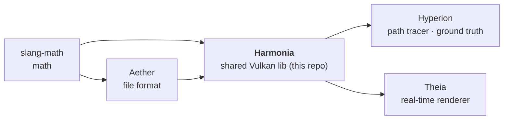

# AGENTS.md — Harmonia

Quick-start context for AI agents so basic facts don't have to be rediscovered from scratch.

**Outstanding work, governance (definition of done + guardrails) and release history: see
[`PLAN.md`](PLAN.md).**

## What this repo is

**Harmonia** is the shared **Vulkan pipeline library** used 1:1 by both renderers.
It provides the `harmonia::app::App` host (windowing, swapchain, offscreen capture, arg parsing),
the SPIR-V/Slang shader loading (`compile_slang_shaders`, `createShaderModule`), color-space
utilities, image I/O, tonemapping, the shared `path_integrator.slang` estimator + denoiser
stage, and the `harmonia::app::IRenderer` interface.

Pipeline (dependency direction):



**Split rule:** code shared 1:1 between renderers goes in Harmonia. Code that diverges
stays renderer-specific (Hyperion = path tracer w/ index buffers + RT; Theia = mesh-shader
rasterizer w/ meshlets). GPU-optimized scene upload / instance / meshlet layouts are
renderer-specific, NOT here. Aether's CPU types (`Aabb`, `MeshData`, `MaterialLibrary`)
are the file-format vocabulary; `harmonia::scene` deliberately carries the GPU-side twins
(`sm::float3`-based `Aabb`, `GpuVertex`-carrying `MeshData`) — the translation happens at
scene load (`SceneLoader`), so the file-format library and the GPU library stay decoupled.

**Layers & namespaces (enforced):** Harmonia is layered and each layer has its own
namespace — `harmonia::utils` → `harmonia::core` → `harmonia::vulkan_init` →
`harmonia::rt` (acceleration structures / micromaps — the separable ray-tracing
capability) → `harmonia::scene` → `harmonia::renderer` / `harmonia::pipeline` /
`harmonia::presentation` → `harmonia::app`, plus the flat vocabulary `harmonia::`
(`DeviceContext`, `GpuTypes`). Includes may only go **down** the graph — the checked-in `ARCHITECTURE.md`
contract (the check-arch reflexion gate; ctest `test_arch` runs the vendored
`tools/check_arch.py` engine — label `analysis`, local; not wired into CI) enforces the DAG, declared edges only (default deny), **no include cycles**
(file-level
SCC detection — catches same-layer header cycles the pairwise matrix cannot see), the
**namespace law** — headers open their module's namespace (the root vocabulary opens
`harmonia`; nested modules like `harmonia::utils::Math` count) — and any
`theia/`/`hyperion/` include — **Hyperion and Theia are siblings: both depend on
Harmonia, never on each other**.
Renderer namespaces stay separate
(`theia::`, `hyperion::`); nothing renderer-specific may live in `harmonia::`. Note the
rasterizer-base constraint: `harmonia::rt` must stay a separable capability — a future
rasterizer path consumes `scene` without `rt`.

**Local GI-SMS work:** `shaders/sms_compute.slang` is the concrete shared compute
include; `sms_path.slang` owns the actual-event PT/SMS partition independently of
root-solve success. Geometry/descriptor adapters remain renderer-owned. The
resumable `pipeline::SmsPass` publishes ready only after full-slot validation and
resolve; never accumulate/export pending or failed work. Theia's spatiotemporal
reuse on the shared SmsPass is shipped (Theia v0.8.2, qualified on the C1/C2/C3
track; see the Theia PLAN Baseline) - the shared-library checkpoints above are
complete for the current scope.

**Material model = OpenPBR Surface** (Academy Software Foundation). The shared OpenPBR BSDF
(`shaders/bsdf_shared.slang`) — diffuse (Fujii/EON), F82 conductor Fresnel (with the
`F90 = saturate(50·F0)` vanishing-interface fade, Lagarde/Frostbite — no lobe-weight gates),
GGX specular & microfacet transmission BTDF with Turquin/Kulla-Conty multiple-scattering
compensation, LTC sheen, thin-film iridescence (`mx_fresnel_airy`), the coat/fuzz layering
algebra, and the volumetric-medium primitives for the chromatic subsurface / transmission
random walk (`sssExtinction`, `transmissionVolumeCoeffs`, Henyey-Greenstein) — is used 1:1 by
both renderers. Transmission absorption follows **MaterialX tint semantics**: the BTDF is
tinted by `transmission_color` per crossing at `transmission_depth == 0` and is **white**
(untinted) at depth > 0, where the color is realized volumetrically by the walk
(σ_t = −ln(color)/depth) over the actual path length.

**Dielectric sidedness contract (C7):** hit records carry the **raw outward-winding**
geometric normal (`HitInfo.geoNormal` / `GiHit.geoNormal`) — never pre-flipped to face the
ray. Shading flips a local copy by wo; the side bit `dot(wo, geoNormal) < 0` becomes
`SurfaceHit.backface` → the BSDF `exiting` branch (inverted relative IOR: side-correct
Fresnel/Snell + genuine TIR on exit). `geometry_thin_walled` is **exempt**: a thin film has
no bulk interior, so its crossings are side-independent (no eta inversion, never TIR). The
thin-walled **subsurface sheet** follows OpenPBR 1.1.2 (#258/#321): `subsurface_radius` /
`subsurface_radius_scale` are ignored (infinitesimal MFP), `subsurface_color` applies
exactly once, split reflect/transmit ½(1∓g) by `subsurface_scatter_anisotropy`.
Medium walks (Hyperion raygen/miss/closesthit, Theia `runMediumWalk`) apply **exact
deterministic Beer–Lambert transmittance for pure absorbers** (single-scatter albedo = 0 —
ratio-tracking degenerate case, zero walk variance); scattering media use the chromatic
hero-wavelength free-flight estimator. OpenPBR's canonical/reference implementation is **MaterialX** (`mx_*` genGLSL nodes);
follow OpenPBR parameter naming and cross-check against MaterialX. The shared scene-referred
estimator is `shaders/path_integrator.slang`; the shared denoiser (`shaders/denoiser.slang`) is
an à-trous wavelet edge-stopping filter + temporal accumulation — a **presentation stage only**,
forced off for `--output`/`--no-postfx` (fixed pixel radius ⇒ non-converging; see the two-tier
output contract in README).

Hyperion/Theia demos are thin subclasses of `harmonia::app::App` injecting a `harmonia::app::IRenderer`.
Shaders load from `*_SHADER_DIR`, never CWD.

## CLI flags (parsed by `harmonia::app::App::applyCommonArg`)

These work for **both** Hyperion and Theia (Hyperion adds `--spp`, `--depth`):

| Flag | Meaning |
|------|---------|
| `--scene <name>` / `-s` | Scene name (resolves against assets dir) or path. Bare arg also works. |
| `--output <file>` / `-o` | **Headless mode**: render N frames, save EXR (untonemapped) + PNG (tonemapped), exit. |
| `--width <n>` / `--height <n>` | Render resolution. |
| `--validation` / `--no-validation` | Vulkan validation layers. **ON by default — the family contract is that validation is ALWAYS enabled** (AppConfig.validation = true; context creation hard-fails without the layer; test fixtures and every tool keep it on — `--no-validation` is an explicit human escape hatch that no family script passes). |
| `--no-postfx` | Force off every post-processing stage (A-SVGF denoiser + TAA) — the interactive-window identity that `--output` enforces for offscreen capture. |
| `--indirect-ambient <f>` | Presentation-only indirect ambient boost (scene-referred linear units). |
| `--sequence-frames <N>` | **ANI7 sequence render** (with `--output`): render N ANIMATION frames instead of one capture - the animation tick is pinned to the output-frame index (t = k/fps constant across that frame's accumulation samples), accumulation restarts per frame, and files are written as `<stem>_0000<ext>` ... `<stem>_<k><ext>` (EXR + PNG each). 0 (default) = classic single capture. An animated `--output` without this flag is a single-sample last-tick image (warned once). |
| `--frame <N>` | **ANI8 animation seek**: start the animation clock at frame N - sequence output frame k renders tick **N + k** (movie frame generation: one image per run with `--sequence-frames 1 --frame N`), the interactive window starts at N and plays in real time, and a camera bound via `[camera] node` re-places itself from N on. 0 (default) = unchanged behavior. |
| `--capture-every-ms <f>` | **ANI7 time-based capture** (requires `--sequence-frames`): sample the animation every N milliseconds of ANIMATION TIME instead of the integer tick grid - output frame k renders `start + k * interval` seconds (sub-frame sampling at e.g. 16.67 ms, multi-frame jumps at e.g. 1000 ms); the range is start + count x interval (count = `--sequence-frames`). ONE clock (`App::animationClock` -> seconds + change key) feeds every consumer (scene stamp, deform, TLAS, scripted camera) - they can never disagree. 0/absent (default) = the tick grid, unchanged; rejected without `--sequence-frames`. |
| `--start-seconds <f>` | Explicit capture start in SECONDS (>= 0) for `--capture-every-ms`; absent = derived from `--frame` / fps. |
| `--ibl-diffuse-resolution <n>` | IBL diffuse irradiance atlas width (height = width / 2, 2:1 lat-long). Default 256. |
| `--display-overlay` | Optional post-tonemap, **display-referred** overlay renderer (interactive presentation debug - never scene-referred). |
| `--deterministic-replay` | Replayable frame/sample RNG sequencing for the stochastic stages: the same stream every run, so captures and A/B diffs are reproducible on top of `--rng-seed`. |
| `--rng-debug` | Stochastic debug path switch for renderer-side RNG visualization/tests (the base seed itself is `--rng-seed <n>`). |
| `--offscreen-frames <n>` | Scene-referred frames accumulated before saving in offscreen (headless) mode. Default 4; raise it for stochastic convergence (the ANI7 sequence accumulates this many per output frame). |
| `--frames-per-flip <n>` | Interactive window: accumulation frames per swapchain flip - 1 = one render per present (default, I6), N > 1 converges the displayed image faster per flip at the cost of flip rate and input latency. |
| `--denoiser-*` | Presentation-stage (scene-output) denoiser controls: values `--denoiser-strength <f>` (0..1), `--denoiser-iterations <n>` (1..8), `--denoiser-history-blend <f>`, `--denoiser-gradient-alpha <f>`; toggles `--denoiser-no-history` / `--denoiser-history` and `--denoiser-no-gradient` / `--denoiser-gradient`. Forced off for `--output` / `--no-postfx` captures (the two-tier output contract - the denoiser is a presentation stage only). |

⚠️ There is **no `--offscreen` flag**. Headless is triggered by `--output` being set.

## Parity comparison tools

`tools/compare_renders.py <reference.exr> <candidate.exr>` computes `mean_diff`, `rel_mse`,
`ssim` (tone-mapped sRGB), luminance-histogram correlation, `psnr`, `mse`, `rel_mean_pct`,
percentile/max diffs and a signed heatmap (`--signed-heatmap`). `tools/check_consistency.py`
covers bias/variance (Theia N vs 4N frames).

Three companion harnesses (same tooling contract):
- `tools/compare_sequences.py <ref-dir> <cand-dir>` - **ANI7 sequence gate**:
  the strict-AND metric set per frame pair plus the temporal layer (per-metric
  mean / worst-frame, first->last drift); frame pairing by the trailing
  `_<index>`, count/index mismatch = error.
- `tools/check_vulkan_validation.py [--scene <s>...]` - the **zero-warning
  gate**: renders the manifest (or the named scenes) with validation ON and
  fails on any validation message or app WARN/ERROR line.
- `tools/render_and_validate.py <hyperion_exe> <theia_exe> <output_root>` -
  renders the manifest's Hyperion/Theia pairs and runs `validate_renders.py`
  over the batch (the parity sweep producer).

Contract (all must hold or the numbers are meaningless):
- Reference = Hyperion EXR; candidate = Theia EXR. **Pre-tonemap linear EXR**, never PNG.
- Same resolution, same working color space (same `[render]` preset).
- Theia's unified accumulation RT path is the only path now.
- **Gate = strict AND across the metric set** (mean_diff ≤ 120 in 1/255 units, rel-MSE ≤ 250,
  SSIM ≥ 0.6, luminance-histogram corr ≥ 0.8) over the **14 scenes** in
  `tools/validation_manifest.toml` at 320×240 / 256 spp / 256 frames. **Recalibrated
  2026-11-16 (owner decision):** the old clamp-era numbers (4.0 / 0.01 / 0.98 / 0.999) were
  unreachable under estimator-pure capture; each threshold now sits strictly between the
  measured clean noise envelope and the measured *completely-different* anchors - the gate
  catches gross divergence, not Monte-Carlo noise (method + measurements: PLAN.md §7 and the
  manifest comments). **Budget-specific** - recalibrate if spp/frames/resolution change.
  Known limitation: the metrics are luminance-based, so a luma-preserving channel swap is
  invisible. `tools/frames_to_video.py <input_dir> <output.mp4> [--fps N | --interval-ms X] [--crf N]`
encodes a `--sequence-frames` image sequence into a playable H.264/yuv420p mp4
(frames ordered NUMERICALLY by their trailing `_<index>`, hard-linked into an
image2 sequence; ffmpeg required). `--interval-ms` pairs with
`--capture-every-ms`, so playback duration equals the captured time range
(verified: 10 frames x 100 ms -> 1.000 s at 10 fps).

`compare_renders.py --gate scale-aware` remains in the tool for ad-hoc HDR
  comparisons; the manifest no longer routes scenes through it (both transmissive fixtures
  pass the plain gate).
- For IBL references, render Hyperion at high spp (`--spp 256`) — a low-spp reference is
  noisy and inflates `mean_diff`. See Aether/AGENTS.md "low-spp reference trap".

Which metric catches which failure mode, and the bias-vs-noise method: see `PLAN.md`
(*Parity methodology*).

## Build & test

```powershell
cmake -S . -B build -G Ninja -DCMAKE_BUILD_TYPE=Release `
      -DCMAKE_C_COMPILER=clang-cl -DCMAKE_CXX_COMPILER=clang-cl `
      -DCMAKE_TOOLCHAIN_FILE="<vcpkg-root>/scripts/buildsystems/vcpkg.cmake"
cmake --build build
cd build; ctest --output-on-failure
```

Equivalent preset flow (Ninja + Release + clang-cl + `$env:VCPKG_ROOT` toolchain):
`cmake --preset win` / `cmake --build --preset win` / `ctest --preset win`.

**Linux (g++/Ninja — supported, CI-proven):**

```bash
# Vulkan SDK: https://sdk.lunarg.com/sdk/download/latest/linux/vulkan_sdk.tar.xz
#   export VULKAN_SDK=<extract>/<version>/x86_64   (the layout VulkanSDK.cmake
#   requires: include/{vma,SDL3,volk}, lib/libSDL3.so, bin/slangc — found via slangc)
# The Linux SDK tarball ships NO SDL3 (the Windows one does): bridge the
#   distro's libsdl3-dev into that layout (ln -s include/SDL3, lib/libSDL3.so).
cmake -S . -B build -G Ninja -DCMAKE_BUILD_TYPE=Release \
      -DCMAKE_C_COMPILER=gcc -DCMAKE_CXX_COMPILER=g++ \
      -DCMAKE_TOOLCHAIN_FILE="$VCPKG_INSTALLATION_ROOT/scripts/buildsystems/vcpkg.cmake"
cmake --build build
ctest --test-dir build --output-on-failure
```

**CI:** `.github/workflows/build.yml` runs on `windows-latest` + `ubuntu-26.04` for pushes
to `main` and PRs targeting `main`; manual dispatch remains available. Ordinary
development/WIP pushes do not trigger CI. It is **pure build** for renderer targets (their test suites need a GPU and stay a
local activity); Aether/slang-math additionally run their CPU suites. Checkouts set
`lfs: true` except Aether's, which is **`lfs: false`** — build-only CI never reads asset
binaries, and skipping the ~210 MB of Aether LFS assets per leg guards the account's
Git LFS bandwidth quota (the Aether CPU suite runs locally with full assets). The Linux leg installs the SDK tarball (cached),
bridges SDL3, and builds with the image's g++ under the same `-Wall -Wextra -Werror
-Wpedantic` gate as Windows (`/W4 /WX`). The Windows leg runs the LunarG installer
  silently with the LOCAL machine's component set (core, glm, sdl2 (ships SDL2+SDL3),
  volk, vma, arm64) and registers its Bin on PATH exactly like the local install -
  the contract check (vma/SDL3/volk/slangc) is the gate.

> **⚠️ Do not run things in parallel — it slows the machine to a crawl.**
> - **Tests are serialised in CMake:** every test carries `RUN_SERIAL`, so `ctest -j`
>   cannot parallelise them. That only covers *within* one `ctest` invocation, so still
>   run ONE repo's suite at a time (never Harmonia + Theia + Hyperion together).
> - **GPU jobs strictly one after the other:** renders, gallery generation and parity
>   gates all saturate the GPU. Run one, wait for it to finish, then start the next.
>   Two concurrent jobs make both several times slower and interleave their logs.
> - **Offscreen capture self-deprioritises:** `App::renderOffscreen()` drops the
>   process to below-normal CPU priority (`BELOW_NORMAL_PRIORITY_CLASS` on Windows,
>   nice +10 on POSIX) for the whole capture, so the desktop stays usable while a
>   render runs. A per-frame `std::this_thread::yield()` alone is NOT sufficient - it
>   is `SwitchToThread()`/`sched_yield()`, only a hint that does nothing when no
>   equal-or-higher-priority thread is already runnable. On POSIX the drop is one-way
>   for an unprivileged process (raising priority back needs `CAP_SYS_NICE`), so it is
>   used only in the one-shot capture path. This helps *during* a capture; it is still
>   not licence to run two captures at once.

**Lint (CI):** `.github/workflows/build.yml` runs a **blocking** `lint (Q2-Q6)` job
on ubuntu-latest: clang-format (pinned 22.1.3 via pip - the local dev version; a
different version reformats differently and fails), cppcheck (explicit source-file
scan of `src/` + `include/`, gate = no `error:` severity), ruff over `tools/`
(contract: root `ruff.toml`, identical in all five family repos; findings stay at
zero - fix code, do not grow ignores), bandit (accepted tool-script patterns in the
`--skip` list), actionlint + yamllint on the workflows. Local pre-flight: run the
same commands from the repo root before pushing a lint-affecting change.

**Static analysis:** `python tools/check_tidy.py` — parallel clang-tidy over
`build/compile_commands.json`, classified per `.clang-tidy`'s WarningsAsErrors contract
(clang-diagnostic/clang-analyzer/bugprone fail the run; modernize/performance/portability
are report-only). Also registered as ctest `test_tidy` (label `analysis`; the fast test loop is `ctest -LE analysis`; skips when
clang-tidy, Python3 or the database is missing).

**Dead-code gate:** `python tools/check_dead.py` - orphan headers, never-compiled sources (absent from `compile_commands.json` AND unreferenced by any CMake file), and FetchContent declare/consume mismatches. Also registered as ctest `test_dead` (label `analysis`; local only - registration is gated on the per-user check-dead skill install, so CI runners skip it). Justified findings go into `tools/check_dead.exceptions` with a reason; real dead code is deleted in a fix commit.

Sanitizer lane (Clang/GCC configures only):
`-DHARMONIA_SANITIZER=address|undefined|thread`. Host-side FP is deterministic
(`/fp:strict` / `-ffp-contract=off -fno-fast-math`).

Image I/O uses OpenImageIO (PNG/JPEG/EXR load+save, EXR chromaticities); OpenEXR/stb are
transitive dependencies. The first configure builds OpenImageIO from source (one-time,
several minutes; later configures reuse the vcpkg binary cache).

⚠️ If `cmake --build` fails inside `GoogleTestAddTests.cmake` with a 5 s discovery timeout
on a freshly-linked test exe (cold DLL load / AV scan on its first run), just re-run
`cmake --build build` — gtest discovery passes on retry.

## Conventions

- Commit, but do **not** push unless asked.
- Build the current candidate locally, warning-clean, and run the applicable local
  verification/lint before any authorized development/WIP push. Local Windows
  success does not establish a Linux build or hosted CI success.
- **Logging:** the shared `Logger` prefixes each line with a per-app tag. Applications call
  `Logger::setTag("...")` once at startup (Hyperion → `[HYPERION]`, Theia → `[THEIA]`); the
  Harmonia default is `[HARMONIA]`. Keep the tag uppercase to match the `[INFO]` level style.
- **GPU-driven, latest standard Vulkan, cross-vendor only** (core + `KHR`/`EXT`). No
  vendor-specific extensions (`VK_NV_*`/`VK_AMD_*`/`VK_INTEL_*`) — must run on any vendor.
- Working color space is scene-referred (e.g. `lin_rec2020_scene` / `lin_rec709_scene`).
- SDL3, slangc and volk come from the Vulkan SDK (not vcpkg); vcpkg provides tomlplusplus and OpenImageIO.

## GPU-driven design (Harmonia device layer)

**Principle:** all draw/dispatch submission parameters are GPU-resident and GPU-written.
The CPU records commands only; it never reads back GPU-side state to determine counts or parameters.

**Always-required Vulkan 1.4 features (enabled in Context.cpp):**
- `maintenance4` (Vulkan 1.3), `maintenance5` (Vulkan 1.4) — both required.
- `shaderDemoteToHelperInvocation` (Vulkan 1.3) — required: the C14 `geometry_opacity` cutout
  path uses Slang `discard` (Theia `forward_render.frag.slang`), so the emitted SPIR-V
  declares the `DemoteToHelperInvocation` capability (VUID-08740).
- `deviceAddressCommands` (`VK_KHR_device_address_commands`, MOD5) — required: all AS creation
  goes through `vkCreateAccelerationStructure2KHR` (device-address-only); the legacy
  `vkCreateAccelerationStructureKHR` path is deleted, no fallback.
- `rayTracingMaintenance1` + `rayTracingPipelineTraceRaysIndirect2` (`VK_KHR_ray_tracing_maintenance1`) — required; Hyperion dispatches via `vkCmdTraceRaysIndirect2KHR` exclusively.
  `maintenance5` enables `VkBufferUsageFlags2CreateInfo` (64-bit buffer usage flags),
  which is needed by Theia's DGC preprocess buffer (`VK_BUFFER_USAGE_2_PREPROCESS_BUFFER_BIT_EXT`).
- `pushDescriptor` (Vulkan 1.4).
- `hostImageCopy` (Vulkan 1.4) — texture/IBL upload goes host→optimal-tiling image directly via
  `vkCopyMemoryToImage` (no staging buffer, no device copy); see `Texture::create` /
  `IblProbe::uploadEnvPanorama`. Image usage `VK_IMAGE_USAGE_HOST_TRANSFER_BIT`, copy layout `GENERAL`.
- `VK_EXT_descriptor_buffer` (MOD1) — the GPU-driven descriptor path: descriptor data is
  written into GPU buffers and bound via `vkCmdBindDescriptorBuffersEXT`. Hard-required:
  every descriptor pool/set was deleted with MOD1 (no fallback exists).
- `VK_KHR_robustness2` — `nullDescriptor` only (VK14): bind `VK_NULL_HANDLE` instead of
  dummy 1x1 resources. `robustBufferAccess2`/`robustImageAccess2` deliberately NOT enabled
  (perf cost).
- Ray-tracing core quartet — `VK_KHR_acceleration_structure`, `VK_KHR_ray_tracing_pipeline`,
  `VK_KHR_ray_query`, `VK_KHR_deferred_host_operations`: hard-required (the RT paths have
  no fallback).

**Coverage lane (Clang/GCC configures only):** configure a separate build with
`-DHARMONIA_COVERAGE=ON` (e.g. `-B build/coverage`), then run `python tools/coverage.py` - it
builds the instrumented tree, runs the tests with `LLVM_PROFILE_FILE` set, merges the
profiles and prints the llvm-cov report for `src/` (gcc builds report via gcov; exit 77
when the LLVM tools are missing). NOT wired into CI: the test suites need a GPU and CI is build-only for the renderer band, so a CI coverage report would measure nothing - the lane stays a local activity.

Further capability candidates (verified present on the dev GPU, not yet adopted) are
tracked in `PLAN.md` §5.8 — capability audit (SDK 1.4.363 / driver 621.24, re-audited 2026-11-17).
- **VMA allocator flag:** `VMA_ALLOCATOR_CREATE_KHR_MAINTENANCE5_BIT` must be set alongside
  `VMA_ALLOCATOR_CREATE_BUFFER_DEVICE_ADDRESS_BIT` to let VMA handle
  `VkBufferUsageFlags2CreateInfo` in `VkBufferCreateInfo::pNext`. When `VK_EXT_pageable_device_local_memory`
  is present, `VMA_ALLOCATOR_CREATE_EXT_MEMORY_PRIORITY_BIT` is also set (driver pages device-local memory
  by priority under VRAM pressure).

**Optional extensions managed here (all follow the same probe→enable pattern):**

| Extension | `DeviceContext` flag | Purpose |
|-----------|---------------------|---------|
| `VK_EXT_mesh_shader` | `meshShaderSupported` | Mesh/task shaders (Theia rasterizer) |
| `VK_EXT_ray_tracing_invocation_reorder` | `serSupported` | SER reorder hint (Hyperion/Theia RT) |
| `VK_KHR_ray_tracing_position_fetch` | `positionFetchSupported` | Object-space vertex positions in RT hit shaders (the object-space position-fetch guardrail) |
| `VK_EXT_device_generated_commands` | `dgcSupported` | GPU-generated mesh draw commands (Theia GD6) |
| `VK_KHR_opacity_micromap` | `opacityMicromapSupported` | Per-microtriangle opacity for `geometry_opacity` cutouts (C14); micromaps are acceleration structures (AS-create/build path — VK15); scene load fails fast if a mesh needs it and the device lacks it |
| `VK_EXT_pageable_device_local_memory` (+ its dep `VK_EXT_memory_priority`) | `pageableMemorySupported` | Driver pageable device-local memory; VMA assigns priorities |
| `VK_KHR_calibrated_timestamps` | `calibratedTimestampsSupported` | GPU↔host clock correlation (`vkGetCalibratedTimestampsKHR`); sampled once at startup (see `App::logGpuClockCalibration`) |
| `VK_KHR_present_id` + `VK_KHR_present_id2` | `presentIdSupported` | Per-present monotonic ID tagging (MOD6: the v2 API is used; v1 is enabled as its declared dependency) |
| `VK_KHR_present_wait` + `VK_KHR_present_wait2` | `presentWaitSupported` | CPU-side "frame is on-screen" wait via `vkWaitForPresent2KHR` (`Swapchain::waitForPresent`, MOD6) |
| `VK_KHR_present_mode_fifo_latest_ready` | `fifoLatestReadySupported` | `VK_PRESENT_MODE_FIFO_LATEST_READY_KHR` — FIFO v-sync, latest-ready image (lower latency) |
| `VK_EXT_device_fault` | `deviceFaultSupported` | VK16 device-lost forensics: on `VK_ERROR_DEVICE_LOST` retrieve `vkGetDeviceFaultInfoEXT` (fault addresses, vendor faults), dump the raw vendor binary blob as `device_fault_<timestamp>.bin`; pure diagnosability |
| `VK_EXT_device_address_binding_report` | `addressBindingReportSupported` | VK16 companion: bind/unbind events via a dedicated INFO/DEVICE_ADDRESS_BINDING debug messenger — the records accompany the fault and make its buffer addresses correlate-able |
| `VK_KHR_swapchain_maintenance1` | `swapchainMaintenance1Supported` | MOD4 v1 fence/release half: per-present fences (`VkSwapchainPresentFenceInfoKHR`) + `vkReleaseSwapchainImagesEXT` on resize — `Swapchain::recreate` retires the old swapchain without a whole-device idle. Present scaling (the other half) was probed (`supportedPresentScaling = 0` on the reference GPU) and stays out; extension-absent devices keep the legacy device-idle resize path |
| `VK_EXT_memory_budget` | `memoryBudgetSupported` | VK21: per-heap VRAM budget/usage logged at startup; offscreen-capture guard warns above 90% device-local budget |
| `VK_EXT_present_timing` | `presentTimingSupported` | VK18 (2026 revision): swapchain opts in at creation (`VK_SWAPCHAIN_CREATE_PRESENT_TIMING_BIT_EXT` + per-surface capability), record queue sized, past-presentation timings drained per frame into rolling cadence stats (`HARMONIA_PRESENT_TIMING=1`); telemetry only |
| `VK_KHR_shader_subgroup_rotate` (via Vulkan14Features) + `VK_KHR_shader_maximal_reconvergence` + `VK_KHR_shader_subgroup_uniform_control_flow` + `VK_KHR_shader_quad_control` | `subgroupRotateSupported` / `shaderMaximalReconvergenceSupported` / `shaderSubgroupUniformControlFlowSupported` / `shaderQuadControlSupported` | VK4 subgroup capability set (rotate is promoted — enable via Vulkan14Features, not the standalone struct, VUID-pNext-10360). Consumers: ReSTIR reservoir merge/compaction warp reductions and PERF5 10e live-count dispatch; compaction micro-benchmark receipt in `tests/component/test_subgroup_bench.cpp` |
| `VK_KHR_pipeline_binary` | `pipelineBinarySupported` | VK5: explicit pipeline-binary cache — `core::PipelineBinaryCache` captures driver binaries per pipeline and recreates from them across sessions (validity anchored on the driver global key: driver update ⇒ full re-capture). **Default ON** at `<exe-dir>/pipeline-cache`; `HARMONIA_PIPELINE_BINARY_CACHE` overrides the directory, `off`/`0` disables. Consumed by the shared passes + renderer pipelines through `DeviceContext::pipelineBinaryCache`. See `PLAN.md` §5.8 |

**Acceleration structure builds — device-side only (Khronos deprecation compliant):**
- All BLAS/TLAS builds use `vkCmdBuildAccelerationStructuresKHR` (device-side).
- `vkBuildAccelerationStructuresKHR` (host-side) is **never used** — it is deprecated per the
  [Khronos RT AS deprecation blog](https://www.khronos.org/blog/vulkan-ray-tracing-deprecating-host-side-acceleration-structure-builds).
- `VK_KHR_device_address_commands` / `vkCreateAccelerationStructure2KHR` is the **future forward
  path** for AS creation (cleanest device-address-only API). SHIPPED (MOD5): vkCreateAccelerationStructure2KHR is the only AS creation path; the legacy vkCreateAccelerationStructureKHR is deleted (hard-required).
