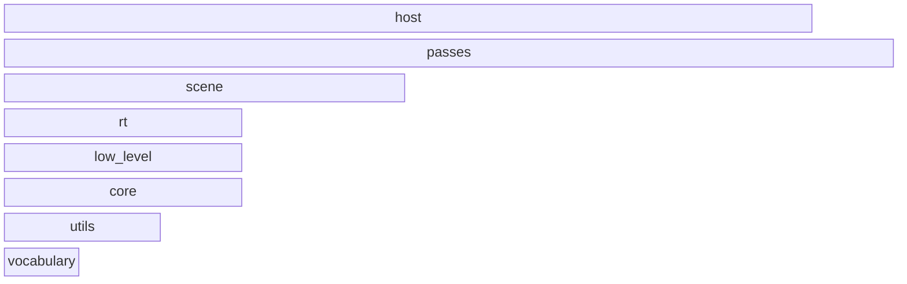
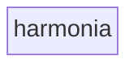
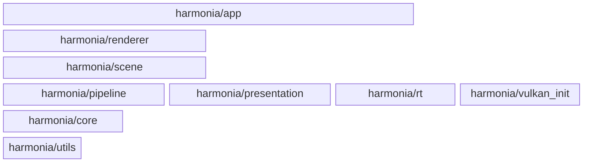

# Architecture

The checked-in architecture contract for Harmonia (the check-arch reflexion
gate: this document is the posited model, the include graph is the extracted
model, `test_arch` reflexes one against the other). The layer stack and the
declared edges mirror the family design: strict downward-only dependencies,
the shared vocabulary `harmonia::` at the bottom, the `app` host on top.
Renderer isolation is law: `theia` and `hyperion` are siblings — both consume
Harmonia, neither is ever included here.

<!-- check_arch: diagram BEGIN -->
### the layers



### layer vocabulary - the modules



### harmonia - the nested modules


<!-- check_arch: diagram END -->

## The machine contract

```arch
scan: src
extensions: .hpp, .cpp
exclude: build, _deps, .git
unclassified: error
external: OpenImageIO, SDL3, aether, gtest, slang-math, sys, toml++, vma, volk
forbidden: theia, hyperion
quotes_relative: true
repo_fallback: false
cycles: true
namespace_root: .hpp
namespace_module: .hpp
namespace_require:
unresolved: info

layer vocabulary
layer utils
layer core
layer low_level
layer rt
layer scene
layer passes
layer host

module harmonia in vocabulary
module harmonia/utils in utils
module harmonia/core in core
module harmonia/vulkan_init in low_level
module harmonia/rt in rt
module harmonia/scene in scene
module harmonia/renderer in passes
module harmonia/pipeline in passes
module harmonia/presentation in passes
module harmonia/app in host

allow harmonia/utils -> harmonia
allow harmonia/core -> harmonia
allow harmonia/core -> harmonia/utils
allow harmonia/vulkan_init -> harmonia
allow harmonia/vulkan_init -> harmonia/core
allow harmonia/rt -> harmonia
allow harmonia/rt -> harmonia/core
allow harmonia/scene -> harmonia
allow harmonia/scene -> harmonia/utils
allow harmonia/scene -> harmonia/core
allow harmonia/scene -> harmonia/rt
allow harmonia/renderer -> harmonia
allow harmonia/renderer -> harmonia/utils
allow harmonia/renderer -> harmonia/core
allow harmonia/renderer -> harmonia/scene
allow harmonia/pipeline -> harmonia
allow harmonia/pipeline -> harmonia/utils
allow harmonia/pipeline -> harmonia/core
allow harmonia/presentation -> harmonia
allow harmonia/presentation -> harmonia/utils
allow harmonia/presentation -> harmonia/core
allow harmonia/app -> harmonia
allow harmonia/app -> harmonia/utils
allow harmonia/app -> harmonia/core
allow harmonia/app -> harmonia/vulkan_init
allow harmonia/app -> harmonia/rt
allow harmonia/app -> harmonia/scene
allow harmonia/app -> harmonia/renderer
allow harmonia/app -> harmonia/pipeline
allow harmonia/app -> harmonia/presentation
```

## Reading the stack

`vocabulary` (`harmonia/` root: `DeviceContext`, `GpuTypes`) is the leaf every
layer may use; `utils`/`core` are the foundation; `vulkan_init` owns device
creation; `rt` is the separable ray-tracing capability (a rasterizer consumer
would use `scene` without it — the rasterizer-base constraint);
`renderer`/`pipeline`/`presentation` are sibling pass layers (declared edges
only — default deny keeps them independent); `app` is the host. Includes may
only go **down** the stack, and only along declared edges.
