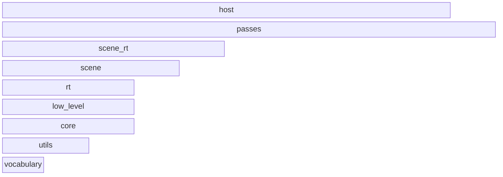
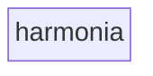
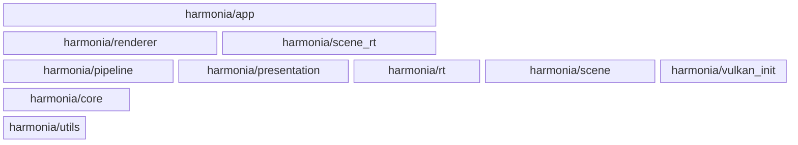
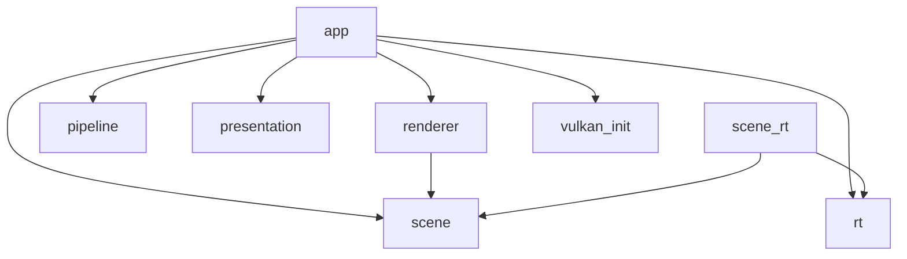

# Architecture

This document is the architecture contract of Harmonia. The `arch` block below is
checked by `tools/check_arch.py`: the script extracts the include graph of the sources
and compares it with the declared layers, modules and dependencies. The diagrams between
the two `check_arch` markers are generated from the same rules and compared on every
run, so they are never edited by hand. The block itself is changed only on purpose;
[How to change the contract](#how-to-change-the-contract) describes the procedure.

The design rests on three rules:

- Dependencies point only downward. The shared vocabulary `harmonia::` is the bottom
  layer and the application host `app` is the top layer. A module includes another one
  only when the contract declares the dependency.
- Each module has its own namespace and every header opens it. The namespace follows
  the directory: `harmonia/core` is `harmonia::core`.
- The renderers are siblings of this repository. No file here includes `theia/` or
  `hyperion/`.

## Logical frame completion

Some renderer work cannot finish in one GPU submission; specular manifold sampling,
for example, runs trials whose count is not known in advance. For such work the
renderer exposes `IFrameCompletion` from the `app` layer. After the host has submitted
and waited for the initial producer work, it asks the adapter whether the frame is
ready. While it is not, the host records and submits one bounded continuation at a
time. Everything that depends on the frame (the renderer's post passes, accumulation,
the denoiser, the sample and frame counters and the capture export) starts only when
the adapter reports that the frame is ready; an error aborts the frame.

The host reads back only status and error codes. Ray and workgroup counts stay on the
GPU. A renderer without an adapter keeps the one-submission schedule. The contract adds
no module and no dependency: `app` already uses `core::CommandPool`.

<!-- check_arch: diagram BEGIN -->
### the layers



### layer vocabulary - the modules



### harmonia - the nested modules


<!-- check_arch: diagram END -->

## The machine contract

```arch
scan: src
extensions: .hpp, .cpp
exclude: build, _deps, .git
unclassified: error
external: OpenImageIO, SDL3, aether, gtest, slang-math, sys, toml++, vma, volk
forbidden: theia, hyperion
quotes_relative: true
repo_fallback: false
cycles: true
namespace_root: harmonia         # the flat vocabulary opens harmonia; nested
namespace_module: harmonia       # modules map harmonia/<mod> -> harmonia::<mod>
namespace_require: .hpp          # headers must ALWAYS open their namespace
unresolved: info
within_layer: deny              # undeclared same-layer edges: violations
kind: library                   # public API surface: volume judged per file
header_size: error               # the standing bloat rule (hard gate)
smells: report                 # refactoring-catalog proxies: report-only review signals

layer vocabulary
layer utils
layer core
layer low_level
layer rt
layer scene
layer scene_rt
layer passes
layer host

module harmonia in vocabulary
module harmonia/utils in utils
module harmonia/core in core
module harmonia/vulkan_init in low_level
module harmonia/rt in rt
module harmonia/scene in scene
module harmonia/scene_rt in scene_rt
module harmonia/renderer in passes
module harmonia/pipeline in passes
module harmonia/presentation in passes
module harmonia/app in host

allow harmonia/utils -> harmonia
allow harmonia/core -> harmonia
allow harmonia/core -> harmonia/utils
allow harmonia/vulkan_init -> harmonia
allow harmonia/vulkan_init -> harmonia/core
allow harmonia/rt -> harmonia
allow harmonia/rt -> harmonia/core
allow harmonia/scene -> harmonia
allow harmonia/scene -> harmonia/utils
allow harmonia/scene -> harmonia/core
allow harmonia/scene_rt -> harmonia/scene
allow harmonia/scene_rt -> harmonia/rt
allow harmonia/scene_rt -> harmonia/core
allow harmonia/scene_rt -> harmonia
allow harmonia/renderer -> harmonia
allow harmonia/renderer -> harmonia/utils
allow harmonia/renderer -> harmonia/core
allow harmonia/renderer -> harmonia/scene
allow harmonia/pipeline -> harmonia
allow harmonia/pipeline -> harmonia/utils
allow harmonia/pipeline -> harmonia/core
allow harmonia/presentation -> harmonia
allow harmonia/presentation -> harmonia/utils
allow harmonia/presentation -> harmonia/core
allow harmonia/app -> harmonia
allow harmonia/app -> harmonia/utils
allow harmonia/app -> harmonia/core
allow harmonia/app -> harmonia/vulkan_init
allow harmonia/app -> harmonia/rt
allow harmonia/app -> harmonia/scene
allow harmonia/app -> harmonia/renderer
allow harmonia/app -> harmonia/pipeline
allow harmonia/app -> harmonia/presentation
```

## Reading the stack

The layers from bottom to top. The last column lists the dependencies the contract
declares for each module.

| Layer | Module | Role | Depends on |
|-------|--------|------|------------|
| `vocabulary` | `harmonia` | The shared device state and GPU types (`DeviceContext.hpp`, `GpuTypes.hpp`) | nothing |
| `utils` | `harmonia/utils` | Color spaces, tone mapping, math helpers, RNG | vocabulary |
| `core` | `harmonia/core` | Buffers, images, command pools, barriers, shader modules, descriptor-buffer writer, logger, pipeline binary cache | vocabulary, `utils` |
| `low_level` | `harmonia/vulkan_init` | Instance, validation layer, device selection and creation, capability probes | vocabulary, `core` |
| `rt` | `harmonia/rt` | Acceleration structures, TLAS builder, opacity micromaps: the separable ray-tracing capability | vocabulary, `core` |
| `scene` | `harmonia/scene` | Scene loader, materials, textures, meshes, lights, IBL probe, deformation pass | vocabulary, `utils`, `core` |
| `scene_rt` | `harmonia/scene_rt` | Ties a scene to ray tracing: triangle meshes with their BLAS, analytic spheres, TLAS build and refit, emissive triangles | `scene`, `rt`, vocabulary, `core` |
| `passes` | `harmonia/renderer` | Camera, camera assembly, shared descriptors, RT pipeline helper | vocabulary, `utils`, `core`, `scene` |
| `passes` | `harmonia/pipeline` | Render-pass interface, accumulation, denoiser and SMS passes | vocabulary, `utils`, `core` |
| `passes` | `harmonia/presentation` | Swapchain, tone mapper, image capture | vocabulary, `utils`, `core` |
| `host` | `harmonia/app` | The application host: window, frame loop, capture, frame completion | vocabulary, `utils`, `core`, `vulkan_init`, `rt`, `scene`, `renderer`, `pipeline`, `presentation` |

`scene` does not depend on `rt`. Only `scene_rt` joins the two, so a rasterizer can
consume a scene without any ray-tracing code (the rasterizer-base constraint). The
three modules of the `passes` layer are siblings: the contract declares no dependency
between them, and an include between them is a violation.

The diagram shows the declared dependencies between the modules that carry several of
them. `core`, `utils` and the vocabulary are left out.



## What the check verifies

`tools/check_arch.py` reads the `arch` block and the sources under `src` (`.hpp` and
`.cpp`) and fails when it finds any of these:

| Rule | Setting in the contract | Meaning |
|------|-------------------------|---------|
| Direction | `allow A -> B` lines | An include from A to B exists only when an edge is declared. Anything else is a violation (default deny) |
| Stack order | `layer` lines | A declared edge that points from a layer to a higher layer is a violation |
| Same layer | `within_layer: deny` | An undeclared include between two modules of one layer is a violation |
| Classification | `unclassified: error` | A file that belongs to no declared module is a violation |
| Cycles | `cycles: true` | No cycle in the include graph, down to single files |
| Namespaces | `namespace_root: harmonia`, `namespace_require: .hpp` | Every header opens the namespace of its module (`harmonia::` for the root files, `harmonia::<module>` otherwise) |
| Renderer isolation | `forbidden: theia, hyperion` | No include of a renderer |
| File size | `header_size: error` | A source file of 1000 lines or more is a violation |
| Diagrams | the marked section | The diagrams must equal the ones generated from the rules |

External includes (`OpenImageIO`, `SDL3`, `aether`, `gtest`, `slang-math`, `vma`,
`volk`) are reported, not forbidden. The code-smell indicators (`smells: report`: hub,
pass-through, orphan modules and similar) are written only with `--report` or `--json`
and never fail a run.

```text
python tools/check_arch.py --repo . --doc ARCHITECTURE.md --report
```

Exit codes: 0 clean, 1 violations, 2 a contract or usage error, 77 skipped. The check is
also registered as the ctest `test_arch` with the label `analysis`.

## How to change the contract

1. Change the code first, then the `arch` block, or the other way around, and bring
   both into agreement before committing.
2. Add a module with a `module <path> in <layer>` line, a layer with a `layer <name>`
   line (the declaration order is the stack, bottom first) and a dependency with an
   `allow A -> B` line. A line that names an undeclared module is a contract error.
3. Regenerate the diagrams after a rule change:

```text
python tools/check_arch.py --repo . --doc ARCHITECTURE.md --diagram
```

4. Run the check. To draft a contract from the sources as they are (new repository, or
   a large restructuring), use `--derive`; it writes a document with the modules,
   layers and dependencies it measured:

```text
python tools/check_arch.py --repo . --derive --out ARCHITECTURE.draft.md
```

An include such as `harmonia/app/App.hpp` resolves against the scan root (`src`), and a
quoted relative include resolves against the directory of the file that contains it.
There is no fallback to the repository root (`repo_fallback: false`).
