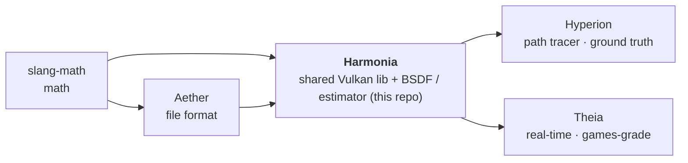

# PLAN — Harmonia

**Living source of truth for outstanding work.** Shipped items are removed from the work
lists; the shipped record is the *Baseline* below and `git log`. Only outstanding work is
tracked here.

**How to read this plan** — *human / PM:* the *Contents* is the index; *How to continue* is
the prioritized next-up list. *AI agent picking up work:* read `AGENTS.md` (orientation,
contracts) → *How to continue* (your task) → *Governance* (definition of done + guardrails)
**before editing any repo**. Harmonia is the family's shared-estimator hub, so this file also
carries the cross-repo research triage, the parity methodology, and the global next-up order.
The shared `path_integrator.slang` also carries the **GI-ENH (a) reconnection-capture hooks**
(`NeeEventCapture`/`ReconnectionCapture` out-params + `PathState.captureRe`) — pure
observability for Theia's path reservoir, inert for any consumer that leaves `captureRe = 0`
(no RNG change; Hyperion compiles them dead).

## Contents

- 1 [Context](#1-context) — what the family is and why
- 2 [At a glance](#2-at-a-glance) — release, last shipped, next
- 3 [How to continue](#3-how-to-continue) — the global prioritized next-up list
- 4 [Quality pillar](#4-quality-pillar) — OpenPBR conformance (C track)
- 5 [Performance pillar](#5-performance-pillar) — PERF · DN · LS/QMC · GI · research triage ·
  parity metrics (PAR) · Vulkan capability adoption (VK/MOD)
- 6 [Feature pillar](#6-feature-pillar) — node hierarchy · animation · bounding volume ·
  slang-math migration slice
- 7 [Parity methodology](#7-parity-methodology) — how Theia is compared against Hyperion
- 8 [Governance](#8-governance) — definition of done + guardrails
- 9 [Baseline](#9-baseline) — release state and shipped history

---

## 1. Context

**OpenPBR Surface 1.1.1** is the single material standard. The family is **two renderers on
three substrates**: slang-math (math), Aether (scene/asset format), and Harmonia (the shared
Vulkan library + the OpenPBR BSDF and path estimator — **this repo**).



- **Hyperion** — offline path tracer, the **unbiased ground truth** (`Hyperion/PLAN.md`).
- **Theia** — real-time path-traced renderer that **converges to Hyperion**, sharing
  Harmonia's OpenPBR BSDF/estimator; the **games-grade tier** (`Theia/PLAN.md`).

**Goal: improve both renderers with the latest algorithms and insights from the industry**
(SIGGRAPH 2025–26 and the surrounding literature). Adopt each technique in the **shared
Harmonia estimator + BSDF** wherever both renderers benefit; per-renderer only where they
genuinely diverge.

| Renderer | API / pipeline | Light transport | OpenPBR | Use case | Parity gate |
|----------|----------------|-----------------|---------|----------|-------------|
| **Hyperion** | Vulkan 1.4 KHR RT pipeline | Unidir. path trace, NEE+MIS, env-CDF, full random walk | Full, unbiased | Offline reference / convergence target | *is* the reference |
| **Theia** | Vulkan 1.4 mesh-shader + RT-GI (`ray_query`) | Accumulation path trace (shared `path_integrator`) + ReSTIR PT (unified reservoir — absorbs DI) + A-SVGF (interactive only; identity in offscreen capture) | Converges to Hyperion | Interactive / real-time / games | convergence gate |

**Parity goal:** Theia converges to Hyperion. The gate is a small **metric set** (§7), not a
single number — PSNR / mean-diff alone is misleading for HDR/scene-referred rendering
(dominated by bright pixels, blind to structure). Cornell scenes PASS (`mean_diff ≤ 4.0`);
the `shaderball_*` eye-parity gaps are closed.

Sibling plans: `slang-math/PLAN.md`, `Aether/PLAN.md`, `Hyperion/PLAN.md`, `Theia/PLAN.md` in
the sibling clones.

---

## 2. At a glance

- **Release:** v0.7.20 - GI-SMS spatiotemporal reuse foundations (the PSMS-ReSTIR port's
  shared layer); Aether v0.8.1, slang-math v0.8.0.
- **Last shipped:** v0.7.19 - general rendering correctness and fail-safe GPU resource lifetimes. Prior v0.7.18 - Aether pin v0.8.1. Prior v0.7.16 - VK16 device-lost forensics + SM6 remainder. Prior v0.7.14 - **AR1** (`harmonia/scene` rt-free, `harmonia/scene_rt`
  module, contract edge removed) + **AR2** (layered CMake targets) + **T-03** narrow
  barrier face + the Q1/Q3 quality wave - see Baseline.
- **Quality gates (family-uniform):** blocking lint (Q2-Q6) on every push -
  clang-format pinned 22.1.3, ruff contract in `ruff.toml` (identical x5), cppcheck,
  bandit, actionlint 1.7.12, yamllint. Coverage stays a local activity (the test
  suite needs a GPU).
- **Next:** **GI-SMS** (caustics / SDS chains) is global item #1 below.
- **Newly available (dev driver/SDK upgrade; extension surface unchanged vs driver 617.14):** the Vulkan 1.4
  capability set is verified on the dev GPU (**RTX 5070, driver 621.01 / SDK 1.4.363**, 295
  device extensions, slang 2026.17) - subgroup rotate/reconvergence family, `pipeline_binary`,
  `device_fault`, `shader_module_identifier`, `present_timing`, `descriptor_heap`,
  `unified_image_layouts`, `memory_budget`, next-gen shader model; new in 621.01:
  maintenance9/10/11, the cooperative-matrix/vector family, subgroup partitioned; see SS5.8 rows VK15-VK22.
  **Adopted since v0.7.6:** present pacing (VK6 -> MOD6 `present_id2`/`present_wait2`),
  `host_image_copy` (VK8/MOD3), `pageable_device_local_memory` + `calibrated_timestamps`
  (VK10), `opacity_micromap` (VK2, v0.7.7), `descriptor_buffer` (VK7/MOD1), `robustness2`
  nullDescriptor (VK14), `device_address_commands` AS2KHR (MOD5), `device_fault` +
  `device_address_binding_report` (VK16 — device-lost forensics), `swapchain_maintenance1`
  fence/release (MOD4 v1 — per-present fences + image release on resize; scaling stays out).
---

## 3. How to continue

### SMS correctness continuation — post-release (2026-11-03)

Published Harmonia v0.7.19, Hyperion v0.7.18 and Theia v0.8.1 now carry the general
fixes and refreshed galleries; their exact local full builds and dual-OS CI passed.
Those published changes are merged back into all three `dev/gi-sms-restir` branches
and verified locally: H149/149, Hy72/72, T57/57, zero compiler warnings/logged
VUIDs/skips. The owner authorizes continuing SMS to demonstrated correctness, not
a main merge or another release. No temporal merge or tolerance relaxation.

**Harness checkpoint:** `tools/qualify_sms.py` now fails closed on nonfinite
images, invalid ROI/shape/reference energy and stale/missing outputs. It records
commit/dirty state, executables, shader bundles, inputs and runner identity.
Completed-frame wall timing (`HARMONIA_FRAME_TIMING=1`) excludes startup/output
but includes all logical-frame completion waits. Equal time covers off/local/reuse,
per-seed MSE/error bars and at most one timing-only refinement. Nine CPU contract
tests and ruff pass; real C1 smoke passes in every mode. Shared completion tests
6/6 and all lint lanes pass. Three fixture errors were corrected openly; the
first timing-control genuinely rejected a missed budget before its mock was fixed.

**Measured diagnosis and repair:** the old sparse-root explanation was wrong.
Both sphere OBJs had inward winding (all 3,968 C1 triangles had negative
geometric-normal/center dot products). With outward winding restored and vertex
positions/normals unchanged, the first C1 frame reports 44,524 eligible receivers,
883 roots, 883 canonical candidates, 124,525 valid neighbor domains and 2,476
root-bearing neighbors. Reuse makes 2,512 canonical inverse attempts with 2,443
accepts and 2,476 neighbor inverse attempts with 2,405 accepts; 2,259 neighbors
are selected. Off reports all zero. A planar fixture independently proves the
observation path. Shift failure reasons are returned to the caller, so custom
shader fixture layouts do not inherit the diagnostics descriptors. Full T58/58,
zero validation/skips; all lint lanes pass. The outward-winding control fails on
the old assets and passes on the corrected assets, and all three scenes validate.
Reference/quality/performance must now be regenerated because fixture hashes changed.

**Equal-time measurement policy:** the first real run had an 8 s seed outside the
5% budget. Record that as `timing-inconclusive` while still collecting all modes
and seeds; never label it accepted equal-time evidence. Only comparisons within
5% for every mode/seed may pass. A separate CPU control checks this path. Do not
use the prior timing-only failed run as a quality result.

**C1 acceptance remains BLOCKED after fixing real root generation.** The outward
reference is accepted at 4096 spp (split-seed uncertainty .430%). Local SMS fails
at 512 frames: pooled RGB ratio 1.144638, mean per-seed MSE 365.1014. At 2048 the
measured local ratio is 1.072171 and reuse ratio 1.071827, still outside 2%.
Local/reuse mean MSE is 57.9716/57.4312 (only ~1% lower), so no efficiency benefit
is established. Three seeds are near one while seed 91 remains 1.298398; its ratio
falls to 1.049630 at 8192 frames. This is long-tailed convergence, not evidence of
an unbiased implementation passing the bounded gate. A 16384-frame attempt timed
out with no image; the completed 8192 result is the diagnostic receipt.

Focused attempts preserved in scratch: 15 neighbors give ratio 1.071694 and mean
MSE 56.8113 (not worth the cost), so production remains at three. Disabling the
prior gives ratio 3.901104 and MSE 10435.39. Raising pilot walks 128 -> 256 gives
ratio 1.301860 and MSE 157.2278, so production remains at 128. Reciprocal work is
not capped; observed completed trials reach max 175. Hyperion local at 512 has
per-seed ratios 1.298514, .894005, .846967, .841042. PT-only C1 has no matching
firefly pixels, isolating the issue to SMS weighting rather than retained PT paths.

**Curved-glass geometry resolved: the production formula was exact; the
fixture data was defective.** A double-precision replica of the untouched
`smsGeometricTerm` reproduces the GPU output `0.010009538382291794` to
`3.3e-7` relative (float32 precision) when fed the fixture's data, and
reproduces the independent oracle value `0.0040998597330524035` to `2.6e-9`
once the fixture's `dndv` is corrected. Root cause: the curved-oracle fixture
passed `dndv = dpdv` instead of the true `dn/dv` (for the R=0.5 sphere,
`dn/dphi = 2*dpdv`); the inconsistent `dndu`/`dndv` scales corrupted the
constraint-Jacobian normal-derivative terms. The earlier "transmission
half-vector defect" hypothesis is withdrawn: `h` parallel to the shading
normal at refraction roots is expected, and the second-position-derivative
terms cancel exactly at admissible roots (`h` is tangent-free), which the
original formula implements correctly. The committed regression
`SmsGeometryCurvedGlassMatchesIndependentFiniteDifferenceOracle` now passes
with the untouched shader, and `tools/sms_curved_oracle.py` emits a fully
consistent per-vertex derivative set (`dpd* = R*dnd*`) so fixture data can be
copied without recomputation. The removed-term shader experiment was reverted
before commit and never shipped.

**C1 bias excluded; the blocker is contribution-tail variance
(2026-11-03).** Convergence ladder on the current build and scene (accepted
4096-spp reference, four harness seeds): `local` pooled ROI ratio `1.1446`
@512f (seed-std `0.291`) -> `1.0722` @2048f (`0.151`) -> `1.0165` @8192f
(`0.047`, seeds 17/91); `reuse@2048` pooled `1.0718`. Plain-PT Theia @5827f
reads `0.996/0.997` and the reference is converged to `+0.10%` (65536 spp),
so the scene, PT baseline and reference are clean. No rung shows
statistically significant bias (t ~ 0.5-1.0) and the excess dilutes as
rare-firefly dilution predicts; the historical fixed "+7%" claim is
withdrawn. The blocker is structural: with per-seed ROI-total std `14%` at
2048 frames, the harness `+-2%` energy gate at 512/2048 frames is
unreachable for any estimator with this tail weight. Meeting C1 requires
principled tail-variance reduction with an unbiasedness review - a research
scope decision, not an estimator repair; caps, clamps, tolerance changes
and blind parameter increases remain rejected per the decision boundary.

**Decision boundary:** do not merge SMS to main or continue to C2/C3 acceptance as
if C1 passed. A different proposal/variance-reduction design would be new research
requiring an explicit scope decision and unbiasedness review. More blind neighbors,
pilot walks, temporal reuse, trial caps, clamps or tolerance changes are not an
accepted fix. Full product/lint verification applies to the restored code only,
not to the failed estimator experiments. The winding fix and diagnostics remain
valid and are retained.

**Scope decision (2026-11-04): the accepted fix is the published-method port.**
The owner directive is that SMS work reuses established papers rather than
inventing estimators. The in-scope variance remedy is therefore the port of
Hong, Duan, Wang, Yuksel, Zeltner, Lin, "Sample Space Partitioning and
Spatiotemporal Resampling for Specular Manifold Sampling", SIGGRAPH Asia 2025
(DOI `10.1145/3757377.3763927`, reference code
`github.com/Utah-Graphics-Lab/PSMS-ReSTIR`): tile trust regions, conditional
sample spaces for Bernoulli trials, per-block priors, and manifold-shift GRIS
reuse. This supersedes the generic "new research" boundary above for that
specific paper; caps, clamps, tolerance changes and blind parameter increases
remain rejected.

**PSMS-ReSTIR port audit (2026-11-04; qualified 2026-11-06).** Sections 3, 4
and 5.2 of the paper are implemented and verified faithful (periodic 3x3
trust regions with per-proposal termination, prior-mixed conditional
Bernoulli spaces with Eqs. 7-9 marginals and `trials/P(C)` weights,
inverse-checked J=1 shifts with the 5-iteration cap, log-domain GRIS pairwise
MIS). Section 5 temporal/spatial reuse is implemented, debugged through
eleven root-caused defects (see the Theia PLAN receipts, including the
SmsReservoir float-bits ABI fix in `sms_types.slang` here), and qualified on
the C1/C2/C3 track: correctness bias 0.15-1.2% at the 8192-frame gate on all
three scenes, deterministic same-seed captures, and a 2.5x equal-time MSE win
on absorption-prefix chains (C2) with parity on the light-tailed cases. The
reference implementation is sparse-cloned at `external/PSMS-ReSTIR`.

**Current execution queue:** repair the qualification harness before trusting any
new acceptance result, then diagnose the existing C1 spatial estimator with real
shift counters. Work stays on dev; GPU jobs remain strictly serial.

| Item | Acceptance / independent oracle | Verification |
| --- | --- | --- |
| Harness integrity | Nonfinite images, wrong dimensions, stale/missing outputs and invalid reference energy are rejected; the performance stage executes | `python -B -m unittest tools.test_qualify_sms -v` from Theia; broken/finite controls; baseline tuple crash reproduced by a regression test |
| Provenance | Every accepted reference is tied to commits, dirty diffs, executables, shader bundles, scene/material/mesh inputs and the runner; changed inputs cannot reuse it | Manifest inspection plus CPU stale-reference control; render manifests include exit codes/options |
| Correctness metrics | Finite 512/2048 C1-C3 data, four seeds, pooled RGB energy and mean per-seed MSE; 2048 error improves for both modes | Independent Hyperion SMS-off references, explicit per-seed results, cached finite vs NaN controls |
| Equal time | Actual completed-frame wall time excludes startup/output but includes renderer, continuations and completion waits; off/local/reuse budgets match within 5%, with at most one timing-only refinement | Opt-in per-frame host timing records, independent 64-frame pilots, CPU log/budget controls, actual per-seed times and error bars |
| C1 reuse diagnosis | Disjoint counters identify roots, neighbor domains/candidates, inverse attempts/accepts and selected neighbor paths; no contradictory state classifications | Diagnostic descriptor buffer read only after GPU completion, with disabled-diagnostics zero-effect checks and unit/production captures |
| Acceptance | Curved quality/equal-time benefit, mixed PT ownership, deterministic stability, resize/reload and tails | Repeat the frozen bounded scenes and gates; spatial reuse remains default-off until demonstrated. No claim of main readiness without owner approval |

Older review/history below remains evidence, but the earlier sparse-root diagnosis
stays withdrawn. Do not choose temporal caching, extra seeds or reduced scope
before the measured failure is understood. Full product suites/lint run at code
checkpoints; hosted CI is not implied by local evidence.

### SMS consolidation and implementation review - 2026-11-03

> **SUPERSEDED (2026-11-06): the C track shipped.** The consolidation branch
> `dev/gi-sms-restir` was merged to `main` in all three repos, qualified on the
> C1/C2/C3 track, and released as Harmonia v0.7.20 / Theia v0.8.2 / Hyperion
> v0.7.19. Work continues on `main`; the branch is retired. The narrative below
> is historical record only.

**Authoritative reassessment; supersedes the older handoff diagnoses below.**
The owner approved consolidation/review, not an SMS main merge, new release pins
or temporal reuse. **One active branch name in all three independent repos:**
`dev/gi-sms-restir`. Harmonia merge `7c901c1` preserves old dev `4c36ce6` and WIP
`fee0614`; Theia merge `4a9bb75` preserves old dev `eff5d6b` and WIP `64fa14d`.
Hyperion already contains its work at `128b220`. WIP refs remain archives.
Runtime, shader, test and workflow contents after the merges match the WIP tips;
only planning conflict resolutions differ. Local/remote main remain Harmonia
`a649bbb`, Hyperion `49c1f21`, Theia `257c8b4`; tags and pins are unchanged.

#### What is genuinely implemented

- Shared scene-projected manifold solver, geometric/interface factors, independent
  Philox trials, uncapped resumable reciprocal work, conditional regions and
  per-frame directional priors; concrete compute shared by native adapters.
- Actual-event PT/SMS ownership and first eligible receiver after supported
  prefixes; completion/validation before accumulation/export. Existing planar
  mirror, Snell, Beer, prefix and numeric controls are useful evidence.
- Theia's immutable-local spatial estimator, log weights/proxies, inverse-checked
  shifts and mode wiring. Spatial reuse is experimental/default-off; normal
  application mode is local SMS, not SMS-off. Hyperion has an independent
  SMS-off path and single-owner sampling/accumulation repairs.

#### Findings and required fixes

| Priority / ID | Finding and evidence | Required outcome |
| --- | --- | --- |
| P1 S1 — repaired during consolidation | Both supposedly committed sphere OBJs were excluded by `.gitignore:35` (`*.obj`). The WIP tracked only four TOML files, so fresh checkouts lacked all C1-C3 casters. | `c93260a` adds a fixture-scoped ignore exception and the two existing meshes, byte-identical to prior C1 run copies. All scenes validate; an index-only Git archive contains every mesh reference. No regeneration. |
| P1 S2 — open | `Theia/tools/qualify_sms.py:244` unpacks three values from `render_theia`, which returns two. An isolated mocked pilot reproduces `ValueError: not enough values to unpack (expected 3, got 2)`. | Repair/test the performance entry point before any equal-time campaign. Lint-clean was not evidence that this stage worked. |
| P1 S3 — open | Correctness accepts NaN images: `roi_energy`/`roi_mse` do not validate pixels, and comparisons with NaN at lines 227/232 never reject. A nonfinite-image control records a passing correctness manifest; a finite constant-image control rejects lack of convergence. | Fail closed on nonfinite pixels, invalid dimensions/ROIs, unusable reference energy and mismatched shapes before metrics. Cover finite-valid and broken-image controls; verify fresh exports rather than just file existence. |
| P1 S4 — open | Equal-time accounting violates the frozen protocol: lines 114-116 time the entire process (startup and image encoding included), then divide by frames. Off mode and 5% budget refinement are missing. Lines 229-231 and 264 label first-seed MSE as pooled; reuse convergence is not checked. | Measure steady logical-frame time including continuations/waits but excluding loading/warmup/output. Freeze counts using independent pilots, verify actual budget matching, and pool/report all four seeds for both modes with uncertainty. Include off/local/reuse; do not relax tolerances. |
| P1 S5 — open | Reference/correctness manifests are not bound to inputs or binaries: only smoke records heads/scene/material hashes; no stage records complete shader/binary/mesh hashes, options, exits or dirty state. `main()` reuses any old accepted reference for the case name. | Store per-run provenance and reject stale reference/input combinations. Preserve failed attempts separately and never accept an old output after a failed/missing export. |
| P1 S6 — diagnosis withdrawn | Sparse roots are NOT the proven reason for zero C1 reuse. `probe_sms_neighbor_census.py:96-98` sets `done_root=B/2`, making its absent metric `B-2*done_root` identically zero; B conflates absent/root-bearing neighbors, and the purported canonical-absent count classifies neighbor sums. The receipt itself reports 1,690 slots with a root-bearing neighbor. Production `sms_reuse.slang:75-84` tries canonical inverse checks even without a neighbor candidate; lines 90-94 attempt incoming shifts for root-bearing neighbors. | Preserve the observed identical local/reuse images; add disjoint counters for local roots, valid domains, source candidates, forward/inverse/topology/visibility failures and accepted shifts. Diagnose the existing map before choosing temporal caching, higher seed counts or reduced acceptance scope. Existing probes prove neither impossibility nor temporal necessity. |
| P1 S7 — open before main integration | Consumer CMake still pins pre-SMS Harmonia `v0.7.18`; local builds use sibling overrides, and CI selects dev only for named SMS refs. Green sibling builds do not prove the default pinned build or eventual main combination. | Plan dependency availability and merge order: Harmonia first, then consumers against an approved compatible dependency/release or supported override. Regrade hosted Windows/Linux on that combination. No pins/releases change in this review. |

The old C1 RGB ratios (.99817/.99368) and 3.05x **first-seed** MSE improvement
remain historical local measurements; the previous **pooled MSE** label was
wrong. A read-only reanalysis of all 16 cached candidate EXRs confirms finite
320x240 pixels and exact local/reuse equality in all eight pairs. Mean per-seed
ROI MSE is .0326700 at 512 frames and .0108003 at 2048 (about 3.025x); the pooled
energy ratios agree with the recorded values. This is cached-artifact evidence,
not fresh rendering or proof of the shift-failure cause. Row 2 is partial
(missing runtime counters), not done. C2/C3 acceptance,
motion/resize/reload, reciprocal tails, final full gates and galleries remain
unverified. Do not call even an experimental SMS main merge ready yet.

#### Fix main independently of SMS

These are source-confirmed defects on the preserved main baselines. Candidate
repairs exist on dev; extract minimal hunks with fail-to-pass tests against main,
not wholesale SMS commits. Main has not been rebuilt/regraded in this review.

1. **P1 Hyperion sample budget / RNG / accumulation** (`b297f10`): main schedules
   N capture frames with N samples per dispatch, does not wire the CLI seed into
   PathTracer config or advance raygen's stream by frame, and blends history in
   raygen as well as shared accumulation. Fix honest reference sampling first.
2. **P1 Harmonia fail-closed accumulation / resource retirement** (relevant hunks
   in `a000c88` / `301b97d`): requested accumulation creation must fail the run
   rather than disable averaging; a failed host wait must not free submitted
   command/semaphore resources. The Image view-usage guard also fixes invalid
   views for transfer-only images. Extract with fault controls, without SmsPass.
3. **P1 shared BSDF discrete/continuous consistency** (`a666fc6`): main's
   continuous eval/pdf queries include events that sampleBSDF treats as delta
   (legacy mirror / smooth or thin transmission). Port with BSDF/NEE controls,
   without new SMS ownership or a broader material redesign.
4. **P2 Theia timestamp-query lifecycle** (`e61f4e4`): main writes queries before
   an initial device reset and later uses host reset without enabling its feature.
   Preserve device-side per-pair reset and first-use/skipped-pass tests.
5. **Maintenance:** carry the approved main/PR-only CI policy and GCC braces
   separately if needed. Local syntax/lint success is not hosted CI success.

**Recommended order:** isolate those generic fixes on a separately approved
hotfix branch; repair S2-S5 on consolidated SMS dev; resolve S6 with real counters;
then run bounded C1/C2/C3 quality/equal-time/stability acceptance. Decide the
production mode/dependency delivery after the evidence. Galleries come last.

#### Verification contract and receipts

| Deliverable | Acceptance / oracle | Check and scope |
| --- | --- | --- |
| Join histories | Both previous tips are ancestors; no main/tag/pin changes; source matches reviewed WIP | `git merge-base --is-ancestor <old-tip> HEAD`; source diff against WIP at each merge; final local/remote ref audit |
| Preserve missing data | Every scene mesh exists in a clean Git archive and matches graded geometry | `sms_mesh_packaging_check.py` in approved scratch; three `Aether/build/aether-validate.exe <scene> --all` runs, exit 0 |
| Review claims | Actual failing controls or source evidence, not completion prose | `sms_review_cpu_checks.py`, exit 0: baseline missing assets, tuple exception, NaN false-pass vs finite rejection, census tautology; no production mutation/GPU use |
| Recheck old image claims | Finite candidate data and exact local/reuse pixels, without confusing cached evidence with new runs | `python -B sms_review_existing_images.py`, exit 0; all 16 candidate EXRs plus the existing reference, no rendering or exposure/tonemap changes |
| Joined regression | Warning-clean serial local builds and selected SMS/lifecycle/sampling/timer tests | `sms_consolidation_checks.ps1`: `cmake --build <repo>/build --parallel 2`, then `ctest --test-dir <repo>/build -LE analysis -R 'Sms\|FrameCompletion\|CaptureSamplingContract\|FrameSampling\|SamplingPlan\|PassTimer\|Buffer\|CommandPool\|Image' -V`, H then Hy then T |
| Fix queue | Separate repaired packaging, open SMS defects and independent main fixes | This section and Theia/Hyperion pointers; no renderer/estimator edits in this review |

Receipts: approved scratch `sms_consolidation_review/`. Source review is not an
independent mathematical proof of the estimator. Full product/analysis suites,
hosted CI and curved/equal-time acceptance are not rerun here. The first mesh
check wrongly looked for an unrun C3 artifact; its corrected archive check uses
the existing C1 copies of both meshes. This was a check-path correction, not a
geometry change or renderer retry.

**Joined-candidate verification receipt:** all three local Windows builds exit
0 with zero compiler warnings. Serial selected regressions pass Harmonia 53/53
(19.10 s), Hyperion 24/24 (351.64 s), Theia 27/27 (243.96 s): each `ctest` exits
0, with zero validation diagnostics, zero skipped/not-run tests and no retries.
104 product tests were selected; 90 H + 47 Hy + 30 T = 167 other non-analysis
tests were excluded, along with all analysis lanes. This is not a full-suite run.
`lint-preflight.ps1 -Repos @('Harmonia','Hyperion','Theia')` exits 0: all six lint
lanes clean in each repo. No new Linux/hosted-CI success is claimed.

Evidence anchors: Harmonia `b542b4c`, Theia `6373588`, Hyperion `eda12ff`;
runtime/shader/test/workflow trees match their reviewed source tips (H `fee0614`,
T `64fa14d`, Hy `128b220`). The only added runtime data are the byte-identical
packaged meshes at H `c93260a`; subsequent changes are documentation only.
Builds use the existing sibling-source overrides, not a clean default-pinned
dependency build. Logs and exit summaries are in approved scratch
`sms_consolidation_review/{Harmonia,Hyperion,Theia}.{build,tests}.log` and
`results.json`; CPU controls, archived-mesh checks and cached-image reanalysis
also exit 0 as specified above. The open findings are intentionally not repaired
by this consolidation, except for S1's missing data.

**CI/local-first policy:** automatic CI is main pushes and main-target PRs;
manual dispatch remains available. Ordinary development/WIP pushes skip CI.
Renderer GI-SMS PR/manual jobs select the matching Harmonia branch, not pre-SMS
main. The four GCC dangling-else test sites are braced without changing assertions.
Two-TU local GCC syntax checks pass; local Windows build/H143 regression and
family lint pass. This is not a complete Linux build or a hosted green CI claim.
Build/check locally before an authorized push. Main and dependency pins remain
unchanged. The consolidated `dev/gi-sms-restir` branch now includes the
experimental, default-off spatial-reuse work; the WIP ref is archival.

### GI-SMS #2 — bounded finish plan / next-model handoff

**This is the current execution queue.** Older numbered plans and receipts below
are history, not instructions to restart completed work. The owner requested a
concrete completion plan before switching models. This change prepares that plan
only; it does not implement the remaining feature or approve a main merge.

#### Starting point — preserve, do not redo

| Repository | Work branch | Last verified checkpoint before this planning-only change |
| --- | --- | --- |
| Harmonia | `dev/gi-sms-restir` (consolidated; WIP archived) | `c4b8f17` |
| Theia | `dev/gi-sms-restir` (consolidated; WIP archived) | `a9452d9` |
| Hyperion | `dev/gi-sms-restir` | `cd4b3e7` |

Verified already: local/reference SMS, R/TT/Beer transport, first-receiver path
ownership, uncapped resumable trials, Hong directional regions/priors, planar
mirror/glass/absorption/mirror-prefix reuse, numeric/support/inverse controls,
and ready-only accumulation/export. Latest evidence: H143, Hy71 (reference
sampler/prior remain byte-exact), T57 product tests; six numeric units, seven
failure/restoration controls; mirror MSE128 reuse/local `.491742`. These do not
establish curved correctness or equal-time speed/quality. Do not rerun them as
"new progress" unless a changed candidate invalidates their evidence key.

**Guardrails:** work only on these non-main branches; build locally before
pushing; keep local/remote main at the pre-SMS revisions listed below. No tags,
releases or dependency-pin changes. GPU jobs/builds stay serial. Keep monolithic
GI; animation/wavefront remain parked. No trial cap, failed-frame export, geometric
clamp, relaxed root tolerances, ownership-by-solve-success, exact-PDF treatment of
reciprocal counts, or recursive temporal reuse. Spatial reuse stays default-off
until the qualification gates pass. No changes to Aether main are needed.

#### Fixed qualification set — no growing scene collection

Use the existing planar glass fixture as calibration **C0**; it is not a new
research task. Add only three small, deterministic, test-only scene packages
under `Harmonia/tests/assets/sms/`, shared as data by both applications:

| Case | Fixed purpose / contents | Observable evidence |
| --- | --- | --- |
| C1 curved glass | One closed smooth-glass triangulated sphere, diffuse receiver, finite area emitter, black environment; IOR 1.5, zero roughness, no normal maps/dispersion/scattering. | Nonzero completed TT paths and accepted inverse-checked shifts; visible curved caustic. |
| C2 absorption + prefix | Reuse C1 geometry with colored pure absorption (.6/.8/.9, depth 1) and a camera view through a supported specular prefix. | Nonzero eligible prefixed receivers and tail roots; RGB Beer/prefix energy preserved. |
| C3 boundary / mixed PT | C1-derived small room with an opaque blocker, another diffuse surface and a rough/PT-owned object; fixed camera framing includes a support boundary and PT indirect ROI. | Missing-shift support, nonzero PT indirect/reconnection/cached-suffix use, and receiver-depth 2/3/4 boundaries are exercised. |

Store camera, geometry/material parameters, working color space, light, depth,
fixed spatial ROIs and file hashes in one small qualification manifest. Freeze
it before grading the candidate. Use the same triangle geometry and OpenPBR
materials in both renderers; do not compare a triangle caster with an analytic
sphere or silently promote a zero-roughness metal to legacy delta mirror.
R remains covered by the existing mirror gates and the supported glass events.
If the proposed prefix arrangement or C3 does not generate its required paths,
fix the scene first; a mode flag alone is not evidence that the path ran.
Validate every new/edited scene with `Aether/build/aether-validate.exe <scene> --all`.

#### Execution order — close one row before moving on

| Step | Concrete change / owner | Done when | Status |
| --- | --- | --- | --- |
| 1. Application modes | Theia `src/demo/main.cpp`, `Application.hpp`, **both** GiPass config construction sites in `Application.cpp`; Hyperion demo config/parser. Add `--sms-mode off\|local\|reuse` (reuse Theia-only). Default remains local during qualification. Off disables both SMS estimation and its PT partition. Preserve mode on initialization, resize and scene reload. | Actual application captures in each supported mode exit 0 with finite EXR/PNG, correct logged mode and zero validation diagnostics; an invalid mode exits 2 without images. Resize retains the requested mode. | DONE: Theia `--sms-mode off/local/reuse` and Hyperion `off/local` wired at both Theia config sites (init+resize) and the single Hyperion tracer site; invalid values exit 2 without images (cornell). All-mode 160×120 captures exit 0 with EXR+PNG and no diagnostics; resize reads the stored mode. Hyperion off required one shader repair: raygen now initializes EVERY slot's metadata unconditionally (the resolve/validate pass requires samples/dimensions even for Absent slots); collection stays resolution-gated. Hy71 passed with the shader change. Two intermediate attempts (zero-fill of the work buffer, TRANSFER_DST usage) did NOT fix the failure and were reverted; the failed `--sms-mode off` captures (GPU error bits 2) and the diagnosis are preserved in scratch logs. Hosted CI remains unverified. |
| 2. Observable paths + assets | Add renderer-owned diagnostic collection and a single-purpose `Theia/tools/qualify_sms.py` runner/manifest for C0–C3. Do not create a new general benchmarking framework or change the 24-byte producer / 16-byte prefix ABI just for logging. | Off reports zero SMS work; local reports roots but no reuse; reuse reports accepted shifts. C3 reports genuinely nonzero PT indirect, accepted reconnections and cached-suffix use. No host readback drives dispatch/trial counts. | PARTIAL: runner `qualify_sms.py` (smoke/reference/correctness/performance/stability; JSON manifest with heads, input hashes, timings, exits; copies fixtures into the ignored run dir and rewrites material/mesh references absolute because the loader resolves them against assetsDir) and C1–C3 TOML scenes + shared material library under `Harmonia/tests/assets/sms/` exist and validate (`aether-validate` exit 0 each). Caster geometry uses committed triangulated UV-sphere OBJs (`sms_sphere_r05/r035`) shared by BOTH renderers — the Aether sphere primitive is analytic in Hyperion but tessellated in Theia and caused a first correctness attempt at 1.104 pooled ratio on mismatched geometry (preserved in scratch receipts). C1 smoke passes in all modes; C1 reference accepted at 4096 spp (split-seed ROI uncertainty .183%). C2/C3 smoke + C3's PT/reconnection/suffix counters still open; per-mode SMS counters inside the renderers are not yet exposed. ABI unchanged. |
| 3. First independent curved reference | Run **C1 only first**. Hyperion ordinary PT with SMS/partition off is the reference, not Hyperion SMS sharing the candidate's Jacobian. Compare Theia local and reuse with it. | Reference precision is sufficient and C1 passes the fixed RGB/convergence criteria below. Reuse's path counters prove it actually ran. | PARTIAL: shared-triangle C1 reference accepted locally at 4096 spp, split-seed ROI difference .183%; pooled energy .99817/.99368 at 512/2048 frames. Recorded 3.05x MSE improvement uses only seed 17, not pooled MSE. Provenance, fail-closed metrics and actual reuse counters still require S3-S6 above. The earlier .397% receipt used mismatched sphere geometry and is not the current reference. |
| 4. Early equal-time go/no-go | Measure C1 before expanding acceptance work. Include initial GI, priors, every continuation, resolve and CPU completion waits. Compare off/local/reuse with identical scene/settings. | Reuse has lower pooled linear-RGB MSE than local at matched elapsed time, not merely at matched frames. If not, profile the measured bottleneck and fix/retest this same case before adding more tests/gallery work. | BLOCKED: existing C1 local/reuse captures are bit-identical, but the prior "sparse roots proven / temporal reuse required" diagnosis is WITHDRAWN by the consolidation review (S6). The diagnostic conflates states and has an identically-zero metric; its own results report root-bearing neighbors. First repair the performance/metric/provenance harness (S2-S5), then collect disjoint shift outcome counters. Do not select temporal reuse, more seeds, or a relaxed goal on the old evidence. No equal-time benefit, no-regression timing bound, or main-merge readiness is established. |
| 5. Finish bounded transport qualification | Apply the same reference/quality procedure to C2/C3. Reuse existing inverse/MIS controls; add only a targeted rendered control for any uncovered support/ownership gap. Exercise the remaining-depth boundary and unsupported PT complement. | C2/C3 pass RGB gates; C3 proves nonzero ordinary indirect/reconnection/suffix use with no lost/doubled energy. C2 also demonstrates equal-time caustic quality benefit. | NOT STARTED |
| 6. Stability / tails | C1–C3 repeated fixed-seed captures, camera motion, resize and scene reload; targeted numeric/GPU failure injection. Collect continuation and reciprocal-tail diagnostics after waited GPU completion. | Repeat static captures are deterministic, 64 moving-camera frames + 3 resize cycles + 3 scene switches are validation-clean, failures export no images, and tail/runtime results are recorded without a trial cap or dropped pending samples. | NOT STARTED |
| 7. Final code checkpoint | Choose/document the accepted production setting; local build and final applicable product/analysis/lint gates; one explicit hosted check or later main-target PR after local success. Avoid retuning the estimator to fit the fixtures. | Accepted mode is used by normal Application rendering, final checks pass, limitations/metrics are documented; no external CI-green claim without an actual run. Keep main untouched pending owner authorization. | NOT STARTED |
| 8. Review deliverables | Regenerate both existing galleries once, after steps 1–7. Hyperion 1280×720/64 spp; Theia 1280×720/256 frames. Include the C1–C3 comparison sheet separately from normal showcase scenes. | Owner reviews both galleries and the accuracy/equal-time/stability summary. Mark #2 complete only when this and all previous rows are accepted. | NOT STARTED |

**Current next task:** repair/test the qualification harness (S2-S5 above), then
obtain trustworthy shift-failure counters (S6). Step 1 is implemented; do not
repeat its mode wiring or redesign the sampler on the old diagnosis.

#### Frozen numerical and measurement protocol

- Start at 320×240, black environment for C1/C2, fixed exposure/color space and
  receiver-inclusive depth chosen to include the supported prefix/tail. Seeds
  are exactly `17, 91, 1234, 2026`; freeze all settings in the manifest.
- Reference ladder: ordinary PT at 4096 → 16384 → 65536 spp, advancing **only**
  if independent seed/split-reference uncertainty in each fixed ROI's RGB energy
  exceeds 0.5%. If still insufficient, report a reference-budget blocker; do not
  silently call a noisy reference ground truth or add unlimited render rounds.
- Candidate correctness: 512 and 2048 complete frames per seed in local/reuse
  modes. At 2048 frames require pooled RGB energy within the existing 2% bound
  against the qualified reference, and report each seed separately. Require
  lower pooled error at 2048 than 512. ROIs come from geometry/reference, never
  candidate brightness. Do not normalize away an energy/tint error. The 0.5%
  reference-precision prerequisite is a proposed measurement rule, not evidence
  that any new reference already exists.
- Equal time: exclude scene loading/pipeline warmup, but include **all** steady
  logical-frame work and completion waits. Independent timing pilots: three
  fixed 64-frame runs per mode. Freeze mode-specific frame counts targeting
  2 s and 8 s **before** the four quality seeds. Render each chosen count to full
  completion and report actual elapsed times; refine timing once if budgets
  differ by more than 5%. Never stop sample-dependent Bernoulli work at the time
  limit, discard the last frame, or select counts using the quality results.
- Success is a demonstrable equal-time MSE reduction on C1 and C2, with raw
  timings/error bars reported, not an invented FPS target or a claim that every
  scene speeds up. C3 must retain correct supported and PT-owned energy. If the
  result is inconclusive, label it inconclusive rather than changing the goal.
- Diagnostics: eligible receivers, completed R/TT roots, shift attempts/accepts,
  inverse/support rejection counts, actual PT indirect/reconnection/suffix use,
  continuations per logical frame, and mean/p95/p99/max reciprocal counts (or
  explicitly labeled GPU histogram bounds). Counters are observations only;
  they cannot alter sampling, ownership, dispatch counts or completion policy.
- One failed gate means: preserve the failure → smallest reproduction → root
  cause → focused fix → rerun that gate. Do not launch galleries/full suites to
  hide an unexplained failure. If two focused attempts still leave the cause
  unexplained, stop with the exact blocker for owner review. This is a work
  escalation rule, never a renderer trial cap.
- Full suites are a stage/checkpoint boundary activity, not the inner edit loop.
  Reuse verified evidence only when code, shader, fixture and environment keys
  still match. No new scene categories, temporal reuse, wavefront work, format
  expansion or new transport classes without an explicit scope decision.

#### Commands / artifacts the next model must leave behind

Commands below containing `--sms-mode` / `qualify_sms.py` are **implemented and
verified for steps 1–2** (mode flags in both demo apps; runner stages
smoke/reference verified on C1). The runner emits commit/scene hashes, options,
seeds, timings, errors and exit codes into ignored `Theia/build/sms-qualification/`;
only fixture data, runner and short summaries live in git.

```powershell
# Existing build commands (serial, from C:\Development\GitHub).
cmake --build Harmonia/build --parallel 2
cmake --build Hyperion/build --parallel 2
cmake --build Theia/build --parallel 2

# Planned normal-Application smoke after step 1.
Theia/build/theia.exe --scene shaderball_transmission --sms-mode reuse --width 160 --height 120 --offscreen-frames 2 --rng-seed 17 --validation --output Theia/build/sms-qualification/smoke.exr

# Planned single-purpose stage entry points after step 2.
python Theia/tools/qualify_sms.py --stage smoke --case C1
python Theia/tools/qualify_sms.py --stage reference --case C1
python Theia/tools/qualify_sms.py --stage correctness --case C1
python Theia/tools/qualify_sms.py --stage performance --case C1
# Only after C1's go/no-go: repeat reference/correctness for C2/C3 and performance for C2.
python Theia/tools/qualify_sms.py --stage stability --case C1

# Final product checks; run relevant analysis/lint lanes as documented by AGENTS.
ctest --test-dir Harmonia/build -LE analysis --output-on-failure
ctest --test-dir Hyperion/build -LE analysis --output-on-failure
ctest --test-dir Theia/build -LE analysis --output-on-failure
```

**Handoff discipline:** each row ends in a small verified code checkpoint and a
short PLAN update containing commands/results and the next open row. Commit/push
only development/WIP refs after local success. Main, tags, pins and galleries
await their separate authorization/review. The next model should report which
row it is closing, not present a primitive test pass as completion of #2.

### GI-SMS #2 continuation checkpoint — 2026-11-03

**Current authorization:** commit and push on the development/WIP branches below.
Do not merge or push into `main`; no tags, releases or dependency-pin changes.
This supersedes earlier task-local "no push" notes in the historical receipts.
**#2 is not complete.** Animation and `perf5/wavefront-stage1` remain parked.

| Repository | Stable source checkpoint | Development branch | Preserved prototype |
| --- | --- | --- | --- |
| Harmonia | `fd252f77411de3fe28f1cda8a097fe7a867a43df` | `dev/gi-sms-restir` | `wip/gi-sms-spatial-reuse`, original snapshot `4545db1` |
| Hyperion | `049f34c8398be97327e18c756cf48eeaa2076058` | `dev/gi-sms-restir` | No separate prototype changes |
| Theia | `76e24720da5dd00cc5e067e12ea75b3ad2b99f75` | `dev/gi-sms-restir` | `wip/gi-sms-spatial-reuse`, original snapshot `da3bebd` |

Pre-SMS `main` baselines (verified identical locally and remotely, with no SMS
source files): Harmonia `a649bbb11e3fc309cd1ed8fd0a1b1107c0c0ee09`, Hyperion
`49c1f21ebdea3f7ef40bfee32eae9dfcf6295295`, Theia
`257c8b495d6516e347a0be43d83b256ab8f0ad1e`. The development branches preserve
21 / 10 / 6 existing unpublished commits respectively, before handoff commits.

The development branches contain the verified local-SMS milestone plus this
handoff, not the unfinished reuse wiring. All previously unpublished commits
are reachable from them. The WIP branches preserve the exact original changes
(one Harmonia file and 17 Theia files, including untracked sources); the snapshot
commits are archival, **not acceptance claims**. Local `main` was returned to
`origin/main` only after preserving the work. Leave all three working trees on
`dev/gi-sms-restir` when stopping. Switch Harmonia and Theia together when resuming
reuse: Theia's WIP depends on Harmonia's helpers/cache hook. Do not mix branch sets.

#### Pause verification plan and receipts

Oracle: the owner's request to preserve all work off `main`, push development
branches, and leave a stable, reproducible stopping point. This is branch/docs
work, not a behavioral estimator change; a broken-estimator negative control is
not applicable to this pause. Existing feature controls retain their own scope.

| Item | Acceptance / exact check | Status |
| --- | --- | --- |
| Preserve unfinished work | Before switching, compare every original `git hash-object -- <path>` with `git rev-parse <snapshot>:<path>`; all 18 blobs must match. | DONE: all 18 match in `4545db1` / `da3bebd`. |
| Stable source | In each repository, `cmake --build build --parallel 2`, then `ctest --test-dir build -LE analysis -V`; suites strictly serial across repositories, no validation diagnostics. | DONE: H143/143, Hy71/71 and T45/45 pass; all build/test exits 0, zero validation diagnostics. H/Hy retained; only interrupted Theia resumed. |
| Remote continuation | `git -c push.followTags=false push -u origin refs/heads/dev/gi-sms-restir:refs/heads/dev/gi-sms-restir`, plus the explicit WIP ref in Harmonia/Theia; compare `git rev-parse <branch>` against `git ls-remote --heads origin <branch>`. | DONE: all five branches pushed, exact local/remote tips and upstreams verified. |
| Main isolation / clean stop | `git rev-parse main origin/main` and remote `git ls-remote --heads origin main` must match the pre-push remote-main receipt; `git status --porcelain` empty on each development branch. | DONE: audit exit 0; local/remote main pre-SMS, all pre-existing remote refs (including tags) unchanged, all three trees clean. Repeat after any further handoff commits. |

Environment: Windows, Release, clang-cl/Ninja, Vulkan SDK 1.4.363.0 / Slang
2026.17, RTX 5070. Existing CMake caches use sibling Harmonia/Aether/slang-math
source overrides; committed FetchContent pins are unchanged.
Dependency source revisions: clean Aether `b12ec6a4748cce50e244c88d0f5cffd9dfe4e9ec`
and clean slang-math `ae605e2f5cf6b2f1b33f973d2ecf7ea5217ae9d7`, both on their
already-synced main branches (no changes/pushes made to either dependency).
Renderer entry shaders are touched before rebuilding so stale imported Slang programs cannot
stand in for the stable source. This is an author-run existing-build-tree check,
not an independent clean-environment re-grade. Analysis lanes and full galleries
are not part of this pause rerun. Pre-push Q2–Q6 lint passed for all three repos,
including the archived WIP C++ files (exit 0, zero failing repositories).

Machine-local preservation/test receipts are under
`C:\Users\norbe\AppData\Local\Temp\opencode\`:
`gi_sms_pause_inventory.json`, `gi_sms_pause_lint.log`,
`gi_sms_pause_verification.json`, and `gi_sms_pause_{repo}_{build,ctest}.log`.
These generated logs and prior EXRs remain local/ignored, not source artifacts.

The final-ref audit command is
`powershell -NoProfile -ExecutionPolicy Bypass -File C:\Users\norbe\AppData\Local\Temp\opencode\verify_gi_sms_pause.ps1`
(exit 0, receipt `gi_sms_pause_final_audit.json`). It checks original blob
preservation, exact stable runtime source, clean development trees, upstreams,
local/remote tip equality, unchanged main and every pre-existing remote ref.
The initial suite driver retained H143 (22.97 s) and Hy71 (423.64 s), then
PowerShell stopped on CMake's expected `-- GLOB mismatch!` regeneration stderr
before completing Theia. This is a wrapper interruption, not a compiler/test
failure. The next Theia attempt was interrupted by an OpenCode server restart
after configure; its shell notification exited 4 with no completed test receipt.
Resume only Theia, preserving H/Hy evidence. Use native stdout/stderr capture
without promoting the regeneration notice to a terminating PowerShell error.
If the application exits before the remaining check finishes, all source is
already committed/pushed: treat that check as incomplete and rerun it next time,
not as a green result. Partial build outputs can be rebuilt normally.

**Completed pause re-grade:** Harmonia 143/143 (22.97 s), Hyperion 71/71
(423.64 s), and the resumed Theia 45/45 (212.51 s). All build/test exits are 0;
all validation-message scans are zero. Each repo excludes its three `analysis`
lanes, with no skipped product tests. Theia's build/test completion is recorded
in `gi_sms_pause_Theia_build_after_restart.log` and
`gi_sms_pause_Theia_ctest.log`; earlier wrapper/server interruptions remain
recorded above, not hidden as a clean first attempt. These results establish the
stable local-SMS source only, not the archived spatial-reuse prototype. The
owner has now authorized active resumption on the development/WIP branches.

#### Verified capability versus unfinished work

- Stable: shared solver, actual-event ownership, resumable uncapped reciprocal
  trials, Hong directional regions/priors, Hyperion mirror/glass/Beer/SDS, and
  Theia's local receiver/prefix production, continuation, ready-only resolve,
  accumulation/export failure handling. Earlier complete non-analysis receipts
  are H143 / Hy71 / T45; detailed radiometric/control evidence remains below.
- WIP only: pure pairwise MIS/RIS helpers, native forward/inverse shifts, target
  cache, and optional current-frame spatial estimator. Selected finite-domain
  and shift units passed before the final wiring. The completed shift-control
  logs reject ignored target budget, disabled inverse identity and changed light
  endpoint; all three exact restores pass. These are unit/source receipts, not
  rendered reuse acceptance. The numeric-repair WIP now compiles, and five pure
  GPU numeric tests plus six failure/restoration controls pass. Eight selected
  local/reuse frame tests also pass validation-clean: mirror reuse ratios
  .998317 / 1.000240 / .997181 / .999980, MSE128 reuse/local .491742. Default
  Hyperion sampler/prior hashes remain byte-exact. This accepts the ordinary
  mirror fixture only, not general curved/conditional-prefix reuse or equal-time
  performance. Theia PLAN defines the next glass/Beer/SDS rendered slice.
  That slice now passes selected gates after a new largest-uniform RIS regression
  exposed loss of precision in log-CDF selection: choose the first positive
  candidate and compare a bounded probability instead of adding log(u) to total.
  Six numeric units/seven controls, glass/Beer/mirror-prefix SDS and the PT-owned
  depth cutoff pass; disabled rendered reuse fails the MSE assertion, exact
  restore passes.
  Full current Theia product regression now passes T57/57 (exit 0, zero validation
  diagnostics/skipped tests), with warning-clean build and local Q2-Q6 lint.
  Keep SMS spatial reuse experimental/default-off until curved/mixed-depth and
  visibility support, actual reconnection/suffix counters, equal-time quality,
  reciprocal-tail/runtime/stability and both review galleries are accepted.
- Scene assets and the machine-local qualification runner are the new step-2
  deliverables; see the bounded finish plan above for their current status.
  C1 correctness attempts and the analytic-vs-triangulated sphere finding are
  recorded there. The analytic-sphere primitive must never be used as a
  cross-renderer caster: `ISceneBuilder::addSphereMesh` is analytic (AABB BLAS)
  in Hyperion but tessellated in Theia by contract.

#### Exact resume sequence (PowerShell, from `C:\Development\GitHub`)

**CI maintenance steering:** the owner selected automatic CI on pushes to `main`
and PRs targeting `main`, skipping ordinary development/WIP pushes, and requires
local builds before pushes. Keep manual dispatch available; do not modify `main`.
Failed-run logs identify GCC `-Werror=dangling-else` at four Harmonia test macro
sites and renderer CI checking out pre-SMS Harmonia main (missing SmsPass.hpp /
sms_transport.slang), rather than the matching GI development branch.

| CI item | Acceptance / oracle | Verification |
| --- | --- | --- |
| Automatic triggers | Main push and main-target PR run; development push and other-target PR do not. | `actionlint` / `yamllint`, parsed workflow event-matrix check with a broadened-trigger negative control. |
| Matching sibling source | GI-SMS PR/manual contexts select the corresponding Harmonia development/WIP branch; main and unrelated branch contexts retain Harmonia main. No release/pin change. | Workflow expression/context cases, checkout branch existence and required SMS file presence; forced-main negative control must fail GI contexts. |
| GCC portability | Add braces at the four reported test macro sites, preserving every assertion and input. | Local GCC syntax compile against the affected real GoogleTest TUs (original rejects dangling else, candidate passes), local Windows build and H143 product regression. |
| Local-first push | Every touched repo builds warning-clean before its workflow/source checkpoint is pushed. | Serial `cmake --build <repo>/build --parallel 2`, local lint, then explicit development/WIP ref pushes only. No externally green CI claim without a run. |

CI repair receipts: original affected GCC translation units reject only the
reported dangling-else sites (exit 1); both braced candidates pass local WSL GCC
syntax compilation (exit 0). This is two-TU syntax evidence, **not** a complete
Linux link/build or Linux GPU run. Local Windows builds of Harmonia, Hyperion and
Theia all exit 0 with no compiler diagnostics; H143/143 regression passes after
the brace change (24.72 s, zero validation diagnostics). Q2-Q6 preflight passes
all three repositories. Parsed event/ref model: 24 cases pass; three broadened
push-trigger and two forced-main sibling controls reject. Failed hosted runs are
retained as history; no hosted green result is claimed yet. Auxiliary worktrees
on the existing H/Theia development branches receive only CI/docs/brace fixes;
the numeric reuse feature stays confined to WIP and main stays pre-SMS.

Machine-local CI receipts: `ci_*_sms_failed.log`,
`ci_gcc_{baseline,candidate}_test_sms*.cpp.log`, `ci_local_*_build.log`,
`ci_local_Harmonia_ctest.log`, `ci_local_lint.log`; replay scripts are
`verify_sms_ci_gcc.py` (WSL) and `verify_sms_ci_policy.py` in the approved scratch
directory. Ordinary development pushes now skip hosted CI, but every code push
still requires its local build and relevant verification first.

**Active resumption plan (owner authorized development/WIP commits and pushes):**
finish the interrupted Theia stable check without repeating H143/Hy71; then
resume the paired WIP branches. Before implementation, the numeric repair is
bounded by the following observable criteria. Keep the 24-byte producer ABI and
16-byte prefix cache, actual-event ownership, frozen endpoints and reciprocal
trial law unchanged. Proxy representation may change, not its mathematical role.

| Numeric repair item | Oracle / acceptance | Planned verification |
| --- | --- | --- |
| Reuse-off cache isolation | A finite local estimate cannot fail because an unused physical-F proxy overflows/underflows. | Selected production-local mirror/Snell/Beer/SDS fixtures, plus an HDR cache-bypass GPU control. Hyperion sampler/prior SPIR-V must retain the recorded exact hashes. |
| Factored proxy and weighting | Preserve finite final radiometry for the review's `value=1e38,pLight=4`, `value=1e-20,pLight=1e-30`, and `F=1e-30,pLight=1e-38,count=4` counterexamples; no clamp/drop or reciprocal-as-PDF substitution. | `Theia/build/tests/theia_module_tests.exe --gtest_filter="SmsResamplingFixture.*"`; GPU range cases compared with independently evaluated double-precision products/log identities. Original materialized-product/UCW controls must fail the named finite-output assertions. |
| Log-domain MIS/RIS integrity | Preserve RGB expectation (10,10,10), missing-support compensation and alternative domain-proxy scales, including cross-domain scales outside float materialization range. | The same finite-domain GPU fixture, plus exact selection-boundary and wrong-support/MIS/normalization controls; restored candidate must pass. |
| Actual reuse wiring | Compile native sampler/resolve, leave work/cache immutable during resolve, preserve ordinary mirror radiometry and reduce same-budget error; this is not a general/equal-time acceptance claim. | `cmake --build Theia/build --parallel 2`, then `Theia/build/tests/theia_module_tests.exe --gtest_filter="SmsGiReuseFrameFixture.*"`; afterward extend glass/Beer/SDS and support boundaries. |

Design candidate: explicit zero support plus positive log2 proxies, separate
reciprocal/conditional/light factors, log-sum-exp pairwise/RIS arithmetic and
final-only RGB materialization. A pre-code independent double-precision model
preserves (10,10,10) for scales (1,1,1), (1.5,1/7,9),
(1e-40,1e38,1e-30) and (1e38,1e-40,1e30), maximum absolute error 1.07e-13.
The three reviewed range examples reproduce nonfinite/zero legacy float
intermediates while the factored model retains the finite weighted estimates.
These are arithmetic planning receipts only, not GPU or implementation evidence.

Read this section and all three AGENTS.md files first. Confirm clean trees before
switching; do not reset or discard unrelated work. Development/WIP pushes remain
authorized, but `main`, tags, releases and dependency pins remain out of scope.

```powershell
git -C Harmonia switch wip/gi-sms-spatial-reuse
git -C Theia switch wip/gi-sms-spatial-reuse
git -C Hyperion switch dev/gi-sms-restir
```

Repair the three numeric findings above before accepting or enabling reuse.
Then, in a Visual Studio developer shell with the documented SDK/toolchain:

```powershell
cmake --build Harmonia/build --parallel 2
cmake --build Hyperion/build --parallel 2
cmake --build Theia/build --parallel 2
Theia/build/tests/theia_module_tests.exe --gtest_filter="SmsResamplingFixture.*:SmsSceneFixture.NativeManifoldShift*"
Theia/build/tests/theia_module_tests.exe --gtest_filter="SmsGiReuseFrameFixture.*"
```

Do not overlap builds/GPU work with mutation runners. Available machine-local
runners: `verify_sms_shift_controls.py`, `verify_sms_resampling_controls.py`, and
`verify_theia_sms_controls.py` in the scratch directory above. They are not
portable repository tools yet; inspect their source/restore logic before reuse.
Re-run local mirror/Snell/Beer/SDS gates and family regression after the cache/
resolve changes. Extend rendered reuse beyond the ordinary mirror fixture before
any general acceptance or production enablement. Return to the stable source by
switching **both** Harmonia and Theia to `dev/gi-sms-restir` and rebuilding.

**SDS prefix verification plan (H `042fc74`, Hy `1d0dd6e`):** collect the first
eligible opaque non-specular receiver after a PT-sampled specular prefix. Keep
one slot/path; do not extend ownership to later diffuse vertices. Null or
scattering prefixes stay PT-owned. Freeze prefix RGB throughput before the root
storage fields are used, multiply it once in the contribution, and freeze the
receiver's remaining depth. Match both R/TT ownership gates to that remaining
budget. Same frozen endpoints / common root site / uncapped trials remain.
Independent fixture: non-unit (.4) camera-prefix planar mirror, diffuse floor,
white tail mirror and finite area emitter. Virtual-camera projection plus direct
and both virtual-emitter integrals includes the prefix mirror reused as a tail.
Command `hyperion_module_tests.exe --gtest_filter=SmsSdsFrameFixture.*`;
512 samples × four fixed seeds, 2% reflected-energy gate. Omitting prefix
throughput must fail; no-prior/N=1 controls and the existing primary fixtures
must remain valid. This verifies SDS transport, not prefix spatial reuse.
Source-review follow-up: add shifted-camera slab fixtures with receiver budgets
3 and 4 (global depths 4 and 5). A .4 planar prefix maps to the existing independent
Snell/Beer oracle's virtual camera. Without absorption, B=3 must have zero TT
energy; with pure absorption, its uncharged internal exit remains PT-owned and
must preserve Beer energy. B=4 must preserve TT/Beer energy in both cases. Run
`hyperion_module_tests.exe --gtest_filter=SmsSdsGlassFrameFixture.*:SmsSdsAbsorptionFrameFixture.*`.
Use 512 samples × four fixed seeds for B=4; pool four seeds at 4096 samples for
the PT-only absorption B=3 control (2% RGB gate). Replacing receiver remaining
depth with global maxDepth must fail the B=3 rendered checks, exact restore pass.
This adds depth-boundary evidence; null/scattering and multiple-prefix coverage
remain source-reviewed, not independently rendered by these fixtures.
**Executed SDS checks:** mirror-prefix four-seed reflected-energy ratios at 512
samples are .999864 / .999988 / .997711 / 1.00187; insufficient R budget contributes
only direct lighting. Prefix-weight omission fails and exact restore passes.
Shifted ordinary slab B=3 is exactly zero across all four seeds; B=4 achromatic
ratios are .997445 / .996110 / .996263 / 1.000820. Shifted pure-absorption B=3
ratios span .999125–1.006210 (PT-owned, 4096 samples/seed); B=4 ratios span
.996511–1.001020 (512 samples/seed). All four selected slab tests pass with zero
validation messages. Global-depth mutants fail both B=3 checks; exact restores
pass. Source-only review confirms aperture/virtual-camera/oracle/depth coverage.
Full family re-run passes H142/142, Hy69/69, T34/34 with zero validation messages;
canonical architecture and H/Hy tidy/dead pass. Theia reference control remains
0/76,800 changed pixels. SDS can now be checkpointed locally; full #2 is not done.

**Common-sampler extraction (after the SDS receipt):** share the light proposal,
supported-tail sampling, contribution and initial/repeat/prior controller in one
compute include. Six explicit aliases bind renderer scene/hit/texture types and
material/emitter/CDF arrays. Geometry reconstruction and descriptor layouts stay
renderer-owned; common BSDF/frame mathematics stays together in Harmonia.
The initially selected typed-dispatch alternative was rejected by the exact-pixel
gate (evidence below). The compile-time include retains the original concrete
entry-point call graph and the existing typed projector/texture contracts.
No solver/transport/math changes are permitted in this slice.
Require exact existing EXR receipt comparison, all mirror/Snell/Beer/SDS gates and
the family regression before a separate local refactoring checkpoint. Then wire
Theia to that contract, rather than copying and evolving a second sampler.
`check_sms_refactor_receipts.py snapshot` / `compare` in the approved scratch
directory bind 32 EXRs (8 fixture families × 4 seeds), 393,216 RGB pixels, to
the pre-extraction commits. Require zero changed pixels and zero max absolute
error without normalization; retain the exact-difference mask for review.
Extraction status: selected mirror/SDS energy checks pass but the first typed
extraction fails exact pixels (1,828 changed among the 8 regenerated images;
the other 24 are not yet regraded). Max difference is .000863661. Hold the
refactoring checkpoint and isolate expression/code-generation changes; do not
relax the zero-pixel gate or misreport unchanged old artifacts as new evidence.
The first build exposed missing direct bsdf/math imports, now repaired; this
was a deterministic compile error, not a flaky runtime retry.
Known-good committed-source replay regenerates the 8 mirror/SDS EXRs exactly,
so capture reproducibility is not the cause. Moving the receiver expression back,
restoring the full hit type, and retaining global push constants did not remove
the typed-dispatch drift. Reject that extraction shape. Use the other considered
design: one shared compute include with six explicit renderer aliases, preserving
the original concrete entry-point call graph. Geometry still implements the typed
ISmsProjector contract, and texture access ISurfaceTextureSampler. The exact
32-image gate is unchanged; this is a design correction, not a tolerance change.
At extraction checkpoint H `0e4eda9` / Hy `f9c5995`, the main sampler produced
byte-identical SPIR-V, SHA-256
`9778594237923a4fabff377867a82a697fe8622b526ce50cb66469d5d0d8b017`,
254,400 bytes, versus committed pre-extraction source. The prior program is also
byte-identical: 123,184 bytes, SHA-256
`a05bfa2dfa0177fe950612226c4139b4c8b19b8dd37185fd4dd1a9ed5d0597a0`.
Fresh full 32-image regrade passes at 0/393,216 changed pixels and zero maximum
absolute difference. Prefix-weight and conditional-alpha/mass controls fail,
exact restored shaders pass. Full H142/Hy69/T38 passes validation-clean, canonical
architecture and H/Hy tidy/dead pass, Theia control unchanged 0/76,800 pixels.
The original function/macro expansion was source-reviewed against the baseline.
**Support follow-up after the pure extraction checkpoint:** source review
of the new Theia adapter found that production's geometric-normal fallback must
not become an SMS miss (zero/exactly cancelling/tiny blended vertex normals).
Match production's squared-length branch, with zero derivatives on geometric
fallbacks. A visibility ray must use an actual opaque occlusion query, not report
"clear" because a blocker's shading reconstruction failed. The new Theia adapter
adds fallback and raw-occlusion fixtures; all four native tests and wrong-normal,
missing-fallback, wrong-cutoff and missing-occlusion controls pass/reject as intended,
with exact restored shaders passing. Apply
the corresponding production-matching fallback/raw-visibility contract to the
Hyperion adapter and shared visibility call site in the behavior-fix receipt
below, before enabling Theia SMS. In particular test a mixed zero-normal
planar mirror against the independent virtual emitter, not only all-zero normals.

**Support/visibility behavior-fix plan (H `0e4eda9`, Hy `f9c5995`, T `608a5da`):**
extend `SmsSceneFixture.ProductionReaderMatchesTransformedTriangleAndEllipsoidDifferentials`
with all-zero, exact-cancelling, tiny-blend and mixed-zero normals, and compare
the fallback directly to actual RT G-buffer normals as well as the flat-plane
oracle. Add finite-distance opaque visibility checks including analytic spheres.
First run these additions against the unchanged adapter and require the expected
normal/visibility failures. Match production's normalized-vertex / blended-length
fallback with zero fallback derivatives; keep visibility on a raw TLAS query.
Wire the common samplePath visibility through `scene.occluded`, for both adapters.
Add `SmsFallbackFrameFixture.*` with mixed-zero caster normals; four fixed seeds,
2% independent virtual-emitter energy and 128/32 sample MSE regression. Restore
the old normal field and shading-dependent visibility in isolated controls;
they must fail the matching GPU/renderer assertions, restored candidate pass.
Then full family regression, validation and focused source review. This is a
behavior correction, separate from the completed bit-exact extraction checkpoint;
do not call it a pixel-identical refactoring or change the energy tolerances.
Baseline support receipt: the extended production-reader test fails unchanged
adapter `f9c5995` as intended (exit 1, validation 0): exact cancellation becomes
a miss, the tiny-blend derivative is 200,000 instead of zero, mixed-zero normal
error is .148032, and opaque visibility reports the cancelling-normal blocker
clear (ray 6). Actual RT G-buffer fallback checks pass in that same run. The
mixed-zero rendered baseline was also run before the production correction.
That rendered baseline fails all four seeds at .635797 / .646512 / .628923 /
.644350 reflected-energy ratio (validation 0), while actual RT uses the expected
geometric fallback. Also add a finite black blocker at x=1, y=[1.1,1.2], z=[-2,2]
and restrict the receiver oracle to x>1.3. Direct/camera/receiver→mirror legs stay
clear; independently intersect the mirror→emitter leg with that rectangle in the
virtual-emitter quadrature. `SmsVisibilityFrameFixture.*` uses 512 samples × four
seeds, pooled reflected energy within 2%. Omitting the COMMON visibility call must
fail this rendered gate, restored candidate pass (direct query tests alone do
not prove the sampler actually uses occlusion).
**Executed support/visibility checkpoint:** the corrected mixed-zero four-seed
ratios are .991267 / 1.010980 / .981383 / 1.008340, matching the ordinary flat-
mirror receipt; normal/finite-distance/analytic-sphere reader checks and actual
RT G-buffer fallbacks pass. The finite-blocker ratios are .983174 / 1.014450 /
1.013130 / .981179 (pooled about .997983). Restoring the old normal field,
restoring shading-dependent visibility, and omitting the COMMON visibility call
each fail their matching GPU/render gate; exact restores pass. Focused source
review finds no introduced query/field/ownership/oracle blocker; normalize(0)
portability remains tied to the unchanged actual-RT reference. Full family
H142/Hy71/T38 validation-clean, canonical architecture and H/Hy tidy/dead pass;
Theia control stays 0/76,800 changed pixels. Theia native compute entries compile
but receiver production, active completion/candidates/reuse and final acceptance
remain outstanding. No pixel-identical refactoring claim is made for this behavior fix.

**Next shared ownership/GI slice (H `6b4a59b`, Hy `7183545`, T `73e0091`):**
factor the actual-event classifier into a shared path-state helper used by both
renderers. Preserve the existing Hyperion semantics, including first receiver,
specular-only prefix, receiver-relative R/TT budget, pure-absorber direct exit,
and invalidation on later diffuse/null/scattering/extra specular events. Verify
`harmonia_component_tests.exe --gtest_filter=SmsFixture.SmsPathOwnership*` against
an independently enumerated terminal-path table (not solver outcomes), with wrong
depth and missing-prefix-invalidation controls. Then adopt in Hyperion and Theia,
using the existing rendered R/TT/Beer/SDS/depth controls as the integration oracle.
This shared classifier is prerequisite plumbing, not active Theia/GI completion.
Executed shared-classifier receipt: all 16 terminal-path cases pass; missing
prefix gating, wrong TT depth and retained internal-reflection controls fail,
exact restores pass. H143/143 validation-clean plus tidy/dead pass. Hyperion's
unchanged payload fields now adapt to the common helper; its full 71-test
regression passes validation-clean. Source-only review confirms mapped material,
raw sidedness, post-integrator direction, current-receiver ordering, incoming
medium-boundary direction, CDF identity and solve-independent ownership match.
Theia active wiring is implemented in the working tree, builds and passes a
160×120 / four-frame actual Application completion smoke (validation 0), but its
independent GiPass radiometry/control and broader acceptance are not yet verified.
Theia local active integration is now verified separately: T45/45 validation-
clean, architecture/tidy/dead and moving-camera TAA pass. Actual GiPass mirror,
closed glass, colored absorption, SDS, relative-depth and production-configuration
energies pass per-seed/channel 2% gates; missing/doubled/overlap/RGB/prefix controls
fail and restores pass, actual GPU error exports no image. See Theia/PLAN.md for
receipts and ROI/normal-reference qualifications. This completes local candidates,
not SMS manifold reuse or final equal-time/stability/gallery acceptance.

**2c.2 verification plan (H `3ac0de6`, Hy `1cc64a5`):**
Finite-domain GPU probe uses 65,536 draws/case, exact mass / conditional-alpha
tolerance 1e-6 and absolute per-tile frequency tolerance .012. Include empty/full
unions, duplicate bits, wrap and non-square regions for N=1/2/3/4/16/32.
Prior renderer comparisons use 512 samples per fixed seed (17/91/1234/2026),
pooled four-seed energy within 2% in every channel, and lower aggregate image MSE
than the no-prior N=16 sampler at the same sample budget. Individual seed ratios
are reported; existing N=1 per-seed radiometry gates stay unchanged.

Implement Hong §4,
Eqs. 7–9: per-frame 16×16 pixel-block priors, 128 unrestricted pilot walks,
important-tile union I, alpha=.8 with nonzero uniform coverage, exact conditional
mixture/region mass. The family's directional U already includes caster choice
through the first hardware hit; use a sparse per-light/block union over those
directions, rather than inventing a second explicit object-selection PMF. Keep
the existing normalized light proposal. This uses the paper's seed prior in the
global directional parameterization; it does not claim its separate explicit
light/object-pair selection optimization. Multiple objects/modes remain covered
by U and the unchanged uniform component. Prior construction never contributes
radiance, uses no reciprocal trials, and is frozen before all main initial /
repeat trials. Missing prior entries mean the exact uniform distribution.

| Deliverable | Acceptance / oracle | Verification |
| --- | --- | --- |
| Prior/conditional sampler | I empty/full/partial, mask union duplicates, rectangular C including wrap/poles, Eq. 8 mass and Eq. 9 conditional mixture match exact finite-domain probabilities | `harmonia_component_tests.exe --gtest_filter=SmsFixture.SmsPrior*` |
| GPU frame wiring | clear/build once after frozen light prep, never update during reciprocal continuation; GPU-generated pilot dispatch; no host count reads; bounded sparse capacity covers at most128 pilots/block | selected prior controller tests + actual `SmsPriorFrameFixture.*` |
| Radiometry / quality | four fixed seeds, 2% independent mirror/slab/Beer energy; no-prior and N=1 receipts preserved; compare same-budget MSE without claiming equal-time wins yet | `hyperion_module_tests.exe --gtest_filter=SmsPriorFrameFixture.*` + regression |
| Sensitive checks | wrong conditional alpha or omitted region mass must fail; exact restore passes | isolated GPU controls, full family validation + source review |

Use the existing work/queue ABI plus an opaque optional auxiliary pointer; keep
new renderer-specific scene traversal in Hyperion. Theia integration follows
this prior checkpoint. No trial cap, recursive temporal merge, release or push.
**Executed prior checkpoint:** finite-domain probabilities and GPU build-once
ordering pass. Mirror / glass / absorption pooled MSE ratios versus no prior at
the same 512-sample budget are 0.0735051 / 0.058157 / 0.0588911. Pooled energy
ratios are approximately 1.00164 (mirror), 0.998991 (glass), and
(0.999428,0.999507,0.999549) (absorption RGB), all within 2%. N=1 prior reference
receipts stay exact. Wrong adjusted-alpha and region-mass controls fail both
finite-domain and actual render gates; exact restores pass. Focused source review
finds no joint-law/support/hash/order/lifetime blocker (source-only). Full family
H142/142, Hy63/63, T33/33 validation-clean, architecture and applicable tidy/dead
pass; Theia control unchanged 0/76,800 pixels. No equal-time or Theia reuse claim.
Required transport follow-up before claiming SDS coverage: collect the first
eligible non-specular receiver after a PT-sampled specular camera prefix, not
only depth zero. Freeze its prefix throughput and remaining depth in the same
single work slot; PT keeps later diffuse vertices, null/scattering prefixes and
unsupported tails. Verify an independent two-planar-mirror/virtual-camera fixture
with non-unit prefix reflectance, so omitted prefix throughput is a strong failing
control. Prefix reuse is separate from the primary-receiver spatial shift stage.
Prior-control detail: forcing alpha=.8 even for an empty I∩C correctly caused
an explicit GPU sampling error before radiometry, not the planned energy failure.
The shader was restored. The valid-domain wrong-alpha control now preserves
alpha=0 for empty intersections but wrongly uses .8 for nonempty ones, so it
must be rejected specifically by density/energy checks rather than invalid rank.

**2c.1 verification plan (H `0472ffc`, Hy `f29eb14`):**
Numerical support control added: one root may have two tolerance-equivalent
returned directions on opposite sides of a tile boundary. Exact enumeration of
a 16×16 categorical model gives 8/7 energy if C covers only one returned tile's
3×3 neighborhood. First make the GPU model reject that implementation. Preserve
the paper's 3×3 WALK trust region, but conservatively bound the conditional seed
region over the existing root-equivalence angular tolerance (including poles /
azimuth wrapping). Its area and sampler remain exact and use the same 1/P(C)
correction (Hong footnote 3 permits other analytically integrable regions).
Then require all numeric-equivalent roots' permitted seed tiles to be covered.
Do not change root matching, physical BSDFs or the 2% radiance tolerance.

Implement Hong §3.3,
Eqs. 4–6 directly in directional primary sample space (allowed by §3.1 / footnote
3): N×N periodic tiles, 3×3 distinct-tile trust regions (N<=3 covers all U).
Terminate a walk when a projected step leaves its seed's trust region; also check
the initial/final root so every accepted seed belongs to C(root). Initial and
repeat still use one compiled samplePath site and frozen endpoints. Initial seeds
are uniform in U; repeat seeds are uniform in C(root). Store its known rectangular
P(C)=extent.x*extent.y/N² (3×3 for exact interior roots, larger at numeric boundaries)
and return reciprocal count / P(C), never a capped count. N=1 is the exact
unpartitioned limit, used by the existing reference fixtures, not a second solver.

| Item | Observable acceptance / oracle | Verification |
| --- | --- | --- |
| Tile / conditional law | wrap, boundaries and N=1/2/3/4/16/32; all conditional seeds lie in C; known categorical roots integrate to 1 after the region factor | `harmonia_component_tests.exe --gtest_filter=SmsFixture.SmsPartition*` |
| Actual renderer | N=1 mirror/glass/absorption receipts preserved; N=16 mirror mean within 2% of independent virtual-emitter energy at 4096 samples × four fixed seeds | `hyperion_module_tests.exe --gtest_filter=SmsPartitionFrameFixture.*` |
| Sensitive oracle | omitted 1/P(C) must fail finite-domain and actual rendered energy assertions; exact restored candidate passes | isolated shader controls; then full touched-repo regression / validation |

Default runtime N=16 follows the paper; existing base-SMS energy fixtures request
N=1 explicitly. The prior is the next separate slice. Do not demand improved
variance before the prior: Hong §3.4 explicitly describes that trade-off. No new
material model, trial cap, temporal merge, release or push.
**Executed 2c.1 checkpoint:** tile/cardinality/conditional tests pass, including
numeric boundary and seam/pole coverage. The bare 3×3 conditional model fails at
1.143984 energy, matching the exact 8/7 counterexample; the conservative cover
passes without changing root matching. Missing 1/P(C) fails both the finite-domain
and rendered mirror energy gates; exact restored shaders pass. N=16 reflected
energy ratios at 4096 samples across four seeds are 0.99822 / 0.999659 / 0.996928 /
1.00662. N=1 mirror, glass and absorption receipts remain exact. Focused source
review finds no introduced support/solver/weight/lifetime blocker (not runtime
regrade). Full family H140/140, Hy60/60, T33/33, all validation-message counts zero;
architecture and H/Hy tidy/dead pass; Theia control 0/76,800 changed pixels.
Per-frame priors, Theia candidates/reuse and final quality/performance/galleries
remain outstanding. No sampling-improvement claim is made before equal-time tests.

**Next production integration batch (Harmonia `c323d94`, Hyperion `b297f10`):**

**Source-review boundary corrections before accepting the milestone:** (1) a
positive-power emitter can have a repeated fp32 CDF interval; it has zero SMS
proposal mass and must stay PT-owned. Use one shared positive-finite interval /
area-density predicate in both preparation and emission ownership, with actual
GPU controls for repeated / invalid CDF intervals. (2) existing sampleBSDF divides
by max(transmissionWeight,1e-6); exclude glass weights below 1e-6 consistently
instead of changing that established BSDF coefficient. Probe below/at the boundary
against the actual sampler. (3) preserve sampleBSDF's abs(woL.z)<=1e-5 zero-event
cutoff in SMS response; test below/at/above for mirror and glass. Commands:
`harmonia_component_tests.exe --gtest_filter=SmsFixture.SmsTransport*`, then actual
mirror-energy tests, renderer negative controls and full family regression.
Each loosened-eligibility / ignored-grazing mutant must fail its matching GPU
assertion. Review otherwise confirms frozen trial law, ordinary coefficients away
from these boundaries, event partition and fail-closed ready/resolve sequencing;
its evidence is source-only, not independent runtime acceptance.

Production completion must prove every slot is Absent/Done, not merely queue
exhaustion. Add a GPU full-slot validation dispatch (GPU-generated header grid)
before waited host status. It only atomically ORs errors; a serial control pass
promotes error→Failed afterward, avoiding mixed atomic/non-atomic status races.
A dropped-live-record producer must report Failed; an isolated no-op validator
mutant must fail that assertion. Re-run `harmonia_component_tests.exe
--gtest_filter=SmsQueueFixture.*` and full regression before active renderer wiring.
Hyperion's production validator also resolves completed SMS into HDR before
the serial status promotion; any non-finite sum fails before App accumulation /
export. Partial HDR writes on a failed frame are discarded, not accumulated.
Scene-reader work also exposed a concrete RT mismatch: nonuniform procedural
sphere normals were radial in world space. Correct RT to inverse-transpose /
object-space UV and tangent reconstruction; verify actual RT G-buffer normals
against the same independent ellipsoid oracle before accepting the integration.
**First actual Hyperion SMS mirror milestone (author working tree):**
`hyperion_module_tests.exe --gtest_filter=SmsFrameFixture.Mirror*` exits 0,
validation ON / zero messages, four 128×96×128-sample exact-delta mirror EXRs in
`Hyperion/build/tests/sms_mirror_seed{17,91,1234,2026}.exr`. Isolated reflected
energy ratios (observed minus independently integrated direct light) are
0.991267 / 1.01098 / 0.981383 / 1.00834, all within the preselected 2% gate.
Aggregate image MSE at 128 samples is 0.24561× its 32-sample value. Continuation
dispatches 11266 / 11443 / 11803 / 12200 prove real resumed trials ran; test total
8.654 s is not an equal-time performance result. Actual production scene-reader
test and prior RT sampling tests also pass (3 selected, zero validation messages).
**Executed review controls:** actual GPU domain test passes, and its tiny-weight /
ignored-grazing / zero-mass mutants each fail (exit 1), with exact restored SPIR-V
passing (exit 0). Actual RT ellipsoid-normal test passes; restoring the old
world-radial normal fails it. Renderer missing-SMS / doubled-SMS / replay-trial-zero
mutants each fail the reflected-energy oracle; every exact restore passes. Real
App GPU-error injection exits 1 with no EXR/PNG exported; restored normal capture
exits 0, validation-clean. Python initially failed reading a UTF-8 shader under
Windows' legacy default encoding before any mutation; corrected explicit UTF-8.
Shared response needed an explicit math import; build failure was fixed before
any boundary test ran. These are tooling/build corrections, not retried stochastic
test failures. Final post-correction family regression passes: Harmonia 137/137,
Hyperion 56/56, Theia 33/33; all verbose validation-message counts zero. Canonical
architecture and Harmonia/Hyperion tidy/dead pass; Theia control remains float-
exact (0/76,800 changed pixels). Direct PathTracer test clients now wait/check
completion before consuming radiance. This is a local mirror-integration checkpoint,
not completion of the full item #2. No push, tags, release or pin changes.
Closed glass / absorption, Hong partitioning,
Theia reuse and galleries are NOT complete; do not mark GI-SMS done from this.

**Immediate next slice after the mirror checkpoint:** exercise the production
Hyperion projector on a closed slab and compare entry/exit positions to the
already-derived Snell oracle (unit-scale error <=3e-4). Then render a camera-visible
diffuse receiver below a glass slab with an emitter above it: use independent
radial Snell/area integration for transmitted energy, the existing 2% / multiple-
seed / increasing-sample gates and missing/doubled-energy controls. Commands:
`hyperion_module_tests.exe --gtest_filter=SmsSceneFixture.ProductionSlab*` and
`hyperion_module_tests.exe --gtest_filter=SmsGlassFrameFixture.*`.
Reuse the existing scalar parallel-slab oracle from `derive_sms_geometry.py`;
this is renderer implementation verification, not new algorithm research.
Pure absorption follows only after this TT slice is green, then Hong / Theia.
**Executed flat-glass acceptance:** production projector roots at 0/25/55 degrees
from three starting seeds (including off-root cases) match positions <=3e-4, residual <=1e-5 and
geometric term <=2e-5 relative. Actual TT EXR energy ratios across seeds
17/91/1234/2026 are 0.988291 / 1.00283 / 0.991974 / 0.995082; 128/32-sample MSE
ratio 0.25149. Missing/doubled TT controls each fail, exact restores pass. Hyperion
full 58/58, zero validation messages; canonical architecture and tidy/dead pass.
Only tests changed since the mirror implementation; curved caustics, absorption,
Hong / Theia / performance remain outstanding. EXRs are
`Hyperion/build/tests/sms_closed_glass_seed{17,91,1234,2026}.exr`.

**Pure-absorption slice verification plan:** extend only the same untextured
smooth closed TT domain to `transmission_depth>1e-4` with zero scattering. Use
the existing `transmissionVolumeCoeffs` + deterministic Beer transmittance, white
interfaces at positive depth, and the actual medium exit's geometric normal.
Ordinary PT retains all internal-reflection/scattering paths; first boundary
reflection must clear SMS ownership. Keep the explicit >=4 depth gate on both
SMS proposal and ownership. Verify colored slab RGB against radial Snell + Beer
integration, including the small ordinary-PT internal-reflection series in the
oracle with a stated truncation bound. Run
`hyperion_module_tests.exe --gtest_filter=SmsAbsorptionFrameFixture.*`;
missing/doubled/incorrect per-crossing-tint controls must fail; preserve mirror /
zero-depth glass energy and full family regression. This is a material-domain
extension, not support for scattering or arbitrary specular chains.
**Executed absorption acceptance:** four RGB energy-ratio triples are
(0.988379,0.988374,0.988369), (1.00354,1.00378,1.00391),
(0.992698,0.992854,0.992933), (0.995692,0.995808,0.995866), all within 2%.
Aggregate 128/32-sample MSE ratio is 0.251622. Missing Beer, doubled Beer and
extra per-crossing-tint mutants each fail the RGB oracle; exact restores pass.
Focused source review finds no introduced coefficient/normal/domain/ownership
blocker and confirms the independent internal-reflection series/bound (source-
only review, not runtime regrade). Full family: H 137/137, Hy 59/59, T 33/33,
zero validation messages, canonical architecture and H/Hy tidy/dead pass;
Theia no-op control remains 0/76,800 changed pixels. A fixture rvalue-argument
build error was corrected with std::move before the first absorption test ran.
EXRs: `Hyperion/build/tests/sms_absorption_seed{17,91,1234,2026}.exr`.

| Deliverable | Acceptance / oracle | Verification |
| --- | --- | --- |
| Hyperion scene adapter + shared supported-event domain | actual uploaded triangles / transformed procedural spheres give raw outward normals and normal derivatives; real scene-reprojected R/TT roots match independent mirror / Snell geometry; unsupported classes remain PT-owned | `cmake --build C:/Development/GitHub/Hyperion/build`; `C:/Development/GitHub/Hyperion/build/tests/hyperion_module_tests.exe --gtest_filter=SmsSceneFixture.*` |
| Actual runtime sampler / receiver / resolve / completion adapter | initial and repeat roots execute at one compute samplePath site with frozen endpoints; pending queues drain before resolve/accumulation; failure aborts capture; ordinary PT suppresses only actual supported classes, independent of solve success | selected `SmsFrameFixture.*` actual-RT tests + shared frame-completion failure tests; SPIR-V call-site inspection; then full family suites |
| First exact-delta mirror caustic energy EXR | programmatic Material::mirror fixture (TOML zero-roughness metal is still continuous GGX), independent virtual-emitter integral, multiple seeds / increasing samples; missing and doubled SMS mutants rejected | `hyperion_module_tests.exe --gtest_filter=SmsFrameFixture.Mirror*`; scratch analytic EXR checker; full validation-enabled capture |

Use the existing test/build layout. The direct-only scratch floor control matches
its independent quadrature to -0.008844% at 1024 samples; actual RT first-hit
position probe also matches the camera construction. The unresolved narrow-GGX
image variance is not evidence that the direct-light reference is biased. Do not
change the material model or relax the 2% prototype energy tolerance. Exact-delta
fixtures and several independent seeds are the acceptance oracle. Scope remains
one smooth R / closed entry-exit TT, no rough/dispersion/scattering/normal-mapped
casters; pure absorption is a later explicit verified extension. No push.

**GI-SMS runtime batch verification plan (baseline `a666fc6`, local Windows/GPU):**

| Item | Acceptance / oracle | Exact verification | Status |
| --- | --- | --- | --- |
| Mapped status readback | after a waited GPU write, copy exact bytes; reject invalid/unmapped/out-of-range reads without changing destination; invalidate VMA before copying | `cmake --build build`; `build/tests/harmonia_component_tests.exe --gtest_filter=VulkanFixture.Buffer_*` | PASS, 6 tests |
| Resumable queue controller | GPU-generated indirect counts; synthetic work remains pending until its third dispatch, no dropped/duplicated slots; empty work ready; queue/numeric errors fail closed | `build/tests/harmonia_component_tests.exe --gtest_filter=SmsQueueFixture.*:SmsFixture.SmsQueue*` | PASS, 7 tests |
| Regression / preservation | full non-analysis suite, zero validation messages; canonical architecture + tidy/dead | `ctest --test-dir build -LE analysis -V`; canonical `check_arch.py --repo . --doc ARCHITECTURE.md`; `ctest --test-dir build -L analysis -E ^test_arch$ --output-on-failure` | PASS, 135 tests + analysis 2/2 |

Readback's new API has no baseline call surface; a no-copy success mutant must
fail the byte oracle. Queue tests use the shared production control kernel and
host controller with a synthetic three-step producer, not a CPU copy of the
queue. A drop-pending mutant must fail the pending/completion assertions. Author
working-tree evidence, not independent runtime re-grade. One GPU job at a time.
Shared controller lives in `harmonia/pipeline` (no upward App dependency); renderer
Applications adapt IFrameCompletion. Host observes ready/error only; GPU owns work
and dispatch counts. Work records 256B, headers 64B, fixed per-dispatch budget but
uncapped total continuation trials. This batch alone is NOT renderer integration
or energy proof; the remaining steps stay in the bounded GI-SMS plan.
**Selected runtime evidence:** 6 Buffer tests and 4 real GPU queue/controller tests
pass with validation ON and zero validation messages. No-copy readback mutant
fails exact GPU-byte assertions (exit 1), restored source passes. Drop-pending
producer mutant fails pending status plus preserved-work assertions (exit 1),
byte-exact restored SPIR-V passes (exit 0). Initial new-test build exposed missing
Vulkan struct initializers under `/WX`; corrected all fields, not suppressed.
Hardware cache-coherency diversity is not yet a runtime matrix: current GPU tests
verify waited bytes, while explicit VMA invalidation is also source-checked.
**Source-review corrections:** disassembly confirms ABI but found signed 32-bit
OpPtrAccessChain indexing above the slot domain. Reject capacities >INT32_MAX
before allocation (resource limit, never a Bernoulli trial limit). Make the
same-queue / 64-thread producer contract explicit. Replace racy visit counters
with an independent atomic per-step ledger; assert every untouched word and a
fully reprocessed restarted frame. Add virtual-header GPU probes at 64,
65535×64, the 2D transition and uint/signed boundaries without huge allocation.
Add invalid compacted slots, combined continuation errors, persistent overflow
and successful reset after error. Readback uses distinct GPU-written offset words.
Add a duplicate-index mutant and require ledger failure. No runtime proof of
raw-BDA out-of-allocation guards from ordinary validation silence is claimed.
**Next energy-fixture diagnostic (not SMS acceptance):** the scratch planar
fixture's 4096-sample PT image differs +10.03% from a virtual-emitter integral.
Source inspection shows its TOML zero-roughness metal is still a continuous
floored-GGX material, not the legacy `Material::mirror` delta flag. Ordinary NEE
at that narrow lobe can be heavy-tailed; one seed is not evidence of bias. Also,
depth 2 still includes secondary NEE, so it is not a direct-only control. Check
depth 1 / actual camera-hit geometry first, then an exact-delta controlled fixture
and multiple seeds. Do not tune the energy tolerance or change material semantics
merely to fit this prototype. No SMS contribution exists in these baseline EXRs.
**Final queue checkpoint:** follow-up source review clears its pointer-boundary
finding and identifies no introduced blocker. Author-run full family rerun:
Harmonia 135/135, Hyperion 54/54, Theia 33/33; all validation-message counts zero,
canonical architecture and Harmonia/Hyperion tidy/dead pass. Both consumers rebuilt,
Theia's 320×240/32-frame control remains float-exact. Drop-pending and duplicate
mutants each fail (exit 1), restored candidates pass (exit 0); the duplicate case
specifically fails the atomic ledger. No-copy mutant similarly fails/restores.
No retries or skipped GPU tests. This checkpoint is queue/runtime infrastructure;
actual scene sampling, receiver production, resolve and renderer completion
adapters remain unwired. No claim of rendered SMS energy or real-time cost.

**GI-SMS mixed-measure prerequisite plan (baseline `a000c88`):** query the actual
shared BSDF, not a CPU copy. Delta-only mirror / smooth nondispersive glass /
thin-wall transmission must expose zero continuous eval/pdf, while sampleBSDF
still returns valid delta samples (the legacy positive PDF sentinel is not a full
normalized event PMF). Rough transmission and a continuous coat
must retain positive eval/pdf. This prevents ordinary NEE from estimating an
extra finite-width lobe on top of the delta paths SMS owns. Command:
`cmake --build build`; `build/tests/harmonia_component_tests.exe --gtest_filter=SmsFixture.SmsMeasure*`.
Run against the existing functions first, then correct only the continuous-query
measure classification if it fails. Preserve BSDF lobe formulas, branch RNG draw
order and delta sample weights/sentinels. Extend the GPU modes to the strict
roughness boundary, dispersion, oblique exit/TIR, tilted coat and thin-sheet
continuous mixture. Baseline functions must fail the delta cases; continuous
controls must remain positive. Recompile both renderer consumers, run full
validation-enabled regression and captures before committing; no push.
**Executed (`a000c88` + this correction):** expanded 12-mode GPU test passes;
isolated old-function SPIR-V fails its zero-continuous-lobe assertions (exit 1),
then exact restored candidate passes (exit 0). Full non-analysis suites pass:
Harmonia 126/126, Hyperion 54/54, Theia 33/33; all verbose validation-message
counts zero. Both consumers rebuilt; canonical architecture checks and Harmonia /
Hyperion tidy/dead lanes pass. Theia Cornell control stays float-exact
(0/76,800 pixels changed). Both 160×120/16-sample transmission captures exit 0,
validation-clean, finite and nonblack. These are smoke captures, not yet SMS
energy proof. Source review found no new blocker; its PDF-sentinel warning is
now explicit in code/tests. Commands: `verify_reference_sampling.ps1`,
`sms_measure_controls.py`, each renderer CLI with `--scene shaderball_transmission
--width 160 --height 120 --validation --output ...` and `--spp 16` (Hyperion) /
`--offscreen-frames 16` (Theia). Scripts/receipts are in the approved scratch home.

**GI-SMS reference-owner/validation follow-up plan:** independent review of the
Hyperion sampling prerequisite found that disabled/failed host accumulation can
leave capture with no history owner. Reject explicit disabled accumulation in
Hyperion captures, and fail shared App initialization/rebuild if a requested
AccumulationPass cannot be created. A fault-injected compute-pipeline creation
failure must fail a real App capture before rendering/export (first run against
the old warn-and-continue behavior, then corrected behavior). Preserve requested
errors; do not silently substitute last-frame output. GPU test contexts in
Harmonia component and Hyperion module tests previously had validation OFF;
earlier zero-message receipts from those contexts were not validation-enabled
evidence. Enable validation and rerun them; real App/CLI captures already used
validation ON. Correct the new Hyperion fixture's missing transfer-destination
image usage before accepting Vulkan cleanliness. No new estimator/BSDF policy,
no push. Commands: full non-analysis suites plus the selected owner-failure and
actual ray-tracer frame tests; scan validation output, do not trust exit code alone.
**Executed selected checks:** all 16 SMS GPU tests rerun under validation-enabled
component context PASS with zero validation messages. All 5 real-App completion /
owner tests PASS; the new requested-accumulation creation-failure test fails the
old warn-and-continue path and passes the corrected fail-closed path. Hyperion's
2 actual RT history-owner tests and 2 capture-policy tests also pass with
validation ON and zero validation messages. Earlier uninstrumented component
receipts are superseded by these enabled runs, not retroactively called validated.
**Fatal-status latch regression:** follow-up source review found that a failed
resize rebuild followed by a successful queued resize could clear the fatal
flag and return exit 0. Keep stage-pipeline failure latched for the whole run,
reset only when starting a new run. Add a real interactive App test injecting
failure on the first of two queued SDL resize events, observing successful
processing of the second, and still requiring nonzero exit. The old reset-on-
every-rebuild behavior must fail this test; rerun with validation ON after fixing.
**Validation-discovered image lifecycle fix:** the verbose enabled suite found
`VUID-VkImageViewCreateInfo-image-04441`: Image::create always creates a view,
including transfer-only images. Transfer-only images are valid Vulkan objects,
but cannot have views. Keep their image/transition/copy support and return a null
view; shader/attachment usage must retain a real view. Add an explicit null-view
assertion to the existing clear/readback test (fails original code), then require
both pixel preservation and zero validation messages. This is a source fix, not
adding unused shader usage just to silence validation.
**Executed image check:** the null-view assertion fails the original implementation
alongside 04441. The corrected transfer-only path retains a valid image, clears /
copies the expected pixels and has no view; the storage-image positive control
retains its view. Both tests pass with validation ON, zero validation messages.
Clear barriers now name CLEAR rather than COPY for the clear operation.
**Final prerequisite verification:** Harmonia 125/125, Hyperion 54/54 and Theia
33/33 pass in verbose runs with zero validation messages; enabled test contexts
are checked rather than inferring validation from silent disabled runs. Canonical
architecture checks pass in all three; tidy/dead lanes pass in Harmonia/Hyperion.
Theia's 320×240/32-frame control remains float-exact (0/76,800 changed pixels).
The queued-resize regression fails the old flag-reset code and passes with fatal
status latched for the run, including a successful second queued rebuild. Source
review reports its identified reference-owner blockers resolved. SMS renderer
integration remains the next task, not a result of these prerequisite repairs.

**Status quo:** Hyperion has a local experimental SMS runtime and independently
checked mirror / flat closed-glass / pure-absorption EXRs. Hong partition/prior,
Theia reuse and final curved-scene performance/gallery acceptance remain pending.
Theia is not yet wired. The initial 2026-11-02 audit found only uncalled
helpers, so the earlier "done" claim was incorrect. Finish the remaining
[bounded GI-SMS plan](#gi-sms-bounded-implementation-plan), not just its primitives.
PERF5 stage-1 was measured and parked; its continuation is the combined
wavefront + PERF4 recovery arc in `Theia/PLAN.md`, not an unconditional rewrite.

| # | Task | Track | Status | Notes |
|---|------|-------|--------|-------|
| 1 | **GI-SMS** (Hong et al., SIGA 2025) — caustic estimator, partitioning + spatial ReSTIR | GI | **in progress** | Hyperion mirror/glass/absorption, trust regions and per-frame directional priors pass radiometry/control checkpoints. Next: specular-camera-prefix coverage, Theia local candidates + inverse-checked spatial MIS, then curved-scene equal-time/stability evidence and both galleries. |
| 2 | **C11: ReSTIR SSS** (Werner et al., HPG 2024) — reservoir resampling over shared BSSRDF | C | **done** | Existing reconnection shift handles SSS paths (x_k captured after medium exit). SSS-specific shifts (reconnection through medium) are a future refinement. |
| 3 | **PERF5: megakernel → wavefront** (Padilla et al., 2026) — scheduling prerequisite for PERF4 | PERF | **parked** | Theia stage-1 cost ~2× monolithic GI; retained on `perf5/wavefront-stage1`. Re-entry requires a credible combined compaction/reordering recovery budget; see `Theia/PLAN.md`. |
| 4 | **PERF4: ray reordering** (Meister et al., 2025) — sort rays in wavefront buffer | PERF | **pending** | Combined with PERF5 re-entry, after GI-SMS. Published trace-only speedups are not total-GI speedups; sorting, traffic and barriers must be included. |
| 5 | **I6: configurable frames-per-flip** (Theia window) | I | **done** | `--frames-per-flip <N>` in the shared parser; N = 1 is the classic cadence (display half gated per flip). Validated: suites + interactive smoke + N=1 control. **Pacing oracle shipped:** `mainLoop()` logs the rendered/flips ratio every 300 frames (see §5.3). |
| 6 | **VAL1: interactive-path validation smoke** — `check_vulkan_validation.py` runs the offscreen path only (no present), which is how the 08045/10820 violations survived since MOD1/MOD6; add a short `--validation` windowed run to the gate | CH | **next** | tooling, small |

**Shipped:** C9 bounded VNDF, DN3 converging denoiser, GI-ENH (k≥3 + pairwise
MIS + forced NEE + Russian roulette), C12 micrograin NDF + GAF, MOD1 descriptor buffers, VK14 nullDescriptor,
MOD2 timeline semaphores, MOD5 AS creation v2, MOD6 present pacing v2.
GI-SMS's helper functions are not a shipped caustic estimator; see the audit below.

**Code-health queue:** wave 1 shipped 8/8 items
(H-01..H-06 here + HY-01/T-01/T-02 and the H-04 follow-through in the renderers). Remaining
`consider` tier, roughly ordered: X-01 single canonical `check_tidy.py`; T-04
`Scene::uploadBuffer` Middle Man; X-02 shared buffer uploads into Harmonia; A-01
`_obj_transform` dedup; A-03 `parseMesh` guard clause; A-02 OBJ-transform CLI unification
(UX decision); H-05 color-space *decision* core (NOT the matrix literals); T-03
barrier helper (barrier-sensitive); H-07 opportunistic `create()`/`record()`
extractions; X-03 tools `main()` splits; SM-02 unrolled rows; A-05 `applyKw` tables (mind
SM6-Aether); SH-02 shared Slang medium-walk module (inside PERF5 only). Closed as rejected:
SM-01, A-04, HY-02 (RNG parity invariant), H-05b (matrix literals — image identity).

**Smell harvest (the contract's report-only smell proxies — follow-up candidates,
never auto-findings):**
- **large modules (candidates for an internal split at the next touch):** `scene` 3356 lines /
  22 files (the family's largest here — the **AR1** split is also the size fix), `app` 2200,
  `core` 2047, `pipeline` 1712, `vulkan_init` 1458, `presentation` 1125. Split only where a
  seam is real; otherwise the size is accepted. `theia/renderer`
  (5093 lines) is tracked in Theia's PLAN.
### Architecture lens - layer assignment

The family mapped onto the engine hint sets (A runtime map for the family, C renderer
stack for Theia/Harmonia, D path-tracer stack for Hyperion). Proposal, mirrored from the
measured include graphs - every module landed in a designed home; the interesting rows
are the straddlers and the empty bands.

| Module | Band (hint set) | Confidence |
|---|---|---|
| `slang-math` (`sm`) | A: core systems - math library / C: shading foundation | certain |
| Aether `types` + `format` | A: resources (asset formats, resource manager) | certain |
| Aether tools (`blender_to_aether`, `mtlx_to_aether`, `omm_bake`) | tools & pipeline (side band, not shipped) | certain |
| `harmonia` root (`DeviceContext`, `GpuTypes`) | C: RHI/backend (device, handles) | certain |
| `harmonia::utils` | A: core systems | certain |
| `harmonia::core` | C: RHI/backend (buffers, images, command pools, barriers, shader modules) | certain |
| `harmonia::vulkan_init` | C: RHI device creation / A: platform independence | certain |
| `harmonia::rt` | D: acceleration structures (separable capability by design) | certain |
| `harmonia::scene` graph/media | C: scene representation for drawing | certain |
| `harmonia::scene` loader | A: resources + C: scene representation | certain |
| `harmonia::scene` builders (`IblProbe`, `EmissiveBuilder`, `ProceduralGeometry`) | straddles A: resources / C: render features | likely |
| `harmonia::renderer` (Camera, Descriptors, Pipeline) | C: RHI + C: application (cameras) | certain |
| `harmonia::pipeline` passes (Accumulation, SceneOutputCopy+Denoise) | C: render features (post) - straddles presentation (the denoiser is a presentation stage) | certain |
| `harmonia::presentation` (Swapchain, ToneMapper, ImageCapture) | straddles C: RHI swapchain / C: post / A: profiling (capture) | likely |
| `harmonia::app` (windowing, frame loop, offscreen) | C: application + A: front end/platform | likely |
| Theia `scene` | C: scene representation | certain |
| `theia::renderer` + `theia::pipelines` | C: frame scheduling + RHI seam | certain |
| `theia::cull` (GpuCull, LightCuller, HiZ, GpuDrivenState) | C: frame scheduling (culling, GPU-driven indirect) | certain |
| `theia::postfx` (TAA, MotionVector) | C: render features (post/TAA) | certain |
| `theia::gi` (GiPass, Pairing, EnvImportance) | C: render features (GI) | certain |
| `theia::camera` | C: application (cameras) | certain |
| Theia `demo` (+ queued ComputeRig) | C: application + A: front end (the ComputeRig is the frame-scheduling seed) | certain |
| Hyperion `scene` | D: scene description | certain |
| Hyperion `PathTracer` + SBT | D: integrator / light transport | certain |
| shared `shaders/` (OpenPBR BSDF, path integrator, denoiser) | C: shading & material system + D: integrator | certain |

**Straddling:** `harmonia::presentation` (RHI swapchain / post / capture), `harmonia::app`
(front end / platform), `IblProbe` (resources / render feature), the queued ComputeRig
(frame-scheduling seed). All are true couplings, not drawing mistakes. Resolution
pattern for the app-side straddlers (the narrow-face doctrine): the demo
reaches into the renderer/GI passes through a **narrow face** - a draw-op list, a render
proxy, command submission - never direct calls into the passes or the device; the queued
ComputeRig and the `theia/pipelines` class promotion are exactly that face.
**Unhomed A-bands** (curiosity, never a defect): gameplay foundations, animation (ANI track
would straddle bands per the runtime map), audio, physics, HID (SDL via `harmonia::app`),
multiplayer, front end (the demos are GUI-less by design), scene-graph band (Theia's cull
covers it; Harmonia is GPU-driven by design).
**Revisit if:** a new effect type lands (render-features band grows); HUD/menus appear (a
front-end band would be new); ANI1 animation starts (it straddles - plan its band then);
PERF5 megakernel->wavefront (the hint-D integrator-structure decision); VR/other
presentation (presentation band).

- **bloat queue (`header_size`): DRAINED.** `App.cpp` split into
  `App.cpp` (592) + `AppOffscreen.cpp` (203) + `AppPresent.cpp` (360); `SceneOutputCopyPass.cpp`
  split into `SceneOutputCopyPass.cpp` (401) + `SceneOutputCopyPassDenoise.cpp` (696) with a
  detail header for the shared constants. `header_size: error` promoted in the contract — a file
  over the lines limit is now a hard gate.
### Refactoring technique guide (refactoring.guru catalog)

**Categorization v2 - work fronts by band.** The track IDs below stay the
addressing scheme; the batching view is the engine band each item lands in (per the
architecture lens). Five fronts, sequenced by coupling:

| Front (band) | Items | Note |
|---|---|---|
| 1 scene description & representation | AR1, BV, NH1, NH2, META1/2, A-01, A-03, A-05 | one seam (Aether + `harmonia/scene`), one contract change |
| 2 frame scheduling | ComputeRig, theia/pipelines class, T-03, X-02 | internal order: pipelines class -> ComputeRig -> T-03 (each builds the face the next needs) |
| 3 integrator & shading | GI-SMS, PERF4, SM6-*, H-05, SH-02 | SM6-* version-gated on slang-math v0.4.0 |
| 4 RHI & platform | VK16, VK17+VK5, AR2 | quietest band |
| 5 hygiene & tooling (side band) | Q1-Q6, X-01, X-03, A-02, T-04 | cross-cutting; Q1 (coverage) is the precondition for front-2 surgery |

Two calls cut both ways: T-04 may dissolve for free inside front 1 (the upload
path restructures anyway); X-02 is filed under front 2 (it serves frame scheduling) but is RHI-shaped.
Sequencing note: Q1 lands before front 2 - the safety net precedes the surgery.

**Status quo:** the file-level bloat queue is drained and `header_size: error`
is the standing gate; the frame-scheduling band is split (`theia/renderer` 795 +
pipelines/cull/postfx/gi/depth/camera modules). **Front 1 progress:** AR1 is EXECUTED - the scene module is rt-free, the
contract edge scene->rt is removed (gate-enforced), and the BLAS/OMM/TLAS builds live in the
new harmonia/scene_rt module; the renderers implement the createTriangleMesh/finishBuild
hooks and build their TLAS. Remaining in front 1: BV/NH1/NH2/META1-2 + the Aether hygiene
items. Still open by front (see categorization v2 below): front 1 opens with AR1 (scene/RT split -
also the `harmonia/scene` 3356-line size fix) and batches BV/NH1/NH2/META1-2 plus the Aether
hygiene items; Q1 (coverage) lands before front-2 surgery; front 2 = promote `theia/pipelines`
to a real class -> Extract the demo ComputeRig -> T-03 barrier helper (clears the last two
report-only signals: `demo` large + `theia/pipelines` orphan); front 3 = GI-SMS/PERF4 (SM6-*
waits on slang-math v0.4.0); front 4 = AR2 + the VK queue; front 5 = consider-tier and CI
hygiene. One technique per commit with render proofs. T-04 is rejected (Theia PLAN) - the uploadBuffer Middle Man is a
deliberate expected-API -> VkResult adapter at 17 call sites; X-03 is rejected - the tools
inventory shows no oversized mains (compare_renders.py: 20 factored functions + a 132-line
main; the big files are the check_arch engine, A-04-rejected omm_bake, and
check_tidy queued under X-01).

Accepted-by-design (no action): the two `harmonia`
hubs, Theia's pass-through chain, slang-math island (`kind: library`).

The queue above, organized by the catalog's technique groups
(https://refactoring.guru/refactoring/catalog). Each item names its technique;
the smell names in parentheses are the catalog smells the check-arch proxies
stand for (hub = Shotgun Surgery/Divergent Change, pass-through = Middle Man,
island = Speculative Generality/Dead Code, large module/header = Large Class).

| Catalog group | Techniques | Our items |
|---|---|---|
| **Composing Methods** | Extract Method; Replace Method with Method Object | the bloat queue (`app/App.cpp` 1088, `pipeline/SceneOutputCopyPass.cpp` 1104, Theia's `ForwardRenderer.cpp` 1342, `demo/Application.cpp` 1089); H-07 `create()`/`record()` extractions |
| **Moving Features between Objects** | Extract Class; Move Method/Move Field; Remove Middle Man | AR1 scene/RT split (Extract Class at module scale — `scene` 3356 lines); CH-T1 `theia/renderer` split (Extract Class); T-03 barrier helper (Extract Method into `core` + Move Method; kills the 8—pass Duplicate Code); X-02 shared buffer uploads (Move Method); T-04 `Scene::uploadBuffer` (Remove Middle Man); A-01 `_obj_transform` dedup (Extract + Move Method); SH-02 shared Slang medium-walk module |
| **Organizing Data** | Replace Data Value with Object; Replace Magic Number with Symbolic Constant | H-05 color-space decision core; SM-02 unrolled rows |
| **Simplifying Conditional Expressions** | Replace Nested Conditional with Guard Clauses | A-03 `parseMesh` guard clause |
| **Simplifying Method Calls** | Parameterize Method; Rename Method; Introduce Parameter Object | A-02 OBJ-transform CLI unification; A-05 `applyKw` tables (mind SM6-Aether) |
| **Dealing with Generalization** | Form Template Method | (the pass `record()` scaffolds, if T-03's helper proves structural rather than a free function) |

Execution rules: one technique per change, compile + test after each; the
contracts' `smells: report` re-runs are the progress meter; promote a smell's
underlying fact into `ARCHITECTURE.md` once the decision is made.

- **accepted by design:** hub `harmonia` (fan-in 8 — the shared vocabulary) and hub
  `app` (fan-out 8 — the host) are *supposed* to be hubs; no action.

**Vulkan adoption queue (after VK16, shipped):** **VK17 + VK5** as one cold-start/CI item
(`VK_EXT_shader_module_identifier` + `VK_KHR_pipeline_binary` — identifier-keyed pipeline
binaries, the Theia cold-start win).
Watchlist unchanged: VK18 `present_timing`; **VK19 `descriptor_heap` — evaluate before any
further descriptor investment** (MOD1's `descriptor_buffer` is the current foundation); VK20
`unified_image_layouts`; VK21 `memory_budget`; VK22 next-gen shader model — **gated on
verifying slang 2026.17 support before any use**. Standing cadence: each release carries at
least one legacy→modern removal or capability adoption while the dev hardware supports it.

**Quality track (same queue discipline as the Vulkan
track).** Core gaps first — coverage is the refactor safety net and the first gap to close
while structural change is under way:
**Q1 coverage lane** — llvm-cov on the Clang lane + gcov/lcov on the GCC lane, wired into
  ctest/CI. Status: lane implemented - per-repo `<PREFIX>_COVERAGE` option +
  `tools/coverage.py` driver (instrumented configure/build, ctest with
  LLVM_PROFILE_FILE, llvm-profdata merge, llvm-cov report for src/); clang-cl lane
  verified on slang-math (90.65% lines) and Aether (83.48%); gcc --coverage wired;
  CI job follow-up.
**Q2 cppcheck** wired alongside clang-tidy (complementary analyzer — note the
pre-existing empty `tools/cppcheck.supp` artifact in all five repos); **Q3 clang-format gate**
(`--dry-run --Werror` — the configs exist, no gate); **Q4 SCA** — osv-scanner over the
`vcpkg.json` manifests (+ free Dependabot/dependency-review-action); **Q5 Python tools lane**
— Ruff + Bandit (+ mypy) over the 27 `tools/*.py` (Aether's 17 ship the asset pipeline);
**Q6 CI config lint** — actionlint + yamllint over the five workflows. Baseline tier: `.editorconfig`.
Optional tier (adopt when called for): libFuzzer targets for Aether's TOML/OBJ/OMM parsers,
Doxygen, ScanCode (vendored trees), markdownlint/Vale over the 17 AGENTS/PLAN/README files,
PSScriptAnalyzer (2 scripts). Architecture rules: the checked-in `ARCHITECTURE.md` contracts + the vendored check-arch
engine (the per-repo check_layers scripts are retired; local gate, not CI).

**Architecture track (structural work, sequenced BEFORE the
feature pillar):** **AR1 scene/RT-build split** — separate the scene GPU-upload path from the
RT-build step so a rasterizer renderer can consume `scene` without `rt` (the rasterizer-base
constraint; `rt/` is already a separable layer, this makes the seam real). Measured
reinforcement: `harmonia/scene` is the repo's largest module (3356 lines / 22 files — the
check-arch `large module` proxy), so the split doubles as the size fix. **AR2 CMake target
split** — `harmonia_core` / `harmonia_rt` / `harmonia_scene` / … object libraries with
`target_link_libraries` expressing the layer DAG, so upward includes become *link* errors
(the `ARCHITECTURE.md` contracts gate the includes; this is the build-system half, deferred from the
layering wave). **Rule:** feature work (§6 node hierarchy / animation / bounding volumes)
starts after the architecture track — features land *on* the structure, not alongside it.

**Excluded:** Neural network techniques (no training).

> **Doctrine:** newer/better replaces old — drop, don't keep alongside. OpenPBR formulas
> and parameters are mandatory for all BSDF changes. Papers are reference links only
> (not redistributed — see `papers/README.md`).

> **Editorial rule (v0.7.5):** conformance to OpenPBR 1.1.1 is reached by *implementing
> established algorithms and proven approximations*, not by re-deriving formulas against a
> reference. **"Verify formula X against MaterialX" is not a work item** — that drift surfaces
> in the Theia↔Hyperion alignment workflow. Accordingly **C8, C2, C3 are dropped** (pure
> formula cross-checks; C8 closed as a verified no-op).

The full research landscape — every track's backlog/watchlist with DOIs and the
convergence-to-Hyperion litmus — is in the pillar tables below.

---

## 4. Quality pillar

Physical correctness of the rendered result — conformance to OpenPBR (Hyperion is the ground
truth; OpenPBR's reference impls — Adobe's and MaterialX's — are cross-checks) and
Theia↔Hyperion parity.

### 4.1 Conformance track (C) - OpenPBR 1.1.1 (current), 1.1.2 patch bump (C16), 1.2 switch-over (C15)

**C0 closed at v0.6.19:** the full `bsdf_shared.slang` ↔ MaterialX audit is complete — all
lobes Correct/Approx, no hacks or spec contradictions remain. (The shipped surface is **8
lobe weights** in `computeLobeWeights` — diffuse, subsurface, specular, metal, transmission,
coat, fuzz, diffuse-transmission — and **7 discrete sample branches** in `bsdf.slang`.)
Conformance is reached by **implementing established algorithms and proven approximations**
per lobe — not by re-deriving formulas against a reference. MaterialX
(`libraries/bxsd/open_pbr_surface.mtlx`,
`libraries/pbrlib/genglsl/{mx_dielectric_bsdf,mx_generalized_schlick_bsdf,mx_microfacet_specular}.glsl`)
and the OpenPBR Surface paper remain the reference; any formula-level drift surfaces in the
Theia↔Hyperion parity/alignment workflow, so discrete "verify formula X" items are not
tracked.

| ID | Task | Status |
|----|------|--------|
| C9 | **Bounded VNDF Sampling for Smith-GGX** (Tokuyoshi, Eto — HPG/CGIT 2024, [doi:10.1145/3651291](https://doi.org/10.1145/3651291)) — lower-variance VNDF IS, identical expectation. Prior implementation's pdf did not normalize at grazing angles → the earlier port sampled Heitz's t2 disk coordinate against the unbounded Eq. 7 PDF, which is biased by up to +/-35%; now implemented as the paper's Listing 1 + Eq. 8 and validated by importance-sampling consistency (E[f/p] = pi across 28 roughness/view configs, inside the 95% CI). | **done** |
| C11 | **ReSTIR Subsurface Scattering for Real-Time Path Tracing** (Werner, Schüler, Dachsbacher — I3D/CGIT 2024, [doi:10.1145/3675372](https://doi.org/10.1145/3675372)) — reservoir resampling *accelerator over the shared random-walk BSSRDF* (mirrors ReSTIR PT over the shared `path_integrator`); NOT a second BSSRDF model. Brings Theia's realtime SSS onto the shared model Hyperion already runs → SSS parity by shared substrate, not by a parallel algorithm. | **next** |
| C12 | **Fully-correlated Anisotropic Micrograin BSDF** (Lucas, Ribardière, Pacanowski — TOG 2024, [doi:10.1145/3658224](https://doi.org/10.1145/3658224)) — physically-grounded flake/particle layer; the OpenPBR flake/sparkle lobe. | **next** |
| C4 | Upgrade specular/coat MS compensation (A2 `1/21` / Kulla-Conty) via **Successive Height Preintegration for Smith Microfacet BRDFs** (Zhang et al., SIG 2026 — confirmed published & open-access). **Owns the multi-bounce-Smith slot** as the evolutionary upgrade of the in-engine Kulla-Conty/A2 compensation. | backlog |
| C13 | **Position-Normal Manifold for Glint Rendering** (Wu, Luan, Hasan — SIG 2025, [doi:10.1145/3721238.3730633](https://doi.org/10.1145/3721238.3730633)) — consistent sparkle/glint estimator. | backlog |
| C15 | **OpenPBR 1.2 switch-over** (on spec release — conformance target: 1.1.1 now, **1.1.2** via the C16 patch bump, then **1.2** here - 1.1.2 (patch) and 1.2 (minor) are separate releases). Delta verified against the ASWF 1.1↔1.2 versioning tool ([PR #307](https://github.com/AcademySoftwareFoundation/OpenPBR/pull/307)): `emission_weight` + `emission_luminance` default 0→1000 (#231); `transmission_scatter` coefficient↔albedo reinterpretation (#286 — **flips the σ_s = transmission_scatter/depth formula in both medium walks**, `transmissionVolumeCoeffs`); `specular_weight` refraction decoupling (#247); `specular_haze`/`specular_haze_spread` dual-lobe NDF (#254) + `specular_retroreflectivity` (#255); class-C formula fixes deferred by policy (coat-darkening #253, F82 clamps #238/#256, input clamps #277). | watchlist (→ 1.2 release) |
| C16 | **OpenPBR 1.1.2 conformance bump** - a 1.1-line **patch release** (docs/examples/notation fixes), NOT the 1.2 minor spec; do not confuse the two (1.2 scope lives in C15). `dev_1.1.2` state: docs/examples-only so far - #315/#313/#309/#322 merged, #321 thin-walled subsurface color MaterialX-graph fix and #304 T_coat notation still open. On release: re-audit the final release diff, verify the thin-walled subsurface color path against #321 (expected no code change - the shipped path follows the #258 clarification), update the declared target 1.1.1 -> **1.1.2** everywhere (AGENTS.md, README, PLAN headings), and drop older-version support by declaration: spec defaults and conformance tests target 1.1.2 only. | queued |
| C-W | Watchlist (wave-optics & iridescence / SSS diffusion / inverse capture): *Microfacet Theory for Non-Uniform Heightfields* (d'Eon, SIG'23); *Photon-Beam Diffusion directional SSS* (Liang, TVCG'25); *Wave-optics BSDF for correlated scatterers* (Yang, CGF'25); *Free-Space Diffraction BSDF* (Steinberg, TOG'24); *Thin-film param estimation* (Nakamoto'24); *Practical Inverse Rendering translucent* (Weier, TOG'25). | watchlist |

*Dropped:* **C8** (Smith G₂ "correctness" — a formula re-check; closed as a verified no-op,
the height-correlated Smith term is the proven approximation in use), **C2** (verify σ_t/HG-`g`
mapping vs MaterialX) and **C3** (verify thin-walled ½S(1−g)/½S(1+g) split) — pure formula
cross-checks that belong to the alignment workflow, not the work list. **C10** dropped as the
duplicate-slot loser for multi-bounce Smith — C4 owns the slot (one-technique-per-slot rule,
§5.6). **C14** (`geometry_opacity`) shipped v0.7.7 — see Baseline.

### 4.2 Parity track (M) — Theia converges to Hyperion

_(No outstanding items — the eye-parity / M0 work shipped; Theia↔Hyperion visually aligned.
The gate machinery is §7.)_

---

## 5. Performance pillar

Real-time FPS / interactivity + offline throughput — Theia's games path and Hyperion's
convergence speed. **Industry GI/denoising/perceptual techniques are adopted here.**

### 5.1 Performance track (PERF)

| ID | Task | Status |
|----|------|--------|
| PERF5 | **Megakernel vs Wavefront** GPU path tracing (Padilla, Webster, Kim — 2026, [arXiv:2605.27323](https://arxiv.org/abs/2605.27323); **verified** — 4-page short paper). Reports wavefront path tracing (WPT) ~16% faster than forward megakernel PT, attributed to cache locality (Nsight traces). *Kernel-scheduling* decision only; the estimator stays shared in Harmonia. Target: **one shared scheduling architecture for both renderers** unless hard evidence forces two (two loop structures = a duplicate path-tracing implementation, rejected by the one-slot rule, §5.6). **Gates PERF4** (ray reordering needs a wavefront ray buffer). | **parked** — measured Theia stage-1 ~2× GI cost; combined recovery arc only |
| PERF4 | **Ray reordering** for faster GPU RT — *On Ray Reordering Techniques…* (Meister, Bokšanský, Guthe, Bittner — 2025, [arXiv:2506.11273](https://arxiv.org/abs/2506.11273); **verified**). The sorting-key method is kernel-agnostic, but the **technique is wavefront-only** — a megakernel traces each ray inline with no ray buffer to sort, so PERF4 cannot ship without PERF5. Yields 1.3–2.0× trace speed; the authors note recovering the sort overhead on fast RT cores is "problematic" (measure on the dev GPU before committing). **Gated by PERF5.** | **pending** — combined PERF5 recovery arc, after GI-SMS |
| PERF3 | **GPU acceleration-structure pipeline** for Hyperion — tracked in `Hyperion/PLAN.md` (AS refit-vs-rebuild + compaction; prerequisite for ANI2). Harmonia slice: `TlasBuilder` currently does full builds only. | backlog |
| PERF6 | **RAFI** multi-node/multi-GPU ray forwarding (Wald, Zellmann et al. — 2026, [arXiv:2605.30294](https://arxiv.org/abs/2605.30294)) — tracked in `Hyperion/PLAN.md` (large-scene/streaming scaling). | backlog |
| PERF8 | *Direct Coherent Ray Generation for Path Tracing* (Lou et al. — Visual Computer 2025, [doi:10.1007/s00371-025-04090-6](https://doi.org/10.1007/s00371-025-04090-6)). | watchlist |

**Scheduling status (2026-11-02):** `Theia/PLAN.md` records the measured, parked
stage-1 and binding re-entry gates. The following full-split prerequisite is an
earlier design assessment, not authorization to resume that old milestone chain;
stage-1 did not require the shared asynchronous-shadow split described below.

**Wavefront (PERF5) implementation finding — the estimator-split prerequisite.** Assessed
against the live code: the shared `integrateSurface`
(`path_integrator.slang:410`) traces **shadow rays synchronously and inline** through the
`ITracer` abstraction at three sites (`:226` sphere NEE, `:329` triangle NEE, `:376` env NEE) —
`tracer.traceTransmittance(...)` returns the shadow transmittance used *in the same call* to
decide the contribution. Wavefront requires
shadow rays to be **asynchronous** (emit → separate trace dispatch → gather), so each NEE
branch must split into an **emit** half (compute `wi`/`tMax`/`Le`/`pdf`/`bsdfVal`/`cosI`/
`fTerm`, write a shadow-ray record + a pending contribution) and a **gather** half (after the
shadow dispatch, commit or discard by the visibility bit). This split must be **identical for
both renderers** (Harmonia split rule), must preserve the exact **RNG sequence** (else
`--deterministic-replay` breaks) and keep **MIS numerically identical** (else the parity gate
breaks). A second phase to split: Hyperion's medium-walk interleaving (`raygen.slang:61–93` —
surface bounces vs free-flight segments as separate budgets in one `while` loop). Theia is
harder — `gi.comp.slang` (~1519 lines) fuses ReSTIR PT + medium walk + path trace.

**Consequence:** PERF5 is a *redesign* of the shared estimator's shadow-ray flow, not a
refactor — and the gate is strict (Hyperion deterministic-replay EXR bit-identical; Theia
14-scene strict-AND parity). It is milestone-gated work (M2 split → M2 Hyperion
wire → M3 Theia wire → M4 AABB consumers → M5 PERF4 sort), with **no parallelism across
milestones** (strict chain). Do not begin shader edits that cannot be brought to a verified,
compiling state in one go — a half-converted estimator leaves both renderers broken.

*Reference material (consult, never a deliverable — not tracked as items):* NVIDIA Vulkan RT
Tutorial v2.0 (nvpro, Vulkan 1.4) for canonical `ray_tracing_pipeline` vs `ray_query`, SBT
layout, AS build/refit and opacity micro-maps.

### 5.2 Denoising & reconstruction track (DN)

**Shipped reality (v0.7.4):** A-SVGF does **not** attenuate to identity at convergence. The
shared à-trous filter has a **fixed pixel radius**, so the structure it destroys depends on
render resolution, not on sample count — a denoised render never converges to the true image.
The parity invariant is therefore held by a **two-tier output contract**, not by the filter:
the denoiser is an interactive presentation stage and is **identity for offscreen capture**
(`--output`), for both renderers (§8 guardrails).

That contract is a workaround for a defective filter, not the end state. The presentation-only
denoiser layer holds **two distinct concerns**, not one:

- **Convergence (DN3).** A provably converging kernel makes the *denoised* image approach the
  true image as samples increase, so the interactive window and the reference stop being two
  different pictures. Fixes the root defect of the fixed-radius à-trous core.
- **Real-time quality at low spp (DN1).** Theia's games-grade window runs at a few samples per
  frame before accumulation resolves it; a neural denoiser recovers plausible detail in that
  regime that a spatial filter cannot. This is a *quality tier for a different operating point*,
  not a fallback to the converging path — both are identity offscreen (v0.7.4), and neither
  stands in for the other.

DN3 lands first (it settles the architecture); DN1 layers on top once the converging core
exists. One direction, sequenced — not two parallel denoiser tracks.

| ID | Paper (venue year, DOI) | Relevance | Litmus | Status |
|----|------------------------|-----------|--------|--------|
| DN3 | **Converging Algorithm-Agnostic Denoising** (Denisova & Bocchi — I3D 2024, [doi:10.1145/3675384](https://doi.org/10.1145/3675384)) | Provably converging, integrator-agnostic — replaces the fixed-radius à-trous core in the shared estimator; parity by construction rather than by stage-disable. | converging | **next** |
| DN1 | **Ragged Neighborhood Attention (RaNAD)** neural denoiser (SIG 2026) — deep-image denoiser for the low-spp interactive window; recovers plausible detail a spatial filter cannot. Presentation-only (identity offscreen per v0.7.4), so it does not touch the parity invariant. Implementation-unblocked by `VK_KHR_cooperative_matrix` (BF16/Float8 compute — VK1): the tensor-class matmul a neural net needs, on-device, no CUDA/TensorRT. | bypassable (presentation) | backlog |
| DN5 | **Generalized Unbiased Reconstruction for Gradient-Domain Rendering** (Yan et al. — TOG 2025, [doi:10.1145/3763297](https://doi.org/10.1145/3763297)) | Unbiased reconstruction; only meaningful if Harmonia adds gradient features (GI-GD, watchlist) — do not start before GI-GD is promoted. | converging | watchlist |

*Dropped:* DN2 and DN4 were further candidates for the **convergence** slot DN3 owns; DN7
(Adaptive Fusion Network) was a direct competitor for the **neural real-time** slot DN1 owns;
DN6 (PatchEX) is TAA-class presentation work with no parity value. One technique per slot.
*Shipped (v0.7.5):* **DEN2** — the two-tier-contract regression test (offscreen capture
bit-identical with the denoiser stage on vs off, both renderers).

*Negative result to design against:* feeding a neural denoiser the raw 1-spp ReSTIR initial
candidates as an extra input does **not** resolve correlation artifacts ("Neural Denoising
under Correlated Noise from ReSTIR Path Tracing", Aalto MSc thesis 2026,
[urn](https://aaltodoc.aalto.fi/items/03b862af-bd57-4c2e-afb0-5d39c5d5f0b9)) — DN1 should not
budget for that input channel.

### 5.3 Interactivity track (I)

_(No outstanding Harmonia items. The one live interactivity item, **I6** (frames-per-flip),
is tracked in `Theia/PLAN.md` — its CLI flag lands in the shared
`src/harmonia/app/CliParser.cpp`. **Pacing diagnostic (shipped with the MOD4 v1 batch):**
`App::mainLoop()` logs `pacing: rendered <R> frames, flipped <F> flips (frames-per-flip <N>)`
every 300 rendered frames (running counters, unconditional) — the measurable frames-per-flip
oracle: N=1 must read R≈F, N=4 must read F≈R/4. Retired I1–I5 rationale: Theia/PLAN.md
Baseline.)_

### 5.4 Sampling track (LS / QMC) — variance reduction for the shared estimator

Beyond ReSTIR (its own track below): many-light importance sampling, product/NEE sampling,
sample-count allocation, and low-discrepancy sequences. All **converging** (consistent
IS/QMC) → safe on the path to Hyperion.

| ID | Paper (venue year, DOI) | Relevance to Theia↔Hyperion | Litmus | Status |
|----|-------------------------|-----------------------------|--------|--------|
| LS1 | **Neural Importance Sampling of Many Lights** (Figueiredo, He, Bako, Kalantari — SIG 2025, [doi:10.1145/3721238.3730754](https://doi.org/10.1145/3721238.3730754)) | Learned per-point light selection for the light-selection slot ReSTIR DI occupies today; only after GI-SMS, since ReSTIR PT owns that slot (§5.5). | converging | backlog |
| SAM1 | **MARS — Multi-sample Allocation via RR & Splitting** (Meyer, Rath, Yazici, Slusallek — SIGA 2024, [doi:10.1145/3680528.3687636](https://doi.org/10.1145/3680528.3687636)) | Fixed-point per-technique sample allocation; optimizes MIS efficiency of the shared integrator. | converging | backlog |
| QMC1 | **SZ Sequences — binary-based (0,2^q)-sequences** (Ahmed, Pharr, Ostromoukhov, Huang — 2025, [arXiv:2505.20434](https://arxiv.org/abs/2505.20434)) | Drop-in Sobol' replacement, bitwise matrices, up to ~1.93× error reduction. Both consistent → only variance changes. **One sequence ships**: measure SZ on our scenes, then either replace Owen-Sobol' outright or close the item — never carry both. | converging | backlog |
| LS4 | **Neural Path Guiding with Distribution Factorization** (Figueiredo, He, Kalantari — EGSR 2025, [arXiv:2506.00839](https://arxiv.org/abs/2506.00839)) | Online neural guiding for *indirect* transport; overlaps GI-PG (§5.5) — pick one before starting. | converging | backlog |

### 5.5 Global illumination track (GI) — ReSTIR ecosystem

Theia's interactive GI runs on the ReSTIR family. Shipped state: **ReSTIR PT** — one unified
reservoir driven by the shared path integrator, which **absorbs DI** (`useRestirDi` is forced
false whenever PT is on — the assignment in `buildGiFrameParams` (`Theia/src/demo/Application.cpp`);
the DI candidate path lives inside the same reservoir — the reservoir writes in `GiPass.cpp`
`updateDescriptors`) — plus spatial-only path reuse (see the §8
no-temporal-merge guardrail) and A-SVGF as an interactive-only presentation stage. The
2025–26 ReSTIR wave is tracked here; adopt per the **convergence-to-Hyperion invariant**
(never bias Theia). The SIG 2026 *"Efficient Sampling: ReSTIR and More"* talks are the
focal set. The actionable item (GI-SMS) is in *How to continue*; the rest is an adopt/reject
watchlist.

**Overview / onboarding:** the [Wikipedia *Spatiotemporal reservoir resampling* article](https://en.wikipedia.org/wiki/Spatiotemporal_reservoir_resampling)
is a well-sourced entry point — RIS, weighted reservoir sampling, streaming RIS, unbiased
contribution weights, confidence weights (M-cap), backprojection, and shift mappings
(reconnection / half-vector copy / random replay / hybrid). For concept orientation only;
**primary implementation sources remain the papers below** (Bitterli 2020, Lin 2022 GRIS,
Lin/Kettunen/Wyman 2026 Enhanced).

| ID | Paper (venue) | Relevance to Theia | Status |
|----|---------------|--------------------|--------|
| GI-SMS | **Sample Space Partitioning and Spatiotemporal Resampling for Specular Manifold Sampling** (Hong et al., **SIGGRAPH Asia 2025**) | Better sampling of specular caustics / SDS chains; ordinary PT can sample some such paths but with high variance. Does not replace the BSDF's Snell/Fresnel/TIR physics. **Owns the caustics slot** — GI-BDPT targets the same niche and is deliberately not tracked. | **next** — [bounded plan](#gi-sms-bounded-implementation-plan) |
| GI-ENH | **ReSTIR PT Enhanced adoption** (Lin, Kettunen, Wyman — **I3D/PACMCGIT 2026, Best Paper**, [doi:10.1145/3804494](https://doi.org/10.1145/3804494)) — engineering upgrade of Theia's path reservoir. *(Core landed: (b) vector-valued resampling weights (§6.3), (c) Gaussian paired-neighbor self-inverse maps (§3), (a) the k=2 reconnection shift with Eq. 5 footprint criteria + opacity-gate mixture + GRIS Jacobian — bias-floor-proven unbiased (cornell 1.826 vs 1.830 replay-only), and multi-frame captures made run-to-run reproducible (per-frame-slot descriptor sets + reservoir ping-pong barrier).)* **Remaining:** replay stream compaction. (The k=3 hybrid extension and forced-NEE reconnection also shipped; the paired shift-sharing optimisation was removed - it consumed the reverse-direction shift, and paper section 3's pairing only amortises the pair of shifts that pairwise MIS weights need, which this architecture does not use.) Tracked in `Theia/PLAN.md`. | **next** |
| GI-PG | **ReSTIR PG** — path guiding w/ spatiotemporally resampled paths (Zeng et al., **SIGGRAPH Asia 2025**) | Hard-to-sample indirect transport; consistent; belongs in the shared estimator. Overlaps LS4 — one guiding approach only. | backlog |
| GI-CG | **Compatibility-Guided Neighbor Selection** (Junkins et al., **HPG 2026, Best Paper**) | Drop-in spatial-reuse quality boost (shift-compatible neighbors) | backlog |
| GI-CV | **Spatio-Temporal Control Variates with ReSTIR for Real-Time Rendering (ReSTCV)** (Shi et al., **SIGGRAPH 2026**, honorable mention) | Reservoir-borne accumulated estimates + CV from neighbor/frame differences — cuts color noise at 1-spp budgets. Consistent **only if** the CV is zero-expectation — audit before adopting. | backlog |
| GI-RS | **Reservoir Splatting** — temporal path resampling + motion blur (Liu et al., **SIGGRAPH 2025**) | Temporal reuse under disocclusion without per-reservoir reprojection | watchlist |
| GI-GD | **Gradient-Domain ReSTIR Path Tracing** (Wang, Kettunen, Lin, Wyman, Wu, Zhao — **CGF 2026**, [doi:10.1111/cgf.70328](https://doi.org/10.1111/cgf.70328)) | Image-space gradient reconstruction over ReSTIR PT (surface paths, consistent → converges); gates DN5 | watchlist |

#### GI-SMS bounded implementation plan

**Checkpoint 2a — 2026-11-02; documentation/research only.** User direction:
small, independently verifiable steps; stop on a dead end rather than stack
assumptions. Animation stays deferred. The working monolithic GI path is the
integration target; no wavefront prerequisite, new dependency or vendor API.

**Audited baseline (Windows, author working trees, clean before this change):**
Harmonia `a649bbb11e3fc309cd1ed8fd0a1b1107c0c0ee09`, Hyperion
`49c1f21ebdea3f7ef40bfee32eae9dfcf6295295`, Theia
`257c8b495d6516e347a0be43d83b256ab8f0ad1e`. These are source snapshots, not
new render measurements. Renderer files and release tags are unchanged.

**Implementation inventory (source inspection, not a runtime correctness claim):**

| Piece | Evidence at the audited baseline | Actual status |
|---|---|---|
| Constraint / Newton sketch | `shaders/math.slang`: `specularConstraint`, `manifoldWalk2Bounce` | Definitions only for the walk; constraint calls occur inside that helper. Fixed normal/frame, finite-difference tangent-plane steps, no per-step geometry query. Not a validated general surface solver. |
| Shared surface estimator | `shaders/path_integrator.slang`: `ITracer`, `integrateSurface` | Emission, NEE, BSDF continuation and RR; no SMS contribution. `ITracer` exposes shadow transmittance only, not the closest-hit/reprojection/differential data SMS needs. |
| Hyperion consumer | Tracked `shaders/`, `src/`, `tests/`; shared estimator calls in `shaders/closesthit.slang` | No SMS call site, reciprocal estimator or SMS test found. |
| Theia consumer | `../Theia/shaders/gi.comp.slang`: explicit "GI-SMS ... is NOT wired in here" comment | No SMS contribution or SMS-specific candidate/reuse path. Ordinary path-reservoir reuse is not SMS integration. |
| Sampling law | `shaders/rng.slang`: `RngState`, `sobolOwenSample` | Owen-scrambled Sobol sampler exists. The i.i.d. assumption of the Bernoulli reciprocal proof is not established merely by incrementing its dimension counter. |

Reproduce the inventory from the family directory (grep exit 1 means no matches):

```powershell
foreach ($r in 'Harmonia', 'Hyperion', 'Theia') {
    git -C $r rev-parse HEAD
    git -C $r grep -n -i -E 'specularConstraint|manifoldWalk2Bounce|bernoulli|mnee|sms|caustic' -- shaders src tests
}
```

The search is corroborated by inspecting `integrateSurface`, Hyperion's consumer
and Theia's primary/path-candidate walk. It is not a formal call-graph proof or
an assertion about other branches/build dependency copies. No helper is deleted
or made reachable by this checkpoint.

**Primary-source contract (read before implementing):**

| Source | What must be preserved |
|---|---|
| [Zeltner et al. 2020](https://rgl.epfl.ch/publications/Zeltner2020Specular), §§4.1–4.4, Alg. 2 | Randomized seed → surface-constrained Newton solve → full specular contribution → independent reciprocal-probability trials. Alg. 3's fixed-budget unique-root sum is biased and is not the capture estimator. The project page's 2021 azimuth-wrap erratum also applies. |
| [Hong et al. 2025](https://research.nvidia.com/labs/rtr/publication/hong2025partition/), §§3–4, Eqs. 4–9 | Trust regions modify the solver's sampling law. Conditional Bernoulli trials require the region-probability factor; prior sampling retains a nonzero uniform component. A position-map/UV parameterization is not available automatically for arbitrary family meshes. |
| Hong §5, Eqs. 10–13 | Delta-path reuse preserves the light vertex, performs forward **and inverse** manifold shifts, and accounts for support with generalized pairwise MIS. The paper's heuristic requires four walks per neighbor. Existing diffuse reconnection is not a substitute. |
| Hong §6, pp. 7–8, Fig. 7 | The experimental 128-trial cap is explicitly theoretically biased. Low observed error is not an unbiasedness proof. Do not copy it into Hyperion or estimator-pure capture. |

Reference-code snapshots inspected, **not copied, built or accepted as numerical
ground truth**: Zeltner
[`1f0e403`](https://github.com/tizian/specular-manifold-sampling/tree/1f0e40342a8760450d5aa6202ea096feaa70256a)
(`src/librender/manifold_ss.cpp`, `src/integrators/path_sms_ss.cpp`), Hong
[`b2c0d42`](https://github.com/Utah-Graphics-Lab/PSMS-ReSTIR/tree/b2c0d425034e6b6c45e083285d6374dda9d54e84)
(`SMS.slang`, `InitialSampling.cs.slang` under
`Source/Falcor/Rendering/PSMSReSTIR`). They contain practical trial caps and/or
geometric-term clamps; the specialized reference integrator also filters path
classes. None of those policies may be imported without reconciling our contract.

**Estimator and ownership constraints.** For a fixed receiver, selected caster and
sampled area-light point, let $p_k$ be the probability that a seed produces admissible root $k$ under
the **actual** solver, including failure/reprojection/iteration rules. Let $K_k$
count fresh i.i.d. trials through the first repeat of that root. Then
$\mathbb{E}[K_k]=1/p_k$. With a joint light/caster selection probability $p_j$ and light
area PDF $p_A(y\mid j)$, the caustic sample is
$F_k(y)K_k/[p_j p_A(y\mid j)]$, where $F_k$ contains the receiver BSDF/cosine,
visibility, specular-chain weights, full manifold geometric Jacobian and emitted
radiance, each **once** (Zeltner Alg. 2; Hong Eqs. 12–13). A failed initial solve
contributes zero. All contributing roots need nonzero sampling support. Do not
substitute a noisy estimate of $p_k$ and invert it, or use $K_k$ as an exact PDF
inside an ordinary balance heuristic.

Existing `evalEmissionGuarded` deliberately accepts emitter hits after delta
bounces. Therefore adding SMS on top would double-count the targeted transport.
Before the first rendered sample, define an exact supported path set $A$
(receiver + ordered specular events + light endpoint + depth) and complementary
ownership: SMS estimates $A$, ordinary PT retains the complement. Membership is
based on path events/material capability, **never** on whether a particular SMS
attempt succeeded. Camera-visible emitters, direct lighting without a specular
chain, unsupported materials and longer chains remain ordinary PT. If support
or ownership cannot be proved for the first fixture, stop before renderer wiring.

The manifold contribution uses the **existing OpenPBR transport**, not reference
code's different Fresnel model. Recover physical branch/lobe factors rather than
copying `sampleBSDF.weight` blindly: that value can have selection probabilities
already cancelled. For a closed dielectric, preserve entry/exit IOR, radiance
measure conversion and tint-versus-Beer semantics. TIR invalidates a proposed
transmission chain; do not silently turn it into a different reflection chain.

**Trial-budget counterexample (exact scalar calculation, not a renderer test).**
For $K\sim\mathrm{Geom}(p)$ and a returned capped count $\min(K,B)$,
$p\,\mathbb{E}[\min(K,B)]=1-(1-p)^B$, not 1. At $B=128$:

| Root probability $p$ | True reciprocal | Expected capped count | Relative energy loss |
|---|---|---|---|
| 0.1 | 10 | 9.999986 | 0.00013901% |
| 0.01 | 100 | 72.374833 | 27.62516677% |
| 0.001 | 1000 | 120.202967 | 87.97970328% |

Computed with exact rational arithmetic using both the geometric probability-mass
sum and survival sum, checked against the closed form; $p=1$ is the known-good
control. Returning zero for unfinished trials is a different truncation, not a
remedy. A watchdog may abort the experiment visibly; it must not write a
successful-looking partial image or drop unfinished samples. Before GPU use,
choose and verify a completion/continuation policy and trial RNG law. A fixed
Newton budget per *individual solve* is distinct from a reciprocal-trial cap:
it changes the root probabilities, which must be the same in initial and repeat
trials, and still requires nonzero support for every targeted root.

**Small implementation checkpoints (one verified change before the next):**

**2b.3a geometric-term verification plan (math baseline `3d65472`, completion
checkpoint `301b97d`):** compile `sms_geometry.slang` into the GPU test entry.
Require relative error at most `2e-5` against independent virtual-mirror,
Snell/radial-area closed-slab (0°, 25°, 55°) and paraxial curved-mirror formulas.
Rigid transforms and tangent reparameterization preserve G; uniform scaling by s
changes it by 1/s². Test entry/exit Snell directions, Fresnel/radiance factors and
explicit TIR rejection. Commands: `cmake --build build`, then
`build/tests/harmonia_component_tests.exe --gtest_filter=SmsFixture.SmsGeometry*:SmsFixture.SmsInterface*`.
An isolated missing-normal-derivative mutant must fail the curved-mirror oracle;
restore the exact SPIR-V and rerun full regression. The double-precision
derivation was checked with an independent planar-optics formula before the
Slang port (relative agreement better than `1e-12`). No geometric clamps or
inverse-square replacement for the coupled Jacobian. Invalid/singular completed
sample geometry must be an explicit failure, not a silently dropped contribution.
These are geometric/physical primitives, not an integrated renderer estimator.
**Executed:** 5/5 GPU geometry/interface tests PASS, including curved normals,
closed two-interface refraction, translation/rotation/reparameterization/scaling,
singular failure and TIR. Omitting normal derivatives failed the curved-mirror
and singular-root controls; removing inter-vertex Jacobian coupling failed the
closed-slab oracle. Original SPIR-V restored byte-exact; full regression
119/119 PASS. No renderer imports this module yet, and no new rendered caustic
or performance result is claimed by this checkpoint.

**2b.3b scene-projected solver plan (baseline `d6a1f89`):** shared Newton solve
uses the verified constraint blocks, at most 32 Newton iterations with 8 bounded
backtracking proposals per iteration, and angular residual at most `1e-5`.
Every accepted proposal goes through a scene-provided reprojection callback,
refreshes geometry and preserves the fixed object/material/event chain. Misses,
changed topology and TIR are failed seeds, never alternate transport. GPU tests
build real triangle BLAS/TLAS planes/slab, compare roots to independent virtual
mirror and Snell solutions within `3e-4` unit-scale distance, and require multiple
non-root starts to trigger actual reprojections. Root identity includes ordered
object keys/events/side-correct eta and direction differences at most `1e-4`;
this is an explicit numerical equivalence tolerance, not an exact root PDF.
Check close-but-distinct synthetic roots and topology changes. Commands:
`cmake --build build`, then
`build/tests/harmonia_component_tests.exe --gtest_filter=SmsFixture.SmsProjected*:SmsFixture.SmsRoot*`.
A disabled-reprojection mutant must fail the non-root-start tests. Restore exact
SPIR-V, rerun the previous geometric oracles and full regression. Solver budgets
bound one trial only; the same solver/seed law is used for initial/repeat trials,
and reciprocal trials remain uncapped/resumable. Actual renderer sampling and
image-quality claims remain gated on Hyperion integration and independent energy.
**Executed:** 4/4 hardware-projected solver/root tests PASS, 0 validation messages.
Non-root starts converge through real BLAS/TLAS ray queries to the independent
mirror and Snell/slab roots. Hardware misses, occluder topology, invalid-side
reflection, TIR and an adapter returning changed keys are rejected. Disabled
reprojection failed both valid-root tests; accepting changed topology failed the
rejection test; coarse dot-product root matching failed the close-direction test.
Both SPIR-V binaries restored byte-exact; full regression 123/123 PASS. Production
renderer sampling remains unwired at this checkpoint.

**2b.2a verification plan (baseline `87b787f`):** implement only resumable
reciprocal-trial accounting in shared `shaders/sms.slang`. It owns completion,
64-bit trial counting and overflow failure, not seed generation or root matching.
Exact GPU tests require K=1 on first success, K=failures+1 for late success
(including beyond 128), identical results across chunk sizes, no publication
while pending, correct low-word carry and visible overflow failure. Commands:
`cmake --build build`, then
`build/tests/harmonia_component_tests.exe --gtest_filter=SmsFixture.SmsReciprocal*`.
Run an isolated 128-trial-cap mutant of the shader and require those tests to
fail; restore the unmodified shader binary and rerun the full 102+ test suite.
This checkpoint does NOT establish an i.i.d. trial stream or full GPU completion
scheduling; those remain gates before renderer integration.
**Executed:** 2/2 new GPU tests PASS, 0 skipped. The isolated cap mutant failed
`SmsReciprocalCountsThroughSuccessWithoutTrialCap` as required (1 failure of
2 selected tests); the original SPIR-V was restored byte-exact and the full
Harmonia non-analysis suite passed 104/104. The module is not imported by a
renderer, so the representative capture receipts from 2b.1 remain the most recent
rendering evidence, not tests of a newly integrated estimator.

**2b.2b verification plan (baseline `4f09ca9`):** use Philox4x32-10 for SMS
trial seeds only; do not alter the incumbent Sobol path sampler. This is a
different sampling purpose (stopping-time trials, not a competing path sampler),
implemented in Slang with no linked/fetched dependency. Pin the Random123
known-answer vectors to upstream `9545ff6413f258be2f04c1d319d99aaef7521150`;
retain its BSD-3-Clause notice. Require all three published counter/key vectors
bit-exact on the GPU. Use a categorical toy with probabilities 1/16, 3/16 and
12/16 failure over 65,536 fixed-key streams. Each selected root's contribution
mean must be within six theoretical standard errors of 1, with every reciprocal
completed; the 4096-iteration test safety bound is failure, never a returned
capped estimate. Run a deliberately correlated trial-zero-replay mutant and
require rejection. Commands: `cmake --build build`, then
`build/tests/harmonia_component_tests.exe --gtest_filter=SmsFixture.SmsTrial*`,
followed by `ctest --test-dir build -LE analysis --output-on-failure` after exact
restoration. Known answers plus statistical controls do not prove randomness:
as for other Monte Carlo PRNGs, the unbiased estimator proof assumes independent
uniform ideal draws; the implementation supplies a standard keyed counter PRNG,
not an unsupported independence claim for adjacent Sobol dimensions.
**Executed:** 2/2 GPU tests PASS, 0 skipped; all 3 Philox known-answer vectors
match bit-exact. Categorical contribution means were 0.987732 and 1.006775
(theoretical mean 1 for each); every selected reciprocal completed. Replaying
trial zero failed the categorical test while retaining the known-answer pass,
as required. Original SPIR-V restored byte-exact; full regression 106/106 PASS.
Slang lacks the attempted `umulExtended` spelling, so wide multiplication uses
32-bit/16-bit limb arithmetic checked by the known answers, not shaderInt64.
The next unresolved part of 2b.2 is renderer-side completion scheduling/root
identity, not counter arithmetic or the PRNG implementation.

**Integration-contract decision before 2b.3:** `IRenderer::record` returns void;
`AppOffscreen.cpp::renderSceneReferred` runs the scene stages and advances the
frame index unconditionally, and `renderOffscreen` exports after a fixed number
of submissions. There is no renderer-ready/pending signal. Resumable SMS alone
does not make that schedule correct: pending local candidates cannot be reused
as completed samples, and final pending contributions cannot be discarded.
An unbounded reciprocal loop in one GPU dispatch is not a safe replacement.
**Owner-approved policy (2026-11-02):** permit host observation of renderer
completion/ready status only, while all ray/workgroup counts remain GPU-resident
and GPU-written. Add an explicit logical-frame/completion contract so trial
draining does not consume new samples, advance sample/frame IDs or run
accumulation on incomplete data. Preserve `--spp`/`--offscreen-frames` meanings,
and export only after all required samples finish. Do not silently amend the
standing GPU-driven rule beyond this status-only allowance, or use a fixed trial
cap to bypass completion.

**2b.2c verification plan (baseline `e3ce61a`):** the app layer owns a narrow
`IFrameCompletion` interface (ready/pending/error + record one bounded continuation).
After the initial producer submission completes, drain continuations before
scene stages, frame/sample index advancement or export. No changes to ray or
workgroup-count ownership; null completion provider keeps the existing schedule.
Host/render errors must stop capture instead of exporting a partial success.
Verify `cmake --build build` and
`build/tests/harmonia_component_tests.exe --gtest_filter=VulkanFixture.FrameCompletion*`:
already-ready work submits zero continuations, delayed GPU status is waited on,
and status/recording errors propagate. Full non-analysis regression and both
renderer build/capture smokes follow. This is completion infrastructure, not an
SMS scene-quality claim.
**End-to-end acceptance before committing 2b.2c:** exercise the real `App` loop
with a synthetic GPU-completion renderer. Two logical frames, each requiring
three continuation submissions, must retain frame IDs 0/1 and capture their
completed-color average (0.5), not the incomplete black images. A producer error
must return nonzero and create no EXR/PNG. Command:
`build/tests/harmonia_integration_tests.exe --gtest_filter=FrameCompletionCapture.*`.
Temporarily bypassing the host completion branch must fail these tests; restore
the exact branch and rerun. The null-provider Cornell captures are already
float-exact to the pre-contract snapshots (0/76,800 changed pixels per renderer).

**2b.2c review fixes — verification plan:** fresh-context read-only review found
that new frame-error returns can bypass GPU retirement before derived renderer
destruction, and that a failed initial completion wait can destroy its semaphore
too early. The inherited one-shot continuation path has the same wait-error
cleanup hazard. Add narrowly scoped Vulkan fault injection (serial tests only):
fail a later-frame submit, fail the initial completion wait, and fail a one-shot
wait. Assert retirement happens before `App::run` returns and before semaphore /
command-buffer destruction, including one retryable idle-allocation failure.
First run these tests against the faulty candidate; the test oracle records
unsafe cleanup and safely retires the device itself to avoid a real use-after-free.
Then fix and rerun with no test recovery used. Preserve the initiating error;
never export a partial image. This is a prerequisite to committing the contract,
not an extra SMS feature or an amendment to the no-push instruction.

**2b.2c executed receipt:** helper 3/3, real-App capture/failure 4/4 and one-shot
lifetime 1/1 selected tests PASS, 0 skipped. The host-bypass mutant failed both
original capture tests; all three lifetime tests failed against the pre-fix
candidate, then passed without oracle recovery. Full Harmonia regression
114/114 PASS. A second fresh-context source review found both lifetime defects
resolved, no remaining completion-scope blocker; it did not rerun GPU tests.
Canonical architecture engine 1.4.2 passed (109 files, 29 edges, no cycles);
vendored 1.4.0 was not silently updated or used as the current gate. Local tidy
and dead-code lanes passed (2/2). Hyperion 47/47 and Theia 33/33 passed after
rebuilds; validation-clean Cornell 320×240, 32 spp / 32 frames captures remain
raw-float-exact to the pre-contract snapshots, with all-black diff maps.
Initial comparison-script import failure was tooling-only (OpenImageIO Python
binding absent); rerun used the existing OpenEXR loader and passed. Actual SMS
adapter wiring, async split + active completion and interactive abort coverage
remain later acceptance work, not claims made by these infrastructure tests.

**2b.1 verification receipt (baseline `d0818f1`, Windows/Vulkan):** built with
`cmake --build build`; execute the actual Slang/SPIR-V arithmetic with
`build/tests/harmonia_component_tests.exe --gtest_filter=SmsFixture.Sms*`.
Unit-scale analytic mirror fixtures require root and reflected-direction errors
at most `3e-4`, and constraint norm at most `2e-5`; degenerate inputs must return
false without non-finite output. Cover multiple seeds, rigid rotation and a
grazing configuration. Run the new tests against the unchanged helper first
(expected wrong-sign failure), then fix and rerun. Regression command:
`ctest --test-dir build -LE analysis --output-on-failure` (baseline 99/99 PASS).
Compile both renderer consumers and perform a representative validation-clean
capture before committing shared shader changes. Zero/all-skipped GPU tests are
not acceptance. These tests establish only the planar solver, not a caustic estimator.
**Executed:** original helper 0/3 PASS (wrong reflection sign; coincident vertex
produced a non-finite position), fixed helper 3/3 PASS, 0 skipped; Harmonia
regression 102/102 PASS. Both renderer builds succeeded, and `cornell_classic`
captures at 320×240, Hyperion 32 spp / Theia 32 frames with `--validation`
exited 0. No image-equivalence or caustic-quality claim is made from those smoke
captures. The Theia rebuild retains its three pre-existing E31227 `constexpr`
Slang warnings; no renderer source was changed in this checkpoint.

| Step | Bounded deliverable / oracle | Advance only when |
|---|---|---|
| 2b.2 | Reciprocal estimator and trial-stream tests against a finite categorical distribution with known root/failure probabilities. Define root equivalence, independence, exact trial counting and resource policy before shader wiring. | Known $1/p_k$ moments and failure behavior pass; capped/truncated and correlated-stream controls are rejected. No claim that QMC marginals alone prove the geometric stopping-time law. |
| 2b.3 | Hyperion: one camera-visible diffuse receiver → one smooth mirror → finite emissive area light. Validate solver reprojection, full contribution and path ownership. | Independent virtual-emitter integration agrees in linear radiance; missing/doubled contributions fail; ordinary PT controls remain correct. No new BSDF approximation. |
| 2b.4 | Closed glass slab: two refractive interfaces, no roughness, dispersion, normal maps or scattering. Start with depth-zero tint, then pure absorption as a separate change. | Independent Snell/Fresnel/measure calculation agrees, exit/TIR controls pass, and Beer attenuation scales with actual interior distance. Same material semantics as the existing renderer. |
| 2c.1 | Hong trust-region partitioning and conditional reciprocal weights, initially without a prior; prior distribution is a separate follow-up. | Known finite-domain conditional-probability tests pass, and rendered means agree with the unpartitioned estimator. Missing-region-factor control fails. |
| 2d.1 | Theia local SMS candidates, **before** spatial reuse. Shared mathematics lives in Harmonia; closest-hit/geometry adapters stay renderer-specific. | Matches the independently validated Hyperion estimator under statistical convergence checks; non-caustic regression scenes pass. |
| 2d.2 | Spatial SMS reuse with manifold forward/inverse shifts and explicit GRIS support/MIS accounting. Raw local candidates are the starting inputs. | Identity/no-reuse controls and failed-inverse cases pass; energy does not drift under reuse; no naive recursive temporal merge. |
| 2e | Equal-time quality/performance comparison, complex dragon/teapot integration and owner review. | Report variance, energy, tail/runtime behavior and temporal stability, then both renderer galleries before release approval. |

First solver fixtures are mathematical/kernel tests, not a special material model
shipped in the renderers. General curved/normal-mapped casters, rough offset
manifolds, arbitrary chain lengths, scattering, dispersion and temporal reuse are
**not** silently included in the first milestone. Unsupported paths keep their
existing PT contribution. The final arc is not complete at the mirror checkpoint.

**Verification plan for later code.** At the start of each row, record baseline
SHA, exact build/test/render commands, numeric tolerances, fixed seeds and selected
scope in this plan **before editing**. Use kernel tests for solver arithmetic,
analytic/independent references for radiometry, and ordinary scene captures for
regression. Hyperion/Theia agreement is a consumer check, not an independent
estimator oracle. Compare estimator-pure linear EXRs at matching resolution and
color space. Use multiple seeds and predeclared caustic-region energy confidence
intervals; increasing samples does not have to reduce every individual noisy
error monotonically. Require lower error at equal wall time before claiming a
sampling improvement. GPU jobs and repo test suites run serially.

**Stop conditions:** analytic root/energy failure; unresolved ownership/support;
uncontrolled reciprocal tails or a biased budget policy; absent independent
reference; or impractical cost after the verified simple case. Keep the last
verified local commit, record evidence, and present the blocker. Do not respond by
adding clamps, changing the BSDF, loosening tolerances, starting ReSTIR anyway or
reviving wavefront to hide the failure. No push, tags or release without explicit OK.

**2a verification receipt:** tracked-source search and consumer inspection at the
three SHAs above; paper/reference-code inspection at the cited sections/commits;
exact scalar cap counterexample. No new sampler, shader, fixture, render or GPU
performance result is claimed. This checkpoint has no runtime surface; planned
solver/estimator tests are not reported as executed tests. Its repository checks
are `git diff --check` and changed-file review; behavioral negative controls are
not applicable to this documentation-only change.

*Dropped:* **GI-VOL / Ghost ReSTIR** (participating media — out of scope, and a deferred item
is not tracked work), **GI-LOD** — now has a concrete citation (*Real-Time Level-of-Detail
Rendering with ReSTIR*, Wang et al., SIGGRAPH 2026, [doi:10.1145/3799902.3811100](https://doi.org/10.1145/3799902.3811100):
sample reuse across topology-changing LoD via a UV-space vertex mapping) but stays dropped —
no LoD pipeline exists to consume it; re-triage if ANI5 morph targets ever need
topology-change reuse, **GI-BDPT** (duplicate of the GI-SMS caustics slot).

### 5.6 Research triage — SIGGRAPH / SIGGRAPH Asia / I3D / HPG / EG 2025–26

**Watchlist scope:** we track *any* paper (not just ReSTIR) that advances the two **active**
goals — **quality** (OpenPBR 1.1.1 conformance + Theia↔Hyperion parity) and **speed** (RT /
sampling / denoising throughput) — across all tracks. Anything **out of that box**
(alternative APIs, DSLs/codegen, reference archetypes, lobes beyond OpenPBR 1.1.1) is parked
in **backlog/watchlist**, never "next". Selection criterion is the convergence-to-Hyperion
litmus below; verification uses Semantic Scholar + ACM DL + arXiv/DBLP (never open-index
absence alone).

**Status order:** `next` → `pending` → `backlog` → `watchlist` → `deferred` (lowest). Every
track table is sorted in this order.

**ID gaps:** numbering is not contiguous. Retired IDs mark work that shipped, was folded into
another item, or was dropped as a duplicate slot / out-of-scope: PERF1–PERF2, PERF7, PERF9,
GI1, GI2, GI-BDPT, GI-LOD, GI-VOL, DN2, DN4, DN6, DN7, LS3, PAR6, VK3, VK11, I1–I5, INTEROP1, M0,
C0–C7, R6/R8/R12 (CH1–CH15). Noteworthy retired work is recorded in **Baseline**.

**Phantom-paper audit — corrected:** earlier "phantom" verdicts used only arXiv+DBLP+Wikipedia
absence, which misses SIGGRAPH posters and CGF/proceedings. Confirmed via Semantic Scholar
(broader ACM coverage): **ReSTIR BDPT** ✓ (TOG 44(5) '25), **Ghost ReSTIR** ✓ (SIG '26 poster,
volumetric), **Gradient-Domain ReSTIR PT** ✓ (CGF 2026 → GI-GD). Only **"ReSTIR GO"** remains
unfound by that name (likely a misremembered title). Lesson: never declare a paper phantom
from open-index absence alone.

**Adoption litmus (the convergence-to-Hyperion invariant):** a technique is only acceptable on
the converging path if its contribution → 0 as the sample/frame count → ∞, OR it lives in a
real-time-only layer (denoise, TAA, culling) that is bypassed in reference/accumulation mode.
Any irreducible bias is rejected from the converging path (presentation-only at most).

**One slot, one technique.** Where several papers target the same slot, exactly one is tracked
and the others are dropped — no parallel candidates, no opt-in alternates, no low-end tiers.
A "slot" is an operating regime, not a component: the denoiser layer has two distinct regimes
(convergence vs low-spp real-time quality) and so carries two techniques, DN3 and DN1 — they
do not compete. Current slot assignments: caustics → **GI-SMS** (not GI-BDPT); denoiser
convergence → **DN3** (not DN2 / DN4); denoiser real-time quality → **DN1** (not DN7);
multi-bounce Smith → **C4** (not C10); guiding → **GI-PG** or **LS4**, decide before starting
either; LDS → one of Owen-Sobol' / SZ after measurement (QMC1).

**Conflicts (resolved):**

- *ReSTIR DI vs ReSTIR PT* — mutually exclusive; PT **absorbs** DI into the unified reservoir.
  Don't run both (enforced in code: `useRestirDi = m_useRestirDi && !m_useRestirPt`).
- *Neural GI proxies* (Vertex-Features neural GI, NeLiF, learned light-transport embeddings,
  Gaussian-radiance-field reflections) → **REJECT.** Irreducible bias, diverges from Hyperion.
  Not as a low-end tier, not opt-in, not labelled — rejected outright.
- *Denoiser paradigm* — **the denoiser is a presentation stage and is identity for offscreen
  capture** (shipped v0.7.4; guardrail in §8). A-SVGF is *not* converging — fixed pixel
  radius. The tracked fix is DN3 (converging kernel), gated by DEN2 ✓ (regression test,
  shipped v0.7.5); DEN2's denoiser-on == denoiser-off assertion on captures replaces the old
  "vanish-at-convergence" test.
- *Low-discrepancy sequences* — Owen-scrambled Sobol' is the incumbent; SZ (QMC1) is measured
  and then either replaces it or is closed. The shared library carries exactly one sequence.
- *Cross-vendor re-implementation* — NVIDIA-authored techniques (ReSTIR PG/SMS, neural
  many-light) ship CUDA/TensorRT reference impls; re-target to **Vulkan compute shaders +
  ray_query only** (no NV/AMD/INTEL extensions, no CUDA). Treat their code as algorithm
  reference, never a dependency.

**SIGGRAPH 2026 status** (conference ran 19–23 July 2026): the schedule shows the right
sessions — *Real-Time Rendering*, *Efficient Sampling: ReSTIR and More*, *Reconstruction &
Sampling*, *Light Transport*, *Materials & Textures*, *Shading/Relighting/Volumes* — but
individual paper titles sit behind the schedule app's click-to-expand (not in the overview),
and the conference "Top-10 Fast-Forward" was geometry/differentiable/ML-focused (no GI).
**Re-triage the individual SIG 2026 rendering papers once TOG v45 i4 / ACM Open Access (new
in 2026) is indexable.** The substantive 2026 ReSTIR frontier is already captured: ReSTIR PG +
specular-manifold sampling (GI-SMS, SIGA 2025) and ReSTIR PT Enhanced (I3D 2026).

### 5.7 Parity-metric track (PAR)

**The declared gate is implemented (PAR0, shipped v0.7.5).** `tools/compare_renders.py`
computes `mean_diff`, `rel_mse`, `ssim` (tone-mapped sRGB), luminance-histogram correlation,
`psnr`, `mse`, `rel_mean_pct`, percentile/max diffs and the signed heatmap;
`check_consistency.py` covers bias/variance, and `validation_manifest.toml` gates **14** of
the 30 scenes (strict AND across the metric set). Add new perceptual metrics below as backlog.

**Consistency-run evidence (estimator-pure capture):** `cornell_classic` converges
at the textbook rate (pairwise ratio 0.504 ≈ 1/√N) and passes the bias floor (Theia@1024f vs
Hyperion@1024spp mean_diff 1.84 ≤ 4.0) — the shared estimator + contract work as designed.
`openpbr_metals` passes the variance rate (0.674, in-band) but fails the bias floor (27.9):
at 1024 spp the sun-IBL *reference* is itself firefly-noisy, so that number conflates
reference variance with true residual bias — **bias-floor reads on sun-IBL scenes need a
converged reference (≫1024 spp) or a controlled sun-strength fixture** before they can
indict the estimator. (Akin to the low-spp reference trap, Aether/AGENTS.md.)

| ID | Task | Status |
|----|------|--------|
| PAR2 | **MILO** lightweight perceptual metric for image/latent optimization (Cogalan et al. — TOG/SIG 2025, [doi:10.1145/3763340](https://doi.org/10.1145/3763340)) — cheap full-reference metric to drive Theia-vs-Hyperion loss/tuning. | backlog |
| PAR3 | **CGVQM+D** CG video-quality metric + dataset (Jindal, Sadaka, Thomas, Sochenov, Kaplanyan — CGF/EG 2025, [doi:10.1111/cgf.70221](https://doi.org/10.1111/cgf.70221)) — first CG-specific *video* metric; required by ANI6 (animated parity), so it lands with the animation track. | backlog |
| PAR1 | **tone-map-aware perceptual metric** (SIG 2026, "Adapting Quality Metrics to Tone Mapping") — alongside SSIM/FLIP for the AgX/ACES gate. Owns the tone-mapping-QA slot; PAR6 (Jiang et al., IEEE TMM 2025) was the duplicate candidate and is dropped. | backlog |
| PAR4 | Perceptual-uniformity error metric for HDR colour spaces (Azimi, Kim, Finlayson, Mantiuk — EI/HVEI 2026, [doi:10.2352/ei.2026.38.10.hvei-237](https://doi.org/10.2352/ei.2026.38.10.hvei-237)); complements HDR-FLIP. | backlog |
| PAR5 | **Puzzle Similarity** cross-reference artifact metric (Hermann, Condor, Didyk — ICCV 2025, [doi:10.1109/iccv51701.2025.02682](https://doi.org/10.1109/ICCV51701.2025.02682)) — localizes *where* Theia diverges from Hyperion. | watchlist |

### 5.8 Vulkan capability adoption — newly available on the dev GPU

**Grounding:** verified via `vulkaninfo` on the dev target — **NVIDIA RTX 5070, driver
621.14 (2026-11-04 game-ready bugfix release), apiVersion 1.4.357, conformance 1.4.3.3
(SDK 1.4.363.1, slang 2026.17)** (earlier groundings: driver 621.01, 617.42 / 616.92, and
RTX 4050 Laptop, driver 610.88 / 1.4.341; superseded). Driver 621.14 re-audit (2026-11-06):
**295 device extensions — identical to 621.01, zero arrivals/departures**; every row below
re-verified present, the cross-vendor guardrail exclusions unchanged (KHR forms of clusters /
linear-swept-spheres / cooperative-vector / ray-tracing-maintenance2 all still absent). Runtime
revalidation on 621.14: all three suites green (Harmonia 153/153, Theia 61/61, Hyperion 75/75),
smoke capture zero validation messages. Every row below is verified **present** on this GPU: VK1 (incl. `shaderBFloat16CooperativeMatrix` + `shaderFloat8CooperativeMatrix`), VK4 (rotate + rotateClustered + maximal_reconvergence), VK5 (pipeline binaries + internal cache/compression), VK7 (+ `descriptorBufferCaptureReplay` -- the MOD1 blocker is VMA-side only, not hardware), VK9 (float16 + bfloat16 + float8), and the adopted VK2/VK6/VK8/VK10. All entries are core / `KHR` / `EXT` → compliant
with the cross-vendor guardrail (§8). They follow the established **probe→enable** pattern in
`Context.cpp` (cf. `serSupported` / `dgcSupported` /
`positionFetchSupported` / `meshShaderSupported`): each is *optional* and engaged only when
present — when absent the renderer simply does not use the capability. This is **not** a
fallback: the alternative branch must be image-identical and effectively free, otherwise the
capability becomes a hard requirement and device selection fails fast (§8). Adoption never
biases the image (perf / enabling only) → passes the convergence-to-Hyperion litmus.

*Already adopted, removed from the table:* `VK_KHR_ray_tracing_position_fetch` (formerly VK3)
has been probed and enabled since before this table existed (`Context.cpp`,
`positionFetchSupported`) and underpins the object-space position-fetch guardrail.
`VK_EXT_opacity_micromap` (formerly VK2) shipped v0.7.7 — probed/enabled per-mesh, backing C14
(`geometry_opacity`); the `shaderball_checker` scene demonstrates it. Also adopted (v0.7.6):
**VK10** — `VK_EXT_pageable_device_local_memory` (+ its `VK_EXT_memory_priority` dependency)
for driver-managed VRAM paging, and `VK_KHR_calibrated_timestamps` (GPU↔host clock
correlation, sampled once at startup by `App::logGpuClockCalibration`); **VK8 / MOD3** —
Vulkan-1.4 `hostImageCopy` via `vkCopyMemoryToImage` (host → optimal-tiling image directly;
the staging-buffer upload + `vkCmdCopyBufferToImage` is deleted from `Texture`/`IblProbe`);
**VK6** — `VK_KHR_present_id` + `VK_KHR_present_wait` +
`VK_KHR_present_mode_fifo_latest_ready` (`FIFO_LATEST_READY` present mode, per-present ID
tagging, `Swapchain::waitForPresent`). **VK11** — `shaderDemoteToHelperInvocation` (Vulkan
1.3 core feature) enabled as hard-required in `Context.cpp`: the C14 `geometry_opacity`
cutout's Slang `discard` emits the `DemoteToHelperInvocation` SPIR-V capability, which
tripped VUID-08740 on every `vkCreateShaderModule` until the feature was enabled.
`VK_KHR_swapchain_maintenance1` — **adopted (MOD4 v1)** for the fence/release half:
per-present fences + `vkReleaseSwapchainImagesEXT` let resize retire the old swapchain
without a device idle; the present-scaling half stays out (probe found 0 scaling modes on
the reference GPU).

**Capability audit (SDK 1.4.363.0 / driver 621.01 — 295 device extensions, slang 2026.17; renames vs the previous audit: `host_image_copy` is Vulkan 1.4 core (string retired, feature required by MOD3 anyway), `unified_image_layouts` and `pipeline_binary` are KHR core-track now, `present_timing` moved back to EXT; arrivals: maintenance9/10/11, cooperative matrix/vector family, subgroup partitioned).**
The .363 spec revision itself adds only `VK_INTEL_device_info` (vendor → excluded); the rows
below capture the cross-vendor arrivals now verified present on this GPU. Verified present
but excluded by the cross-vendor guardrail (§8): `VK_NV_cluster_acceleration_structure`,
`VK_NV_partitioned_acceleration_structure`, `VK_NV_ray_tracing_linear_swept_spheres`,
`VK_NV_low_latency2`, `VK_NV_present_metering`, `VK_NV_cooperative_vector`,
`VK_NV_cuda_kernel_launch`. **First action before any adoption:** rebuild all three repos
with the SDK's slang 2026.17 and run the full test suites — a compiler change is a
revalidation event, not a free upgrade. New capability detail from the 621.14 audit:
`VK_EXT_cooperative_matrix_maintenance1` reports all extras **true** (`cooperativeMatrixReductions`,
`Conversions`, `PerElementOperations`, `GetCoordinate`) — strengthens the VK1 basis for DN1
(neural-network inference primitives beyond plain matmul).

| ID | Capability (verified present) | Enables | Track | Status |
|----|------------------------------|---------|-------|--------|
| VK4 | `VK_KHR_shader_subgroup_rotate` + `VK_KHR_shader_maximal_reconvergence` + `VK_KHR_shader_subgroup_uniform_control_flow` + `VK_KHR_shader_quad_control` (subgroupSize 32; RT + compute stages) | Warp-coherent reductions/rotations for **ReSTIR reservoir merging & compaction** → faster spatial reuse; maximal reconvergence guarantees a converged wavefront for the path integrator. **ADOPTED (2026-11-06):** all four probed→enabled (rotate rides `VkPhysicalDeviceVulkan14Features` — promoted; the standalone KHR struct must not appear next to Vulkan14Features in the device chain, VUID-pNext-10360). Micro-benchmark receipt (`tests/component/test_subgroup_bench.cpp`, 4 194 304 elements / 64 iterations, ~1/3 non-zero): atomic-compaction 1.0235 ms/iter vs subgroup-prefix compaction 0.9874 ms/iter, both arms validated as exact multisets — and the bench documents the 10e design insight: per-workgroup base reservation is scheduling-ordered, so bit-identical compaction needs the device-wide hierarchical scan the PERF5 10e persistent-wavefront structure provides. **Exploitation (ReSTIR merges, 10e live-count dispatch) gates on the PERF5 10c verdict.** Known gap: Slang 2026.17 exposes no rotate intrinsic (only WaveActive/WavePrefix/WaveReadLane families) — rotate-specific exploitation waits for slang support. | GI, PERF | **adopted · exploitation → PERF5 10e** |
| VK5 | `VK_KHR_pipeline_binary` | Serialized/faster PSO creation — cuts Theia's cold start (5 pipelines built at init: opaque / transparent / sky / cull / GI) and speeds `.spv` hot-reload | PERF, CH | **blocked (driver defect, 2026-11-06)** — a full app-managed disk cache was implemented and verified *working on the consumption path* (creation from `VkPipelineBinaryInfoKHR` at 0–2 ms/pipeline, stable across runs), but **binary acquisition is defective on driver 621.14**: both spec paths — capture-flagged pipeline retrieval (`VK_PIPELINE_CREATE_2_CAPTURE_DATA_BIT_KHR` + `vkReleaseCapturedPipelineDataKHR`) and direct compile-from-create-info (`vkCreatePipelineBinariesKHR` with `pPipelineCreateInfo`) — hang in `vkGetPipelineBinaryDataKHR` or access-violate at the *next* acquisition, at moving pipeline positions (the transparent mesh-shader pipeline reproduces across 5 runs; validation VUID-clean, device-idle isolated out). Driver 621.01→621.14 did not change the surface (295 = 295 extensions). Re-evaluate on the next driver drop; the consumed-from-cache architecture receipts (driver key via `vkGetPipelineKeyKHR` generic-header wrapper, blob-per-pipeline file format, stale-key pruning) live in the wave commit history. |
| VK7 | **`VK_EXT_descriptor_buffer`** (EXT — *never* promoted to KHR/core as of SDK 1.4.357) + Vulkan-1.4 `dynamicRenderingLocalRead` (core feature, no extension name) | Modern bindless descriptor path — write descriptor data to a GPU buffer, bind via `vkCmdBindDescriptorBuffersEXT`. **SHIPPED** (MOD1): all descriptor pools deleted, `DescriptorBufferWriter` shared helper. | PERF, CH | ~~backlog · blocked~~ **shipped** |
| VK1 | `VK_KHR_cooperative_matrix` — coop-matmul in **compute**, **BF16 + Float8** (`shaderBFloat16`/`shaderFloat8CooperativeMatrix`); stages = compute only | Tensor-class matmul in compute shaders, no CUDA/TensorRT — the on-device matmul path **DN1** (the RaNAD neural denoiser) needs. Consumer is DN1; until DN1 starts this stays speculative, so backlog rather than next. | DN | backlog (→ DN1) |
| VK9 | Reduced precision — `shaderFloat16` / `shaderBFloat16` / `shaderFloat8` | FP16/BF16/FP8 compute; consumer is DN1 (with VK1) | DN, PERF | watchlist (→ DN1) |
| VK12 | `VK_KHR_present_id2` + `VK_KHR_present_wait2` | present-pacing v2 (supersedes the VK6 v1 pair — richer per-present timing/latency control for the interactive window); adoption = **MOD6** (drop v1) | I, PERF | watchlist (→ MOD6) |
| VK13 | ~~`VK_KHR_maintenance7`–`maintenance11`~~ | **Triaged: no actionable features** — these are spec clarifications and minor struct additions (layered rendering, depth/stencil clarifications, sync edge cases); nothing our codebase uses or benefits from. | CH | ~~watchlist~~ **closed** |
| VK14 | ~~`VK_KHR_robustness2` (`robustBufferAccess2` + `nullDescriptor`) + `VK_KHR_compute_shader_derivatives`~~ | **SHIPPED**: `nullDescriptor` enabled (hard-required) — all dummy resources DELETED (GiPass gradient/motion images, ForwardRenderer env + tile-light buffers). `robustBufferAccess2/ImageAccess2` deliberately NOT enabled (perf cost). Compute derivatives NOT adopted (not used yet). | PERF, CH | ~~watchlist~~ **shipped** |
| VK15 | `VK_KHR_opacity_micromap` | **SHIPPED (v0.7.11)** — and it is **not** a rename (extension proposal issue 5: "not an exact promotion"): the re-issue folds micromaps into the acceleration-structure API (issue 6) — `VK_ACCELERATION_STRUCTURE_TYPE_OPACITY_MICROMAP_KHR`, sized via `vkGetAccelerationStructureBuildSizesKHR` (NULL `pMaxPrimitiveCounts`), built via `vkCmdBuildAccelerationStructuresKHR` with `VK_GEOMETRY_TYPE_MICROMAP_KHR` (NULL range infos; usage-driven), new KHR sTypes (10006230xx), reshaped `VkAccelerationStructureTrianglesOpacityMicromapKHR` (usage counts dropped from the BLAS link). The standalone `vkCreateMicromapEXT` surface is **deleted**; `Micromap` is an `AccelerationStructure` (MOD5 device-address creation reused). Proven image-identical on `shaderball_checker` (MAD = 0 vs the EXT-path gallery) with zero validation errors/warnings. | CH | **shipped** |
| VK16 | ~~`VK_EXT_device_fault` (+ `VK_EXT_device_address_binding_report`)~~ | **SHIPPED** — device-lost forensics: both extensions probed→enabled (conservative: `deviceFault` + `deviceFaultVendorBinary` per-feature; `reportAddressBinding` when present). On the device-lost surface points (acquire / display submit / present / offscreen submit) `vkGetDeviceFaultInfoEXT` retrieves the fault: description, fault addresses (typed: invalid read/write/execute, instruction pointer) and vendor fault entries are logged, and the raw vendor binary blob is dumped to `device_fault_<timestamp>.bin` next to the run's artifacts for vendor-tool analysis. The address-binding records ride the same report; a dedicated INFO/DEVICE_ADDRESS_BINDING debug messenger logs every bind/unbind (base address, size, named resources) so fault addresses can be correlated with buffers. Pure diagnosability: retrieval failures never mask the original `VK_ERROR_DEVICE_LOST`. (The SDK's `VK_KHR_device_fault` promotion aliases the same EXT entry point; the EXT names are what the probe enables.) | CH | **shipped** |
| VK17 | `VK_EXT_shader_module_identifier` | Skip recompiling unchanged shaders (identifier-based reuse) — CI and cold-start win; natural companion to VK5 `pipeline_binary`. **2026-11-06:** enable verified feasible on driver 621.14; the consumer stays deferred — modules in this codebase are transient per pass (created + destroyed within one init call), so there is no repeat module creation to skip today, and shader identity inside a future VK5 cache is carried by the driver pipeline key. | PERF, CH | backlog (enable-ready, consumer deferred) |
| VK18 | `VK_EXT_present_timing` | **SHIPPED (query-only telemetry, 2026-11-06)** — the SDK's 2026 revision: swapchain opts in at creation (`VK_SWAPCHAIN_CREATE_PRESENT_TIMING_BIT_EXT`, gated on device feature + per-surface capability), timing-record queue sized (`vkSetSwapchainPresentTimingQueueSizeEXT`), stage-query flags on each present, `vkGetPastPresentationTimingEXT` records drained per frame into rolling cadence stats (`[present-timing] n=… mean/max interval`), gated behind `HARMONIA_PRESENT_TIMING=1`. Telemetry only — no pacing decision reads it. Absolute/relative target-time scheduling stays out (I-track follow-up; those feature bits deliberately not enabled). | I | **shipped (telemetry) · scheduling → I track** |
| VK19 | `VK_EXT_descriptor_heap` | The descriptor-subsystem successor (Khronos, 2026-02). MOD1 just shipped `descriptor_buffer`; evaluate this before any further descriptor investment | PERF, CH | watchlist |
| VK20 | `VK_KHR_unified_image_layouts` | Unified image layouts — layout/transition ergonomics across the sync-heavy pass graph | CH | watchlist |
| VK21 | `VK_EXT_memory_budget` | **SHIPPED (2026-11-06)** — per-heap budget/usage logged at startup (next to the calibrated-clock log) and a guard before every large offscreen capture: warns when a device-local heap is above 90% of budget (the observed display-GPU DWM demotion scenario). Pure query — image-neutral. | PERF, CH | **shipped** |
| VK22 | `VK_KHR_shader_untyped_pointers` + `VK_EXT_shader_replicated_composites` + `VK_EXT_shader_64bit_indexing` + `VK_EXT_shader_long_vector` | Next-generation shader model — gated on slang 2026.17 support verification before any use | CH | watchlist |

**Modernization removals — legacy → modern (drop, not just add).** The capability table above
lists what we can *enable*; the "modern Vulkan preferred over legacy" rule (§8) means the
higher-value move is *removing* legacy code now that a verified-present modern equivalent
exists. **Standing priority:** this family's code stays
*latest-standard Vulkan and GPU-driven by design* — each release carries at least one
legacy→modern removal or capability adoption whenever the dev hardware supports it;
MOD5/MOD6/VK13/VK14 are the current harvest. Each removal is
perf/code-health-only and binding-/sync-/data-equivalent → never biases the
image, passes the convergence-to-Hyperion litmus. Grounded in current code:

| ID  | Legacy (drop) | Modern (use) | Deletes | Track | Status |
|-----|---------------|--------------|---------|-------|--------|
| MOD1 | Descriptor pools/sets — `vkCreateDescriptorPool`/`vkAllocateDescriptorSets`/`vkUpdateDescriptorSets` (5 files) | **`VK_EXT_descriptor_buffer`** — bindless: write to a GPU buffer, bind via `vkCmdBindDescriptorBuffersEXT` | the `Descriptors` pool abstraction + per-pass pools/allocated sets + all update-writes | PERF, CH | **SHIPPED**: all 5 pools deleted (Harmonia `Descriptors` + Theia `ForwardRenderer`/`GiPass`/`GpuCullPass`/`LightCuller`). `DescriptorBufferWriter` shared helper (typed `vkGetDescriptorEXT` for all 6 descriptor types). ~900 lines of boilerplate removed. Push descriptors → descriptor buffers (pipeline layout constraint). Uniform buffer descriptor support added. |
| MOD2 | `VkFence` — ~~one-shot submits + async-compute fences~~ | **SHIPPED**: timeline semaphores (core 1.2) everywhere. `OneShot.hpp` gained `createTimelineSemaphore`/`waitTimelineSemaphore` + timeline-signal submit; Theia's async path uses a single monotonic-value timeline semaphore. All sync on **one primitive**. | CH | ~~backlog~~ **shipped** |
| MOD4 | ~~Full swapchain recreate on resize~~ | **SHIPPED (fence/release half):** `VK_KHR_swapchain_maintenance1` probe-enabled (the former `VK_EXT_swapchain_maintenance1`) for per-present fences (`VkSwapchainPresentFenceInfoKHR`, one fence per swapchain image slot) + `vkReleaseSwapchainImagesEXT` — `Swapchain::recreate` retires the old swapchain with bounded fence waits + acquired-image release, no whole-device idle (`App::handleResize` documents what syncs on what; the rebuild half keeps its device idle until `IRenderer::onResize` carries a sync contract). The driver-side **present-scaling** half stays out: probed `supportedPresentScaling = 0` for every mode (RTX 5070 / driver 621.01). Recreate-on-resize remains the behavior; only the wait shape changed. Extension-absent devices keep the legacy device-idle fallback inside `recreate()`. | — | ~~backlog~~ **closed (scaling not needed) · fence/release shipped** |
| MOD5 | ~~Acceleration-structure creation — `vkCreateAccelerationStructureKHR` + CPU-side build-info plumbing~~ | **SHIPPED**: `vkCreateAccelerationStructure2KHR` (device-address-only, `VK_KHR_device_address_commands`) — the old creation call AND the post-creation address query are both deleted (the address IS the input). Hard-required feature + extension. | CH, PERF | **shipped** |
| MOD6 | Present pacing — ~~`VK_KHR_present_id` + `VK_KHR_present_wait` (VK6, shipped v0.7.6)~~ | **SHIPPED**: `VK_KHR_present_id2` + `VK_KHR_present_wait2` — the v1 pair is dropped (probe→enable unchanged; `VkPresentId2KHR` in the present info, `vkWaitForPresent2KHR` info-struct wait). | I, PERF | ~~backlog~~ **shipped** |

*Shipped (v0.7.6):* **MOD3** — Vulkan-1.4 `hostImageCopy`
(`VK_EXT_host_image_copy` promoted to core) replaced the staging-buffer→`vkCmdCopyBufferToImage`
upload in `Texture`/`IblProbe` with `vkCopyMemoryToImage` (host → optimal-tiling image
directly).

**Shipped (v0.7.10) — two validation follow-throughs:** the MOD1 descriptor-buffer writes
carry the buffer's **creation size** as the descriptor range (`VUID-VkDescriptorAddressInfoEXT-
range-08045`; `Buffer`-typed writer overloads + explicit-size raw variant), and MOD6's
`VkPresentId2KHR` tagging is matched by `VK_SWAPCHAIN_CREATE_PRESENT_ID_2_BIT_KHR` at
swapchain creation (`VUID-VkPresentId2KHR-None-10820`). Both violations were pre-existing and
invisible to the offscreen-only validation gate (see **VAL1**).

**Additive, not a removal (skip):** `VK_EXT_nested_command_buffer` would modernize recording,
but there is no secondary-command-buffer legacy to drop (engine is already primary-only) —
watch only.

---

## 6. Feature pillar

Capabilities beyond the core estimator — scene structure (node hierarchy), animation, and
bounding-volume consumers. None bias the image — they extend *what* can be represented, not
the estimator. (The schema slices are tracked in `Aether/PLAN.md`; render-loop work in
`Theia/PLAN.md`.)

### 6.1 Node hierarchy track (NH) — not a Harmonia slice

**Architecture directive: the renderers always receive the flat, world-resolved rendering list.** Node-hierarchy logic (graph, transform compounding, instanced subtrees) lives in the Aether loader (NH1, `Aether/PLAN.md`) — Harmonia never walks a node tree and never compounds transforms. The former NH2 (compounding in Harmonia) is therefore dropped: Aether's NH1 emits world-space instances into the same flat list the renderers consume today. GPU-side instancing optimizations (sub-graph buffer sharing) remain a perf concern, not a hierarchy feature — revisit only with a measured need.

(NH1 schema + NH4 DCC round-trip: `Aether/PLAN.md`.)

### 6.2 Animation track (ANI) — Harmonia slice = convey world-transform updates

**Architecture directive (same as 6.1): animation and hierarchy evaluation lives in Aether; how a world-position update came about is not Harmonia's concern.** The contract: Aether evaluates its node graph and animation curves and produces **world-transform updates per instance**; Harmonia conveys them as data (the flat list the renderers already consume). Each renderer then **optimizes internally how to deal with an update** — TLAS refit vs rebuild, motion vectors, buffering and scheduling are renderer-internal choices. Hyperion renders the sequence offline; Theia updates per frame with motion vectors for temporally-coherent GI/ReSTIR/denoise.

| ID | Task | Deps | Status |
|----|------|------|--------|
| ANI2 | **Per-frame TLAS refit** — when Aether emits world-transform updates (animated scenes), refit/rebuild the TLAS each frame. The update arrives as plain world transforms; refit-vs-rebuild is the renderer's internal optimization choice. Nothing refit-related exists today (full builds only, `TlasBuilder.cpp`), so PERF3 lands the refit-vs-rebuild machinery first. | ANI1 (Aether evaluation API), PERF3 | backlog |
| ANI4 | **Skinning (LBS/DQS)** — bone hierarchy + per-vertex bone weights; blend-skinning for articulated characters. The data schema and the CPU evaluation reference live in Aether (same directive); the GPU vertex deformation is BLAS-level update (beyond ANI2) and stays renderer-side. | ANI1, ANI2 | backlog |
| ANI5 | **Morph targets / blendshapes** — interpolate between vertex sets (facial animation, shape keys). Schema + CPU evaluation reference in Aether; GPU deformation renderer-side (BLAS-level update). | ANI2 | backlog |
| ANI6 | **Animated parity gate** — extend the metric set to sequences. Needs the still-image gate (PAR0) and the video metric (PAR3). | PAR0, PAR3, ANI7 | backlog |

(ANI1 schema + evaluation API: `Aether/PLAN.md`. ANI3 object motion vectors: `Theia/PLAN.md`. ANI7 render sequence to disk: `Hyperion/PLAN.md`.)
### 6.3 Bounding volume track (BV) — Harmonia slice

An authorable per-geometry object-space AABB, generated from OBJ vertex data and consumed by
the renderers for culling and (future) ray rejection. The foundation (BV1 schema in Aether,
BV2 surfacing here, BV3 cull consumer in Theia) shipped; the path-tracing consumer lands with
the wavefront rewrite.

| ID | Task | Deps | Status |
|----|------|------|--------|
| BV4 | **Wavefront ray-gen + NEE consumers** — AABB slab-test cull in the wavefront ray-generation phase (fewer rays to sort/trace) + NEE shadow-ray reject in the shade phase. The data model from BV1–BV3 feeds this directly; no separate AABB buffer needed. | PERF5, BV2 | backlog |

### 6.4 slang-math migration slice

| ID | Task | Deps | Status |
|----|------|------|--------|
| SM6-Harmonia | **slang-math migration slice** — ~~replace the hand-rolled saturate sites (`src/harmonia/scene/Material.hpp` 12, `SceneOutputCopyPass.cpp` `clamp01()`, `Texture.cpp`, `CliParser.cpp`, `ColorSpace.cpp`, `IblProbe.cpp`)~~ (done v0.7.14/15, `sm::saturate` 27 sites), ~~delete the duplicate `kPi` constants~~ (done: `utils/Math.hpp` now derives `kPi/k2Pi/kInvPi/kInv2Pi` from `sm::pi<float>()`; `IblProbe.cpp` local `kPiCpu`, `Light.cpp` + `EmissiveBuilder.cpp` `std::numbers::pi_v` replaced — the dead `Math::isNanOrInf` was already deleted in H-04), ~~`IblProbe` hand-rolled `Mat3` → `sm::float3x3`~~ (done: primaries matrices construct-from-rows, identical values), ~~`Geometry.cpp` TRS → `sm::trs`~~ (done: slang-math v0.5.0 closed-form compose, pin bumped), ~~per-component trig sweep~~ (done: **no qualifying sites** — swept `src/` 2026-10; every `std::sin`/`std::cos` is scalar-on-scalar spherical/cone math (`IblProbe.cpp` `extractDominantSun`, `ProceduralGeometry.cpp`, `Light.cpp` cone angles), not per-component across float3 members; the shaders' scalar `atan2` calls are already the canonical Slang intrinsics), ~~test-mirror `rsqrt` cleanup~~ (done: **no mirror in this tree** — `tests/unit/test_math.cpp:73` is a scalar `std::sqrt` VNDF mirror, no `1/std::sqrt` anywhere in Harmonia; the one family-wide mirror lives in `Hyperion/tests/unit/test_bsdf.cpp:492` and is that repo's slice). **Upstream-blocked remainder:** `sm::rsqrt` / `sm::sin` / `sm::atan2` do not exist in slang-math v0.5.0 (newest tag) — SM1/SM2 there are backlog; migrate when they ship. Track origin: slang-math/PLAN.md SM6. | slang-math v0.5.0 tag | **done** (Harmonia slice; trig+rsqrt functions are upstream slang-math SM1/SM2) |

---

## 7. Parity methodology

Compare Theia (accumulation) to Hyperion (ground-truth path tracer). Each metric catches a
different failure mode; the gate is **all** of them, never one alone. **All six are
implemented (PAR0 shipped v0.7.5); the manifest gates 14 of the 30 scenes at strict AND.**

| Metric | Catches | Domain | Gate | Implemented |
|--------|---------|--------|------|-------------|
| **mean_diff** (L1) | absolute error budget | scene-referred EXR | ≤ 4.0 (1/255 units) | ✅ `tools/compare_renders.py` |
| **Rel-MSE** | HDR error without firefly / bright-pixel domination | scene-referred EXR | below tol | ✅ `tools/compare_renders.py` (`rel_mse`; plain `mse` + `rel_mean_pct` also kept) |
| **SSIM** | structural / contrast / luminance shifts mean_diff is blind to | tone-mapped sRGB | ≥ 0.98 | ✅ `tools/compare_renders.py` |
| **lum-histogram corr.** | global brightness shift | scene-referred EXR | ≥ 0.999 | ✅ `tools/compare_renders.py` |
| **signed diff + heatmap** | WHERE it differs (brighter/darker, region) | EXR | diagnostic | ✅ `--signed-heatmap` |
| **bias / variance** | biased-wrong vs just-noisy (MC consistency) | Theia N vs 4N frames | diagnostic | ✅ `tools/check_consistency.py` |

**Scope of the gate:** `tools/validation_manifest.toml` runs the automated gate on **14
scenes** at 320×240 / 256 spp / 256 frames — not the full 30-scene gallery. The gate is strict
AND across the metric set (PAR0); the `compare_renders.py --gate scale-aware` (absolute OR
relative+PSNR) path remains the sanctioned looser gate for HDR transmissive fixtures
(`Theia/README.md` gate policy).

**Bias vs noise — the real question.** Theia is a *consistent* estimator of Hyperion iff
Theia@∞frames → Hyperion@∞spp. Method: (1) confirm consistency (Theia N vs 4N diff → 0);
(2) whatever remains at convergence is **bias** — root-caused in code, never tuned away.

**Visual look-and-feel review.** Alongside the metric gate and signed heatmaps, review the
Hyperion/Theia PNG pairs by eye (a vision-capable reviewer can diff them directly): the
metrics catch numeric and structural drift, but not every perceptual mismatch (halos,
texture/color shifts inside tolerance, correlation blotches). A scene that passes the gate
but *looks* different is a finding, not a pass.

**Capture purity (Theia):** an `--output` capture disables all Theia
presentation aids — denoiser/TAA (v0.7.4), the firefly clamps, and the A3(a) secondary-bounce
roughness regularization — and forces camera jitter **on**, so the capture integrates the
same pixel footprint as Hyperion's per-sample jitter and converges to the *unclamped* ground
truth. The gate therefore compares estimator to estimator: what fails now is true bias or
true variance, never a presentation aid. Expect visible firefly speckle on HDR scenes at
finite frames — that is variance (attack with frames / GI-ENH variance work), and the
bias-vs-noise method above is how to tell it apart from bias. Multi-frame Theia captures are
run-to-run pixel-reproducible (per-frame-slot descriptor sets + the reservoir ping-pong
barrier) — the bias-vs-noise method can debug against byte-stable references.

**Gold-standard perceptual (optional, heavyweight):** HDR-FLIP (Andersson et al. 2020, HDR
ext. 2021) — JND-based pair metric for HDR; pull in when the cheap set flags disagreement with
the eye. (LPIPS is the neural alternative but needs a model.)

Refs: Wang et al. 2004 (SSIM); Andersson et al. 2020 (FLIP); Huynh-Thu & Ghanbari 2008 (scope
of PSNR).

---

## 8. Governance

### Definition of done

A change is not **done** until the build is warning-clean **and** a representative run is
validation-clean. Both gates are enforced, not aspirational.

**C++ — warning-clean compile.** All repos build under strict warnings-as-errors flags
(`Platform.cmake`: clang-cl `/W4 /WX /permissive- /Zc:__cplusplus`, Clang/GNU
`-Wall -Wextra -Werror -Wpedantic`). A compiler warning **is** a build failure — fix the
cause, never silence it with an opaque cast or `#pragma warning disable`. If a suppression is
genuinely unavoidable, document the reason inline at the pragma and call it out in the
commit. No new warning lands on `main`.

**Vulkan — validation-clean run.** Every run — headless capture (`--output out.exr`) and the
interactive window — runs with validation layers ON and emits **zero** validation errors or
warnings (no VUID messages). A validation message is a bug, never noise: root-cause it
(image-layout transitions, descriptor-pool sizing, pipeline barriers, push-constant layout,
queue-family transfers, …) before moving on. At release time, re-verify across the full
30-scene gallery via `tools/check_vulkan_validation.py` (validation surfaces are
sample-count-independent, so tiny sampling at 320×240 suffices).

**Screenshot gallery standard** (the `screenshots/` PNGs embedded in each renderer README):
1280×720, Hyperion **64 spp** (fireflies acceptable — 256 spp is too slow for the full set),
Theia **256 frames**. **Parity references** are distinct: a clean Hyperion **256 spp** EXR at
the 320×240 parity resolution (never compare against a low-spp reference — the low-spp trap,
Aether/AGENTS.md).

**Definition of done (per change):** `ctest` green in the touched repo(s) **+** a
representative headless render validation-clean **+** the build warning-clean.

**Definition of done (per release):** the above **plus `verify-full`** — the opt-in strict
target present in all five repos (`verify` + format-check + clang-tidy + cppcheck) — **plus**
the parity harness (`tools/render_and_validate.py` over `validation_manifest.toml`) **plus**
`tools/check_vulkan_validation.py` over the 30-scene gallery **plus** regenerated screenshots.

### Guardrails

- **OpenPBR 1.1.1** is the standard; Hyperion is unbiased (no clamps/hacks) **in the
  estimator**. Enforced: the render-path firefly clamp is removed (`raygen.slang:86`), BSDF
  shared 1:1 via Harmonia. Carve-out, stated so "no clamps" is not quietly false: a
  neighbourhood soft-clamp exists in the **display path only** (`shaders/tonemap.slang:289/341`)
  and never touches the scene-referred EXR that parity is measured on.
- **The denoiser is a presentation stage, never part of the estimator (v0.7.4 contract).**
  The A-SVGF stage is forced off for offscreen capture (`--output`) in both renderers
  (`src/harmonia/app/App.cpp:372`); a capture is the raw scene-referred estimator result.
  Reason: the à-trous kernel has a fixed pixel radius, so its effect scales with resolution
  and never vanishes with samples — a denoised image is not a converging image. Do not
  re-enable it on the capture path, and do not describe it as converging. (DEN2 makes this a
  test; DN3 aims to remove the need for the special case.)
- **The path reservoir has NO temporal merge — do not add one back.** Verbatim from
  `Theia/AGENTS.md`: a streamed temporal merge (yesterday's merged reservoir as today's input)
  double-counts re-selected history on heavy-tailed path candidates — measured −2.8% darker on
  cornell indirect @1024f, reproduced in Monte-Carlo simulation; M-caps don't fix it. Spatial
  reuse reads neighbours' **unmerged local** reservoirs (bindings 20/21 store local candidates
  only) — plain unbiased RIS — and progressive accumulation already integrates the temporal
  axis. The DI reservoir's temporal merge carries the same latent bias, invisible on
  light-tailed direct lighting. The only sanctioned route back to temporal memory is the
  unbiased GRIS pairwise-MIS form tracked in `Theia/PLAN.md` (*ReSTIR-PT refinements*).
- **Do not hack to the goal** — root-cause fixes, not tuned thresholds.
- **Fix bugs at once.** A bug found is root-caused and patched immediately. If an
  immediate fix is genuinely impossible (blocked behind a refactor, upstream change, or
  not-yet-understood cause), log it in the PLAN.md of the repo that carries the work, with a
  rationale and a next action. "Defer" / "track for later" / "document first" are not acceptable resolutions
  for a known defect.
- **Solve directly, never defer.** Every divergence is root-caused and fixed in code. No
  "validation gate", "classify as unrealistic input", or "measure/document first" tracks.
- **Dielectric sidedness contract (C7):** `HitInfo.geoNormal` / `GiHit.geoNormal` is the RAW
  outward-winding normal — never pre-flipped to face the ray. Consumers flip a local copy by
  wo (shading) and read the side bit as `dot(wo, geoNormal) < 0` (backface → BSDF `exiting`
  branch). `geometry_thin_walled` has no bulk interior: its crossings are side-independent
  (no eta inversion, never TIR).
- **Terminator = genuine Chiang 2019 factor.** Defined as `shadowTerminatorFactor` in
  `bsdf_shared.slang:942`; applied in BOTH renderers at every NEE site AND the
  BSDF-continuation throughput (MIS-consistent) — shared sites `path_integrator.slang:221`
  (sphere NEE), `:324` (triangle NEE), `:373` (env NEE), `:486` (continuation); Theia-side
  `gi.comp.slang:899,1017` and `forward_render.frag.slang:302,328`. No origin lift (rejected —
  see the bsdf_shared.slang header). Keep all sites in sync when editing.
- **Position-fetch vertices are OBJECT-space** (`HitTriangleVertexPositionsKHR`, Vulkan spec) —
  always transform by `ObjectToWorld3x4`. Skipping it desyncs the geoNormal on TLAS-rotated
  instances. (`VK_KHR_ray_tracing_position_fetch` is probed and enabled in `Context.cpp`.)
- **Transmission tint follows MaterialX semantics:** the BTDF is tinted by
  `transmission_color` per crossing at `transmission_depth == 0`, and is **white** at
  depth > 0, where the colour is realized volumetrically by the walk (σ_t = −ln(color)/depth)
  over the actual path length.
- **Pure absorbers use exact deterministic Beer–Lambert transmittance** (single-scatter
  albedo = 0 — the degenerate ratio-tracking case, zero walk variance). Do not replace it with
  a stochastic walk.
- **Host-side AS builds are never used** — `vkBuildAccelerationStructuresKHR` is deprecated
  per Khronos; device builds only (see `AGENTS.md`).
- **Required Vulkan 1.4 feature floor** (hard requirements, not optional probes):
  `maintenance4` (1.3), `maintenance5` + `pushDescriptor` (1.4), `synchronization2`,
  `dynamicRendering`, descriptor indexing, `bufferDeviceAddress`, `timelineSemaphore`,
  `rayQuery` + `rayTracingPipeline` + `accelerationStructure`. VMA must be created with
  `VMA_ALLOCATOR_CREATE_KHR_MAINTENANCE5_BIT` alongside
  `VMA_ALLOCATOR_CREATE_BUFFER_DEVICE_ADDRESS_BIT`.
- **FetchContent asset trap** — editing the Aether working tree's `assets/*.toml` has **no
  effect** on a render: the build consumes the FetchContent copy of Aether pinned by
  `GIT_TAG`. Symptom: two "different" renders give byte-identical metrics. Either commit+tag
  Aether and bump the pin, or configure with
  `-DFETCHCONTENT_SOURCE_DIR_AETHER=<path-to-aether>`. Same pattern for slang-math and
  Harmonia. (Canonical wording: Aether/AGENTS.md.)
- **Vulkan policy: latest + KHR/EXT, modern over legacy, no fallbacks.** Hyperion and Theia
  target the **latest stable Vulkan** (currently 1.4) and bump as new core versions ship.
  Prefer **core features + KHR/EXT extensions** over vendor (NV/AMD/INTEL) extensions wherever
  a portable path exists, and prefer **modern extensions over superseded/legacy ones**
  (`VK_KHR_ray_tracing_pipeline`, not `VK_NV_ray_tracing`; `VK_KHR_dynamic_rendering` and
  `VK_KHR_synchronization2`, not legacy render-pass and semaphore/barrier APIs; core /
  `VK_EXT_mesh_shader`, not `VK_NV_mesh_shader`; `VK_KHR_buffer_device_address`, not
  `VK_EXT_buffer_device_address` / `VK_NV_buffer_device_address`). **No fallback paths** — if
  a required feature is missing at device selection, fail fast rather than maintain a second
  code path. An *optional* capability is permitted only when its absent-branch is
  **Standing priority:** latest-standard Vulkan + GPU-driven
  approaches + state-of-the-art algorithms are core to this family's identity — every
  release carries at least one legacy→modern removal or verified-present capability
  adoption (§5.8 MOD table), and the research tracks (§5) adopt the current
  SIGGRAPH/HPG/I3D state of the art rather than legacy techniques.
  image-identical and free to maintain (the §5.8 probe→enable pattern); anything that produces
  a different image, or duplicates a code path to stay alive, is a fallback and is removed.
  The same rule applies to this plan itself — no "opt-in alternative", no "low-end tier", no
  two candidate techniques carried for one slot.
- Commit per-repo; push only on explicit OK.
- **Tags are always pushed to GitHub.** When a release is tagged, the tag (and the
  commit/branch it rides on) is pushed so GitHub reflects the true released state. After any
  local tag, verify `git ls-remote --tags origin` matches `git tag -l` for every repo. Release
  order follows the dependency direction: slang-math → Aether → Harmonia → Theia / Hyperion;
  each downstream repo's `FetchContent` `GIT_TAG` pin is bumped to the freshly tagged upstream
  version in its own release commit.
- Build: clang-cl + Ninja + vcvars; slangc `.slang`→`.spv`; force-recompile `.spv` when shared
  Harmonia shaders change (CMake does not track Slang import chains — touch the consuming
  entry shaders; new Theia compute entries → `THEIA_ENTRY_SHADERS`).
- `mul(M, v)` column-vector; `-matrix-layout-row-major` in every slangc invocation.
- **Living document — done work is removed.** Shipped/resolved items are deleted from this
  plan, never marked "done" and left behind; the shipped record lives in the Baseline and
  `git log`. When the last item in a track ships, collapse it to a one-line "no outstanding
  items" note.

---

## 9. Baseline

- **v0.7.20** (Hyperion v0.7.19, Theia v0.8.2): **GI-SMS spatiotemporal reuse
  foundations.** The resumable `SmsPass` gains the optional temporal dispatch slot;
  the `SmsReservoir` ABI stores weight/mass as uint float-bits (writing `asuint` into
  float fields stored sane GRIS weights ~2e3 as ~1e9 values and exploded the C-track
  pooled energy by 2270x before the fix); `contribution()` grows zero-path
  observation hooks (`SMS_ZERO_*`, no-op defaults); the shared compute support set
  extends to the full SMS module family. Qualified with Theia on the C1/C2/C3 track:
  pooled-energy bias 0.15-1.2% at the 8192-frame gate, deterministic same-seed
  captures, and a 2.5x equal-time MSE win on absorption-prefix chains (parity on
  light-tailed scenes). Dependencies unchanged: Aether v0.8.1, slang-math v0.8.0.
- **v0.7.19** (Hyperion v0.7.18, Theia v0.8.1): **general rendering correctness.** Discrete events no longer expose continuous BSDF/NEE densities; requested accumulation fails closed after scene overrides; frame-slot/resize/reload/shutdown/save retirement precedes resource reuse/destruction; swapchain retirement checks failed waits and fatal recreation stops queued events; transfer-only images have no views. Full local H109/Hy55/T34, warning-clean builds and all lint lanes; baseline/mutation controls fail and exact restores pass. README galleries refreshed at 1280x720, 64 spp Hyperion and 256-frame Theia. No SMS integration. Dependencies: Aether v0.8.1, slang-math v0.8.0.
- **Tagged on GitHub:** slang-math @ **v0.3.1**; Aether @ **v0.7.6**; Harmonia @ **v0.7.13**;
  Hyperion @ **v0.7.13**; Theia @ **v0.7.14**. Verified: `git ls-remote --tags origin` ==
  `git tag -l` in all five repos, and the `FetchContent` pins resolve (Theia → Harmonia
  v0.7.13; Hyperion → Harmonia v0.7.13; Harmonia → Aether v0.7.6 + slang-math v0.3.1).
  GitHub Releases are published as of this wave, gated on the dual-OS CI. The v0.7.10 tag
  was moved once (15ddd42 → 0596f40) to include the GCC `-Wextra` fix before anything
  consumed it.
- **v0.7.15** (current; Theia v0.7.16, Hyperion v0.7.15): **H-05 color-space seam guards + SM6.** Five fail-fast guards (working-color-space tokens abort the scene load; scene-EXR container + chromaticities contract in `ImageCapture`; denoiser stage vs `--output` conflict enforced in `App`; IBL panoramas must be linear-encoded OpenEXR; unmapped swapchain color spaces refused) + 8 no-GPU rejection tests, and 27 unit-range clamps via `sm::saturate` (bit-identical; renders at the stochastic noise floor). Aether pin v0.7.8. 98/98 ctest, gate clean.
- **v0.7.14** (Theia bumped to v0.7.15, Hyperion to v0.7.14): **AR1 + AR2 +
  front-2 groundwork.** AR1: `harmonia/scene` is **rt-free** - the BLAS/OMM/TLAS builds
  live in the new `harmonia/scene_rt` module (layer between scene and the passes); the
  contract edge `scene -> rt` is REMOVED (gate-enforced seam: a rasterizer renderer
  consumes scene without rt); the derived scenes implement the
  `createTriangleMesh`/`finishBuild` hooks. AR2: the monolithic `harmonia_lib` split into
  layered targets (vocab/utils/core/low_level/rt/scene/scene_rt/passes/app) with
  `target_link_libraries` expressing the include-DAG - upward includes are now link
  errors; `harmonia::harmonia` stays the consumer alias. T-03 root: `core::imageBarrier`
  gained defaulted aspect/queue-family parameters (backward compatible). Q1: the coverage
  lane (`HARMONIA_COVERAGE` + `tools/coverage.py`; clang-cl verified via `-fuse-ld=lld`).
  90/90 ctest; Theia 19/19 + Hyperion 49/49 rebuilt against the layered targets; gate
  clean (104 files, 29 edges, namespaces mapped).
- **v0.7.13** (Theia bumped to v0.7.14, Hyperion to v0.7.13): **code-health wave 2
  — the arch gate, family-wide.** `tools/check_layers.py` hardened: the namespace check was
  a no-op for layered files (single-colon regex bug — only root-vocabulary files were ever
  validated), now every file must open its own layer namespace (nested modules count;
  forward-decl blocks of other layers are fine); **file-level SCC cycle detection** catches
  same-layer header cycles the pairwise matrix cannot see; angle-bracket project includes
  are counted; **renderer isolation** — any `theia/`/`hyperion/` include fails the gate
  (the renderers are siblings: both depend on Harmonia, never on each other).
  `scene::Xform` → **`Transform`** (the only abbreviation-flagged name in the code-health
  queue; type + `xform` member + `toTransform`), and the legacy
  `presentation/OutputColorSpace.hpp` forwarding shim is gone (its comment even pointed at
  the wrong repo). AGENTS documents the sibling-isolation invariant and the deliberate
  Aether seam (file-format vs GPU-side `Aabb`/`MeshData` twins). The same gate discipline
  landed in all five repos. **Verified:** 88/88 ctest (-LE analysis) + `test_layers` on
  Windows; full Linux chain green; zero validation errors and warnings; 3-scene smoke
  renders at release settings **pixel-identical (MAD = 0)** to the gallery.
- **v0.7.12** (Theia bumped to v0.7.13, Hyperion to v0.7.12): **the layering wave.**
  New `harmonia/rt/` layer (`AccelerationStructure`/`TlasBuilder`/`MicromapBuilder` promoted
  out of `renderer/`) breaks the `scene`↔`renderer` cycle — strict DAG: `utils`/`core` →
  `vulkan_init` → `rt` → `scene` → `renderer`/`pipeline`/`presentation` → `app`. Layered
  namespaces `harmonia::<layer>` mirror the directories (flat `harmonia::` = the shared
  vocabulary `DeviceContext`/`GpuTypes`); Hyperion's classes move to `namespace hyperion`
  (Theia already `theia::`). `tools/check_layers.py` — the architecture-rules gate — enforces the include-graph allowlist + namespace-vs-directory as
  ctest `test_layers`. **Rasterizer-base constraint recorded:** `rt` stays a separable
  capability (roadmap item splits the scene upload from the RT-build step). Docs verified
  against the code (layered names; two beyond-EOF line citations re-anchored to symbols; the
  SM6 notes corrected — `Math::isNanOrInf` was deleted in H-04). **Verified:** 90/90 ctest
  (incl. `test_layers`) on Windows and Linux; **zero validation errors and warnings**; the
  full 30-scene gallery regenerated pixel-identical (MAD = 0) across all 60 renders.
- **v0.7.11** (current; Theia bumped to v0.7.12 with it, Hyperion consumes live; Aether /
  slang-math unchanged): **VK15 — opacity micromap on the KHR acceleration-structure API.**
  `VK_KHR_opacity_micromap` is **not** a rename (extension proposal issue 5: "not an exact
  promotion"): micromaps fold into the AS API (issue 6) — created via
  `vkCreateAccelerationStructure2KHR` (`type = OPACITY_MICROMAP_KHR`; the MOD5 device-address
  path, reused through `AccelerationStructure::create`), sized via
  `vkGetAccelerationStructureBuildSizesKHR` (usage-driven — NULL `pMaxPrimitiveCounts`), built
  via `vkCmdBuildAccelerationStructuresKHR` with `VK_GEOMETRY_TYPE_MICROMAP_KHR` (NULL range
  infos), attached via the reshaped `VkAccelerationStructureTrianglesOpacityMicromapKHR` (new
  KHR sTypes `10006230xx`; usage counts dropped from the BLAS link). The standalone EXT
  surface is **deleted** (`vkCreateMicromapEXT`/`vkCmdBuildMicromapsEXT`/
  `vkGetMicromapBuildSizesEXT`, `VkMicromapEXT`, the `MICROMAP_*` buffer-usage bits,
  `UniqueMicromapEXT`); `Micromap` **is** an `AccelerationStructure`. The dead
  `vkGetBufferMemoryRequirements` descriptor-range pattern died family-wide with it (Theia's
  LightCuller/GpuCullPass residuals fixed in v0.7.12). **Verified:** 89/89 ctest on Windows
  and Linux; `shaderball_checker` **pixel-identical to the EXT-path release gallery (MAD = 0)**
  in both renderers; **zero validation errors and warnings** (interactive + offscreen, both
  renderers). PLAN §3 records the remaining Vulkan queue (VK16, VK17+VK5, watchlist).
- **v0.7.10** (slang-math bumped to v0.3.0, Aether unchanged @ v0.7.4): **dual-OS CI
  + refactoring wave + I6 + two validation fixes.** **CI:** `.github/workflows/build.yml` on
  `windows-latest` + `ubuntu-26.04` — pure build for the renderer targets (GPU suites stay
  local), CPU suites for the base repos; Linux installs the LunarG SDK tarball (cached) and
  bridges distro SDL3, Windows runs the LunarG installer with the local component set + PATH
  registration; vcpkg registry pinned with baseline tripwires. `harmonia::getEnvString`
  (portable env read). **Refactoring wave 1** (refactoring.guru review, 8/8 approved items,
  all behavior-neutral, ctest-gated per item): H-01 denoiser parameter objects
  (`DenoiseGuides`/`DispatchGrid` — de-risks PERF5/DN3), H-02 shared hostImageCopy upload
  helper (`core/HostImageUpload`), H-03 `setTextureIndex` index collapse, H-04 `Math.hpp`
  dead-code purge incl. the wrong gamma-2.2 `srgbToLinear` twin, H-06 `SceneLoader::load`
  phase extraction + `SceneLoadContext` (de-risks NH1/NH2). **I6:** `--frames-per-flip <N>` —
  N accumulation frames per swapchain flip in the interactive window (N = 1 byte-identical to
  the classic cadence). **Validation fixes** (pre-existing since MOD1/MOD6, surfaced by an
  interactive `--validation` smoke): `VUID-VkDescriptorAddressInfoEXT-range-08045` —
  descriptor ranges now use the buffer's **creation size** (`Buffer`-typed writer overloads /
  explicit-size raw variant), never the rounded memory-requirement size;
  `VUID-VkPresentId2KHR-None-10820` — the swapchain is created with
  `VK_SWAPCHAIN_CREATE_PRESENT_ID_2_BIT_KHR` under the same condition as the present-id
  tagging. Both error classes gone on interactive + offscreen; 89 ctest green on both OSes.
- **v0.7.9** (slang-math unchanged, Aether bumped to v0.7.4): **C9 bounded VNDF fixed (was up
  to 35% biased); DN3/C12/GI-SMS landed; MOD1+VK14; background-priority captures.** (Entry
  backfilled from the release commit; documented retroactively with v0.7.10.)
  **GI-SMS correction (2026-11-02 source audit):** the release wording overclaimed
  the implementation; only uncalled manifold helpers are present, not an
  integrated MNEE/SMS/Bernoulli estimator. See the bounded plan in §5.5.
- **v0.7.8** (slang-math unchanged, Aether bumped to v0.7.4): **VK11** —
  `shaderDemoteToHelperInvocation` enabled as a hard-required Vulkan 1.3 feature
  (`Context.cpp`): the C14 cutout's Slang `discard` emits the `DemoteToHelperInvocation`
  SPIR-V capability, which tripped VUID-08740 on every `vkCreateShaderModule` —
  validation-clean now. **OpenPBR 1.1.1 conformance audit** (against the v1.1.1 spec tag +
  reference graph): `specular_weight` > 1 is now supported end-to-end (parser unclamped; the
  spec's mandated ξ_s·F_s ≤ 1 clamp lives in `openpbrModulatedEta`; the metal path is
  unchanged — its >1 clamp is 1.2's #238, tracked in C15); `transmissionVolumeCoeffs` adopts
  the spec's gray-shift of negative μ_a (was a per-channel clamp). Coat darkening, thin-film,
  thin-walled subsurface and HDR emission verified already conformant. **Theia↔Hyperion
  duplication audit:** verified no-op — the shared core is already maximal (PhysicalCamera,
  SceneBase, MaterialLibrary, IblProbe, CliParser, OffscreenCapture and the estimator/BSDF
  shaders live here; per-repo code is renderer-specific). **Parity tooling:**
  `render_and_validate.py` drops `--no-camera-jitter` (Theia capture forces jitter +
  estimator purity — Theia Baseline); §7 gains the vision look-and-feel review and the
  capture-purity note. **Research triage refresh (SIG/I3D/HPG 2026):** GI-ENH (ReSTIR PT
  Enhanced, I3D 2026 Best Paper) added as global next-up #10; C15 (OpenPBR 1.2 switch-over
  delta table) tracked for the release event; GI-CV promoted to backlog; DN1 annotated with
  the correlated-noise negative result; GI-LOD's citation recorded (stays dropped).
  **Tooling**: presets, `tools/check_tidy.py` + ctest `test_tidy`,
  `HARMONIA_SANITIZER`, deterministic host FP. 89 ctest green (incl. the tidy lane);
  validation-clean headless on the 14-scene manifest set.
- **v0.7.7** (slang-math unchanged, Aether bumped to v0.7.3): **C14 / VK2 — real
  OpenPBR `geometry_opacity` cutout**, closing the only non-conformant row in the OpenPBR
  table (§4.1). `geometry_opacity` (scalar and textured via the new `map_opacity` material
  input) is now the spec's actual presence weight `mix(S_ambient-medium, M_surface, α)`
  (§Opacity/Transparency), not a BRDF-weight approximation. **Harmonia's slice:**
  `VK_EXT_opacity_micromap` probed/enabled (`opacityMicromapSupported`,
  `Context.cpp`/`PhysicalDevice.cpp`); `MicromapBuilder` (device-side
  `vkCmdBuildMicromapsEXT`, matching the AS-build device-only rule); `TriangleMesh::buildBlas`
  chains a built micromap via `VkAccelerationStructureTrianglesOpacityMicromapEXT` and — new —
  drops `VK_GEOMETRY_OPAQUE_BIT_KHR` on any mesh a cutout material can reach
  (`MeshOpacity::alphaTested`), which is what lets the shadow path see the cutout at all.
  `bsdf_shared`'s `ITracer::traceOccluded` (bool) became `traceTransmittance` (float) —
  shadow visibility is now the OpenPBR ∏(1-α) product (the spec's "transparent shadows"
  form), not a binary hit/miss. The stochastic opacity pass-through
  (`path_integrator.slang`) no longer charges the surface-bounce budget
  (`PathState::passedThrough`, a null interaction exactly like a medium free-flight segment)
  and resumes the ray with a new `kNullInteractionEpsilon` instead of the scattering
  `kRayEpsilon` — reusing the larger epsilon was silently stepping the resumed ray through
  coincident geometry (a cut-out object resting on a floor rendered the floor-contact patch
  black; root-caused via a per-hit identity probe, not tuned away). Aether/Hyperion/Theia
  slices in their PLAN.md baselines. Verified: `verify-full` clean in all four touched repos;
  ctest green (Aether 42, Harmonia 88, Hyperion 42, Theia 17); validation-clean headless
  (28/28 manifest runs + `shaderball_checker`/`shaderball_opacity`/`shader_ball` ad hoc);
  `shaderball_checker` PASS (strict AND) for with- vs without-extension in both renderers —
  the acceleration is provably image-identical to the unaccelerated cutout; 30×2 screenshot
  gallery regenerated.
- **v0.7.6** (Harmonia-only; both renderers consume it live): **Vulkan capability adoption.**
  VK10 (`VK_EXT_pageable_device_local_memory` + `VK_EXT_memory_priority`; VMA
  `EXT_MEMORY_PRIORITY` flag; `VK_KHR_calibrated_timestamps` via `App::logGpuClockCalibration`),
  VK8/MOD3 (`hostImageCopy` via `vkCopyMemoryToImage`; staging-buffer upload deleted from
  `Texture`/`IblProbe`), VK6 (`VK_KHR_present_id`/`present_wait`/`present_mode_fifo_latest_ready`;
  `Swapchain::waitForPresent`). All probe→enable except `hostImageCopy` (hard Vulkan-1.4
  requirement, MOD3 = removal). Verified: warning-clean, `verify-full` clean, ctest 83/83,
  validation-clean headless + windowed, EXR-stats pixel-confirmed, 29×2 gallery regenerated
  (Hyperion byte-identical). **VK7/MOD1 deferred** — VMA 3.4 cannot allocate capture-replay
  memory. Drive-by: `GpuTypes.hpp:87` clang-format fix.
- **v0.7.5**: **PAR0** — a real parity gate (Rel-MSE/SSIM/luminance-histogram, strict AND,
  manifest 3→14 scenes); **B4** emissive analytic-sphere NEE (Hyperion); **B5** `--no-postfx`
  real + unknown-arg hard-error; **FB1–FB3** — the three forbidden fallback paths removed;
  **DEN2** denoiser two-tier-contract regression test. **C8** closed as a documented no-op.
  **C9** and **DN3** attempted and **reverted** (unfaithful to the published algorithms);
  restored to Heitz-2018 VNDF and established A-SVGF. `verify-full` / ctest (142) /
  Vulkan-validation (58/58) clean.
- **v0.7.4**: **two-tier denoiser output contract** — A-SVGF forced off when `--output` is
  set, both renderers (`src/harmonia/app/App.cpp:372`). Root cause: the shared à-trous
  filter's fixed pixel radius makes denoised output resolution-dependent and non-converging
  (Hyperion 320×240 vs its own 4× supersample: 13.7/255, spp-independent), and it was applied
  asymmetrically between renderers → 12–21/255 parity error on env-lit regions.
- **v0.7.3**: code-health refactoring — **R6** RAII Vulkan handle wrappers
  (`harmonia::UniqueHandle`, 18 owning classes + App semaphores); **R8** Extract Class (Theia
  Application/ForwardRenderer; Harmonia App: CliParser/AppConfig, OffscreenCapture,
  FrameSync); **R12** namespace consistency (all Harmonia types in `harmonia::`).
  `verify-full` clean; no rendering behavior change.
- **v0.7.2** (slang-math bumped to v0.2.1): Extract Function on all god methods across the
  family (recordFrame 780L, SceneOutputCopyPass::record 720L, createPipeline 567L,
  IblProbe::loadFromEXR 360L, buildSceneBuffers 465L, …); Scene→SceneBase Template Method;
  setDebugName templatization; submitOneShot/makeSampler/createFence shared helpers; magic
  numbers → named constants; dead code removal; latent bug fixes (stoi→from_chars, range
  clamps, sizeof push-constant, ignored VkResults). No rendering behavior change.
- **v0.7.1**: GI2 full PT (Theia multi-bounce path reservoir; no temporal merge by design);
  GI2.7 M-aware denoising + `check_consistency.py` variance-⊘-1/N harness (Harmonia).
- **Earlier releases (v0.6.19 → v0.7.0):** OpenPBR conformance **C0–C7** (the full
  `bsdf_shared.slang` ↔ MaterialX audit); the Harmonia substrate single-sourcing (SYN1); OBJ
  tooling + camera/doc/license cleanup (SYN2); the `check_vulkan_validation.py` gate. Detail
  in `git log`.
- Permanent invariants from this work live in **Guardrails** (§8).
- **INTEROP note:** ANARI (INTEROP1) and CrossRT codegen (PERF9) were permanently deferred —
  a second rendering API is the largest fallback of all. Re-open deliberately with a concrete
  consumer if external interop ever becomes a goal.
