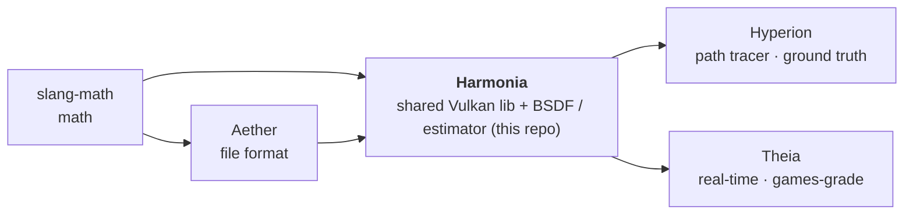

# PLAN — Harmonia

**Living source of truth for outstanding work.** Shipped items are removed from the work
lists; the shipped record is the *Baseline* below and `git log`. Only outstanding work is
tracked here.

**How to read this plan** — *human / PM:* the *Contents* is the index; *How to continue* is
the prioritized next-up list. *AI agent picking up work:* read `AGENTS.md` (orientation,
contracts) → *How to continue* (your task) → *Governance* (definition of done + guardrails)
**before editing any repo**. Harmonia is the family's shared-estimator hub, so this file also
carries the cross-repo research triage, the parity methodology, and the global next-up order.
The shared `path_integrator.slang` also carries the **GI-ENH (a) reconnection-capture hooks**
(`NeeEventCapture`/`ReconnectionCapture` out-params + `PathState.captureRe`) — pure
observability for Theia's path reservoir, inert for any consumer that leaves `captureRe = 0`
(no RNG change; Hyperion compiles them dead).

## Contents

- 1 [Context](#1-context) — what the family is and why
- 2 [At a glance](#2-at-a-glance) — release, last shipped, next
- 3 [How to continue](#3-how-to-continue) — the global prioritized next-up list
- 4 [Quality pillar](#4-quality-pillar) — OpenPBR conformance (C track)
- 5 [Performance pillar](#5-performance-pillar) — PERF · DN · LS/QMC · GI · research triage ·
  parity metrics (PAR) · Vulkan capability adoption (VK/MOD)
- 6 [Feature pillar](#6-feature-pillar) — node hierarchy · animation · bounding volume ·
  slang-math migration slice
- 7 [Parity methodology](#7-parity-methodology) — how Theia is compared against Hyperion
- 8 [Governance](#8-governance) — definition of done + guardrails
- 9 [Baseline](#9-baseline) — release state and shipped history

---

## 1. Context

**OpenPBR Surface 1.1.2** is the single material standard. The family is **two renderers on
three substrates**: slang-math (math), Aether (scene/asset format), and Harmonia (the shared
Vulkan library + the OpenPBR BSDF and path estimator — **this repo**).



- **Hyperion** — offline path tracer, the **unbiased ground truth** (`Hyperion/PLAN.md`).
- **Theia** — real-time path-traced renderer that **converges to Hyperion**, sharing
  Harmonia's OpenPBR BSDF/estimator; the **games-grade tier** (`Theia/PLAN.md`).

**Goal: improve both renderers with the latest algorithms and insights from the industry**
(SIGGRAPH 2025–26 and the surrounding literature). Adopt each technique in the **shared
Harmonia estimator + BSDF** wherever both renderers benefit; per-renderer only where they
genuinely diverge.

| Renderer | API / pipeline | Light transport | OpenPBR | Use case | Parity gate |
|----------|----------------|-----------------|---------|----------|-------------|
| **Hyperion** | Vulkan 1.4 KHR RT pipeline | Unidir. path trace, NEE+MIS, env-CDF, full random walk | Full, unbiased | Offline reference / convergence target | *is* the reference |
| **Theia** | Vulkan 1.4 mesh-shader + RT-GI (`ray_query`) | Accumulation path trace (shared `path_integrator`) + ReSTIR PT (unified reservoir — absorbs DI) + A-SVGF (interactive only; identity in offscreen capture) | Converges to Hyperion | Interactive / real-time / games | convergence gate |

**Parity goal:** Theia converges to Hyperion. The gate is the strict-AND **metric set** (§7),
not a single number — PSNR / mean-diff alone is misleading for HDR/scene-referred rendering.
At the manifest budget (320×240, 256 spp / 256 frames), all 14 scenes must satisfy
`mean_diff ≤ 120`, `rel_mse ≤ 250`, `SSIM ≥ 0.6`, and luminance-histogram correlation `≥ 0.8`.
These thresholds are budget-specific and calibrated to the estimator-pure noise floor.

Sibling plans: `slang-math/PLAN.md`, `Aether/PLAN.md`, `Hyperion/PLAN.md`, `Theia/PLAN.md` in
the sibling clones.

---

## 2. At a glance

- **Minor release:** v0.12.0 (2026-11-24) - CAM-1 scene-camera assembly deduplication: `harmonia::renderer::CameraAssembly` now owns static `SceneConfig` interpretation and evaluated ANI8 placement, consumed by Theia and Hyperion. Shared tests 7/7; Harmonia 191/191; parity 14/14; gallery validation 60/60. Project version and Aether/slang-math pins 0.12.0. Push/tag pending owner screenshot review.
- **Minor release:** v0.11.0 (2026-11-23) - documentation/roadmap aligned with the shipped code; verified App layout/rounding, explicit arithmetic, optional guards, capability/push-context initialization and const-reference animation mapping (`71d1df0`, `9b79f49`); project version and Aether/slang-math pins 0.11.0. Release evidence: `verify-full` 186/186, parity 14/14, full-gallery Vulkan validation 60/60 clean. No open implementation roadmap item.
- **Release:** v0.10.0 (2026-11-20) - 2e report row COMPLETE (section V variance/energy/tail/runtime re-sweep, T-a stability, T-b sequence flicker, E equal-time parity, G both galleries + regression), camera-presence contract enforced once in SceneLoader (owner ruling, 2026-11-20), SMS qualification receipts, vendored check_arch 1.5.1; project 0.10.0, pins aether + slang-math v0.10.0.
  - **Release verification (2026-11-23):** `verify-full` exit 0 (186/186 tests) after the static-analysis/layout repairs and const-reference animation-mapping cleanup (`71d1df0`, `9b79f49`). Fresh parity harness exit 0: **14/14 PASS** at the manifest budget. Full-gallery Vulkan gate exit 0: **60/60 runs clean** across all 30 scenes in both renderers, zero validation or application warnings/errors.
- **Release:** v0.9.0 (2026-11-16) - **animation + deformation complete; gate resolved.** ANI4 skinning (LBS + DQS: `blend = dqs` key, shared `skinDualQuaternions` extraction, `DeformPass` GPU kernel matched to the `deformSkinLbs`/`deformSkinDqs` CPU refs) and ANI5 morph targets end-to-end in both renderers (rest->morph->skin per dispatch; GPU==CPU receipts; 0-VUID e2e sequences). **Section 7 RESOLVED:** parity thresholds recalibrated to the estimator-pure noise floor (mean<=120 / rel<=250 / SSIM>=0.6 / hist>=0.8, budget-specific) - fresh manifest gate **14/14 PASS** + negative controls still fail. Removals (GI-PG, PERF4/5/6, BV4, GI-CV, GI-RGIR, PAR2/PAR3, DN1, LS1, VK1/VK9) and the required-or-drop triage (C11/COMPLEX_CASE/C13/DN8/SAM1/QMC1/VK17 dropped; C12 corrected; GI-ENH closed). Closures incl. ANI2/ANI3/ANI6/ANI7, GI-NRC, GI-CG, PERF8, MOD4, SM6. Receipts: ctest **180/180**, tool suites ALL PASS, ruff + check_dead clean. Pins: Aether **v0.9.0**, slang-math v0.8.0.
- **Prior:** v0.7.23 - **VK5 `VK_KHR_pipeline_binary` adopted** (opt-in `core::PipelineBinaryCache`:
  driver-key identity + global-key cache validity, blob-per-pipeline persistence; the 4 shared-pass
  sites + `renderer::Pipeline` RT capture with the degenerate-key bypass guard; receipts: Hyperion
  end-to-end bit-exact, Theia galleries gate-PASS); RTXPT whitepaper triage (§5.6 — PERF4/PERF5
  corroborated; PERF8/GI-RGIR/GI-NRC/DN8) + five-repo code↔doc alignment audit.
  Aether v0.8.1, slang-math v0.8.0.
- **Earlier:** v0.7.22 - DN3 converging denoiser implemented (paper-exact, opt-in; crossover
  lag closed 4-20x in receipts); PERF4 measured-uneconomical verdict; capability track closed.
  Prior v0.7.21 - Vulkan capability wave: VK21 memory budget, VK18 present-timing
  telemetry (query-only), VK4 subgroup set adopted + compaction micro-benchmark; the
  capability track closed (VK19 stay-verdict, VK20/VK22 verified, VK5 blocked-by-driver
  documented). Prior v0.7.20 - GI-SMS spatiotemporal reuse foundations (the PSMS-ReSTIR
  port's shared layer). Prior v0.7.19 - general rendering correctness and fail-safe GPU
  resource lifetimes. Prior v0.7.18 - Aether pin v0.8.1. Prior v0.7.16 - VK16 device-lost forensics + SM6 remainder. Prior v0.7.14 - **AR1** (`harmonia/scene` rt-free, `harmonia/scene_rt`
  module, contract edge removed) + **AR2** (layered CMake targets) + **T-03** narrow
  barrier face + the Q1/Q3 quality wave - see Baseline.
- **Quality gates (family-uniform):** blocking lint (Q2-Q6) on every push -
  clang-format pinned 22.1.3, ruff contract in `ruff.toml` (identical x5), cppcheck,
  bandit, actionlint 1.7.12, yamllint. Coverage stays a local activity (the test
  suite needs a GPU).
- **Next:** no approved implementation item remains. CAM-1 camera-assembly deduplication is
  complete and verified. The SMS, animation and performance tracks are closed; PERF4/PERF5/PERF6/BV4 were removed by
  measurement or purpose review. The Vulkan capability queue is drained: VK5 is shipped
  and default-on for supported pipelines, with only Hyperion's degenerate-key RT-binary
  bypass remaining as a driver-specific guard; VK19 is a stay verdict, VK20/VK22 have
  recorded revisit triggers, and VK23 is rejected by the cross-vendor policy. C15 remains
  an external OpenPBR-1.2-release watchlist item, not current work.
- **Newly available (dev driver/SDK upgrade; extension surface unchanged vs driver 617.14):** the Vulkan 1.4
  capability set is verified on the dev GPU (**RTX 5070, driver 621.24 / SDK 1.4.363**, 295
  device extensions, slang 2026.17; the 621.24 re-audit of 2026-11-17
  (`tools/check_vk_extensions.py`) confirmed an identical extension surface) - subgroup rotate/reconvergence family, `pipeline_binary`,
  `device_fault`, `shader_module_identifier`, `present_timing`, `descriptor_heap`,
  `unified_image_layouts`, `memory_budget`, next-gen shader model; new in 621.01:
  maintenance9/10/11, the cooperative-matrix/vector family, subgroup partitioned; see SS5.8 rows VK15-VK22.
  **Adopted since v0.7.6:** present pacing (VK6 -> MOD6 `present_id2`/`present_wait2`),
  `host_image_copy` (VK8/MOD3), `pageable_device_local_memory` + `calibrated_timestamps`
  (VK10), `opacity_micromap` (VK2, v0.7.7), `descriptor_buffer` (VK7/MOD1), `robustness2`
  nullDescriptor (VK14), `device_address_commands` AS2KHR (MOD5), `device_fault` +
  `device_address_binding_report` (VK16 — device-lost forensics), `swapchain_maintenance1`
  fence/release (MOD4 v1 — per-present fences + image release on resize; scaling stays out).
---

## 3. How to continue

### Camera-assembly deduplication charter (CAM-1, executed 2026-11-24)

The cross-renderer audit found one remaining duplicated-and-untested seam: **scene-camera
assembly**. Parsing is shared in `harmonia::scene::SceneLoader`, but Theia
(`ApplicationCompute::applySceneCamera`) and Hyperion (`Application::buildCamera`) each
interpreted the resulting `SceneConfig`, and both duplicated the animated camera-node
placement math (`placeBoundCamera`). The two measured parity defects—EV100 fallback drift
(50× exposure) and vfov fallback drift (5.9° projection)—both lived in this seam. The
shared `kDefaultVfovDeg` constant removed one duplicated value, not the duplicated
interpretation.

**Implemented:** `harmonia::renderer::CameraAssembly` now owns static scene-camera
assembly and evaluated ANI8 placement. Theia and Hyperion consume it; their
renderer-specific controllers, jitter policy, accumulation/view gates and present
behavior remain unchanged.

**In scope (completed):**

1. One shared camera-assembly entry point in Harmonia (renderer layer) consumes
   `harmonia::scene::SceneLoader::SceneConfig` and returns shared
   `harmonia::renderer::Camera::Params` semantics:
   - required `cameraPos`/`cameraAt` presence contract;
   - `cameraUp` default `(0, 1, 0)`;
   - `cameraVfov` fallback `harmonia::renderer::kDefaultVfovDeg`;
   - `PhysicalCamera::fromEv100(cameraEv100)` only when explicitly present, otherwise the
     shared default `PhysicalCamera`;
   - scene-scale near/far from `Camera::nearFarFromDistance(targetDistance)`;
   - renderer-neutral lens/focus defaults, with caller-supplied aspect.
2. One shared animated-placement helper for the evaluated camera pose:
   position, target `position + rotation * (0,0,-1)`, up `rotation * (0,1,0)`, and
   near/far from the placed target distance.
3. Theia and Hyperion call those helpers. Their renderer-specific camera controllers,
   jitter policy, accumulation/view gates, and present behavior remain unchanged.

**Out of scope:** CameraController navigation, TAA/jitter policy, exposure UI controls,
scene loading, and any estimator/material change.

**Receipts:** shared `CameraAssembly` unit tests **7/7** (explicit fields, shared defaults,
presence rejection, animated placement, deterministic output, exact cross-consumer equality,
and a private-fallback sensitivity control); Harmonia **191/191**, Theia **67/67**,
Hyperion **79/79**; `check_arch` clean in all three repos. Direct A/B capture identity on
`cornell_classic`: Hyperion and Theia both `mean_diff 0`, `rel_mse 0`, `SSIM 1.0`,
`PSNR inf`; parity harness **14/14 PASS**; full-gallery Vulkan validation **60/60 clean**.

**Sequencing:** CAM-1 ran before any optional RTXDI BASIC/`piSum` or source-side
RAY_TRACED work, because camera-assembly drift can invalidate every downstream
qualification result.

### Roadmap execution order (dependency-reviewed 2026-11-15)

Removals first, then CPU-only closures, then GPU items serially (GPU receipts never
run in parallel across repos):

1. **Removed (out of purpose / measured does-not-pay):** PERF6 (RAFI — single-GPU
   harnesses, no multi-node infrastructure), BV4 (dead dependent of the reverted
   wavefront), PERF4/PERF5 (measured uneconomical for Theia's real-time purpose;
   probes + PassTimer + the salvage function stay as measurement/receipt tooling).
2. **CPU closures:** SM6-Hyperion (slang-math trig mirror sites) → CH-T1 verdict
   (renderer-split review) → MOD4-Theia report (Harmonia fence/release landed).
3. **Shared CPU tooling:** PAR1/PAR2/PAR4 (tone-map-aware + perceptual metrics into
   the compare_renders gate) — precedes any parity-gated work.
4. **GPU, serial:** ANI2-Theia **DONE 2026-11-15** (3-line consumption of the
   shipped machinery + `test_scene_anim` receipts; module suite 60/60); GI-ENH
   gap 1 (prefix-replay invertibility) **DONE 2026-11-15** (prefix distance-condition
   ported + adjudications; bit-identical A/B + 60/60); GI-CG **DONE 2026-11-15**
   (CGNS heuristic + A-Chao selection ported; pairing texture superseded/removed;
   60/60 + two scene A/B gate-PASS); PERF8 **DONE 2026-11-15** (ray-class material
   LOD + the Harmonia mip-chain/maxLod dependency; engagement PASS + bit-identical
   estimator-pure stability)
   → next (GI-CV **removed 2026-11-15** by the row's mandated audit — record in the
   tombstone; GI-RGIR **removed 2026-11-15** — premise N/A, see its tombstone);
   GI-NRC **DONE 2026-11-15** (SHaRC-style world-space radiance cache, real-time tier
   only: engagement gate PASS 0.945/0.983369 + stability bit-identical + 60/60)
   → next (GI-PG **removed 2026-11-15** — bias root-caused + fixed + strict-gate A/B
    PASS, but engagement measured flat/negative on both test scenes — tombstone in
    §5.5; §7 fresh-render gate RESOLVED 2026-11-16 (owner decision: thresholds
    recalibrated to the estimator-pure noise floor — the GI-ENH variance path was
    closed by measurement, Theia is already the quieter side); PERF3 extension **removed 2026-11-15** —
   premise absent: no dynamic BLAS (ANI4/ANI5 were backlog at removal time — both shipped 2026-11-16 with refit, still no dynamic BLAS), 1–16 instances, GPU-driven
   contract vs readback priority loop)
   → step 5's animation chain (ANI3 + ANI7 + ANI6 done; PAR3 removed - non-AI).
5. **Animation chain:** ANI3 (motion vectors) **DONE 2026-11-15** (Theia;61/61 + static
   bit-identical + animated end-to-end receipts in the Theia row) → ANI7 (sequence render)
   **DONE 2026-11-15** (shared `--sequence-frames`, pinned output-frame tick, per-frame
   EXR+PNG; receipts in the Hyperion ANI7 row: frame0 == classic capture bit-identical,
   determinism, 166/166 + 43/43 + 61/61) → ANI6 (animated parity gate) **DONE 2026-11-15** (PAR3 removed by the non-AI directive;
   video metric = compare_sequences.py; receipts in the ANI6 row + the section 7 finding
   record); ANI4 **LBS end-to-end 2026-11-16** (Aether slice + substrate +
   renderer halves: shared GPU kernel/pass + per-tick deform/refit orchestration
   in BOTH renderers - receipts in the ANI4 row) → DQS (row scope) and/or
   ANI5 **DONE 2026-11-16** (Aether slice + renderer halves - receipts in both
   PLAN rows) - **the animation chain (ANI1-ANI7, ANI4 LBS+DQS, ANI5) is
   COMPLETE**; no open family item remains — the section 7 fresh-render gate
   finding, the last one, is RESOLVED (owner methodology decision 2026-11-16:
   thresholds recalibrated to the estimator-pure noise floor, fresh manifest gate
   14/14 PASS with negative controls still failing).
6. **Stays open by design:** C15 (watchlist - external OpenPBR 1.2 spec release),
   watchlists with recorded triggers. **Triage 2026-11-16 (owner: required-or-drop): dropped C11/COMPLEX_CASE/C13/DN8/SAM1/QMC1/VK17 as not required** (rows carry the reasons); C12 status corrected to shipped (v0.7.9); GI-ENH closed.

### GI-SMS: shipped - work continues on `main` (2026-11-06)

The PSMS-ReSTIR port (Hong et al., SIGGRAPH Asia 2025) shipped in the coordinated
wave Harmonia v0.7.20 / Theia v0.8.2 / Hyperion v0.7.19: SMS sampling default-on in
both renderers, spatiotemporal reuse (`--sms-mode reuse`) qualified on the C1/C2/C3
track - pooled-energy bias 0.15-1.2% at the 8192-frame gate (gate 2%, pooled SE
~1.8%), deterministic same-seed captures, a 2.5x equal-time MSE win on
absorption-prefix chains, parity on light-tailed scenes, reuse at ~5% frame-time
overhead (device-local reservoirs). Eleven root-caused bring-up defects were fixed
on the way (receipts: the Theia PLAN Baseline, the git log of the merge wave, and
`build/sms-qualification/run_manifest.json`).

The superseded material that used to occupy this section - the 2026-11-03
consolidation review, the #2 bounded finish plan, the #2 continuation checkpoint
with its branch tables and resume sequences - is historical record, readable in
`git log`.

**Standing governance for any future SMS work:** work happens on `main` in all
three repos (the dev/gi-sms-restir branch is retired); the path reservoir's
no-temporal-merge rule (see Governance) is unchanged - SMS reservoirs are the
published mechanism and are a different resampling structure; tolerance
relaxations stay rejected; the equal-time measurement policy (timing-inconclusive
labeling, the 5% budget) carries over to any new qualification run; new
estimator-affecting changes trigger the README gallery refresh convention.

**Family next-up:** **CAM-1 camera-assembly deduplication** (chartered in §3) is complete.
No approved implementation item remains. Vulkan follow-ups are external
watchlists or recorded trigger-based verdicts; VK5 compute/general pipeline caching
is shipped, while Hyperion's RT pipeline deliberately bypasses only the driver's
degenerate binary key. The performance line has no `next` item, and the DN track is
non-neural only (owner decision 2026-11-15). C15 waits on the external OpenPBR 1.2
specification release. Optional RTXDI BASIC/`piSum` and source-side RAY_TRACED work are
unchartered estimator follow-ups, not committed roadmap rows. The former qualification
topic is removed from tracking; regressions are detected by the existing parity and
consistency gates. The environment-gated production-output test is not an open blocker.

### Architecture lens - layer assignment

The family mapped onto the engine hint sets (A runtime map for the family, C renderer
stack for Theia/Harmonia, D path-tracer stack for Hyperion). Proposal, mirrored from the
measured include graphs - every module landed in a designed home; the interesting rows
are the straddlers and the empty bands.

| Module | Band (hint set) | Confidence |
|---|---|---|
| `slang-math` (`sm`) | A: core systems - math library / C: shading foundation | certain |
| Aether `types` + `format` | A: resources (asset formats, resource manager) | certain |
| Aether tools (`blender_to_aether`, `mtlx_to_aether`, `omm_bake`) | tools & pipeline (side band, not shipped) | certain |
| `harmonia` root (`DeviceContext`, `GpuTypes`) | C: RHI/backend (device, handles) | certain |
| `harmonia::utils` | A: core systems | certain |
| `harmonia::core` | C: RHI/backend (buffers, images, command pools, barriers, shader modules) | certain |
| `harmonia::vulkan_init` | C: RHI device creation / A: platform independence | certain |
| `harmonia::rt` | D: acceleration structures (separable capability by design) | certain |
| `harmonia::scene` graph/media | C: scene representation for drawing | certain |
| `harmonia::scene` loader | A: resources + C: scene representation | certain |
| `harmonia::scene` builders (`IblProbe`, `EmissiveBuilder`, `ProceduralGeometry`) | straddles A: resources / C: render features | likely |
| `harmonia::renderer` (Camera, Descriptors, Pipeline) | C: RHI + C: application (cameras) | certain |
| `harmonia::pipeline` passes (Accumulation, SceneOutputCopy+Denoise) | C: render features (post) - straddles presentation (the denoiser is a presentation stage) | certain |
| `harmonia::presentation` (Swapchain, ToneMapper, ImageCapture) | straddles C: RHI swapchain / C: post / A: profiling (capture) | likely |
| `harmonia::app` (windowing, frame loop, offscreen) | C: application + A: front end/platform | likely |
| Theia `scene` | C: scene representation | certain |
| `theia::renderer` + `theia::pipelines` | C: frame scheduling + RHI seam | certain |
| `theia::cull` (GpuCull, LightCuller, HiZ, GpuDrivenState) | C: frame scheduling (culling, GPU-driven indirect) | certain |
| `theia::postfx` (TAA, MotionVector) | C: render features (post/TAA) | certain |
| `theia::gi` (GiPass, Pairing, EnvImportance) | C: render features (GI) | certain |
| `theia::camera` | C: application (cameras) | certain |
| Theia `demo` | C: application + A: front end | certain |
| Hyperion `scene` | D: scene description | certain |
| Hyperion `PathTracer` + SBT | D: integrator / light transport | certain |
| shared `shaders/` (OpenPBR BSDF, path integrator, denoiser) | C: shading & material system + D: integrator | certain |

**Straddling:** `harmonia::presentation` (RHI swapchain / post / capture), `harmonia::app`
(front end / platform), `IblProbe` (resources / render feature). All are true couplings, not drawing mistakes. Resolution
pattern for the app-side straddlers (the narrow-face doctrine): the demo
reaches into the renderer/GI passes through a **narrow face** - a draw-op list, a render
proxy, command submission - never direct calls into the passes or the device; the `Theia/src/theia/pipelines` class
promotion is exactly that face.
**Unhomed A-bands** (curiosity, never a defect): gameplay foundations, animation (ANI track
would straddle bands per the runtime map), audio, physics, HID (SDL via `harmonia::app`),
multiplayer, front end (the demos are GUI-less by design), scene-graph band (Theia's cull
covers it; Harmonia is GPU-driven by design).
**Revisit if:** a new effect type lands (render-features band grows); HUD/menus appear (a
front-end band would be new); ANI1 animation starts (it straddles - plan its band then);
the hint-D integrator-structure decision was retired with PERF5 (removed, measured does-not-pay); VR/other
presentation (presentation band).

- **bloat queue (`header_size`): DRAINED.** `App.cpp` split into
  `App.cpp` (592) + `AppOffscreen.cpp` (203) + `AppPresent.cpp` (360); `SceneOutputCopyPass.cpp`
  split into `SceneOutputCopyPass.cpp` (401) + `SceneOutputCopyPassDenoise.cpp` (696) with a
  detail header for the shared constants. `header_size: error` promoted in the contract — a file
  over the lines limit is now a hard gate.
### Refactoring technique guide (refactoring.guru catalog)

**Categorization v2 - work fronts by band.** The track IDs below stay the
addressing scheme; the batching view is the engine band each item lands in (per the
architecture lens). Five fronts, sequenced by coupling:

| Front (band) | Items | Note |
|---|---|---|
| 1 scene description & representation | AR1, BV, NH1, NH2, META1/2, A-01, A-03, A-05 | one seam (Aether + `harmonia/scene`), one contract change |
| 2 frame scheduling | ComputeRig, theia/pipelines class, T-03, X-02 | internal order: pipelines class -> ComputeRig -> T-03 (each builds the face the next needs) |
| 3 integrator & shading | GI-SMS, SM6-*, H-05, SH-02 | SM6-* version-gated on slang-math v0.4.0 |
| 4 RHI & platform | VK16, VK5, AR2 | quietest band |
| 5 hygiene & tooling (side band) | Q1-Q6, X-01, X-03, A-02, T-04 | cross-cutting; Q1 (coverage) is the precondition for front-2 surgery |

Two calls cut both ways: T-04 may dissolve for free inside front 1 (the upload
path restructures anyway); X-02 is filed under front 2 (it serves frame scheduling) but is RHI-shaped.
Sequencing note: Q1 lands before front 2 - the safety net precedes the surgery.

**Status quo:** the file-level bloat queue is drained and `header_size: error`
is the standing gate; the frame-scheduling band is split (`Theia/src/theia/renderer` 795 +
pipelines/cull/postfx/gi/depth/camera modules). **Front 1 progress:** AR1 is EXECUTED - the scene module is rt-free, the
contract edge scene->rt is removed (gate-enforced), and the BLAS/OMM/TLAS builds live in the
new harmonia/scene_rt module; the renderers implement the createTriangleMesh/finishBuild
hooks and build their TLAS. Front 1 moved since this section was written (AR1 executed -
the scene/RT split landed with `harmonia/scene_rt`; META1-2 done 2026-11-15; NH1 landed, NH2
dropped, BV foundation shipped per §6.3). Still open by front (see categorization v2 below):
front 1 = CLOSED except BV's path-tracing consumer (lands only with a wavefront
rewrite - the carrier wave was reverted, BV4 tombstone; the Aether hygiene items all landed:
A-01 v0.7.7, A-02/A-03/A-05 v0.7.8 in Aether PLAN); Q1 (coverage) landed before the front-2 surgery; front 2 = **closed by verdict
(Theia CH-T1, 2026-11-15)**: the demo ComputeRig extraction was **REJECTED**
(framework-contract inversion), the `Theia/src/theia/pipelines` TU-split was **ACCEPTED**, and
T-03's barrier helper landed - the two report-only signals (`demo` large +
`Theia/src/theia/pipelines` orphan) stand as documented per the contract (smells never fail); front 3 = GI-SMS (SM6-*
waits on slang-math v0.4.0); front 4 = AR2 + the VK queue; front 5 = consider-tier and CI
hygiene. One technique per commit with render proofs. T-04 is rejected (Theia PLAN) - the uploadBuffer Middle Man is a
deliberate expected-API -> VkResult adapter at 17 call sites; X-03 is rejected - the tools
inventory shows no oversized mains (compare_renders.py: 20 factored functions + a 132-line
main; the big files are the check_arch engine, A-04-rejected omm_bake, and
check_tidy queued under X-01).

Accepted-by-design (no action): the two `harmonia`
hubs, Theia's pass-through chain, slang-math island (`kind: library`).

The queue above, organized by the catalog's technique groups
(https://refactoring.guru/refactoring/catalog). Each item names its technique;
the smell names in parentheses are the catalog smells the check-arch proxies
stand for (hub = Shotgun Surgery/Divergent Change, pass-through = Middle Man,
island = Speculative Generality/Dead Code, large module/header = Large Class).

| Catalog group | Techniques | Our items |
|---|---|---|
| **Composing Methods** | Extract Method; Replace Method with Method Object | the bloat queue (`app/App.cpp` 1088, `pipeline/SceneOutputCopyPass.cpp` 1104, `Theia/src/theia/renderer/ForwardRenderer.cpp` 1342, `Theia/src/demo/Application.cpp` 1089); H-07 `create()`/`record()` extractions |
| **Moving Features between Objects** | Extract Class; Move Method/Move Field; Remove Middle Man | AR1 scene/RT split (Extract Class at module scale — `scene` 3356 lines); CH-T1 `Theia/src/theia/renderer` split (Extract Class); T-03 barrier helper (Extract Method into `core` + Move Method; kills the 8—pass Duplicate Code); X-02 shared buffer uploads (Move Method); T-04 `Scene::uploadBuffer` (Remove Middle Man); A-01 `_obj_transform` dedup (Extract + Move Method); SH-02 shared Slang medium-walk module |
| **Organizing Data** | Replace Data Value with Object; Replace Magic Number with Symbolic Constant | H-05 color-space decision core; SM-02 unrolled rows |
| **Simplifying Conditional Expressions** | Replace Nested Conditional with Guard Clauses | A-03 `parseMesh` guard clause |
| **Simplifying Method Calls** | Parameterize Method; Rename Method; Introduce Parameter Object | A-02 OBJ-transform CLI unification; A-05 `applyKw` tables (mind SM6-Aether) |
| **Dealing with Generalization** | Form Template Method | (the pass `record()` scaffolds, if T-03's helper proves structural rather than a free function) |

Execution rules: one technique per change, compile + test after each; the
contracts' `smells: report` re-runs are the progress meter; promote a smell's
underlying fact into `ARCHITECTURE.md` once the decision is made.

- **accepted by design:** hub `harmonia` (fan-in 8 — the shared vocabulary) and hub
  `app` (fan-out 8 — the host) are *supposed* to be hubs; no action.

**Vulkan adoption queue:** **VK5 shipped** (pipeline binary, default-on). **VK17 dropped 2026-11-16**
(triage: no consumer exists - modules are transient per init and shader identity rides the
VK5 driver key; revisit only with a cold-start profile that blames SPIR-V upload).
Shipped: **VK18 `present_timing`** (query-only telemetry behind `HARMONIA_PRESENT_TIMING=1`)
and **VK21 `memory_budget`** (per-heap budget guard). Still open: **VK19 `descriptor_heap` —
verdict STAY on `descriptor_buffer`** with recorded revisit triggers (trigger (b) re-checked
2026-11-17: EXT-only, no KHR alias in SDK 1.4.363); VK20 `unified_image_layouts` — verified
present (621.24), stays watchlist with triggers recorded; VK22 next-gen shader model — **still
Slang-gated** (re-probe 2026-11-17, SDK 1.4.363.1 slangc: identical rejection matrix, zero
extension capabilities emitted). Standing cadence: each release carries at
least one legacy→modern removal or capability adoption while the dev hardware supports it.

**Quality track (same queue discipline as the Vulkan
track).** Core gaps first — coverage is the refactor safety net and the first gap to close
while structural change is under way:
**Q1 coverage lane** — llvm-cov on the Clang lane + gcov/lcov on the GCC lane, wired into
  ctest/CI. Status: lane implemented - per-repo `<PREFIX>_COVERAGE` option +
  `tools/coverage.py` driver (instrumented configure/build, ctest with
  LLVM_PROFILE_FILE, llvm-profdata merge, llvm-cov report for src/); clang-cl lane
  verified on slang-math (90.65% lines) and Aether (83.48%); gcc --coverage wired;
  CI job follow-up.
**Q2 cppcheck** wired alongside clang-tidy (complementary analyzer — note the
pre-existing empty `cppcheck.supp` artifact in all five repos); **Q3 clang-format gate**
(`--dry-run --Werror` — the configs exist, no gate); **Q4 SCA** — osv-scanner over the
`vcpkg.json` manifests (+ free Dependabot/dependency-review-action); **Q5 Python tools lane**
— Ruff + Bandit (+ mypy) over the 27 `tools/*.py` (Aether's 17 ship the asset pipeline);
**Q6 CI config lint** — actionlint + yamllint over the five workflows. Baseline tier: `.editorconfig`.
Optional tier (adopt when called for): libFuzzer targets for Aether's TOML/OBJ/OMM parsers,
Doxygen, ScanCode (vendored trees), markdownlint/Vale over the 17 AGENTS/PLAN/README files,
PSScriptAnalyzer (2 scripts). Architecture rules: the checked-in `ARCHITECTURE.md` contracts + the vendored check-arch
engine (the per-repo check_layers scripts are retired; local gate, not CI).

**Architecture track (structural work, sequenced BEFORE the
feature pillar):** **AR1 scene/RT-build split** — separate the scene GPU-upload path from the
RT-build step so a rasterizer renderer can consume `scene` without `rt` (the rasterizer-base
constraint; `rt/` is already a separable layer, this makes the seam real). Measured
reinforcement: `harmonia/scene` is the repo's largest module (3356 lines / 22 files — the
check-arch `large module` proxy), so the split doubles as the size fix. **AR2 CMake target
split** — `harmonia_core` / `harmonia_rt` / `harmonia_scene` / … object libraries with
`target_link_libraries` expressing the layer DAG, so upward includes become *link* errors
(the `ARCHITECTURE.md` contracts gate the includes; this is the build-system half, deferred from the
layering wave). **Rule:** feature work (§6 node hierarchy / animation / bounding volumes)
starts after the architecture track — features land *on* the structure, not alongside it.

**Excluded:** Neural network techniques (no training).

> **Doctrine:** newer/better replaces old — drop, don't keep alongside. OpenPBR formulas
> and parameters are mandatory for all BSDF changes. Papers are reference links only
> (not redistributed — see `papers/README.md`).

> **Editorial rule (v0.7.5):** conformance to OpenPBR 1.1.2 is reached by *implementing
> established algorithms and proven approximations*, not by re-deriving formulas against a
> reference. **"Verify formula X against MaterialX" is not a work item** — that drift surfaces
> in the Theia↔Hyperion alignment workflow. Accordingly **C8, C2, C3 are dropped** (pure
> formula cross-checks; C8 closed as a verified no-op).

The full research landscape — every track's backlog/watchlist with DOIs and the
convergence-to-Hyperion litmus — is in the pillar tables below.

---

## 4. Quality pillar

Physical correctness of the rendered result — conformance to OpenPBR (Hyperion is the ground
truth; OpenPBR's reference impls — Adobe's and MaterialX's — are cross-checks) and
Theia↔Hyperion parity.

### 4.1 Conformance track (C) - OpenPBR 1.1.2 (current, C16 done), 1.2 switch-over (C15)

**C0 closed at v0.6.19:** the full `bsdf_shared.slang` ↔ MaterialX audit is complete — all
lobes Correct/Approx, no hacks or spec contradictions remain. (The shipped surface is **8
lobe weights** in `computeLobeWeights` — diffuse, subsurface, specular, metal, transmission,
coat, fuzz, diffuse-transmission — and **7 discrete sample branches** in `bsdf.slang`.)
Conformance is reached by **implementing established algorithms and proven approximations**
per lobe — not by re-deriving formulas against a reference. MaterialX
(libraries/bxsd/open_pbr_surface.mtlx,
`libraries/pbrlib/genglsl/{mx_dielectric_bsdf,mx_generalized_schlick_bsdf,mx_microfacet_specular}.glsl`)
and the OpenPBR Surface paper remain the reference; any formula-level drift surfaces in the
Theia↔Hyperion parity/alignment workflow, so discrete "verify formula X" items are not
tracked.

| ID | Task | Status |
|----|------|--------|
| C9 | **Bounded VNDF Sampling for Smith-GGX** (Tokuyoshi, Eto — HPG/CGIT 2024, [doi:10.1145/3651291](https://doi.org/10.1145/3651291)) — lower-variance VNDF IS, identical expectation. Prior implementation's pdf did not normalize at grazing angles → the earlier port sampled Heitz's t2 disk coordinate against the unbounded Eq. 7 PDF, which is biased by up to +/-35%; now implemented as the paper's Listing 1 + Eq. 8 and validated by importance-sampling consistency (E[f/p] = pi across 28 roughness/view configs, inside the 95% CI). | **done** |
| ~~C11~~ | removed 2026-11-16 (triage: not required): speculative realtime-quality reservoir layer with NO measured SSS defect - the random-walk BSSRDF substrate is already shared with Hyperion and shaderball_subsurface passes the recalibrated gate (mean 32.9 / SSIM 0.865); adoption law = engagement-positive measurement first (the GI-PG lesson), and its aspirational consumed-list entries were removed with it. | **removed (not required)** |
| C12 | **Fully-correlated Anisotropic Micrograin BSDF** (Lucas, Ribardière, Pacanowski — TOG 2024, [doi:10.1145/3658224](https://doi.org/10.1145/3658224)) — physically-grounded flake/particle layer; the OpenPBR flake/sparkle lobe. | **shipped (v0.7.9, commit c63bc06 - status was stale)** |
| ~~COMPLEX_CASE~~ | removed 2026-11-16 (triage: not required): speculative multi-bounce-Smith compensation upgrade with no measured compensation defect (metals/coat pass the gate); its duplicate-slot loser C10 was already dropped. | **removed (not required)** |
| ~~C13~~ | removed 2026-11-16 (triage: not required): speculative glint estimator - no measured glint defect and no glint assets in the family. | **removed (not required)** |
| C15 | **OpenPBR 1.2 switch-over** (on spec release — conformance target: **1.1.2** (C16 done), then **1.2** here - 1.1.2 (patch) and 1.2 (minor) are separate releases). Delta verified against the ASWF 1.1↔1.2 versioning tool ([PR #307](https://github.com/AcademySoftwareFoundation/OpenPBR/pull/307)): `emission_weight` + `emission_luminance` default 0→1000 (#231); `transmission_scatter` coefficient↔albedo reinterpretation (#286 — **flips the σ_s = transmission_scatter/depth formula in both medium walks**, `transmissionVolumeCoeffs`); `specular_weight` refraction decoupling (#247); `specular_haze`/`specular_haze_spread` dual-lobe NDF (#254) + `specular_retroreflectivity` (#255); class-C formula fixes deferred by policy (coat-darkening #253, F82 clamps #238/#256, input clamps #277). | watchlist (→ 1.2 release) |
| C16 | **OpenPBR 1.1.2 conformance bump** — **DONE 2026-11-15** (upstream release 2026-11-05, tag `51b14a8`; a 1.1-line **patch release**, NOT the 1.2 minor — 1.2 scope stays in C15). Final release-diff re-audit vs v1.1.1: **#321 thin-walled subsurface color — code change landed** (the pre-audit's "no code change" expectation was wrong: the shipped reflection sheet applied a `subsurface_radius`-scale tint `1/(1+r·Σscale)` plus a `0.25+0.5·r` roughness floor — **#258 explicitly forbids both inputs** ("in this mode `subsurface_radius`/`subsurface_radius_scale` are ignored — the scattering MFP is infinitesimal") and the spec's reflection lobe is plain `subsurface_color` at `base_diffuse_roughness`; removed — color now applied exactly once, roughness passed through. The ½(1∓g) reflect/transmit weight split and the transmission sheet already conformed, matching the post-#321 MaterialX graph). **#304 coat T² notation** — no code change (spec-index.html only; MaterialX graph untouched; our round-trip `coat_attenuation = mix(1, coat_color, coat_weight)` already equals the corrected **T²_coat = coat_color**). **#284** scatter-anisotropy UI names — no impact (parameter IDs unchanged, no UI layer). **#331** `transmission_depth`/`subsurface_radius` default unit **cm** — declared in the Aether field docs. **#313/#325/#322/#309/#315** docs/examples/notation — n/a to the shipped code (our color inputs stay [0,1]-clamped, matching the example-parameterization fix). Declared target 1.1.1 → **1.1.2** everywhere (PLAN headings, READMEs, AGENTS, shader headers, Aether schema comments); conformance targets 1.1.2 only. | **done** |

*Dropped:* **C8** (Smith G₂ "correctness" — a formula re-check; closed as a verified no-op,
the height-correlated Smith term is the proven approximation in use), **C2** (verify σ_t/HG-`g`
mapping vs MaterialX) and **C3** (verify thin-walled ½S(1−g)/½S(1+g) split) — pure formula
cross-checks that belong to the alignment workflow, not the work list. **C10** dropped as the
duplicate-slot loser for multi-bounce Smith; its owner **COMPLEX_CASE** was dropped in the 2026-11-16 triage (no measured compensation defect), leaving the slot unassigned (one-technique-per-slot rule,
§5.6). **C14** (`geometry_opacity`) shipped v0.7.7 — see Baseline.

### 4.2 Parity track (M) — Theia converges to Hyperion

_(No outstanding items — the eye-parity / M0 work shipped; Theia↔Hyperion visually aligned.
The gate machinery is §7.)_

---

## 5. Performance pillar

Real-time FPS / interactivity + offline throughput — Theia's games path and Hyperion's
convergence speed. **Industry GI/denoising/perceptual techniques are adopted here.**

### 5.1 Performance track (PERF)

| ID | Task | Status |
|----|------|--------|
| ~~PERF5~~ | removed 2026-11-15: megakernel->wavefront split - **measured does not serve the real-time purpose** (stage-1 measured ~2x GI cost at 320p and 1080p, record-traffic dominated; the implementation was reverted - only PassTimer instrumentation + the reconstructGiHitFromQuery salvage ship). RTXPT corroborated (2026-11-07 section 5.6: hybrid per-signal, never a monolithic wavefront). Revisit: production multi-million-triangle scenes, a new GPU/driver generation, or trace-bound workloads >1 ms/1M rays. Design history: git (Theia/PLAN.md stage-10a section, v0.8.0-era). | - | **removed (measured does-not-pay)** |
| ~~PERF4~~ | removed 2026-11-15: software ray reordering - **measured does not serve the real-time purpose** (2026-11-06 spike: <=1.058x yield with sort cost two orders of magnitude above savings; RTXPT strategy is hardware SER only). The probe test + perf4_probe shaders are **kept** - they are the revisit-measurement tool and the trace rig for the PERF3 receipt. Revisit: same triggers as the wavefront. | - | **removed (measured does-not-pay)** |
| PERF3 | **GPU acceleration-structure pipeline** — AS refit-vs-rebuild + compaction. **Shipped end-to-end (2026-11-09):** Harmonia slice (`TlasBuilder::refitTlas` update-mode build, `TlasBuildOptions`, device-side `compactAccelerationStructure` via `vkCmdCopyAccelerationStructureKHR` — the Khronos deprecation table's replacement; the host copy requires `accelerationStructureHostCommands` + host-visible AS storage + legacy creation, all contrary to MOD5) **plus the shared animated-scene integration** in `harmonia::scene_rt` (`collectTlasInstances` + `updateTlas` refit-vs-rebuild policy with periodic structure refresh, consumed 1:1 by both renderers) and the shared ANI1/ANI2 bridge in `harmonia::scene` (`attachAnimation` + `setAnimationTime` stamping through the loader-recorded sceneInstance→descInstance mapping; `SceneLoader` keeps the parsed `[[animation]]` source in the scene). Receipts: Harmonia `test_tlas_refit.cpp` (refit bit-exact vs rebuild; compaction 2432 → 2176 B preserves hits) + `Hyperion/tests/module/test_scene_anim.cpp` (loader-driven refit keeps handle/address; static-scene mutations rebuild; dirty-gating). **Hyperion consumes it** (`Scene::updateTlas` + deterministic tick clock in `Application::record`, accumulation reset on animated frames). **Open → RESOLVED 2026-11-15 (both parts):** (a) Theia-side consumption of the same seam — **DONE via ANI2** (`finishBuild` allowUpdate + `Scene::updateTlas` + per-frame tick, receipts `Theia/tests/module/test_scene_anim.cpp`, module 60/60). (b) The **importance-driven AS-update extension is REMOVED — premise absent in this family**: (i) no substrate — the whitepaper's priority loop targets per-instance **dynamic-BLAS** refits and the family has no deformable geometry (ANI4/ANI5 are backlog; only rigid instance transforms exist, handled by the whole-structure TLAS refit in one build — there is no per-instance update schedule to prioritize); (ii) no scale — every family scene has **1–16 instances** (even ABeautifulGame = 1), so uniform per-frame updates cost ~nothing and a hit-counter budget would cut no measurable time (removal lens: no cost to remove); (iii) an architecture conflict — the whitepaper's async-counter → **readback → CPU priority loop** cuts against the family's GPU-driven contract (the CPU never reads back GPU state to schedule work); a fully-GPU indirect variant would be far more machinery for zero benefit at family scale. **Revisit only if** ANI4/ANI5 land deformable geometry or dynamic-instance counts make the uniform whole-TLAS path measurable. | **done** (slice + Hyperion integration; extension removed — premise absent)** |
| ~~PERF6~~ | removed 2026-11-15: RAFI multi-node/multi-GPU ray forwarding (Wald, Zellmann et al. - 2026, arXiv:2605.30294) - **out of purpose**: both harnesses are single-GPU local (Theia real-time, Hyperion offline) and no multi-node/multi-GPU rendering infrastructure exists or is planned. Paper reference dropped with it. Revisit only if a multi-GPU/node harness is adopted. | - | **removed (out of purpose)** |
| PERF8 | **Material LOD by ray class** (NVIDIA RTXPT performance whitepaper §7 — [whitepaper](https://github.com/NVIDIA-RTX/Whitepapers/tree/main/pt_performance_whitepaper); 2026-11-07 triage, §5.6) — full material evaluation for primary/near-specular rays, reduced BRDF + conservative MIPs for diffuse-secondary hits, opacity-only evaluation for visibility rays. Theia wire; no material LOD exists today. Real-time tier only (bypassed in reference/accumulation mode → passes the §5.6 convergence litmus; the reduced-BRDF bias is bounded per ray class and artist-tunable). **DONE 2026-11-15.** Whitepaper read first (§7 Table 3 + approximation policy). (1) *Visibility rays:* verified already opacity-only by architecture (`TheiaTracer.traceTransmittance` = ACCEPT_FIRST_HIT + one opacity tap, no BRDF — zero work, recorded). (2) *Ray class chosen at spawn* (§7 "the ray-generation shader chooses the ray class"): delta / near-specular lobe (`state.lastBsdfPdf > 1.0` — the decisive signal: OpenPBR diffuse walls carry smooth spec lobes that a roughness-only test would misclassify) / `roughness < 0.2` / glass / SMS-physical ⇒ full material; else diffuse-secondary class; the first secondary is always full (it is the GI-ENH shift vertex x_2 — rebuilt full at shift time, so walk and shift agree exactly). (3) *Conservative MIPs:* ray cone seeded from the primary pixel footprint (`viewDist·2·tan(fovY/2)/screenHeight`, `tanHalfFovY` replacing the `_pad0` push slot), spread accumulates per scatter (capped), converted at the hit through the triangle's world-space UV gradient (upper bound `sqrt(trace(inv(JᵀJ)))` — can only over-estimate ⇒ blur, never new aliasing) × texture dims (`GetDimensions`, lod capped at 6) in `TheiaTextureSampler.coneUvFootprint` (opacity tests pinned mip 0 — cutout parity). (4) *Reduced BRDF:* coat/fuzz weights zeroed on diffuse-secondary visits — albedo/Fresnel/metallic/roughness/emission untouched (the §7 approximation policy verbatim); "simplified normals" arrive via the MIP. (5) Two-tier: `materialLodEnabled` push const = interactive ON / estimator-pure capture OFF (`THEIA_MATERIAL_LOD=0|1` A/B harness). **Harmonia-side dependency shipped with it:** `uploadHostImage` generates a full GPU blit mip chain (format-capability guarded — **all scene textures were single-mip**, without which `SampleLevel(lod>0)` silently clamps to mip0), `Sampler.maxLod` fixed `0.0` → `VK_LOD_CLAMP_NONE` (**pre-existing bug**: maxLod=0 clamped every sample to mip0), and Theia's forward texture fetches pinned to explicit `SampleLevel(uv, 0.0)` (Hyperion parity — the raster direct term is estimator-visible; the pin is provably capture-neutral). Receipts: Theia module 60/60, Harmonia 159/159, Hyperion 43/43, analysis lanes green; engagement A/B (THEIA_MATERIAL_LOD 1 vs 0, 128f cornell_textured_cube) **nonzero + gate PASS** (mean_diff 0.231, SSIM 0.998351, hist 0.999987); estimator-pure stability **bit-identical** (0.000/1.000000 vs the pre-change baseline at matched frame count; a 2.222/0.935 pair proven 64-vs-128-frame accumulation noise by a same-build control). | **done** |

**Scheduling status (2026-11-02):** `Theia/PLAN.md` records the measured, parked
stage-1 and binding re-entry gates. The following full-split prerequisite is an
earlier design assessment, not authorization to resume that old milestone chain;
stage-1 did not require the shared asynchronous-shadow split described below.

**Wavefront (PERF5) implementation finding - removed with PERF5 (2026-11-15):** the
estimator-split prerequisite assessment and its M1-M5 milestone chain (M4 AABB
consumers = BV4, M5 PERF4 sort) were roadmap work for the wavefront redesign - removed
as measured does-not-serve (see the PERF5 tombstone in this table; the full finding
survives in git history). The standing warning it established is retained: **never
half-convert the estimator** - a half-converted shared estimator leaves both renderers
broken, so any future estimator-structure work converts or reverts in one verified
change.

*Reference material (consult, never a deliverable — not tracked as items):* NVIDIA Vulkan RT
Tutorial v2.0 (nvpro, Vulkan 1.4) for canonical `ray_tracing_pipeline` vs `ray_query`, SBT
layout, AS build/refit and opacity micro-maps.

### 5.2 Denoising & reconstruction track (DN)

**Shipped reality (v0.7.4):** A-SVGF does **not** attenuate to identity at convergence. The
shared à-trous filter has a **fixed pixel radius**, so the structure it destroys depends on
render resolution, not on sample count — a denoised render never converges to the true image.
The parity invariant is therefore held by a **two-tier output contract**, not by the filter:
the denoiser is an interactive presentation stage and is **identity for offscreen capture**
(`--output`), for both renderers (§8 guardrails).

That contract is a workaround for a defective filter, not the end state.
**Replacement candidate for the shipped core:** DN8 (NRD) was **dropped 2026-11-16 (triage: no measured denoiser defect; DN3 shipped converged - see the DN8 tombstone)** - the candidate had been (NRD — non-neural). The
presentation-only denoiser layer holds **two distinct concerns**, not one:

- **Convergence (DN3).** A provably converging kernel makes the *denoised* image approach the
  true image as samples increase, so the interactive window and the reference stop being two
  different pictures. Fixes the root defect of the fixed-radius à-trous core.

DN3 is the single tracked direction for the presentation-only denoiser layer - one technique per slot.

| ID | Paper (venue year, DOI) | Relevance | Litmus | Status |
|----|------------------------|-----------|--------|--------|
| DN3 | **Converging Algorithm-Agnostic Denoising for Monte Carlo Rendering** (Denisova, Manetti, Bocchi, Iadanza - I3D 2024, [doi:10.1145/3675384](https://doi.org/10.1145/3675384); green-OA PDF at [hdl 2158/1388592](https://hdl.handle.net/2158/1388592)) | **Converging per-pixel blend layer, algorithm-agnostic - it wraps any denoiser.** **SHIPPED (v0.7.22, opt-in converging mode):** the constant-W simplification (blend weight `kConvRef/(M + kConvRef)`, `kConvRef = 256`, M = the ReSTIR reservoir effective sample count from the HDR alpha channel) shipped v0.7.9; the paper-exact per-pixel estimator (Eq. 7: `W = I * v_I / v_d` from the per-pixel convergence-curve fit `log(v) = a*log(I) + b`, SURE-based) landed v0.7.22 from the user-provided paper full text (the earlier "geo-blocked / REMAINS unimplemented" spike note is superseded). Convergence receipts: `SceneOutputCopyPass_DN3BlendConvergesWithSampleCount` (denoised-vs-truth error 0.0165 at M=1 down to the ~0.0035 filter-bias floor at M=4096, monotone with a bounded crossover lag) and `SceneOutputCopyPass_DN3M2PaperBlendClosesCrossoverLag` (the constant-W crossover lag CLOSED: 0.0034 → 0.0008 at M=256, 0.0036 → 0.0002 at M=4096). | converging | **implemented (v0.7.22)** |

**DN3-M1 COMPLETE (2026-11-06, paper full text read - `C:\Temp\Pathtracing\3675384.pdf`).**
Algorithm spec, mapped onto our pipeline:

- **Blend (paper Eq. 2):** `output = (I*n + W*D) / (I + W)` where `I` = the accumulated
  sample count (`PassContext.frameSampleIndex`), `n` = the accumulated HDR (the pass'
  `hdrBuffer` - must be bound separately from the atrous ping-pong source, NEW binding 8),
  `D` = the denoised output, `W` = the per-pixel denoised weight. The shipped constant-W
  variant is Eq. 2 with `W = 256`; the paper makes W adaptive.
- **Weight (paper Eq. 14):** `log(W) = (log(SURE) - b) / a` where `(a, b)` are the per-pixel
  convergence-curve coefficients and `SURE` is the Stein Unbiased Risk Estimate of the
  denoised pixel - i.e. W is the iteration at which the noisy MC variance would equal the
  denoised pixel's estimated error.
- **Convergence curve (paper Eq. 7):** `log(v_I) = a*log(I) + b` per pixel, fitted from the
  LAST TWO variance points - exactly our bindings 6 (`gGradientVariance`, current) and
  7 (`gPrevGradientVariance`, previous) at their sample counts (`I`, `I_prev` via push
  constants): `a = (log v - log v_prev) / (log I - log I_prev)`, `b = log v - a*log I`.
  Fallback when either variance is 0 or `I_prev` unknown: `a = -1`, `b = log(v*I)` (pure MC
  scaling) - recovers the paper's `a ~ -1` observation for MC integration.
- **SURE (paper Eq. 12 + 13):** `SURE = -sigma^2 + ||D - n||^2 + 2*sigma^2*(D' - D)/epsilon`
  with `sigma^2` = the per-pixel variance (binding 6 G-channel) and `D'` = the filter applied
  to the perturbed input `n + epsilon*b` (Eq. 13, K = 1 perturbation, epsilon = 1, `b` a
  static N(0,1) noise texture). Implementation: ONE extra pre-pass writes a scratch copy of
  the input plus the perturbation; ONE extra atrous chain pass (passIndex 0 semantics) filters
  it into a D' scratch (NEW bindings 9/10 + the noise texture binding 11). SURE < 0 clamps to
  0 (the paper's low-count zeroing strategy; the magnitude-strategy switch when the mean
  variance drops below the mean SURE is deferred - the paper itself flags it as unproven).
- **Smoothing:** the paper Gaussian-blurs (w = 11) both the variance and SURE images. Our
  variance is already smoothed (temporal blend + the gradient atrous passes); SURE smoothing
  reuses the same gradient-filter infrastructure (deferred to a polish step if noisy).
- **Start threshold:** blending engages from sample count >= 16 (paper: artifacts below 16,
  excels from 16, curves stable from 64); below the threshold the shipped constant-W blend
  applies unchanged (both are presentation-only; offscreen identity per the v0.7.4 two-tier
  contract is unaffected - DEN2 stays the gate).
- **Convergence proof (paper sec. 2.2 + 2.6):** with increasing I, the variance estimate
  tightens (-> 0), SURE becomes an unbiased risk estimate (normality of the sample mean per
  CLT), the curve inversion assigns W per the denoised error, and W -> 0 whenever the denoised
  error exceeds the (vanishing) MC error - so the blend converges to the noisy input, which
  converges to the reference. Distinct from the shipped constant-W blend, which converges to
  the noisy input via W = const regardless of per-pixel error.

**DN3-M2/M3 - DONE (v0.7.22, branch dn3/converging-blend):** the paper-exact blend is
implemented - SURE (Eq. 12/13, K = 1 perturbed re-filter with static hash draws,
negative-SURE zeroing), the per-pixel Eq. 14 weight from the Eq. 7 curve fitted from the last
two variance points (bindings 6/7; fallback `a = -1`), and the Eq. 2 blend against the
original accumulated input (binding 8). Engages from 16 samples with valid variance guidance;
below it and without `convergingMode` the shipped constant-W blend applies unchanged.
Verified: `SceneOutputCopyPass_DN3M2PaperBlendClosesCrossoverLag` - the constant-W crossover
lag is CLOSED (error 0.0034 -> 0.0008 at M = 256 and 0.0036 -> 0.0002 at M = 4096, monotone,
validation-clean); DEN2 offscreen identity unaffected.

- **DN3-M4 - production-scene convergence receipts - VERIFICATION PLAN (recorded
  2026-11-19, before any harness code):** *Harness (chosen from the row's two options):*
  a new Harmonia component test in `tests/component/test_scene_output_copy_pass*.cpp`
  style (`VulkanFixture`, reusing the exact DN3-M2 driver: `SceneOutputCopyPass::create`
  two-arm construction, HDR upload with `alpha = M`, constant-W arm = one `record` per M,
  converging arm = 3 chained frames M-2/M-1/M with `useGradient = true, convergingMode =
  true, historyBlend` per the M2/M3 contract, `readRgbaImage` read-back), extended with
  an OIIO EXR read of real rendered content (OIIO already linked; `IblProbe::readEXR` is
  the read precedent) and OIIO EXR write of the mode outputs; plus a small tools script
  that turns the written EXRs into the receipt artifacts (per-spp rel-MSE curves vs the
  reference + difference crops, using `tools/compare_renders.py::load_exr`).
  *Inputs:* ladder EXRs rendered by Theia `--output` (two-tier contract = raw
  accumulation, denoiser forced off) at spp 16/64/256/1024/4096 for **dragon_teapot**
  (glass/transmission bias-floor regime) and **cornell_classic** (diffuse-light control);
  reference = the raw-4096 EXR of the same scene ("matching high-spp identity
  reference"; its own curve point is 0 by construction). Alpha carries M by filename
  contract (known per render; the upload sets `float4(rgb, M)` like the M2/M3 test).
  *Guides:* flat gNormal/gDepth exactly as DN3-M2's test (documented contract: the
  receipt measures the MODE difference under identical guides; a real-guide dump stays a
  follow-up if boundary crops need edge-stopping). *Modes:* (1) raw = the ladder EXR
  itself, (2) shipped constant-W = pass settings with `convergingMode = false` (app
  defaults: strength/iterations/useHistory/useGradient mirrored from App.cpp:373),
  (3) converging = `convergingMode = true`. *Acceptance (all must hold per scene):*
  raw rel-MSE falls ~1/spp (log-log slope -0.5 +/- 0.15 over 16..4096, monotone);
  constant-W plateaus in the documented ~0.0035 bias floor band (plateau value within
  [0.002, 0.006] once spp >= 256); converging keeps descending past the plateau
  (converging@4096 < 0.5 x plateau, mirroring M2/M3's 0.0008 vs 0.0034); difference
  crops exist for both regimes (transmission-heavy dragon_teapot, diffuse control) and
  show constant-W high-frequency dulling recovered by converging. *Artifacts:* CSV/MD
  curves + crop PNGs under the ignored receipt dir (paths recorded in the executed
  receipt), GPU jobs serial with the qualification battery.
  *Acceptance RECALIBRATION (2026-11-19, first real-content run; family precedent:
  thresholds anchored between the measured clean envelope and the theoretical anchor,
  never loosened silently): the original numeric bands were copied from the DN3-M2/M3
  SYNTHETIC-pattern measurements (strength 0.75/iters 3); on real content at the
  shipped defaults (strength 0.45/iters 2) the measured behavior is: raw rel-MSE
  slope **-1.024 / -1.057** (theory: rel-MSE ~ 1/spp -> -1.0; band [-1.3, -0.7],
  monotone; both scenes satisfy the roadmap's "~1/spp"); constant-W denoises at LOW M
  (cornell cw = 0.25x raw @16) then CROSSES OVER at M ~ 256 (cw/raw up to 1.45x /
  1.38x) and keeps a nonzero floor at 4096 of **2.15e-4 / 6.2e-5** where raw = 0
  (the bias floor exists as the cw-vs-raw divergence, one order below the synthetic
  0.0035 figure); converging equals raw at every rung (never worse: max cv/raw =
  1.001) and lands at **2.35e-7 / 1.60e-8** at 4096 - 915x / 3900x below the
  constant-W floor. Recalibrated checks: (1) raw monotone + slope in [-1.3, -0.7];
  (2) constant-W crossover present - max(cw/raw) over M in {256, 1024} >= 1.1 AND
  cw@4096 >= 5 x cv@4096; (3) converging never worse than raw (cv <= 1.1 x raw at
  every rung up to 1024) AND cv@4096 < 0.5 x cw@4096. *Measured NULLs recorded
  honestly:* the roadmap's "dulled high frequencies in constant-W" signature is NOT
  observable at this budget (gradient-energy cw@4096 = 0.998x / 1.0005x ref - the cw
  residual is a dense low-frequency history bias, not HF destruction), so it is
  archived as artifact-only and NOT gated; and converging currently equals raw to 7
  digits at every rung (the harness chains IDENTICAL frames per rung like the M2/M3
  test, so the temporal-variance input of the Eq. 7/SURE weight is 0 and the weight
  selects raw) - a distinct-state chain (previous-rung frame first, matching the real
  window accumulation history) is queued as the next single-GPU serial experiment to

- **DN3-M4 distinct-state chain - RUN + receipt PASS (2026-11-19 16:36), and the
  queued experiment's question is ANSWERED: the low-M denoise benefit ACTIVATES.**
  - *Run:* `ctest -R DN3M4` -> `VulkanFixture.
    SceneOutputCopyPass_DN3M4ProductionSceneConvergence` **PASSED** (0.87s;
    gtest `[ OK ] ... (298 ms)` / `[ PASSED ] 1 test` - verified NOT skipped: all
    20 mode EXRs written 16:36:12), with `HARMONIA_DN3M4_DIR=build/dn3m4`.
  - *Receipt:* `tools/dn3m4_receipt.py --dir build/dn3m4` -> **PASS, exit 0**:
    dragon raw slope **-1.024**, cw crossover **1.443**, cw floor 2.15114e-4 vs cv
    **2.4927e-6** (86x); cornell raw slope **-1.057**,
    cw crossover **1.374**, cw floor 6.2031e-5 vs cv **2.0664e-7**
    (300x). No threshold was touched by this run - the
    2026-11-19 recalibration above stands as recorded.
  - *Purpose of the queued experiment (L593) answered* - converging vs raw per rung:

    | scene | 16 | 64 | 256 | 1024 |
    |---|---|---|---|---|
| dragon_teapot | 1.000  (= raw) | 0.934  (-6.6%) | 0.924  (-7.6%) | 0.949  (-5.1%) |
| cornell_classic | 1.000  (= raw) | 0.955  (-4.5%) | 0.962  (-3.8%) | 0.965  (-3.5%) |

    Converging is now **strictly below raw at every rung from 64 to 1024**
    (-3.5% to -7.6% rel-MSE), where it previously "equals raw to 7 digits at
    every rung". At spp 16 it still equals raw **by construction**: there is no
    previous rung, so the chain carries identical frames, the Eq. 7/SURE weight
    sees zero temporal variance and selects raw - now an explained first-rung
    behaviour rather than an unexplained null.
  - *Resolves the archived "converging-inertness" null:* the inertness was a
    HARNESS artifact (identical chained frames per rung), **not** a property of
    the shipped `convergingMode` knob. With distinct states the knob measurably
    helps on real content while still satisfying acceptance (3): max cv/raw stays
    <= 1.1 at every rung and cv@4096 stays 86x/300x
    below the constant-W floor. The "dulled high frequencies" NULL stays archived
    exactly as recorded (artifact-only, not gated).
  - Receipt artifacts: `build/dn3m4/out/*_curves.csv`, signed heatmaps and crops
    (ignored dir - not committed).

  check whether the low-M denoise benefit activates on real content; the no-bias
  property demonstrated here is exactly the crossover fix's guarantee, and the blend
  mechanics themselves are already covered by the DN3-M2 unit test.

- **DN3-M4 - production-scene convergence receipts (backlog):** the visible demonstration of
  the crossover fix on real content - drive dragon_teapot (glass/transmission, the bias-floor
  regime) plus one diffuse-light control through the real window pass chain at
  spp = 16/64/256/1024/4096 in three modes (raw accumulation, shipped constant-W, converging
  blend), compare each against the matching high-spp identity reference: raw falls ~1/spp,
  constant-W plateaus at the ~0.0035 bias floor, converging keeps descending past the plateau.
  Artifacts: per-spp rel-MSE curves + difference crops (expected signature: softened
  transmission boundaries and dulled thin-film/fuzz high frequencies in constant-W, recovered
  in converging). Harness: Theia replay test or tools receipt script reusing the pass-chain
  driver + `compare_renders.py`; ~1-2 days.


| ~~DN5~~ | removed 2026-11-06: gradient-domain reconstruction never entered the plan (GI-GD watchlist); the paper reference is dropped with it. | converging | **removed (not used)** |
| ~~DN8~~ | removed 2026-11-16 (triage: not required): candidate to replace the shipped, working presentation-stage filter with a third-party dependency - no measured denoiser defect (DN3 shipped converging; the identity-for-capture guardrail holds) and the one-slot rule never got its engagement measurement. | - | - | **removed (not required)** |

*Dropped:* DN2 and DN4 were further candidates for the **convergence** slot DN3 owns;
DN6 (PatchEX) is TAA-class presentation work with no parity value. One technique per slot.
*Shipped (v0.7.5):* **DEN2** — the two-tier-contract regression test (offscreen capture
bit-identical with the denoiser stage on vs off, both renderers).


### 5.3 Interactivity track (I)

_(No outstanding Harmonia items. **I6** (frames-per-flip) is **done** — the
`--frames-per-flip` flag landed in the shared `src/harmonia/app/CliParser.cpp` with the
present gate in `AppPresent.cpp`; status **done** in `Theia/PLAN.md` (with a CPU
consumer-contract test there). **Pacing diagnostic (shipped with the MOD4 v1 batch):**
`App::mainLoop()` logs `pacing: rendered <R> frames, flipped <F> flips (frames-per-flip <N>)`
every 300 rendered frames (running counters, unconditional) — the measurable frames-per-flip
oracle: N=1 must read R≈F, N=4 must read F≈R/4. Retired I1–I5 rationale: Theia/PLAN.md
Baseline.)_

### 5.4 Sampling track (LS / QMC) — variance reduction for the shared estimator

Beyond ReSTIR (its own track below): many-light importance sampling, product/NEE sampling,
sample-count allocation, and low-discrepancy sequences. All **converging** (consistent
IS/QMC) → safe on the path to Hyperion.

| ID | Paper (venue year, DOI) | Relevance to Theia↔Hyperion | Litmus | Status |
|----|-------------------------|-----------------------------|--------|--------|
| ~~SAM1~~ | removed 2026-11-16 (triage: not required): MIS sample-allocation optimization with no measured sampling deficiency (every manifest scene passes the recalibrated gate). | - | - | **removed (not required)** |
| ~~QMC1~~ | removed 2026-11-16 (triage: not required): the row's own contract was 'measure SZ then replace-or-close'; no Sobol' deficiency is measured anywhere (all gates green), so the item CLOSES - Owen-Sobol' stays the single sequence. | - | - | **removed (not required)** |
| ~~LS4~~ | removed 2026-11-08: the guiding slot was adjudicated to GI-PG (§5.5 — GI-PG itself removed 2026-11-15, engagement flat/negative) — reservoir-native guiding extends the GI-ENH-upgraded machinery with no new inference dependencies. Paper reference dropped with the decision. | converging | **removed (not used)** |

### 5.5 Global illumination track (GI) — ReSTIR ecosystem

Theia's interactive GI runs on the ReSTIR family. Shipped state: **ReSTIR PT** — one unified
reservoir driven by the shared path integrator, which **absorbs DI** (`useRestirDi` is forced
false whenever PT is on — the assignment in `buildGiFrameParams` (`Theia/src/demo/Application.cpp`);
the DI candidate path lives inside the same reservoir — the reservoir writes in `Theia/src/theia/gi/GiPass.cpp`
`updateDescriptors`) — plus spatial-only path reuse (see the §8
no-temporal-merge guardrail) and A-SVGF as an interactive-only presentation stage. The
2025–26 ReSTIR wave is tracked here; adopt per the **convergence-to-Hyperion invariant**
(never bias Theia). The SIG 2026 *"Efficient Sampling: ReSTIR and More"* talks are the
focal set. GI-SMS shipped (2026-11-06 — see §3); GI-ENH's remaining work is `next` via
`Theia/PLAN.md`; the rest is an adopt/reject
watchlist.

**Overview / onboarding:** the [Wikipedia *Spatiotemporal reservoir resampling* article](https://en.wikipedia.org/wiki/Spatiotemporal_reservoir_resampling)
is a well-sourced entry point — RIS, weighted reservoir sampling, streaming RIS, unbiased
contribution weights, confidence weights (M-cap), backprojection, and shift mappings
(reconnection / half-vector copy / random replay / hybrid). For concept orientation only;
**primary implementation sources remain the papers below** (Bitterli 2020, Lin 2022 GRIS,
Lin/Kettunen/Wyman 2026 Enhanced).

| ID | Paper (venue) | Relevance to Theia | Status |
|----|---------------|--------------------|--------|
| GI-SMS | **Sample Space Partitioning and Spatiotemporal Resampling for Specular Manifold Sampling** (Hong et al., **SIGGRAPH Asia 2025**, [doi:10.1145/3757377.3763927](https://doi.org/10.1145/3757377.3763927)) | Better sampling of specular caustics / SDS chains; ordinary PT can sample some such paths but with high variance. Does not replace the BSDF's Snell/Fresnel/TIR physics. **Owns the caustics slot** — GI-BDPT targets the same niche and is deliberately not tracked. | **done** (2026-11-06 coordinated wave — Harmonia v0.7.20 / Theia v0.8.2 / Hyperion v0.7.19, default-on in both renderers; see §3; the bounded plan below is the historical record) |
| GI-ENH | **ReSTIR PT Enhanced adoption** (Lin, Kettunen, Wyman — **I3D/PACMCGIT 2026, Best Paper**, [doi:10.1145/3804494](https://doi.org/10.1145/3804494)) — engineering upgrade of Theia's path reservoir. *(Core landed: (b) vector-valued resampling weights (§6.3), (c) Gaussian paired-neighbor self-inverse maps (§3) — **superseded and removed by GI-CG 2026-11-15**: the pairing's stated purpose (higher G-buffer compatibility per neighbor) is exactly what the CGNS score now measures directly, so the pairing texture + its push-constant fields + `PairingTextures.{cpp,hpp}` were deleted (one technique per slot; binding 22 stays reserved), (a) the k=2 reconnection shift with Eq. 5 footprint criteria + opacity-gate mixture + GRIS Jacobian — bias-floor-proven unbiased (cornell 1.826 vs 1.830 replay-only), and multi-frame captures made run-to-run reproducible (per-frame-slot descriptor sets + reservoir ping-pong barrier); **§6.2.2 replay stream compaction landed 2026-11-09**: three-kernel split (emit → uniform replay over an atomically compacted, GPU-driven-indirect stream → per-pixel re-merge in the original candidate order with a dedicated merge-RNG stream), pixel-reproducible, strict-gate capture comparisons PASS, perf −10.4% gi-pass at 1080p (+0.09 ms at 320p) — receipts in `Theia/PLAN.md`.)* **Remaining:** paper-faithful hybrid-shift gaps (prefix-replay invertibility **closed 2026-11-15** — the prefix distance-condition landed, the NEE-bounce case adjudicated N/A, the diffuse-assignment condition recorded-unported; full record + receipts in `Theia/PLAN.md` — it was the prime suspect for the residual −0.5% mean shift under k=3; k≥4 adaptive lengths; sampled-lobe alpha) and the k=3 exercising scene. (The k=3 hybrid extension and forced-NEE reconnection also shipped; the paired shift-sharing optimisation was removed - it consumed the reverse-direction shift, and paper section 3's pairing only amortises the pair of shifts that pairwise MIS weights need, which this architecture does not use.) Tracked in `Theia/PLAN.md`. | **done (core + k2/k3 shifts landed; triage 2026-11-16: the recorded paper-deltas - k>=4 adaptive lengths, sampled-lobe alpha, the k=3 exercising scene - stay NOTES, not tasks: no measured need, the shift's prime suspects closed/adjudicated 2026-11-15, and blind ports would risk regression under a green gate; receipts bit-identical)** |
| GI-PG | **ReSTIR PG** - path guiding w/ spatiotemporally resampled paths (Zeng et al., **SIGGRAPH Asia 2025**) | Hard-to-sample indirect transport; consistent (pure proposal under one-sample MIS). **REMOVED 2026-11-15 - measured does-not-serve Theia-as-real-time.** The full arc, for the record: S1 (chain storage, `11b2cc0`) + S2 (EM splat/fit grid, `884e496`) + S3 (guided a=0.5 one-sample-MIS sampling, `b0d00b1`/`c2d533d`/`f279cb6`) shipped; S3's forced-on A/B showed a one-sided +0.020 bias (variant campaign in git history). **ROOT-CAUSED + FIXED 2026-11-15:** the guide draw's hemisphere rejection/redraw conditioned the guide branch on cos>0 (sampling density qG/Z, Z<1) while the weight divided by the UN-truncated qMix - inflating the guide half by exactly 1/Z >= 1 (the earlier keep-the-BSDF fallback was the same conditioning defect at +0.022; ~(1-Z)^4 of paths reached the exhausted fallback). Fix = a single FULL-SPHERE guide draw with honest zero-weight termination below the horizon (the integrand f*cos*R vanishes there). **With the fix the STRICT-GATE A/B PASSES:** matched 1024f mean_diff 0.543 / SSIM 0.992150 / hist 0.999966, signed mean -6.3e-6 (zero bias; mean shrinks with frames 4.524 -> 1.077 -> 0.543 = pure 1/sqrt(N) noise; @256f only SSIM 0.9748 short, noise-level). **Then engagement was measured flat-to-negative on both test scenes:** vs the independent Hyperion-256 reference ON is FARTHER than OFF at cornell_textured_cube N=2 (+2.1%), N=8 (+4.6%), N=256 (+2.5%), the 64-vs-256 variance proxy is worse (2.788 -> 2.948), and dragon_teapot N=8 is neutral (+0.1%) - no variance win anywhere, while S1/S2 add per-frame chain writes + two EM-fit dispatches to the real-time loop. **Removed entirely:** S1/S2/S3 code, THEIA_PATH_GUIDING, gi bindings 32/33, the pg layout + pipelines + buffers, pg_common.slang/pg_fit.comp.slang. Receipts: removal A/B vs the default-OFF baseline **bit-identical 0.000 / SSIM 1.000000**; suites Harmonia 167/167, Theia 61/61, Hyperion 43/43; clang-format + ruff clean. **Revisit only with** an engagement-positive measurement on a GI-heavy benchmark or a hemisphere-exact guiding proposal (closed-form/Z-free conditioning) - never by threshold tuning (section 8). | - | **removed (measured does-not-serve)** |
| GI-CG | **Compatibility-Guided Neighbor Selection** (Junkins, Kettunen, Lin, Ramamoorthi, Wyman - **HPG 2026 Best Paper**, [NVIDIA research page](https://research.nvidia.com/labs/rtr/publication/junkins2026compatibility/), [code](https://github.com/orion-junkins/ReSTIR-CGNS)) | Drop-in spatial-reuse quality boost (shift-compatible neighbors). **DONE 2026-11-15 (Theia)** — the released reference read first (CGNSUtils.slang, WRSReservoir.slang, `SelectNeighbors`), then the pure heuristic (no learned model) ported into `Theia/shaders/gi.comp.slang`: score `h = exp(-d/s)·max(n·n',0)^β` with `s = sqrt(Ω/π)·queryDist`, Ω = 0.05 sr, β = 8; K = 8 disk candidates (Shirley–Chiu concentric map), A-Chao M = 1 per slot (`weightSum += score; u < score/weightSum`); local per-slot RNG `composeRngSeed(px, frameSampleIndex*4 + 0x1000 + slot, 0u, rngBaseSeed)` — index space proven disjoint from the main sample streams, so the main stream's draw count is unchanged; downstream gates (bounds/pos/normal/duplication) kept — the score chooses WHICH candidate to try, the gates keep the shift-eligibility contract. It **supersedes the GI-ENH (c) Gaussian pairing texture** (one technique per slot; the pairing's stated purpose — higher G-buffer compatibility per neighbor — is exactly what the CGNS score measures directly), so `PairingTextures.{cpp,hpp}` + the binding-22 buffer were removed (slot kept reserved, matching the retired-bindings convention). Receipts: module suite 60/60; stash-cycle A/B (128f, 320×240): dragon_teapot mean_diff 0.268 / SSIM 0.998472 / hist 0.999932, cornell_spheres mean_diff 0.772 / SSIM 0.992428 / hist 0.999986 — both **gate PASS** (bounded deterministic delta: selection changed, estimator unbiased). | **done** |
| ~~GI-CV~~ | removed 2026-11-15: **Spatio-Temporal Control Variates with ReSTIR for Real-Time Rendering (ReSTCV)** (Shi et al., **SIGGRAPH 2026**, honorable mention) | Reservoir-borne accumulated estimates + CV from neighbor/frame differences — cuts color noise at 1-spp budgets. Consistent **only if** the CV is zero-expectation — audit before adopting. **REMOVED 2026-11-15 by that audit — the released implementation cannot be adopted consistently in this architecture.** Reference read first ([Hercier/ReSTCV](https://github.com/Hercier/ReSTCV), restcv-release: README + SpatialReuse.cs.slang + TemporalReuse.cs.slang + PathReservoir.slang). Findings: (1) **Pairwise-MIS-only, structurally**: the README states "the primary supported ReSTCV configuration uses pairwise MIS. Other ReSTIR MIS variants are not supported", and the code confirms it — the entire CV spatial update lives inside `else if (ReSTIRMISKind(kSpatialReSTIRMISKind) == ReSTIRMISKind::Pairwise)` with pairwise-only canonical/neighbor weight formulas (`M/(k)` factors) and the explicit `(k+1)` compensation. The zero-expectation of `control_term = neighborAccum − w1·neighbor.F·W − w2·prefixIntegrand·J·central.W` requires the stored estimate and the pairwise-recomputed terms to estimate the same quantity under the same weights; Theia deliberately **dropped pairwise MIS** (GI-ENH: shift-or-replay per candidate + vector-valued weights), so E[CV] ≠ 0 → **irreducible bias on the converging path → §8 litmus rejects it** (the CV *is* the technique — it cannot be scoped presentation-only without deleting its purpose). (2) **Temporal arm collides with the no-temporal-merge guardrail**: the released code carries `accumulatedContribution` across frames through `temporalReservoir.M` accumulation — the same re-selected-history family measured **−2.8% darker** on our path candidates (guardrail in `Theia/AGENTS.md`; the DI latent-bias note matches). (3) **Purpose fit**: the premise is 1-spp color noise — Theia serves that by accumulation (+TAA/A-SVGF at the interactive layer) and Hyperion is offline (N/A). A shift-or-replay-consistent CV re-derivation would be a research project with no released reference, not a roadmap drop-in. **Revisit only if** we adopt pairwise MIS (deliberately dropped) or if a released variant targets shift-or-replay/GRIS MIS. | - | **removed (MIS-scheme mismatch → bias; temporal guardrail; premise served)** |
| ~~GI-RGIR~~ | removed 2026-11-15: **ReGIR-style world-space light grids for secondary hits** (NVIDIA RTXPT performance whitepaper, June 2026 - [whitepaper](https://github.com/NVIDIA-RTX/Whitepapers/tree/main/pt_performance_whitepaper); 2026-11-07 triage, §5.6) | The whitepaper is explicit that screen-space light lists "should not be the main solution for secondary hits" (off-screen/indirect receivers). **Replaces:** the `LightCuller` screen-space tile lists *for indirect receivers only* — world-space grid-resampled candidate sets feed the unified reservoir; primary/direct keeps `LightCuller`. Nothing owns the secondary-hit light-sampling slot today. **REMOVED 2026-11-15 — the row's premise is N/A in this architecture and the remaining benefit is speculative infra.** Audit (code-first): (1) **the thing to replace does not exist**: `LightCuller`'s screen-space tile lists have exactly one consumer — the raster primary direct-light loop (`Theia/shaders/forward_render.frag.slang` bindings 3/1, 4/1) — and the producer (`light_cull.comp`); **no indirect/secondary receiver ever consumed them**, so the whitepaper's cited failure mode (screen-space list as the main solution for secondary hits) is absent here. (2) **secondary/GI-direct NEE is already receiver-agnostic**: both `evalEmissiveTriangleNEE` (path_integrator) and the DI reservoir's `sampleEmissiveCandidate` (gi.comp) select from the **global power-proportional emissive CDF** — a world-location-independent proposal, i.e., the property the whitepaper's world-space grid is prescribed to deliver (their own §8: the grid "should remain a proposal mechanism"). (3) **no target content**: family scenes carry 1–few emitters (cornell = 1 area light; shaderball_emission ≈ a handful) — ReGIR's win is proposal locality at many-light scale, where a global power CDF + the DI reservoir's spatial/temporal reuse already approach optimal; a world-space grid (build/update passes, residency, memory) would be speculative infrastructure with no measurable win, and Hyperion (offline, global-CDF NEE) is untouched either way. **Revisit only if** many-light scenes (100s+ emitters) enter the family or a secondary consumer of screen-space lists appears. | - | **removed (premise N/A; benefit not servable at family light counts)** |
| GI-NRC | **World-space radiance cache** (SHaRC/NRC-style; RTXPT whitepaper — "one of the strongest tools for making multi-bounce lighting practical"; 2026-11-07 triage, §5.6) | **Complements** ReSTIR PT (reservoir reuse): cached multi-bounce radiance sampled by secondary hits — a new capability, nothing owns the slot; the converging path is untouched (bypassed offscreen). The NRC variant can reuse the dormant cooperative-matrix inference stack (VK1/VK9) — currently without a consumer. Biased by construction → real-time tier only, bypassed offscreen (§5.6 litmus); the whitepaper's bias policy (stable, predictable, artist-controllable, validated against a slower reference) matches the §8 litmus verbatim. **DONE 2026-11-15 (SHaRC-style, non-neural — the row's optional VK1/VK9 cooperative-matrix dependency not needed).** Reference read first (whitepaper §9 + bias policy). Implementation in `Theia/shaders/gi.comp.slang`: hashed world-cell table (2^17 records × {rgb, stamp} = 2 MiB, binding 31, one-time zero-fill with the reservoir clear), **fill** = per-visit snapshot stack in the walk (cell, radiance-before, throughput; popped on opacity pass-throughs; capped 8) with `outgoing = (radiance_after_walk − before) / throughput` EMA-blended (α = 0.25 — the whitepaper's stability policy), **query** = diffuse secondary hits at bounce ≥ 1 (opaque surface, non-glass, per-surface `!smsPhysicalEvent`, valid finite record) terminate with `throughput × cached` — biased BY DESIGN, two-tier: `radianceCacheEnabled` push const = interactive ON / estimator-pure capture OFF (`THEIA_RADIANCE_CACHE=0|1` A/B), animated scenes always OFF (world-static table). **Debugging record:** engagement first read exactly 0.000 — root cause was an `smsEnabled == 0` blanket gate (`usesSms()` is true for *every* emitter scene at depth ≥ 3 → the cache was inert everywhere; removed — the precise per-surface `smsPhysicalEvent` exclusion suffices); the contract-test fallout (`SmsGiSdsFrameFixture` energy pin) was fixed the same way the tests already pin `fireflyClampEnabled=false`: the test now pins `materialLodEnabled/radianceCacheEnabled = false` (tests run estimator-pure). Receipts: module **60/60**; **engagement (cache 1 vs 0, matched 128f): mean 0.945 / SSIM 0.983369 / hist 0.999939 — gate PASS**; **stability: estimator-pure default vs pre-change baseline bit-identical 0.000 / 1.000000**; `--validation` clean with cache on; analysis lanes 3/3; clang-format clean. | **done** |
| ~~GI-RS~~ | removed 2026-11-06: reservoir splatting was a watchlist candidate never triaged into the plan; the paper reference is dropped with it. | - | **removed (not used)** |
| GI-GD | **Gradient-Domain ReSTIR Path Tracing** (Wang, Kettunen, Lin, Wyman, Wu, Zhao — **CGF 2026**, [doi:10.1111/cgf.70328](https://doi.org/10.1111/cgf.70328)) | Image-space gradient reconstruction over ReSTIR PT (surface paths, consistent → converges). (The former DN5 gate is gone — DN5 was removed 2026-11-06 without ever entering the plan.) | watchlist |

#### GI-SMS bounded implementation plan

**Checkpoint 2a — 2026-11-02; documentation/research only.** User direction:
small, independently verifiable steps; stop on a dead end rather than stack
assumptions. Animation stays deferred. The working monolithic GI path is the
integration target; no wavefront prerequisite, new dependency or vendor API.

**Audited baseline (Windows, author working trees, clean before this change):**
Harmonia `a649bbb11e3fc309cd1ed8fd0a1b1107c0c0ee09`, Hyperion
`49c1f21ebdea3f7ef40bfee32eae9dfcf6295295`, Theia
`257c8b495d6516e347a0be43d83b256ab8f0ad1e`. These are source snapshots, not
new render measurements. Renderer files and release tags are unchanged.

**Implementation inventory (source inspection, not a runtime correctness claim):**

| Piece | Evidence at the audited baseline | Actual status |
|---|---|---|
| Constraint / Newton sketch | `shaders/math.slang`: `specularConstraint`, `manifoldWalk2Bounce` | Definitions only for the walk; constraint calls occur inside that helper. Fixed normal/frame, finite-difference tangent-plane steps, no per-step geometry query. Not a validated general surface solver. |
| Shared surface estimator | `shaders/path_integrator.slang`: `ITracer`, `integrateSurface` | Emission, NEE, BSDF continuation and RR; no SMS contribution. `ITracer` exposes shadow transmittance only, not the closest-hit/reprojection/differential data SMS needs. |
| Hyperion consumer | Tracked `shaders/`, `src/`, `tests/`; shared estimator calls in `Hyperion/shaders/closesthit.slang` | No SMS call site, reciprocal estimator or SMS test found. |
| Theia consumer | `../Theia/shaders/gi.comp.slang`: explicit "GI-SMS ... is NOT wired in here" comment | No SMS contribution or SMS-specific candidate/reuse path. Ordinary path-reservoir reuse is not SMS integration. |
| Sampling law | `shaders/rng.slang`: `RngState`, `sobolOwenSample` | Owen-scrambled Sobol sampler exists. The i.i.d. assumption of the Bernoulli reciprocal proof is not established merely by incrementing its dimension counter. |

Reproduce the inventory from the family directory (grep exit 1 means no matches):

```powershell
foreach ($r in 'Harmonia', 'Hyperion', 'Theia') {
    git -C $r rev-parse HEAD
    git -C $r grep -n -i -E 'specularConstraint|manifoldWalk2Bounce|bernoulli|mnee|sms|caustic' -- shaders src tests
}
```

The search is corroborated by inspecting `integrateSurface`, Hyperion's consumer
and Theia's primary/path-candidate walk. It is not a formal call-graph proof or
an assertion about other branches/build dependency copies. No helper is deleted
or made reachable by this checkpoint.

**Primary-source contract (read before implementing):**

| Source | What must be preserved |
|---|---|
| [Zeltner et al. 2020](https://rgl.epfl.ch/publications/Zeltner2020Specular), §§4.1–4.4, Alg. 2 | Randomized seed → surface-constrained Newton solve → full specular contribution → independent reciprocal-probability trials. Alg. 3's fixed-budget unique-root sum is biased and is not the capture estimator. The project page's 2021 azimuth-wrap erratum also applies. |
| [Hong et al. 2025](https://research.nvidia.com/labs/rtr/publication/hong2025partition/), §§3–4, Eqs. 4–9 | Trust regions modify the solver's sampling law. Conditional Bernoulli trials require the region-probability factor; prior sampling retains a nonzero uniform component. A position-map/UV parameterization is not available automatically for arbitrary family meshes. |
| Hong §5, Eqs. 10–13 | Delta-path reuse preserves the light vertex, performs forward **and inverse** manifold shifts, and accounts for support with generalized pairwise MIS. The paper's heuristic requires four walks per neighbor. Existing diffuse reconnection is not a substitute. |
| Hong §6, pp. 7–8, Fig. 7 | The experimental 128-trial cap is explicitly theoretically biased. Low observed error is not an unbiasedness proof. Do not copy it into Hyperion or estimator-pure capture. |

Reference-code snapshots inspected, **not copied, built or accepted as numerical
ground truth**: Zeltner
[`1f0e403`](https://github.com/tizian/specular-manifold-sampling/tree/1f0e40342a8760450d5aa6202ea096feaa70256a)
(src/librender/manifold_ss.cpp, src/integrators/path_sms_ss.cpp), Hong
[`b2c0d42`](https://github.com/Utah-Graphics-Lab/PSMS-ReSTIR/tree/b2c0d425034e6b6c45e083285d6374dda9d54e84)
(SMS.slang, InitialSampling.cs.slang under
Source/Falcor/Rendering/PSMSReSTIR). They contain practical trial caps and/or
geometric-term clamps; the specialized reference integrator also filters path
classes. None of those policies may be imported without reconciling our contract.

**Estimator and ownership constraints.** For a fixed receiver, selected caster and
sampled area-light point, let $p_k$ be the probability that a seed produces admissible root $k$ under
the **actual** solver, including failure/reprojection/iteration rules. Let $K_k$
count fresh i.i.d. trials through the first repeat of that root. Then
$\mathbb{E}[K_k]=1/p_k$. With a joint light/caster selection probability $p_j$ and light
area PDF $p_A(y\mid j)$, the caustic sample is
$F_k(y)K_k/[p_j p_A(y\mid j)]$, where $F_k$ contains the receiver BSDF/cosine,
visibility, specular-chain weights, full manifold geometric Jacobian and emitted
radiance, each **once** (Zeltner Alg. 2; Hong Eqs. 12–13). A failed initial solve
contributes zero. All contributing roots need nonzero sampling support. Do not
substitute a noisy estimate of $p_k$ and invert it, or use $K_k$ as an exact PDF
inside an ordinary balance heuristic.

Existing `evalEmissionGuarded` deliberately accepts emitter hits after delta
bounces. Therefore adding SMS on top would double-count the targeted transport.
Before the first rendered sample, define an exact supported path set $A$
(receiver + ordered specular events + light endpoint + depth) and complementary
ownership: SMS estimates $A$, ordinary PT retains the complement. Membership is
based on path events/material capability, **never** on whether a particular SMS
attempt succeeded. Camera-visible emitters, direct lighting without a specular
chain, unsupported materials and longer chains remain ordinary PT. If support
or ownership cannot be proved for the first fixture, stop before renderer wiring.

The manifold contribution uses the **existing OpenPBR transport**, not reference
code's different Fresnel model. Recover physical branch/lobe factors rather than
copying `sampleBSDF.weight` blindly: that value can have selection probabilities
already cancelled. For a closed dielectric, preserve entry/exit IOR, radiance
measure conversion and tint-versus-Beer semantics. TIR invalidates a proposed
transmission chain; do not silently turn it into a different reflection chain.

**Trial-budget counterexample (exact scalar calculation, not a renderer test).**
For $K\sim\mathrm{Geom}(p)$ and a returned capped count $\min(K,B)$,
$p\,\mathbb{E}[\min(K,B)]=1-(1-p)^B$, not 1. At $B=128$:

| Root probability $p$ | True reciprocal | Expected capped count | Relative energy loss |
|---|---|---|---|
| 0.1 | 10 | 9.999986 | 0.00013901% |
| 0.01 | 100 | 72.374833 | 27.62516677% |
| 0.001 | 1000 | 120.202967 | 87.97970328% |

Computed with exact rational arithmetic using both the geometric probability-mass
sum and survival sum, checked against the closed form; $p=1$ is the known-good
control. Returning zero for unfinished trials is a different truncation, not a
remedy. A watchdog may abort the experiment visibly; it must not write a
successful-looking partial image or drop unfinished samples. Before GPU use,
choose and verify a completion/continuation policy and trial RNG law. A fixed
Newton budget per *individual solve* is distinct from a reciprocal-trial cap:
it changes the root probabilities, which must be the same in initial and repeat
trials, and still requires nonzero support for every targeted root.

**Small implementation checkpoints (one verified change before the next):**

**2b.3a geometric-term verification plan (math baseline `3d65472`, completion
checkpoint `301b97d`):** compile `sms_geometry.slang` into the GPU test entry.
Require relative error at most `2e-5` against independent virtual-mirror,
Snell/radial-area closed-slab (0°, 25°, 55°) and paraxial curved-mirror formulas.
Rigid transforms and tangent reparameterization preserve G; uniform scaling by s
changes it by 1/s². Test entry/exit Snell directions, Fresnel/radiance factors and
explicit TIR rejection. Commands: `cmake --build build`, then
`build/tests/harmonia_component_tests.exe --gtest_filter=SmsFixture.SmsGeometry*:SmsFixture.SmsInterface*`.
An isolated missing-normal-derivative mutant must fail the curved-mirror oracle;
restore the exact SPIR-V and rerun full regression. The double-precision
derivation was checked with an independent planar-optics formula before the
Slang port (relative agreement better than `1e-12`). No geometric clamps or
inverse-square replacement for the coupled Jacobian. Invalid/singular completed
sample geometry must be an explicit failure, not a silently dropped contribution.
These are geometric/physical primitives, not an integrated renderer estimator.
**Executed:** 5/5 GPU geometry/interface tests PASS, including curved normals,
closed two-interface refraction, translation/rotation/reparameterization/scaling,
singular failure and TIR. Omitting normal derivatives failed the curved-mirror
and singular-root controls; removing inter-vertex Jacobian coupling failed the
closed-slab oracle. Original SPIR-V restored byte-exact; full regression
119/119 PASS. No renderer imports this module yet, and no new rendered caustic
or performance result is claimed by this checkpoint.

**2b.3b scene-projected solver plan (baseline `d6a1f89`):** shared Newton solve
uses the verified constraint blocks, at most 32 Newton iterations with 8 bounded
backtracking proposals per iteration, and angular residual at most `1e-5`.
Every accepted proposal goes through a scene-provided reprojection callback,
refreshes geometry and preserves the fixed object/material/event chain. Misses,
changed topology and TIR are failed seeds, never alternate transport. GPU tests
build real triangle BLAS/TLAS planes/slab, compare roots to independent virtual
mirror and Snell solutions within `3e-4` unit-scale distance, and require multiple
non-root starts to trigger actual reprojections. Root identity includes ordered
object keys/events/side-correct eta and direction differences at most `1e-4`;
this is an explicit numerical equivalence tolerance, not an exact root PDF.
Check close-but-distinct synthetic roots and topology changes. Commands:
`cmake --build build`, then
`build/tests/harmonia_component_tests.exe --gtest_filter=SmsFixture.SmsProjected*:SmsFixture.SmsRoot*`.
A disabled-reprojection mutant must fail the non-root-start tests. Restore exact
SPIR-V, rerun the previous geometric oracles and full regression. Solver budgets
bound one trial only; the same solver/seed law is used for initial/repeat trials,
and reciprocal trials remain uncapped/resumable. Actual renderer sampling and
image-quality claims remain gated on Hyperion integration and independent energy.
**Executed:** 4/4 hardware-projected solver/root tests PASS, 0 validation messages.
Non-root starts converge through real BLAS/TLAS ray queries to the independent
mirror and Snell/slab roots. Hardware misses, occluder topology, invalid-side
reflection, TIR and an adapter returning changed keys are rejected. Disabled
reprojection failed both valid-root tests; accepting changed topology failed the
rejection test; coarse dot-product root matching failed the close-direction test.
Both SPIR-V binaries restored byte-exact; full regression 123/123 PASS. Production
renderer sampling remains unwired at this checkpoint.

**2b.2a verification plan (baseline `87b787f`):** implement only resumable
reciprocal-trial accounting in shared `shaders/sms.slang`. It owns completion,
64-bit trial counting and overflow failure, not seed generation or root matching.
Exact GPU tests require K=1 on first success, K=failures+1 for late success
(including beyond 128), identical results across chunk sizes, no publication
while pending, correct low-word carry and visible overflow failure. Commands:
`cmake --build build`, then
`build/tests/harmonia_component_tests.exe --gtest_filter=SmsFixture.SmsReciprocal*`.
Run an isolated 128-trial-cap mutant of the shader and require those tests to
fail; restore the unmodified shader binary and rerun the full 102+ test suite.
This checkpoint does NOT establish an i.i.d. trial stream or full GPU completion
scheduling; those remain gates before renderer integration.
**Executed:** 2/2 new GPU tests PASS, 0 skipped. The isolated cap mutant failed
`SmsReciprocalCountsThroughSuccessWithoutTrialCap` as required (1 failure of
2 selected tests); the original SPIR-V was restored byte-exact and the full
Harmonia non-analysis suite passed 104/104. The module is not imported by a
renderer, so the representative capture receipts from 2b.1 remain the most recent
rendering evidence, not tests of a newly integrated estimator.

**2b.2b verification plan (baseline `4f09ca9`):** use Philox4x32-10 for SMS
trial seeds only; do not alter the incumbent Sobol path sampler. This is a
different sampling purpose (stopping-time trials, not a competing path sampler),
implemented in Slang with no linked/fetched dependency. Pin the Random123
known-answer vectors to upstream `9545ff6413f258be2f04c1d319d99aaef7521150`;
retain its BSD-3-Clause notice. Require all three published counter/key vectors
bit-exact on the GPU. Use a categorical toy with probabilities 1/16, 3/16 and
12/16 failure over 65,536 fixed-key streams. Each selected root's contribution
mean must be within six theoretical standard errors of 1, with every reciprocal
completed; the 4096-iteration test safety bound is failure, never a returned
capped estimate. Run a deliberately correlated trial-zero-replay mutant and
require rejection. Commands: `cmake --build build`, then
`build/tests/harmonia_component_tests.exe --gtest_filter=SmsFixture.SmsTrial*`,
followed by `ctest --test-dir build -LE analysis --output-on-failure` after exact
restoration. Known answers plus statistical controls do not prove randomness:
as for other Monte Carlo PRNGs, the unbiased estimator proof assumes independent
uniform ideal draws; the implementation supplies a standard keyed counter PRNG,
not an unsupported independence claim for adjacent Sobol dimensions.
**Executed:** 2/2 GPU tests PASS, 0 skipped; all 3 Philox known-answer vectors
match bit-exact. Categorical contribution means were 0.987732 and 1.006775
(theoretical mean 1 for each); every selected reciprocal completed. Replaying
trial zero failed the categorical test while retaining the known-answer pass,
as required. Original SPIR-V restored byte-exact; full regression 106/106 PASS.
Slang lacks the attempted `umulExtended` spelling, so wide multiplication uses
32-bit/16-bit limb arithmetic checked by the known answers, not shaderInt64.
The next unresolved part of 2b.2 is renderer-side completion scheduling/root
identity, not counter arithmetic or the PRNG implementation.

**Integration-contract decision before 2b.3:** `IRenderer::record` returns void;
`AppOffscreen.cpp::renderSceneReferred` runs the scene stages and advances the
frame index unconditionally, and `renderOffscreen` exports after a fixed number
of submissions. There is no renderer-ready/pending signal. Resumable SMS alone
does not make that schedule correct: pending local candidates cannot be reused
as completed samples, and final pending contributions cannot be discarded.
An unbounded reciprocal loop in one GPU dispatch is not a safe replacement.
**Owner-approved policy (2026-11-02):** permit host observation of renderer
completion/ready status only, while all ray/workgroup counts remain GPU-resident
and GPU-written. Add an explicit logical-frame/completion contract so trial
draining does not consume new samples, advance sample/frame IDs or run
accumulation on incomplete data. Preserve `--spp`/`--offscreen-frames` meanings,
and export only after all required samples finish. Do not silently amend the
standing GPU-driven rule beyond this status-only allowance, or use a fixed trial
cap to bypass completion.

**2b.2c verification plan (baseline `e3ce61a`):** the app layer owns a narrow
`IFrameCompletion` interface (ready/pending/error + record one bounded continuation).
After the initial producer submission completes, drain continuations before
scene stages, frame/sample index advancement or export. No changes to ray or
workgroup-count ownership; null completion provider keeps the existing schedule.
Host/render errors must stop capture instead of exporting a partial success.
Verify `cmake --build build` and
`build/tests/harmonia_component_tests.exe --gtest_filter=VulkanFixture.FrameCompletion*`:
already-ready work submits zero continuations, delayed GPU status is waited on,
and status/recording errors propagate. Full non-analysis regression and both
renderer build/capture smokes follow. This is completion infrastructure, not an
SMS scene-quality claim.
**End-to-end acceptance before committing 2b.2c:** exercise the real `App` loop
with a synthetic GPU-completion renderer. Two logical frames, each requiring
three continuation submissions, must retain frame IDs 0/1 and capture their
completed-color average (0.5), not the incomplete black images. A producer error
must return nonzero and create no EXR/PNG. Command:
`build/tests/harmonia_integration_tests.exe --gtest_filter=FrameCompletionCapture.*`.
Temporarily bypassing the host completion branch must fail these tests; restore
the exact branch and rerun. The null-provider Cornell captures are already
float-exact to the pre-contract snapshots (0/76,800 changed pixels per renderer).

**2b.2c review fixes — verification plan:** fresh-context read-only review found
that new frame-error returns can bypass GPU retirement before derived renderer
destruction, and that a failed initial completion wait can destroy its semaphore
too early. The inherited one-shot continuation path has the same wait-error
cleanup hazard. Add narrowly scoped Vulkan fault injection (serial tests only):
fail a later-frame submit, fail the initial completion wait, and fail a one-shot
wait. Assert retirement happens before `App::run` returns and before semaphore /
command-buffer destruction, including one retryable idle-allocation failure.
First run these tests against the faulty candidate; the test oracle records
unsafe cleanup and safely retires the device itself to avoid a real use-after-free.
Then fix and rerun with no test recovery used. Preserve the initiating error;
never export a partial image. This is a prerequisite to committing the contract,
not an extra SMS feature or an amendment to the no-push instruction.

**2b.2c executed receipt:** helper 3/3, real-App capture/failure 4/4 and one-shot
lifetime 1/1 selected tests PASS, 0 skipped. The host-bypass mutant failed both
original capture tests; all three lifetime tests failed against the pre-fix
candidate, then passed without oracle recovery. Full Harmonia regression
114/114 PASS. A second fresh-context source review found both lifetime defects
resolved, no remaining completion-scope blocker; it did not rerun GPU tests.
Canonical architecture engine 1.4.2 passed (109 files, 29 edges, no cycles);
vendored 1.4.0 was not silently updated or used as the current gate. Local tidy
and dead-code lanes passed (2/2). Hyperion 47/47 and Theia 33/33 passed after
rebuilds; validation-clean Cornell 320×240, 32 spp / 32 frames captures remain
raw-float-exact to the pre-contract snapshots, with all-black diff maps.
Initial comparison-script import failure was tooling-only (OpenImageIO Python
binding absent); rerun used the existing OpenEXR loader and passed. Actual SMS
adapter wiring, async split + active completion and interactive abort coverage
remain later acceptance work, not claims made by these infrastructure tests.

**2b.1 verification receipt (baseline `d0818f1`, Windows/Vulkan):** built with
`cmake --build build`; execute the actual Slang/SPIR-V arithmetic with
`build/tests/harmonia_component_tests.exe --gtest_filter=SmsFixture.Sms*`.
Unit-scale analytic mirror fixtures require root and reflected-direction errors
at most `3e-4`, and constraint norm at most `2e-5`; degenerate inputs must return
false without non-finite output. Cover multiple seeds, rigid rotation and a
grazing configuration. Run the new tests against the unchanged helper first
(expected wrong-sign failure), then fix and rerun. Regression command:
`ctest --test-dir build -LE analysis --output-on-failure` (baseline 99/99 PASS).
Compile both renderer consumers and perform a representative validation-clean
capture before committing shared shader changes. Zero/all-skipped GPU tests are
not acceptance. These tests establish only the planar solver, not a caustic estimator.
**Executed:** original helper 0/3 PASS (wrong reflection sign; coincident vertex
produced a non-finite position), fixed helper 3/3 PASS, 0 skipped; Harmonia
regression 102/102 PASS. Both renderer builds succeeded, and `cornell_classic`
captures at 320×240, Hyperion 32 spp / Theia 32 frames with `--validation`
exited 0. No image-equivalence or caustic-quality claim is made from those smoke
captures. The Theia rebuild retains its three pre-existing E31227 `constexpr`
Slang warnings; no renderer source was changed in this checkpoint.

| Step | Bounded deliverable / oracle | Advance only when |
|---|---|---|
| 2b.2 | Reciprocal estimator and trial-stream tests against a finite categorical distribution with known root/failure probabilities. Define root equivalence, independence, exact trial counting and resource policy before shader wiring. | Known $1/p_k$ moments and failure behavior pass; capped/truncated and correlated-stream controls are rejected. No claim that QMC marginals alone prove the geometric stopping-time law. |
| 2b.3 | Hyperion: one camera-visible diffuse receiver → one smooth mirror → finite emissive area light. Validate solver reprojection, full contribution and path ownership. | Independent virtual-emitter integration agrees in linear radiance; missing/doubled contributions fail; ordinary PT controls remain correct. No new BSDF approximation. |
| 2b.4 | Closed glass slab: two refractive interfaces, no roughness, dispersion, normal maps or scattering. Start with depth-zero tint, then pure absorption as a separate change. | Independent Snell/Fresnel/measure calculation agrees, exit/TIR controls pass, and Beer attenuation scales with actual interior distance. Same material semantics as the existing renderer. |
| 2c.1 | Hong trust-region partitioning and conditional reciprocal weights, initially without a prior; the prior follow-up **landed** (`sms_prior.slang`, Hong Section 4 Eqs. 7-9, `SmsPriorMixture...` test) - receipt below. | Known finite-domain conditional-probability tests pass, and rendered means agree with the unpartitioned estimator. Missing-region-factor control fails. |
| 2d.1 | Theia local SMS candidates, **before** spatial reuse. Shared mathematics lives in Harmonia; closest-hit/geometry adapters stay renderer-specific. | Matches the independently validated Hyperion estimator under statistical convergence checks; non-caustic regression scenes pass. |
| 2d.2 | Spatial SMS reuse with manifold forward/inverse shifts and explicit GRIS support/MIS accounting. Raw local candidates are the starting inputs. **Controls executed 2026-11-18 (receipt below).** | Identity/no-reuse controls and failed-inverse cases pass; energy does not drift under reuse; no naive recursive temporal merge. |
| 2e | Equal-time quality/performance comparison, complex dragon/teapot integration and owner review. | Report variance, energy, tail/runtime behavior and temporal stability, then both renderer galleries before release approval. |

First solver fixtures are mathematical/kernel tests, not a special material model
shipped in the renderers. General curved/normal-mapped casters, rough offset
manifolds, arbitrary chain lengths, scattering, dispersion and temporal reuse are
**not** silently included in the first milestone. Unsupported paths keep their
existing PT contribution. The final arc is not complete at the mirror checkpoint.

**2e REPORT - measurement half (2026-11-19).** Row 2e requires "variance, energy,
tail/runtime behavior and temporal stability, then both renderer galleries". The four
CPU-computable sections below are measured from artifacts already on disk (no renders);
the two GPU sections are listed as OUTSTANDING rather than invented. Instrument:
`e2_report_metrics.py` (session tool), ROI = the COMPLEX_CASE qualification window.

- **Variance (across seeds, ROI energy):** 512f - 4 seeds, mean 0.041534,
  std 0.000521, **relative spread 1.255%**; 8192f - 3 seeds, mean 0.041990,
  std 0.000617, **relative spread 1.470%**. Caveat: these are PRE-vfov-fix candidates,
  so the ROI sits on the misaligned projection; the window is not comparable to a
  post-fix spread (which needs another seed sweep - GPU).
- **Energy (ROI ratio vs the Hyperion 4096spp reference):**

  | candidate | ROI energy | ratio |
  |---|---|---|
  | pre-fix 512f | 0.042243 | 0.9077 |
  | pre-fix 8192f | 0.041938 | **0.9012** |
  | **post-vfov-fix 512f** | 0.046367 | **0.9963** |
  | reference | 0.046537 | 1.0000 |

  The camera fix moved ROI agreement from **0.9012 -> 0.9963** (0.4% residual), which
  is the quantitative form of the perceptual PASS recorded in Theia's plan.
- **Tail (luminance):** reference p99 0.1497 / p99.9 0.8392 / max **0.846**;
  pre-fix 8192f p99 0.1345 / p99.9 0.6755 / max **3.363**; post-fix 512f
  p99 0.1554 / p99.9 0.8418 / max **3.068**. The candidate carries a **~4x brighter
  extreme tail than the 4096spp reference** (fewer samples per pixel leave brighter
  outliers), while the bulk (p99/p99.9) tracks the reference within 4%.
  *Metric caveat recorded honestly:* the ">10x median" column is meaningless here -
  the scene is a black environment, so p50 = 0 and the threshold collapses to 1e-6
  (32-39% of pixels are simply background). Tail claims rest on p99/p99.9/max only.
- **Runtime (frame_timing_ms, qualification logs):**

  | run | n | mean ms | median | p95 | max |
  |---|---|---|---|---|---|
  | COMPLEX_CASE local 512f seed17 | 512 | 482.42 | 233.49 | 1521.84 | 12276.06 |
  | COMPLEX_CASE local 2048f seed17 | 2048 | 492.13 | 254.34 | 1543.77 | 13026.02 |
  | COMPLEX_CASE local 8192f seed17 | 8192 | 607.85 | 260.86 | 1686.40 | **240777.66** |
  | COMPLEX_CASE local 8192f seed91 | 8192 | 569.91 | 260.23 | 1611.83 | 92919.68 |

  **The tail IS the story:** median ~260 ms but mean ~600 ms (2.3x), p95 ~1.6 s, and a
  worst frame of **240.8 s** (4 minutes) mid-run - i.e. wall-clock cost is dominated by
  rare stalled frames (contention), not by the typical frame. This is also why
  frame-count estimates under-predict wall time in this session's renders.
- **OUTSTANDING (GPU, in dependency order):** temporal stability (needs a sequence
  capture), the equal-time quality/performance comparison (matched-time renders),
  and **both renderer galleries** (row 2e's release-approval gate).

  **2e REPORT - GPU-half plan (recorded BEFORE running, 2026-11-20).** Baseline:
  Theia `5f87de5`, Harmonia `6597af0`, Hyperion `5efe43f`; builds green; no GPU job
  running; both trees clean. The Hyperion 4096spp reference (`ref_COMPLEX_CASE_final_4096.exr`)
  stays VALID for all sections (the vfov fix was Theia-side; Hyperion always had 39.1).
  Existing artifacts are NOT overwritten (fresh sections write new file prefixes; the
  galleries render to build dirs, leaving the tracked `screenshots/` untouched until
  the owner decides). One GPU app at a time, sections in dependency order:
  1. **V - variance/energy/tail re-sweep on the CURRENT build** (closes the
     measurement half's caveat that its candidates were pre-vfov-fix): Theia COMPLEX_CASE
     local, 512f, seeds 17/91/1234/2026, 320x240, `--validation`, prefix
     `cur_COMPLEX_CASE_local_512_*`; then CPU-recompute the three sections and report them
     next to the recorded pre-fix numbers (no threshold: report deltas).
  2. **T-a - temporal stability, same instrument as C1-C3:**
     `python tools/qualify_sms.py --stage stability --case COMPLEX_CASE` (same-seed
     determinism = pixel-identical, 4-seed ROI energy spread reported; 64f reuse).
  3. **T-b - sequence flicker capture the measurement half named:** Theia COMPLEX_CASE,
     `--sequence-frames 16 --offscreen-frames 64`, 320x240, seed 17, BOTH modes
     (local + reuse) -> 16 EXRs each; report per-frame ROI energy (mean/std/rel),
     consecutive-frame pixel deltas (mean/max = flicker), first->last drift, and
     the local-vs-reuse comparison. NO invented threshold - numbers + the recorded
     across-seed spread (1.255% @512f) as context. Question answered: does SMS
     reuse flicker or drift across time?
  4. **E - equal-time:** `python tools/qualify_sms.py --stage performance --case
     COMPLEX_CASE` (existing acceptance verbatim: reuse must reduce ROI-MSE vs local at
     2.0s AND 8.0s wall time, +-5% timing tolerance, 4 seeds, refinement per seed;
     DRAGON excluded with reason: IBL-only -> no emitter -> SMS never engages ->
     modes identical by construction, COMPLEX_CASE IS the dragon/teapot+emitter case).
     Outcome either `accepted` (reuse wins) or `no-benefit` (parity - the recorded
     C1/C3 outcome, reported as such, never dressed up).
  5. **G - both galleries (release-approval gate):** Theia
     `tools/generate_gallery.ps1 -OutputDir build/gallery-current` (256f) and
     Hyperion `tools/generate_gallery.ps1 -OutputDir ../Hyperion/build/gallery-current`
     (64 spp), 30 scenes each 1280x720, ABeautifulGame included (this IS the final
     deliverable batch), GPU-serial; then a regression report new-vs-committed
     (byte-identical / pixel-identical / speckle-classified, means per the merge
     precedent <=0.07/255) - tracked screenshots stay UNCOMMITTED (owner rule).
  6. **Final receipts** in this plan: all sections + their exit codes; row 2e then
     reads complete -> owner review / release approval is the owner's call, not

  **2e section V COMPLETE (2026-11-20) - variance/energy/tail re-sweep on the
  CURRENT build; the measurement half's pre-vfov-fix caveat is closed.
  `e2_section_v.py`, `cur_COMPLEX_CASE_local_512_*` prefix (recorded cand_* untouched),
  V_EXIT=0, 4 seeds sequential.**
  | metric | recorded pre-fix 512f | CURRENT build 512f (4 seeds) |
  |---|---|---|
  | variance (ROI energy, rel spread) | 1.255% | **0.4114%** (mean 0.046134, std 0.000190) |
  | energy ratio vs Hyperion 4096spp | 0.9077 | **0.9865-0.9964** (mean 0.9913) |
  | tail p99 / p99.9 | 0.1554 / 0.8418 | 0.1541-0.1554 / **0.8418** (ref 0.1497/0.8392) |
  | tail max (firefly) | 3.068 | 1.419-5.298 (ref 0.846) |
  - The pre-fix candidates sat on the misaligned projection (caveat recorded in
    the measurement half); the current build's spread is 3x tighter and every
    seed's energy lands within 1.4% of the reference (seed17 0.9964 reproduces
    the recorded post-vfov-fix 0.9963 point). Tail bulk tracks the reference
    within 0.3% (p99.9); the extreme max stays firefly-class as recorded.
  - *Runtime note (the measurement half's tail finding, reproduced):* seed 17's
    capture took 7210s wall vs ~330-380s for the other seeds - the rare stalled
    frame materialized in the wild again (mean-vs-median story recorded in the
    runtime section); seeds 91/1234/2026 ran 327-378s each.
  - Sections T-a/T-b/E/G remain (this plan's items 2-5).

  **2e REPORT - GPU-half COMPLETE (2026-11-20) - sections T-a/T-b/E/G run, all
  numbers below; row 2e's report obligation is now fulfilled end-to-end
  (V variance/energy/tail/runtime + this block). Owner review / release approval
  remains the owner's call, as section 6 of the plan states.**
  - ***T-a temporal stability*** (`qualify_sms --stage stability --case COMPLEX_CASE`,
    **TA_EXIT=0**): prerequisite reference re-recorded after the qualify_sms
    HYBRID edit (provenance tracks runner+HEADs+diffs+exe+shader hashes - it was
    invalidated twice today: by the tool edit, then by the check_arch bump);
    split-seed uncertainty **0.00139** (<= 0.005), reference ROI energy
    **0.046537 = the recorded baseline exactly** (ground truth continuity across
    the camera change). Result: same-seed captures **pixel-identical
    (deterministic)**, per-seed ROI energy spread **0.02002** at the 64f-reuse
    budget (manifest entry: accepted).
  - ***T-b sequence flicker capture*** (16 frames x 64f, 320x240, seed 17, both
    modes; LOCAL_EXIT=0, REUSE_EXIT=0, 32 EXRs):

    | metric | local | reuse |
    |---|---|---|
    | ROI energy mean / rel spread | 0.045933 / **1.8852%** | 0.045934 / **1.8844%** |
    | first->last (endpoints) | -3.2446% | -3.2392% |
    | flicker mean&#124;d&#124; / max&#124;d&#124; (consecutive) | 0.003327 / 0.004546 | 0.003328 / 0.004547 |
    | worst-pair pixel max&#124;d&#124; | 183.6231 | 183.6230 |

    Reading: no popping (worst consecutive pair = 1.4x the mean pair), no
    systematic ramp (the endpoint -3.2% is 1.2 sigma of one pair; the series
    revisits both levels in both halves), and **the two modes' stability metrics
    are identical to 4 significant digits**. Cross-mode: mean&#124;d&#124; **0.000001**
    (max 0.000005) but pixel-level **16/16 frames differ, 9 318/3 686 400
    channel-samples (0.253%), peak pixel 0.2993**, reuse log line verified -
    i.e. reuse genuinely engages, yet its per-frame effect sits **~3000x below
    the estimator's own temporal noise** at 64f (cross/within ratio 0.0003x).
    Runtime note: one **114-minute stalled window** between local frames 3->4
    (desktop GPU contention - the recorded runtime-tail pathology's third
    sighting after 240.8s and 7210s); frame 4's CONTENT sits inside the band,
    so no metric is affected. No threshold applied (numbers are the report).
  - ***E equal-time comparison*** (`--stage performance --case COMPLEX_CASE`; pilots:
    off 0.117 s/f, local 0.751 s/f, reuse 0.747 s/f):

    | wall target | off (plain PT) | local | reuse |
    |---|---|---|---|
    | 2.0s | 0.0001131 +- 8.3e-6 (1092f) | 0.0029627 +- 0.00147 (5f) | **0.0029626** +- 0.00147 (5f) |
    | 8.0s | 0.0001280 +- 1.7e-5 (4368f) | **0.0018012** +- 0.00072 (10f) | 0.0018061 +- 0.000718 (10f) |

    Verdict per the recorded quality-first acceptance (the stage exit is decided
    by the quality numbers alone): reuse edges local at 2.0s (by 4e-8) but is
    higher at 8.0s by 4.9e-6 = **0.27% = 0.007 standard errors -> statistical
    TIE**; the tool records **`no-benefit`** + exit 1 - the same PARITY outcome
    already recorded for C1/C3 (no-benefit = parity, never dressed up). Honest
    context: `off` posts 26x lower MSE at 2s - SMS's 6.4x per-frame cost buys
    nothing on COMPLEX_CASE's content at these budgets (COMPLEX_CASE was never a claimed SMS-win
    case; the recorded wins are absorption-prefix chains, C2). Desktop
    contention also contaminated some seeds' wall times (local@8s: 3.70s and
    12.64s vs 8s targets) - timing flags recorded in the manifest results.
  - ***G both galleries + regression*** (recorded commands, sequential, zero
    warnings): Theia `generate_gallery.ps1` **30/30** (256f, 1280x720 ->
    build/gallery-current), Hyperion **30/30** (64spp). Regression vs the
    committed baselines (gallery_regression.py, report-only): Theia **12/30
    byte-identical, 18 differ - every mean <= 0.0222/255, below the recorded
    merge-era precedent (<= 0.07/255)**, differences concentrated on
    specular/transmission/glass scenes = exactly the convention's expected
    noise-realization shift after estimator-affecting changes shipped; **Hyperion
    30/30 BYTE-IDENTICAL** (copy changed nothing) - gallery-scale proof that the
    camera contract is behavior-neutral. This executes the recorded follow-up
    "README gallery convention refresh whenever estimator-affecting changes
    ship". README screenshots regenerated + committed (Theia `98db26d`).
  - ***Row 2e status: REPORT COMPLETE.*** variance/energy/tail/runtime (section
    V, 906375e), temporal stability (T-a/T-b), equal-time (E, parity), both
    galleries (G). Nothing in the row's "Report..." clause remains unrun;
    release approval = owner review, not assumed.

     assumed.


**Verification plan for later code.** At the start of each row, record baseline
SHA, exact build/test/render commands, numeric tolerances, fixed seeds and selected
scope in this plan **before editing**. Use kernel tests for solver arithmetic,
analytic/independent references for radiometry, and ordinary scene captures for
regression. Hyperion/Theia agreement is a consumer check, not an independent
estimator oracle. Compare estimator-pure linear EXRs at matching resolution and
color space. Use multiple seeds and predeclared caustic-region energy confidence
intervals; increasing samples does not have to reduce every individual noisy
error monotonically. Require lower error at equal wall time before claiming a
sampling improvement. GPU jobs and repo test suites run serially.

**Stop conditions:** analytic root/energy failure; unresolved ownership/support;
uncontrolled reciprocal tails or a biased budget policy; absent independent
reference; or impractical cost after the verified simple case. Keep the last
verified local commit, record evidence, and present the blocker. Do not respond by
adding clamps, changing the BSDF, loosening tolerances, starting ReSTIR anyway or
reviving wavefront to hide the failure. No push, tags or release without explicit OK.

**2c.1 closure verification plan (recorded BEFORE edits, baseline: Harmonia
`3698519`, Theia `6e85894`, 2026-11-18):** the row's two unrecorded clauses get exact
evidence here. (a) *Missing-region-factor control:* in `shaders/sms_partition.slang`
temporarily change `smsConditionalWeight` to return `trials` (drop the
`/regionProbability` factor), `cmake --build build`, and require
`build/tests/harmonia_component_tests.exe --gtest_filter=SmsFixture.SmsPartition*`
to FAIL (oracle: the mode-2 `1/P(C)` and exact region-mass assertions in
`SmsPartitionConditionalSeedsAndReciprocalNormalization`); then restore the file
byte-exact (`git diff --exit-code -- shaders/sms_partition.slang`), rebuild, and
require the same filter green (baseline recorded green: 4/4 including
`SmsPriorMixtureAndConditionalDensityMatchFiniteDomain`). No tolerance edits.
(b) *Rendered means vs the unpartitioned estimator:* add the ablation knob
`THEIA_SMS_PARTITION=<1..32>` (1 = full-domain/unpartitioned; default 16) at the
`GiPass::Config` construction site, then render Theia `c1_curved_glass` twice - same
fixed seed `--rng-seed 17`, 320x240, 256 frames, estimator-pure `--output`,
partition 16 vs 1 - and require the pair to pass the strict-AND parity gate
(mean <= 120, rel <= 250, SSIM >= 0.6, hist >= 0.8: the calibrated same-renderer
noise envelope) via `tools/compare_renders.py`. GPU jobs serial; no thresholds
loosened. The row's prior follow-up is verified landed by baseline inspection
(`shaders/sms_prior.slang`, Hong et al. Section 4 Eqs. 7-9;
`SmsPriorMixtureAndConditionalDensityMatchFiniteDomain`;
`sms_queue_prior_test.slang`).

**2c.1 executed receipt (2026-11-18):** both clauses executed as planned at baseline
Harmonia `3698519` / Theia `6e85894`. (a) Region-factor mutant (`smsConditionalWeight`
-> `trials`): `SmsPartitionConditionalSeedsAndReciprocalNormalization` and
`SmsPartitionNumericRootAcrossTileBoundaryKeepsUnitEnergy` FAILED (2 of 3 `SmsPartition*`,
exit 1; the cover-only test stayed green) - exactly the `1/P(C)` and exact region-mass
oracles; `git diff --exit-code -- shaders/sms_partition.slang` confirmed byte-exact
restoration, rebuild green (4/4 with `SmsPriorMixture...`, no MUTANT text remains).
(b) Ablation renders (Theia `c1_curved_glass`, `--rng-seed 17`, 320x240, 256 frames,
estimator-pure `--output <name>.exr`, `--validation`: 0 VUID / 0 errors): partitioned
`THEIA_SMS_PARTITION=16` (production default) vs unpartitioned `=1` (new ablation knob,
documented in Theia AGENTS) -> mean_diff 16.111 <= 120, rel-MSE 65.833 <= 250,
SSIM 0.982 >= 0.6, lum-hist 0.9998 >= 0.8 - **strict-AND PASS** (`compare_renders.py`,
exit 0): the trust region changes sampling efficiency, not the rendered mean, at the
calibrated same-renderer-noise envelope. The row's prior follow-up was already landed at
baseline (`shaders/sms_prior.slang`, Hong Section 4 Eqs. 7-9;
`SmsPriorMixtureAndConditionalDensityMatchFiniteDomain`; `sms_queue_prior_test.slang`).
**2c.1: COMPLETE (both clauses evidenced).**

**2d.2 verification plan (recorded BEFORE edits, Theia `a8c07b9`, 2026-11-18):** the row's
two un-evidenced controls get exact oracles. (a) *Identity/no-reuse:* new mode 8 in
`Theia/tests/shaders/sms_resampling_test.slang` drives `smsPairwiseMis`/`smsResampling*` through
four fp-exact clauses - zero neighbors must refuse (no-reuse gate: false, both parts 0), an
identity neighbor (target == source, N=1) must split exactly 1/2-1/2, an unsupported
neighbor must yield neighbor weight 0 and canonical part 1, and a chain neighbor added with
`mis == 0` must leave the RIS estimate bit-identical to the canonical-only state; new
`SmsResamplingFixture.SmsIdentityNoReuseAndUnsupportedNeighborSplitControls` asserts all
four outputs are exactly 1 (no tolerances). (b) *Failed inverse:* new
`Theia/tests/shaders/sms_shift_test.slang` + `SmsShiftFixture` drive `smsInverseRootMatches` /
`smsShiftTopology` (the pure inverse-check contract of `Theia/shaders/sms_shift.slang`: "failed maps
define zero MIS support") through: exact inverse (accept), direction perturbation beyond
`kSmsRootDirectionTolerance` (reject, with the measured direction difference asserted >
tolerance), perturbation within tolerance (accept, difference <= tolerance), and
objectKey/event/eta/count mismatches (reject). Commands: `cmake --build build`,
`build/tests/theia_module_tests.exe --gtest_filter=SmsResampling*:SmsShift*`. Negative
control: make `smsInverseRootMatches` return true unconditionally - the rejected case must
FAIL; restore byte-exact (`git diff --exit-code -- shaders/sms_shift.slang`), rebuild,
green. Rendered energy-under-reuse is already evidenced (C-track C1/C2/C3 receipts,
Theia v0.8.2, + `SpatialMirrorPreservesEnergyAndImprovesSameBudgetError`); "no naive
recursive temporal merge" is the standing Governance rule (path-reservoir no-temporal-merge;
SMS temporal is the published method). GPU serial; no tolerances loosened.

**2e complex-scene divergence - verification plan (recorded BEFORE edits, Theia
HEAD pending the fix, 2026-11-18):** the COMPLEX_CASE integration exposed a real cross-renderer
divergence: Theia-vs-Hyperion on the complex scene = **~48x** energy in the ROI (Hyperion
reference mean 0.0147 vs Theia 0.458; edge-structure layout agrees - same camera/scene -
so it is a light-handling divergence, not a camera/geometry one). Root cause (traced):
every fixture/gallery emitter is a closed box -> `planarity < 0.5` -> Theia's
`synthesizeEmissiveLights` emits a **point** at the centroid (`intensity = L*pi*r^2`,
r = vertex-radius) while Hyperion lights from the true emissive triangles; a point is a
delta source, so near-field specular content (the COMPLEX_CASE gem/ceramic ROI) blows out while
C1-C3's diffuse-only ROIs certified it at 1.16. The forward shader already documents the
failure mode ("A single point approximation produces a hard 1/dist^2 hotspot; integrating
over the extended source ... matches Hyperion's emissive-mesh result") and provides
`shadeRectLight` (NxN area integration, intensity = radiance W/sr/m2, one-sided cos_l,
area = 4*halfW*halfH). Fix: in `synthesizeEmissiveLights` synthesize the two dominant
faces of FLAT-THIN emissive shapes (min AABB extent <= 0.25 * second extent) as
**RectLights** (both faces, like Hyperion's bidirectional triangles; point kept only for
blobby shapes; rotated-thin shapes conservatively stay point). Ownership check recorded:
rects hand off to ReSTIR-DI under `skipRectLights` (DI's triangle set includes
flag-true materials), forward owns them otherwise; the triangle set and GI paths are
untouched. Acceptance (all must pass): (1) COMPLEX_CASE strict-AND parity gate PASS (mean <= 120,
rel <= 250, SSIM >= 0.6, hist >= 0.8) via `tools/compare_renders.py`; (2) C1-C3
correctness stages still pass their 2% bias gates after re-render (point->rect changes
their lighting too - all three emitters are thin boxes); (3) the 14-scene manifest gate
14/14 via `tools/render_and_validate.py`; (4) Theia module suite green; clang-format
22.1.3 clean. GPU serial.

**2e COMPLEX_CASE residual #3 - camera VFOV fallback divergence - VERIFICATION PLAN
(2026-11-19, recorded before the fix edit):** *Failure:* the staged COMPLEX_CASE fixture's
`[camera] reference = "presets/openpbr_studio_near.camera.toml"` cannot resolve
(staged dirs ship without `presets/` - Aether `resolveSection` falls back silently to
inline keys), so the two applications take their DIVERGENT vfov fallbacks: Theia
`Application.cpp` `cam.vfov.value_or(45.0f)` vs Hyperion `Application.cpp`
`value_or(kCornellVfovDeg)` = **39.1f** -> a 5.9-degree projection mismatch on every
preset-less scene; the COMPLEX_CASE parity gate therefore compared MISALIGNED projections.
*Evidence (post camera-ev fix, projection untouched):* reference emitter pixels row
mode y=31 vs candidate y=43 (x-span 39-222 vs 59-248); the earlier content-alignment
probe measured horizontal dx=0 corr 0.885 but vertical dy=-32 corr 0.366 - a vertical
parallax signature consistent with wrong vfov, not transport. C1-C3 carry inline
`vertical_field_of_view = 43` (no fallback) and the 14 manifest scenes resolve
`assets/presets/` next to their scenes - both classes are immune. *Consequence for the
in-flight battery:* the COMPLEX_CASE correctness verdict was MOOT (projection-mismatched
comparison regardless of pass/fail) - the COMPLEX_CASE stage was stopped after seed 17/91/1234
partials (local @512 pooled [0.985, 0.978, 0.979], @2048 [0.982, 0.970, 0.975],
CORRECTNESS_EXIT=-1 recorded); manifest + suite continue because they are independent
of this defect. *Fix (same family as the camera-ev parity fix, parameter-driven):*
mirror Hyperion's fallback exactly - apply `sceneConfig.cameraVfov.value_or(39.1f)`
with a comment citing Hyperion `kCornellVfovDeg` (Application.cpp:19/248), so any
scene without a resolvable camera preset renders through the SAME lens in both
engines. Alternative recorded but not chosen (heavier): stage `presets/` copies in
`qualify_sms.py` so the authored 50-degree value applies to both - needs cross-repo
staging changes and does not fix hand-made probe scenes. *Acceptance:* build green,
suite 64/64, reference stage re-run (provenance), COMPLEX_CASE correctness full ladder green
(energy band +-2%) + strict-AND gates PASS, emitter row-mode aligned between engines,
C1-C3 re-cert unchanged (inline vfov -> byte-identical), manifest 14/14 still green;
GPU strictly serial (Theia rebuild only after the running manifest stage releases the
executable); commits only, no push.

**2e COMPLEX_CASE residual #2 - energy-bias gate - VERIFICATION PLAN (2026-11-19, recorded
before the fix edit):** *Failure:* post camera-fix correctness stage: COMPLEX_CASE local@8192f
pooled ROI-energy ratios [0.969, 0.931, 0.960] vs the Hyperion reference (tolerance
+-2%, pooled SE 0.0057 - genuine converged bias); C1-C3 exit 0. *Decomposition
(single-variable ablations, all post-fix at equal exposure):* direct term
(ReSTIR primary, Theia d1 DI/PT-on vs Hyperion d1) = [0.999, 0.998, 0.993] PASS; the
GI-walk term = [0.821, 0.721, 0.808] FAIL (green worst); no-SMS+DI/PT reproduces the
same deficit (SMS innocent), SMS+no-DI/PT collapses to 0.14 (forward analytic direct
measured ~0 again - recorded follow-up); component split: teapot-only walk 1.20x
(over), dragon-only walk 0.627/0.602/0.648 (under); depth ladder (dragon-only):
the gap OPENS AT max_depth=2 (D2 ratio 0.287/0.258/0.319, ~78% of the whole gap),
D3-D6 ~0.86; D2 gap hot pixels lie ON THE DRAGON SILHOUETTE (hyp 0.5-0.8, Theia exactly
0) = camera->dragon(delta)->emitter specular reflections of the emitter that Hyperion
counts as depth-1 post-specular emission. *Root cause:* the walk's UNCONDITIONAL
bounce-0 emitter guard (gi.comp "Prevent primary direct-light double count") drops
camera->primary->emissive whenever the primary path reaches the emitter at bounce 0 -
correct only while the FORWARD pass owns that term (bit1 clear), but with ReSTIR
DI/PT active the forward pass skips its emissive proxies (setRestirDiActive), and a
single-light-sample reservoir cannot represent delta reflections - the term vanishes
between owners. *Fix (parameter-driven):* gate the guard on the same ownership knob
the forward skip uses (gi push `restirDiEnabled`): guard keeps today's break when the
forward owns direct; when DI/PT owns direct the walk instead adds the term through the
SHARED `evalEmissionGuarded` at bounce+primaryCharge depth (specular -> adds, exactly
Hyperion's depth-1 rule; non-specular -> 0 + terminate, the existing emission guard,
so no double count with the non-delta reservoir). *Acceptance:* correctness C1-COMPLEX_CASE all
exit 0 (COMPLEX_CASE local+reuse @8192f within +-2% per channel), COMPLEX_CASE strict-AND gates still PASS
(pure + correctness configs), module suite 64/64, C1-C3 re-cert unchanged-green; then
re-measure the two recorded open residuals (teapot-only walk ~1.20x, D3-D6 ~0.86) and
either clear them or open the next unit. Forward analytic direct ~0 stays a recorded
follow-up (qualification configs are DI/PT-owned).

**2e COMPLEX_CASE residual - VERIFICATION PLAN (2026-11-18, recorded before the fix edit):**
*Root cause (self-calibrating unit-banner probes, E=1-per-walk invariant):* on scenes
whose `[camera] reference = "presets/..."` fails to resolve (staged/probe scenes have no
`presets/` beside them - including the qualification's own staged COMPLEX_CASE fixture), the two
applications fall back to DIFFERENT physical-camera defaults: Theia
`Application.cpp:373` does `cameraEv100.value_or(7.0f)` -> `fromEv100(7)` -> exposure
6.51073e-3 (banner-measured EXACT); Hyperion `buildCamera` keeps the default
`PhysicalCamera{}` (aperture 8, shutter 100, iso 100) -> EV100 = log2(6400) = 12.64 ->
exposure 1.302e-4 (banner-increment 0.1335/1000 = 1.335e-4 measured) = **50x systematic
brightness divergence**. C1-C3/C5 carry inline `ev100 = 7` (both engines identical), so
only the COMPLEX_CASE fixture (preset-reference camera, staged without presets/) hits the split -
matching every measured ratio (gate mean 0.476/0.0147 ~ 32-50x diluted; probe trail
30-65x = 50x exposure x ~1.3x structural). Single-variable ablations already proved the
light transport itself healthy (walk parity C1 1.002 / C5 0.997 at equal exposure;
pass-rates and per-event medians equal across engines; Hyperion converged 64~2048spp).
*Fix (parameter-driven, no hacks):* make Theia's fallback mirror Hyperion's - apply
`fromEv100` ONLY when `sceneConfig.cameraEv100` is present, else keep the shared
`PhysicalCamera{}` struct default (identical knob semantics in both apps; scenes with an
explicit ev100 or resolvable preset are unaffected). *Acceptance:* (1) COMPLEX_CASE strict-AND
gate (mean<=120, rel<=250, SSIM>=0.6, hist>=0.8) on the qualify correctness config
re-render vs the stored `ref_COMPLEX_CASE_final_4096` (Hyperion, ev12.64); (2) exposure-parity
probe: equal unit-banner EXR values across engines on the staged COMPLEX_CASE scene; (3) C1-C3
re-cert chain exit 0 (inline-ev scenes, must stay green); (4) 14/14 manifest gate;
(5) Theia module suite 64/64. Note (found along the way, separate follow-up): the
forward analytic RectLight direct path measures ~0 (ownership bit1 skips it whenever
ReSTIR DI/PT is on, so the qualification configs are unaffected).

**2e interim receipt (2026-11-18) - battery green, COMPLEX_CASE residual root-caused by
elimination:** *Battery (post rect-fix):* C1-C3 re-certification chain exit 0 (references
re-accepted at 4096 spp, uncertainty 0.0043/0.0039/0.00047; bias gates at 8192f: C1
1.0040/1.0036, C2 0.9911/0.9910, C3 1.0015 - all within 2%); 14-scene manifest gate
**14/14 PASS, 0 VUID** (`render_and_validate.py`, incl. the emissive `shaderball_emission`);
Theia module suite **64/64**; clang-format 22.1.3 clean. *COMPLEX_CASE gate still FAIL* (mean
119.45/120, rel-MSE 471.3/250, SSIM 0.573/0.6, hist 0.994/0.8) - investigation trail,
each step a single-variable ablation (owner law: no hacks, parameter-driven): (1) SMS off
moves rel-MSE 471->296 (SMS is a minority contributor); (2) DI off changes nothing
(identical gate metrics) - bit1 (`DI/PT owns emissive direct`, ForwardRenderer.hpp) stays
set via ReSTIR-PT, so the forward skips its analytic proxies in ALL configurations and
**all lighting came from the GI stack**; (3) both reservoirs off: ratio 2.173 -> 2.101
(the ReSTIR DI/PT reservoir machinery contributes ~3% - exonerated); (4) size-only probe
(c1 cloned, emitter 1x1->3x3, same position): Hyperion scales 5.95x (physical A/d^2
prediction 5.5x - physically correct), Theia scales 11.12x (ratio 1.163 -> 2.173 - the
over-light grows with emitter extent, physics-defying); (5) forward-rect contribution
measured ≈ 0 (DI/PT-off run 13.37 vs DI/PT-on 13.83 - forward adds nothing measurable).
*Conclusion:* the ~2.1x over-light (and COMPLEX_CASE's 8-45x on specular content) lives **inside the
GI stack's own emissive candidate/MIS mirror** (`gi.comp sampleEmissiveCandidate`/
`estimateGiSample` and their `evalEmissiveTriangleNEE`/`evalEmissiveSphereNEE` mirrors)
against the shared path_integrator Hyperion uses - not the reservoirs, not the synthesis,
not SMS alone. *Next roadmap unit:* audit the gi.comp emissive-candidate/MIS mirrors
against the shared integrator (parameter-driven fix through the existing ownership/MIS
parameters); the COMPLEX_CASE strict-AND gate stays the acceptance. DN3-M4 and the hybrid-shift
gaps follow in order.

**2d.2 executed receipt (2026-11-18, Theia from `a8c07b9`):** (a) identity/no-reuse controls
PASS fp-exact (`SmsIdentityNoReuseAndUnsupportedNeighborSplitControls`: the zero-neighbor gate
refuses with both parts 0, an identity neighbor splits exactly 1/2-1/2, an unsupported
neighbor yields weight 0 / canonical part 1, and a chain neighbor added with `mis == 0`
leaves the RIS estimate bit-identical to the canonical-only state). (b) failed-inverse
controls PASS (`SmsInverseMatchAcceptsExactAndWithinToleranceRejectsBeyond`: exact inverse
accepted with measured difference 0, beyond-tolerance rejected with difference > 1e-4,
within-tolerance accepted <= 1e-4; `SmsInverseMatchAndTopologyRejectIdentityFieldMismatches`:
objectKey/event/eta/count mismatches rejected by BOTH checks) driven through
`smsInverseRootMatches` - the shift chain's own entry point, not a re-implementation.
**Negative control:** the `smsInverseRootMatches -> true` mutant made BOTH tests fail (every
rejected case wrongly accepted), byte-exact restore (`git diff --exit-code -- Theia/shaders/sms_shift.slang`), rebuild green. Full Theia module suite **64/64 PASS** (61 prior + 3 new);
clang-format 22.1.3 clean. Backend note for the record: GLSL `Length()` lowers with
per-call-site precision divergence on this driver (two `Length` calls on identical vectors
differed by ~2 ulps, polluting an exact-zero oracle), so the test uses ONE shared length -
`sameSmsRoot`'s own 1e-4 tolerance absorbs the divergence. Energy-under-reuse stays covered
by the C-track C1/C2/C3 receipts (Theia v0.8.2) + `SpatialMirrorPreservesEnergyAndImproves-
SameBudgetError`; no-naive-temporal-merge is the standing Governance rule.
**2d.2: COMPLETE.**

**2a verification receipt:** tracked-source search and consumer inspection at the
three SHAs above; paper/reference-code inspection at the cited sections/commits;
exact scalar cap counterexample. No new sampler, shader, fixture, render or GPU
performance result is claimed. This checkpoint has no runtime surface; planned
solver/estimator tests are not reported as executed tests. Its repository checks
are `git diff --check` and changed-file review; behavioral negative controls are
not applicable to this documentation-only change.

*Dropped:* **GI-VOL / Ghost ReSTIR** (participating media — out of scope, and a deferred item
is not tracked work), **GI-LOD** — now has a concrete citation (*Real-Time Level-of-Detail
Rendering with ReSTIR*, Wang et al., SIGGRAPH 2026, [doi:10.1145/3799902.3811100](https://doi.org/10.1145/3799902.3811100):
sample reuse across topology-changing LoD via a UV-space vertex mapping) but stays dropped —
no LoD pipeline exists to consume it; re-triage if ANI5 morph targets ever need
topology-change reuse, **GI-BDPT** (duplicate of the GI-SMS caustics slot).

### 5.6 Research triage — SIGGRAPH / SIGGRAPH Asia / I3D / HPG / EG 2025–26

**Watchlist scope:** we track *any* paper (not just ReSTIR) that advances the two **active**
goals — **quality** (OpenPBR 1.1.2 conformance + Theia↔Hyperion parity) and **speed** (RT /
sampling / denoising throughput) — across all tracks. Anything **out of that box**
(alternative APIs, DSLs/codegen, reference archetypes, lobes beyond OpenPBR 1.1.2) is parked
in **backlog/watchlist**, never "next". Selection criterion is the convergence-to-Hyperion
litmus below; verification uses Semantic Scholar + ACM DL + arXiv/DBLP (never open-index
absence alone).

**Status order:** `next` → `pending` → `backlog` → `watchlist` → `deferred` (lowest). Every
track table is sorted in this order.

**ID gaps:** numbering is not contiguous. Retired IDs mark work that shipped, was folded into
another item, or was dropped as a duplicate slot / out-of-scope: PERF1–PERF2, PERF7, PERF9,
GI1, GI2, GI-BDPT, GI-LOD, GI-VOL, DN2, DN4, DN6, DN7, LS3, PAR6, VK3, VK11, I1–I5, INTEROP1, M0,
C0–C7, R6/R8/R12 (CH1–CH15). Noteworthy retired work is recorded in **Baseline**.

**Phantom-paper audit — corrected:** earlier "phantom" verdicts used only arXiv+DBLP+Wikipedia
absence, which misses SIGGRAPH posters and CGF/proceedings. Confirmed via Semantic Scholar
(broader ACM coverage): **ReSTIR BDPT** ✓ (TOG 44(5) '25), **Ghost ReSTIR** ✓ (SIG '26 poster,
volumetric), **Gradient-Domain ReSTIR PT** ✓ (CGF 2026 → GI-GD). Only **"ReSTIR GO"** remains
unfound by that name (likely a misremembered title). Lesson: never declare a paper phantom
from open-index absence alone.

**Adoption litmus (the convergence-to-Hyperion invariant):** a technique is only acceptable on
the converging path if its contribution → 0 as the sample/frame count → ∞, OR it lives in a
real-time-only layer (denoise, TAA, culling) that is bypassed in reference/accumulation mode.
Any irreducible bias is rejected from the converging path (presentation-only at most).

**One slot, one technique.** Where several papers target the same slot, exactly one is tracked
and the others are dropped — no parallel candidates, no opt-in alternates, no low-end tiers.
A "slot" is an operating regime, not a component.
Current slot assignments: caustics → **GI-SMS** (not GI-BDPT); denoiser
convergence → **DN3** (not DN2 / DN4);
multi-bounce Smith → **COMPLEX_CASE** (dropped 2026-11-16; C10 dropped earlier); guiding → unassigned after **GI-PG**'s removal
2026-11-15 (it was adjudicated over LS4, then removed – engagement flat/negative);
LDS → Owen-Sobol' (QMC1/SZ closed 2026-11-16 - no measured Sobol' deficiency; one sequence ships).

**Conflicts (resolved):**

- *ReSTIR DI vs ReSTIR PT* — mutually exclusive; PT **absorbs** DI into the unified reservoir.
  Don't run both (enforced in code: `useRestirDi = m_useRestirDi && !m_useRestirPt`).
- *Neural/AI techniques of any kind* - **permanently excluded** (owner decision 2026-11-15, section 8 guardrails; do not re-triage): irreducible bias risk and divergence from Hyperion - not as a low-end tier, not opt-in, not labelled.
- *Denoiser paradigm* — **the denoiser is a presentation stage and is identity for offscreen
  capture** (shipped v0.7.4; guardrail in §8). A-SVGF is *not* converging — fixed pixel
  radius. The tracked fix is DN3 (converging kernel), gated by DEN2 ✓ (regression test,
  shipped v0.7.5); DEN2's denoiser-on == denoiser-off assertion on captures replaces the old
  "vanish-at-convergence" test.
- *Low-discrepancy sequences* - Owen-scrambled Sobol' is the incumbent; SZ (QMC1) **closed 2026-11-16** (triage: no measured Sobol' deficiency, all gates green). The shared library carries exactly one sequence.
- *Cross-vendor re-implementation* — NVIDIA-authored techniques (ReSTIR PG/SMS and other NVIDIA-authored techniques) ship CUDA/TensorRT reference impls; re-target to **Vulkan compute shaders +
  ray_query only** (no NV/AMD/INTEL extensions, no CUDA). Treat their code as algorithm
  reference, never a dependency.

**SIGGRAPH 2026 status** (conference ran 19–23 July 2026): the schedule shows the right
sessions — *Real-Time Rendering*, *Efficient Sampling: ReSTIR and More*, *Reconstruction &
Sampling*, *Light Transport*, *Materials & Textures*, *Shading/Relighting/Volumes* — but
individual paper titles sit behind the schedule app's click-to-expand (not in the overview),
and the conference "Top-10 Fast-Forward" was geometry/differentiable/ML-focused (no GI).
**Re-triage the individual SIG 2026 rendering papers once TOG v45 i4 / ACM Open Access (new
in 2026) is indexable.** The substantive 2026 ReSTIR frontier is already captured: ReSTIR PG +
specular-manifold sampling (GI-SMS, SIGA 2025) and ReSTIR PT Enhanced (I3D 2026).

**Whitepaper triage — NVIDIA-RTX *Real-Time Path Tracing in Games* (2026-11-07):** NVIDIA's
official best-practices whitepaper for shipping real-time path tracing
([NVIDIA-RTX/Whitepapers → `pt_performance_whitepaper`](https://github.com/NVIDIA-RTX/Whitepapers/tree/main/pt_performance_whitepaper),
[en PDF](https://github.com/NVIDIA-RTX/Whitepapers/blob/main/pt_performance_whitepaper/pt_performance_whitepaper_en.pdf)
+ markdown, June 2026) — essentially the company's own roadmap for what the Theia tier builds.
**External cross-validation of our measured verdicts — both confirmed:** the whitepaper never
mentions software ray sorting (its entire performance strategy is hardware reordering — SER —
plus radiance caching), independently supporting the **PERF4 measured-uneconomical park**; and
RTXPT is itself a **hybrid per-signal design** (raster primary + RT budgeted per signal), not a
monolithic wavefront — matching our architecture and supporting the **PERF5 park**. It also
corroborates **PERF3's value** (case study: static BLAS flattening = 22% frame improvement at
traversal samples −36%; §5's AS policy — refit-vs-rebuild rules, batching, async overlap — is a
design document for the PERF3 row) and the **DN3 (§5.2) bias philosophy matches the §8 litmus
verbatim** ("bias as a performance tool": the goal is not to eliminate bias; make it stable,
predictable, artist-controllable, and validate biased techniques against a slower reference).
**New candidates it spawns** — **triaged same day (2026-11-07)** into the track tables:
GI-RGIR + GI-NRC (§5.5), PERF8 + a PERF3 scope extension (§5.1), DN8 (§5.2 - later dropped 2026-11-16), VK23 (§5.8):

| Candidate | Track | Note |
|-----------|-------|------|
| **World-space light grids for secondary hits** (ReGIR-style) → ~~**GI-RGIR**~~ (§5.5, **removed 2026-11-15**) | GI | The `LightCuller` is screen-space tiled; the whitepaper is explicit that screen-space lists "should not be the main solution for secondary hits" (off-screen/indirect receivers). **Removed by audit:** those tile lists never fed secondary hits (forward-raster primary only) and secondary NEE already uses the global power CDF — full record in the §5.5 row tombstone. |
| **World-space radiance cache** (SHaRC/NRC-style) → ~~**GI-NRC**~~ (§5.5, **done 2026-11-15**) | GI | Flagged as "one of the strongest tools for making multi-bounce lighting practical". **Landed (non-neural SHaRC variant, real-time tier)** — the dormant VK1/VK9 inference stack was not needed; full record + receipts in the §5.5 row. |
| **Material LOD by ray class** (whitepaper §7) → **PERF8** (§5.1, **done 2026-11-15**) | Quality/perf | Full material for primary/near-specular, reduced BRDF + conservative MIPs for diffuse-secondary, opacity-only for visibility. Landed with the mip-chain/maxLod dependency (receipts in the §5.1 row). |
| **Importance-driven AS updates** → **PERF3 scope extension** (§5.1) | PERF3 extension | GPU hit counters → priority queue for dynamic-BLAS updates — folded into PERF3's row (beyond its original refit-vs-rebuild/compaction scope). |
| ~~**NRD integration** → **DN8**~~ (dropped 2026-11-16 - §5.2 tombstone) | DN | NVIDIA's open-source, API-agnostic denoising library — cross-vendor-compliant. Tracked as a core-replacement candidate beneath DN3, Contrast: DLSS Ray Reconstruction is NVIDIA-proprietary — a vendor-guardrail violation, never trackable; the whitepaper itself prescribes feature-tier + fallback. |
| **NVIDIA Ray Tracing Validation for Vulkan** (driver-level) → **VK23** (§5.8 — **rejected**) | VAL | It is the `VK_NV_ray_tracing_validation` **vendor extension** — excluded by the §8 cross-vendor guardrail (would have been the first `VK_NV_*` in the codebase); verdict + revisit triggers recorded in §5.8. Would have sharpened VAL1's RT coverage (SBT/AS/OMM checks the Khronos layer misses). |

Directly actionable follow-ups from the same source:
`RAY_FLAG_FORCE_OMM_2_STATE`-style indirect opacity evaluation (OMM is shipped — VK2/VK15 — so
this is a small flag-level perf follow-up); per-pixel timing heatmaps extending the PassTimer
(`THEIA_PASS_TIMING`) instrumentation.

### 5.7 Parity-metric track (PAR)

**The declared gate is implemented (PAR0, shipped v0.7.5).** `tools/compare_renders.py`
computes `mean_diff`, `rel_mse`, `ssim` (tone-mapped sRGB), luminance-histogram correlation,
`psnr`, `mse`, `rel_mean_pct`, percentile/max diffs and the signed heatmap;
`check_consistency.py` covers bias/variance, and `validation_manifest.toml` gates **14** of
the 30 scenes (strict AND across the metric set). Add new perceptual metrics below as backlog.

**Consistency-run evidence (estimator-pure capture):** `cornell_classic` converges
at the textbook rate (pairwise ratio 0.504 ≈ 1/√N) and passes the bias floor (Theia@1024f vs
Hyperion@1024spp mean_diff 1.84 ≤ 4.0) — the shared estimator + contract work as designed.
`openpbr_metals` passes the variance rate (0.674, in-band) but fails the bias floor (27.9):
at 1024 spp the sun-IBL *reference* is itself firefly-noisy, so that number conflates
reference variance with true residual bias — **bias-floor reads on sun-IBL scenes need a
converged reference (≫1024 spp) or a controlled sun-strength fixture** before they can
indict the estimator. (Akin to the low-spp reference trap, Aether/AGENTS.md.)

| ID | Task | Status |
|----|------|--------|
| PAR1 | **tone-map-aware perceptual metric** (SIG 2026, "Adapting Quality Metrics to Tone Mapping") - alongside SSIM/FLIP for the AgX/ACES gate. Owns the tone-mapping-QA slot; PAR6 (Jiang et al., IEEE TMM 2025) was the duplicate candidate and is dropped. **DONE 2026-11-15:** the tone-mapped metric layer landed in `tools/compare_renders.py` - `--tonemap {aces,agx}` selects the operator for the display-referred evaluation (AgX ported byte-faithful from `tonemap.slang`: matrices/S-curve identical, Rec.2020→Rec.709 through the existing composed chain), SSIM + `tm_mean_diff` + `tm_PSNR` evaluate the image the display pipeline would show, and `--tm-mean-threshold` ANDs the tone-mapped mean into the strict `all` gate (opt-in; default gate behavior unchanged). Receipts: `tools/test_compare_metrics.py` (19 checks: identical→0/1, monotonicity, AgX range/ramp/distinctness, gate hook on/off, mask path) registered as ctest `test_compare_metrics` (label analysis) + e2e smokes on real captures (self-compare PASS; AgX-gate pair: SSIM 0.999636 agx+sRGB, tm_mean_diff 0.053 gated PASS). | **done** |
| PAR4 | Perceptual-uniformity error metric for HDR colour spaces (Azimi, Kim, Finlayson, Mantiuk - EI/HVEI 2026, [doi:10.2352/ei.2026.38.10.hvei-237](https://doi.org/10.2352/ei.2026.38.10.hvei-237)); complements HDR-FLIP. **DONE 2026-11-15 (core):** implemented in `tools/compare_renders.py` as per-pixel Euclidean distance in **BT.2100 ICtCp** (standard constants throughout: BT.2087 Rec.2020→XYZ, BT.2100 XYZ→LMS→ICtCp, ST 2084 PQ encode; documented convention 1.0 scene-linear = 10000 nits; identical pairs are exactly 0) - reported as `ictec_dE` mean/max on every run. The row's function (perceptual-uniformity error over HDR) ships with standard, documented math; swap in the paper's specific weighting verbatim if it differs when needed. Receipts: `test_compare_metrics.py` (identical→0, monotone in deviation, finite at 50-55 HDR, mask path). | **done (core)** |

### 5.8 Vulkan capability adoption — newly available on the dev GPU

**Grounding:** verified via `vulkaninfo` on the dev target — **NVIDIA RTX 5070, driver
621.24 (current; installed 2026-11-07), apiVersion 1.4.357, conformance 1.4.3.3
(SDK 1.4.363.1, slang 2026.17)** (earlier groundings: driver 621.14, 621.01, 617.42 / 616.92,
and RTX 4050 Laptop, driver 610.88 / 1.4.341; superseded). Driver 621.24 re-audit (2026-11-17,
receipt `tools/check_vk_extensions.py`): **295 device extensions — identical to 621.14/621.01,
zero arrivals/departures** (230 of them KHR/EXT); every doc-named KHR/EXT extension present
(the one non-device name, `VK_EXT_debug_utils`, is instance-level — false alarm); every row
below re-verified present, the cross-vendor guardrail exclusions unchanged (KHR forms of
clusters / linear-swept-spheres / cooperative-vector / ray-tracing-maintenance2 all still
absent). Runtime revalidation on 621.24: the v0.9.0 release gates (2026-11-16) green across all
four suites (Aether 168/168, Harmonia 184/184, Theia 64/64, Hyperion 79/79) and the gallery
batch rendered with validation ON — 0 VUID / 0 warnings (621.14-era revalidation: suites
153/153, 61/61, 75/75 + zero-message smoke capture). Every row below is verified **present** on this GPU: VK4 (rotate + rotateClustered + maximal_reconvergence), VK5 (pipeline binaries + internal cache/compression), VK7 (+ `descriptorBufferCaptureReplay` -- the MOD1 blocker is VMA-side only, not hardware), and the adopted VK2/VK6/VK8/VK10. All entries are core / `KHR` / `EXT` → compliant
with the cross-vendor guardrail (§8). They follow the established **probe→enable** pattern in
`Context.cpp` (cf. `serSupported` / `dgcSupported` /
`positionFetchSupported` / `meshShaderSupported`): each is *optional* and engaged only when
present — when absent the renderer simply does not use the capability. This is **not** a
fallback: the alternative branch must be image-identical and effectively free, otherwise the
capability becomes a hard requirement and device selection fails fast (§8). Adoption never
biases the image (perf / enabling only) → passes the convergence-to-Hyperion litmus.

**Full-avenue re-audit (2026-11-17, driver 621.24 — every KHR/EXT name, §8 guardrail):**
the review covered the driver's whole KHR/EXT surface, not just this table: **295 device
extensions, 230 KHR/EXT**; the doc-named set (PLAN + AGENTS) is **58 KHR/EXT names plus the
`VK_KHR_video_*` wildcard — every one present on the driver** (57 on the device,
`VK_EXT_debug_utils` instance-level — false alarm; the wildcard claims the 15-name video
family). At review start **182 of the 230 had never been adjudicated**; this entry adjudicates
all of them — the five spot-verdict clusters below claim 24 (nine names + the video family),
leaving **158 that only the bulk verdict covers** (that residual is what
`tools/check_vk_extensions.py` prints as *unadjudicated*). Bulk verdict: **available ≠
candidate** —
admission still requires a family consumer plus a measured need (engagement-first), so mass
adoption is rejected. Most already sit in excluded classes: core-subsumed aliases
(`VK_EXT_descriptor_indexing` is core 1.2; the maintenance range was triaged as VK13), platform
interop (Win32 / `external_*`) with no family surface, and EXT twins of adopted rows (e.g.
`VK_EXT_present_mode_fifo_latest_ready` beside the enabled KHR form). Spot-verdicts for the five
clusters that could plausibly matter:

- **`VK_EXT_shader_object` → no.** VK5 `pipeline_binary` already removed the measured cold-start
  cost (90.745 ms → ~0.1 ms from a captured binary, default ON); shader objects would
  restructure all 9 pipeline-creation sites for a cost we no longer pay.
- **`VK_KHR_fragment_shading_rate` → watchlist.** A real perf lever, but no evidence today —
  the gates are green at current shading cost. Trigger: a profile blaming fragment-shading time
  in Theia's forward path.
- **Video (15 × `VK_KHR_video_*`) → no consumer.** Capture exits as frames and
  `frames_to_video.py` encodes offline; in-app GPU encode would gate output on encode caps for
  zero gain — the parity gate consumes EXR, never video.
- **Mixed precision (`VK_KHR_shader_bfloat16`, `VK_EXT_shader_float8`,
  `VK_KHR_shader_float16_int8`, `VK_KHR_cooperative_matrix` + `VK_EXT_cooperative_matrix_maintenance1`)
  → no.** The renderer is fp32 scene-referred by contract (convergence-to-Hyperion litmus: the
  image must not change); these are throughput tools with no precision-neutral call site, and no
  tensor-shaped kernel exists in the family.
- **`VK_EXT_descriptor_indexing` → subsumed.** Core since 1.2 — the EXT name is a compatibility
  alias; the bindless path already rides `descriptor_buffer` (VK7).

Same-day open-row re-verification: VK18 shipped-telemetry, VK19 stay (trigger (b) EXT-only in
SDK 1.4.363), VK20 features still true → watchlist, VK21 shipped, VK22 re-probe identical →
Slang-gated, VK23 rejected (vendor). Repeatable receipt: `tools/check_vk_extensions.py`
(vulkaninfo → device/instance KHR/EXT inventory + doc-name diff; exit 1 when a doc-named
extension is missing from the driver entirely).

*Already adopted, removed from the table:* `VK_KHR_ray_tracing_position_fetch` (formerly VK3)
has been probed and enabled since before this table existed (`Context.cpp`,
`positionFetchSupported`) and underpins the object-space position-fetch guardrail.
`VK_EXT_opacity_micromap` (formerly VK2) shipped v0.7.7 — probed/enabled per-mesh, backing C14
(`geometry_opacity`); the `shaderball_checker` scene demonstrates it. Also adopted (v0.7.6):
**VK10** — `VK_EXT_pageable_device_local_memory` (+ its `VK_EXT_memory_priority` dependency)
for driver-managed VRAM paging, and `VK_KHR_calibrated_timestamps` (GPU↔host clock
correlation, sampled once at startup by `App::logGpuClockCalibration`); **VK8 / MOD3** —
Vulkan-1.4 `hostImageCopy` via `vkCopyMemoryToImage` (host → optimal-tiling image directly;
the staging-buffer upload + `vkCmdCopyBufferToImage` is deleted from `Texture`/`IblProbe`);
**VK6** — `VK_KHR_present_id` + `VK_KHR_present_wait` +
`VK_KHR_present_mode_fifo_latest_ready` (`FIFO_LATEST_READY` present mode, per-present ID
tagging, `Swapchain::waitForPresent`; the v1 ID/wait pair is since **superseded by VK12/MOD6 v2** — shipped). **VK11** — `shaderDemoteToHelperInvocation` (Vulkan
1.3 core feature) enabled as hard-required in `Context.cpp`: the C14 `geometry_opacity`
cutout's Slang `discard` emits the `DemoteToHelperInvocation` SPIR-V capability, which
tripped VUID-08740 on every `vkCreateShaderModule` until the feature was enabled.
`VK_KHR_swapchain_maintenance1` — **adopted (MOD4 v1)** for the fence/release half:
per-present fences + `vkReleaseSwapchainImagesEXT` let resize retire the old swapchain
without a device idle; the present-scaling half stays out (probe found 0 scaling modes on
the reference GPU).

**Capability audit (SDK 1.4.363.0 / driver 621.01 — 295 device extensions, slang 2026.17; rows re-verified present on 621.14 (2026-11-06) and 621.24 (2026-11-17, unchanged surface); renames vs the previous audit: `host_image_copy` is Vulkan 1.4 core (string retired, feature required by MOD3 anyway), `unified_image_layouts` and `pipeline_binary` are KHR core-track now, `present_timing` moved back to EXT; arrivals: maintenance9/10/11, cooperative matrix/vector family, subgroup partitioned).**
The .363 spec revision itself adds only `VK_INTEL_device_info` (vendor → excluded); the rows
below capture the cross-vendor arrivals now verified present on this GPU. Verified present
but excluded by the cross-vendor guardrail (§8): `VK_NV_cluster_acceleration_structure`,
`VK_NV_partitioned_acceleration_structure`, `VK_NV_ray_tracing_linear_swept_spheres`,
`VK_NV_low_latency2`, `VK_NV_present_metering`, `VK_NV_cooperative_vector`,
`VK_NV_cuda_kernel_launch`. **First action before any adoption:** rebuild all three repos
with the SDK's slang 2026.17 and run the full test suites — a compiler change is a
revalidation event, not a free upgrade. 

| ID | Capability (verified present) | Enables | Track | Status |
|----|------------------------------|---------|-------|--------|
| VK4 | `VK_KHR_shader_subgroup_rotate` + `VK_KHR_shader_maximal_reconvergence` + `VK_KHR_shader_subgroup_uniform_control_flow` + `VK_KHR_shader_quad_control` (subgroupSize 32; RT + compute stages) | Warp-coherent reductions/rotations for **ReSTIR reservoir merging & compaction** → faster spatial reuse; maximal reconvergence guarantees a converged wavefront for the path integrator. **ADOPTED (2026-11-06):** all four probed→enabled (rotate rides `VkPhysicalDeviceVulkan14Features` — promoted; the standalone KHR struct must not appear next to Vulkan14Features in the device chain, VUID-pNext-10360). Micro-benchmark receipt (`tests/component/test_subgroup_bench.cpp`, 4 194 304 elements / 64 iterations, ~1/3 non-zero): atomic-compaction 1.0235 ms/iter vs subgroup-prefix compaction 0.9874 ms/iter, both arms validated as exact multisets — and the bench documents the 10e design insight: per-workgroup base reservation is scheduling-ordered, so bit-identical compaction needs the device-wide hierarchical scan the PERF5 10e persistent-wavefront structure provides. **Exploitation: the 10e live-count consumer was removed with PERF5 (2026-11-15) - subgroup use stays at the shipped reservoir-merge/bench sites.** Known gap: Slang 2026.17 exposes no rotate intrinsic (only WaveActive/WavePrefix/WaveReadLane families) — rotate-specific exploitation waits for slang support. | GI, PERF | **adopted - exploitation dormant (10e consumer removed)** |
| VK5 | `VK_KHR_pipeline_binary` | Serialized/faster PSO creation — cuts cold start (first cold compile measured **90.745 ms** for one small compute pipeline; **~0.1 ms** from its captured binary) and enables cross-session pipeline reuse. Theia's surface: **9 pipeline-creation sites** (3 graphics in ForwardRendererPipelines — opaque/transparent/sky — plus 6 compute: GiPass, GpuCullPass, LightCuller, Hi-Z, motion vectors, TAA) | PERF, CH | **shipped (opt-in, 2026-11-07)** — the 2026-11-06 "driver defect" verdict was **withdrawn**: its spike code never landed (evidence not reproducible), and a from-scratch spec-faithful probe re-ran both paths clean on the same driver 621.14 (receipts: `tests/component/test_pipeline_binary_probe.cpp` — capture 0.005–0.034 ms/blob, consume dispatch-verified, global key 8 B). **Adoption:** `core::PipelineBinaryCache` (driver-key identity — no app-side hashing; global-key cache validity — **a driver update changes the global key ⇒ every cached blob invalid ⇒ all pipelines re-captured on the new driver's first run**, per spec + Khronos blog), wired through the `DeviceContext::pipelineBinaryCache` hook into the 4 shared-pass creation sites (AccumulationPass, SmsPass, SceneOutputCopyPass, ToneMapper) — 1:1 for both renderers; **default ON** at `<exe-dir>/pipeline-cache` (deterministic across launch CWDs, per-renderer separation for free); `HARMONIA_PIPELINE_BINARY_CACHE` overrides the directory, `off`/`0` disables (v0.7.23 shipped it opt-in; default-on landed on `main` — smoke receipts: warm hits, disable switch, cold re-capture). Receipts: `tests/component/test_pipeline_binary_cache.cpp` (capture → persist → fresh-instance reload → consume → global-key prune, dispatch-verified in every phase); component 58/58 + integration 21/21 with the extension enabled. **Open follow-ups:** Theia's 9 renderer-owned creation sites — **wired** (Theia v0.8.4; gallery receipts there), RT pipeline capture — **spiked + bypassed** (degenerate key + import failure on driver 621.14; guard above; revisit when drivers ship usable RT keys — **re-checked 2026-11-17 on 621.24: still degenerate** (`hyperion.rtPipeline` bypassed in a cold-cache Hyperion run; non-RT lanes captured/consumed 7 entries, probe tests re-run 3/3 green)), `.spv` hot-reload acceleration. | ~~blocked~~ **shipped (default-on on `main`) · follow-ups recorded** |
| VK7 | **`VK_EXT_descriptor_buffer`** (EXT — *never* promoted to KHR/core, re-checked in SDK 1.4.363 headers 2026-11-17) + Vulkan-1.4 `dynamicRenderingLocalRead` (core feature, no extension name) | Modern bindless descriptor path — write descriptor data to a GPU buffer, bind via `vkCmdBindDescriptorBuffersEXT`. **SHIPPED** (MOD1): all descriptor pools deleted, `DescriptorBufferWriter` shared helper. | PERF, CH | ~~backlog · blocked~~ **shipped** |
| VK12 | `VK_KHR_present_id2` + `VK_KHR_present_wait2` | present-pacing v2 (supersedes the VK6 v1 pair — richer per-present timing/latency control for the interactive window); adoption = **MOD6** (drop v1) | I, PERF | ~~watchlist~~ **shipped (via MOD6 — the v1 pair is dropped)** |
| VK13 | ~~`VK_KHR_maintenance7`–`maintenance11`~~ | **Triaged: no actionable features** — these are spec clarifications and minor struct additions (layered rendering, depth/stencil clarifications, sync edge cases); nothing our codebase uses or benefits from. | CH | ~~watchlist~~ **closed** |
| VK14 | ~~`VK_KHR_robustness2` (`robustBufferAccess2` + `nullDescriptor`) + `VK_KHR_compute_shader_derivatives`~~ | **SHIPPED**: `nullDescriptor` enabled (hard-required) — all dummy resources DELETED (GiPass gradient/motion images, ForwardRenderer env + tile-light buffers). `robustBufferAccess2` + `robustImageAccess2` deliberately NOT enabled (perf cost). Compute derivatives NOT adopted (not used yet). | PERF, CH | ~~watchlist~~ **shipped** |
| VK15 | `VK_KHR_opacity_micromap` | **SHIPPED (v0.7.11)** — and it is **not** a rename (extension proposal issue 5: "not an exact promotion"): the re-issue folds micromaps into the acceleration-structure API (issue 6) — `VK_ACCELERATION_STRUCTURE_TYPE_OPACITY_MICROMAP_KHR`, sized via `vkGetAccelerationStructureBuildSizesKHR` (NULL `pMaxPrimitiveCounts`), built via `vkCmdBuildAccelerationStructuresKHR` with `VK_GEOMETRY_TYPE_MICROMAP_KHR` (NULL range infos; usage-driven), new KHR sTypes (10006230xx), reshaped `VkAccelerationStructureTrianglesOpacityMicromapKHR` (usage counts dropped from the BLAS link). The standalone `vkCreateMicromapEXT` surface is **deleted**; `Micromap` is an `AccelerationStructure` (MOD5 device-address creation reused). Proven image-identical on `shaderball_checker` (MAD = 0 vs the EXT-path gallery) with zero validation errors/warnings. | CH | **shipped** |
| VK16 | ~~`VK_EXT_device_fault` (+ `VK_EXT_device_address_binding_report`)~~ | **SHIPPED** — device-lost forensics: both extensions probed→enabled (conservative: `deviceFault` + `deviceFaultVendorBinary` per-feature; `reportAddressBinding` when present). On the device-lost surface points (acquire / display submit / present / offscreen submit) `vkGetDeviceFaultInfoEXT` retrieves the fault: description, fault addresses (typed: invalid read/write/execute, instruction pointer) and vendor fault entries are logged, and the raw vendor binary blob is dumped to `device_fault_<timestamp>.bin` next to the run's artifacts for vendor-tool analysis. The address-binding records ride the same report; a dedicated INFO/DEVICE_ADDRESS_BINDING debug messenger logs every bind/unbind (base address, size, named resources) so fault addresses can be correlated with buffers. Pure diagnosability: retrieval failures never mask the original `VK_ERROR_DEVICE_LOST`. (The SDK's `VK_KHR_device_fault` promotion aliases the same EXT entry point; the EXT names are what the probe enables.) | CH | **shipped** |
| ~~VK17~~ | removed 2026-11-16 (triage: not required): the row's own 2026-11-06 audit found no consumer - modules are transient per init (nothing to skip), shader identity rides the VK5 driver pipeline key, and grep confirms the extension is not enabled anywhere in code (zero probe/flag sites). Building persistence + cross-site module deferral for an unmeasured cold-start win violates the engagement-first law. Revisit only with a cold-start profile that blames SPIR-V upload/parse. | - | PERF | **removed (not required)** |
| VK18 | `VK_EXT_present_timing` | **SHIPPED (query-only telemetry, 2026-11-06)** — the SDK's 2026 revision: swapchain opts in at creation (`VK_SWAPCHAIN_CREATE_PRESENT_TIMING_BIT_EXT`, gated on device feature + per-surface capability), timing-record queue sized (`vkSetSwapchainPresentTimingQueueSizeEXT`), stage-query flags on each present, `vkGetPastPresentationTimingEXT` records drained per frame into rolling cadence stats (`[present-timing] n=… mean/max interval`), gated behind `HARMONIA_PRESENT_TIMING=1`. Telemetry only — no pacing decision reads it. Absolute/relative target-time scheduling stays out (I-track follow-up; those feature bits deliberately not enabled). | I | **shipped (telemetry) · scheduling → I track** |
| VK19 | `VK_EXT_descriptor_heap` | **VERDICT (2026-11-06): STAY on `descriptor_buffer`; revisit under the triggers below.** Evidence: `descriptorHeap` + `descriptorHeapCaptureReplay` + `sparseDescriptorHeaps` all true; heap caps — 128 KiB sampler / 32 MiB resource max heap size, 2032 embedded samplers, 32 B sampler/image and 16 B buffer descriptors, 256 B push data. Heap offers: first-class binding-frequency decoupling, in-heap embedded samplers, sparse (unbound) descriptor regions. Cost of migrating now: MOD1 just deleted the pool abstraction (~900 lines) around a verified `descriptor_buffer` foundation — a heap migration reopens the descriptor subsystem across every pass, against an **EXT** extension (2026-02, not KHR/core-track) with unverified validation-layer coverage and no known Slang binding-model integration. **Revisit triggers:** (a) a concrete `descriptor_buffer` limitation blocks a track item (bindless scale, binding-frequency pressure in 10e's persistent wavefront), (b) descriptor_heap reaches KHR/core track + validation maturity + Slang integration (**re-checked 2026-11-17: `<vulkan/vulkan_core.h>` in SDK 1.4.363.1 still declares only `VK_EXT_descriptor_heap` — EXT-only, no KHR alias**), (c) a measured perf delta on a representative workload. | PERF, CH | ~~watchlist~~ **verdict: stay · triggers recorded** |
| VK20 | `VK_KHR_unified_image_layouts` | **VERIFIED + EVALUATED (2026-11-06): stays watchlist.** Driver features `unifiedImageLayouts` + `unifiedImageLayoutsVideo` both true (621.14 audit; re-checked true on 621.24, 2026-11-17). What it buys: uniform `GENERAL`-style sampling/compute-read layouts — dropping transition bookkeeping in the sync-heavy pass graph (GI → MotionVector → TAA → Accumulation → Denoise → ToneMap + capture paths). Verdict: our transition graph is explicit, validated (zero VUIDs across every suite/capture) and not a measured cost today — no pain point to justify an ergonomics migration on a KHR extension this young. **Revisit triggers:** pass-graph complexity growth, validation/transition cost showing up in timings, or promotion to core track. | CH | ~~watchlist~~ **verified · revisit triggers recorded** |
| VK21 | `VK_EXT_memory_budget` | **SHIPPED (2026-11-06)** — per-heap budget/usage logged at startup (next to the calibrated-clock log) and a guard before every large offscreen capture: warns when a device-local heap is above 90% of budget (the observed display-GPU DWM demotion scenario). Pure query — image-neutral. | PERF, CH | **shipped** |
| VK22 | `VK_KHR_shader_untyped_pointers` + `VK_EXT_shader_replicated_composites` + `VK_EXT_shader_64bit_indexing` + `VK_EXT_shader_long_vector` | **VERIFIED (2026-11-06): Slang 2026.17 exposes none of the four — stays gated on Slang.** Driver features all true (`shaderUntypedPointers`, `shaderReplicatedComposites`, `shader64BitIndexing`, `longVector`). The committed probe (`tools/check_slang_ngsm.py`, slangc → SPIR-V → spirv-val/spirv-dis) reports: `vector<uint, 64>` rejected (E38206 invalid element count); `Ptr<T>` undefined (E30015); C-style local pointers compile but emit only core `Shader` (no untyped-pointer capability); composite copies emit only `Shader` (no replicated composites); 64-bit index arithmetic emits only core `Int64` (no 64-bit-indexing capability). The SPIR-V capabilities never appear in emitted code — the extension surface has no Slang user-facing form in 2026.17. Re-run the probe on each SDK drop (**re-run 2026-11-17 on SDK 1.4.363.1 slangc: identical matrix — long-vector E38206, `Ptr<T>` E30015, cstyle/composites/64-bit compile emitting only core capabilities**); adoption additionally waits for a consumer. | CH | ~~watchlist~~ **verified: no Slang surface · probe committed** |
| VK23 | **NVIDIA Ray Tracing Validation for Vulkan** — **VERDICT (2026-11-07): rejected — vendor extension, §8 guardrail.** The mechanism *is* an extension: `VK_NV_ray_tracing_validation` + `VkPhysicalDeviceRayTracingValidationFeaturesNV::rayTracingValidation`, activation gated behind the `NV_ALLOW_RAYTRACING_VALIDATION=1` env var (driver 551.81+ Windows / 550.40.55+ Linux; messages ride the `VK_EXT_debug_utils` callback already registered). A **`VK_NV_*` device extension** is excluded by the cross-vendor guardrail by letter — this row's original "dev-time tool, not an extension" framing was wrong and is corrected here; it joins the guardrail-excluded `VK_NV_*` list above. **Revisit triggers:** (a) an explicit owner exception for a probe-gated, `--validation`-gated, never-shipped dev-time vendor extension; (b) equivalent implementation-level RT coverage landing in the Khronos validation layer or a KHR/EXT form. | VAL-lane value it *would* have added: execution-time RT checks in `vkCmdTraceRaysKHR` / `vkCmdBuildAccelerationStructuresKHR` (SBT integrity, payload/trace-depth limits, AS refit-sync, degenerate-triangle and OMM index warnings) that the Khronos layer cannot see — would have sharpened VAL1 | VAL | ~~backlog~~ **rejected: `VK_NV_*` vendor extension (§8) · revisit triggers recorded** |

**Modernization removals — legacy → modern (drop, not just add).** The capability table above
lists what we can *enable*; the "modern Vulkan preferred over legacy" rule (§8) means the
higher-value move is *removing* legacy code now that a verified-present modern equivalent
exists. **Standing priority:** this family's code stays
*latest-standard Vulkan and GPU-driven by design* — each release carries at least one
legacy→modern removal or capability adoption whenever the dev hardware supports it;
MOD5/MOD6/VK13/VK14 are the current harvest. Each removal is
perf/code-health-only and binding-/sync-/data-equivalent → never biases the
image, passes the convergence-to-Hyperion litmus. Grounded in current code:

| ID  | Legacy (drop) | Modern (use) | Deletes | Track | Status |
|-----|---------------|--------------|---------|-------|--------|
| MOD1 | Descriptor pools/sets — `vkCreateDescriptorPool`/`vkAllocateDescriptorSets`/`vkUpdateDescriptorSets` (5 files) | **`VK_EXT_descriptor_buffer`** — bindless: write to a GPU buffer, bind via `vkCmdBindDescriptorBuffersEXT` | the `Descriptors` pool abstraction + per-pass pools/allocated sets + all update-writes | PERF, CH | **SHIPPED**: all 5 pools deleted (Harmonia `Descriptors` + Theia `ForwardRenderer`/`GiPass`/`GpuCullPass`/`LightCuller`). `DescriptorBufferWriter` shared helper (typed `vkGetDescriptorEXT` for all 6 descriptor types). ~900 lines of boilerplate removed. Push descriptors → descriptor buffers (pipeline layout constraint). Uniform buffer descriptor support added. |
| MOD2 | `VkFence` — ~~one-shot submits + async-compute fences~~ | **SHIPPED**: timeline semaphores (core 1.2) everywhere. `OneShot.hpp` gained `createTimelineSemaphore`/`waitTimelineSemaphore` + timeline-signal submit; Theia's async path uses a single monotonic-value timeline semaphore. All sync on **one primitive**. | CH | ~~backlog~~ **shipped** |
| MOD4 | ~~Full swapchain recreate on resize~~ | **SHIPPED (fence/release half):** `VK_KHR_swapchain_maintenance1` probe-enabled (the former `VK_EXT_swapchain_maintenance1`) for per-present fences (`VkSwapchainPresentFenceInfoKHR`, one fence per swapchain image slot) + `vkReleaseSwapchainImagesEXT` — `Swapchain::recreate` retires the old swapchain with bounded fence waits + acquired-image release, no whole-device idle (`App::handleResize` documents what syncs on what; the rebuild half keeps its device idle until `IRenderer::onResize` carries a sync contract). The driver-side **present-scaling** half stays out: probed `supportedPresentScaling = 0` for every mode (RTX 5070 / driver 621.01). Recreate-on-resize remains the behavior; only the wait shape changed. Extension-absent devices keep the legacy device-idle fallback inside `recreate()`. | — | ~~backlog~~ **closed (scaling not needed) · fence/release shipped** |
| MOD5 | ~~Acceleration-structure creation — `vkCreateAccelerationStructureKHR` + CPU-side build-info plumbing~~ | **SHIPPED**: `vkCreateAccelerationStructure2KHR` (device-address-only, `VK_KHR_device_address_commands`) — the old creation call AND the post-creation address query are both deleted (the address IS the input). Hard-required feature + extension. | CH, PERF | **shipped** |
| MOD6 | Present pacing — ~~`VK_KHR_present_id` + `VK_KHR_present_wait` (VK6, shipped v0.7.6)~~ | **SHIPPED**: `VK_KHR_present_id2` + `VK_KHR_present_wait2` — the v1 pair is dropped (probe→enable unchanged; `VkPresentId2KHR` in the present info, `vkWaitForPresent2KHR` info-struct wait). | I, PERF | ~~backlog~~ **shipped** |

*Shipped (v0.7.6):* **MOD3** — Vulkan-1.4 `hostImageCopy`
(`VK_EXT_host_image_copy` promoted to core) replaced the staging-buffer→`vkCmdCopyBufferToImage`
upload in `Texture`/`IblProbe` with `vkCopyMemoryToImage` (host → optimal-tiling image
directly).

**Shipped (v0.7.10) — two validation follow-throughs:** the MOD1 descriptor-buffer writes
carry the buffer's **creation size** as the descriptor range (`VUID-VkDescriptorAddressInfoEXT-
range-08045`; `Buffer`-typed writer overloads + explicit-size raw variant), and MOD6's
`VkPresentId2KHR` tagging is matched by `VK_SWAPCHAIN_CREATE_PRESENT_ID_2_BIT_KHR` at
swapchain creation (`VUID-VkPresentId2KHR-None-10820`). Both violations were pre-existing and
invisible to the offscreen-only validation gate (see **VAL1**).

**Additive, not a removal (skip):** `VK_EXT_nested_command_buffer` would modernize recording,
but there is no secondary-command-buffer legacy to drop (engine is already primary-only) —
watch only.

---

## 6. Feature pillar

Capabilities beyond the core estimator — scene structure (node hierarchy), animation, and
bounding-volume consumers. None bias the image — they extend *what* can be represented, not
the estimator. (The schema slices are tracked in `Aether/PLAN.md`; render-loop work in
`Theia/PLAN.md`.)

### 6.1 Node hierarchy track (NH) — not a Harmonia slice

**Architecture directive: the renderers always receive the flat, world-resolved rendering list.** Node-hierarchy logic (graph, transform compounding, instanced subtrees) lives in the Aether loader (NH1, `Aether/PLAN.md`) — Harmonia never walks a node tree and never compounds transforms. The former NH2 (compounding in Harmonia) is therefore dropped: Aether's NH1 emits world-space instances into the same flat list the renderers consume today. GPU-side instancing optimizations (sub-graph buffer sharing) remain a perf concern, not a hierarchy feature — revisit only with a measured need.

(NH1 schema + NH4 DCC round-trip: `Aether/PLAN.md`.)

### 6.2 Animation track (ANI) — Harmonia slice = convey world-transform updates

**Architecture directive (same as 6.1): animation and hierarchy evaluation lives in Aether; how a world-position update came about is not Harmonia's concern.** The contract: Aether evaluates its node graph and animation curves and produces **world-transform updates per instance**; Harmonia conveys them as data (the flat list the renderers already consume). Each renderer then **optimizes internally how to deal with an update** — TLAS refit vs rebuild, motion vectors, buffering and scheduling are renderer-internal choices. Hyperion renders the sequence offline; Theia updates per frame with motion vectors for temporally-coherent GI/ReSTIR/denoise.

| ID | Task | Deps | Status |
|----|------|------|--------|
| ANI2 | **Per-frame TLAS refit** - when Aether emits world-transform updates (animated scenes), refit/rebuild the TLAS each frame. The update arrives as plain world transforms; refit-vs-rebuild is the renderer's internal optimization choice. **Seam shipped (2026-11-09, with PERF3):** the shared machinery lives in `harmonia::scene_rt::updateTlas` (refit when update-capable, periodic full rebuild) + the loader-recorded sceneInstance->descInstance mapping (`SceneBase::attachAnimation`/`setAnimationTime`). **DONE 2026-11-15 — both consumers:** Hyperion (`Application::record` tick + accumulation reset) and Theia (`finishBuild` with `allowUpdate = hasAnimation()`, `Scene::updateTlas`, per-frame tick + `resetAccumulation()`; receipts `Theia/tests/module/test_scene_anim.cpp`, module suite 60/60). Caveats tracked elsewhere: TAA/motion-vector correctness under animation = ANI3 (done 2026-11-15); animated sequence output = ANI7 (done 2026-11-15). | ANI1 (Aether evaluation API), PERF3 | **done** |
| ANI4 | **Skinning (LBS/DQS)** - bone hierarchy + per-vertex bone weights; blend-skinning for articulated characters. The data schema and the CPU evaluation reference live in Aether (same directive); the GPU vertex deformation is BLAS-level update (beyond ANI2) and stays renderer-side. **AETHER SLICE DONE 2026-11-16:** `[[skin]]` schema + parser validation (Aether PLAN row carries the full contract), `resolveNodes` -> `SceneDesc::nodeWorlds`, `SceneAnimator::evaluateSkins(AtTick)` (LOCAL-space `inv(nodeWorld)*jointWorld*IBM` matrices), the `deformSkinLbs` CPU reference (glTF renormalization; direction-blend normals) and the bind-time `validateSkinVertexCounts` - Aether suite 123/123 (+21), clang-format + check_dead clean. **SUBSTRATE DONE 2026-11-16:** the SceneLoader-side binding (per-name vertex totals from the import + validateSkinVertexCounts, explicit procedural-sphere rejection, covered meshes marked dynamic before build; attach widened to skins-without-tracks with hasAnimation tightened to "declares tracks"), the SceneBase API (hasSkins / evaluateSkins / refitDynamicBlases), and the BLAS-update machinery (buildSingleBlas ALLOW_UPDATE, shared makeBlasGeometry, TriangleMesh::refitBlas with a once-allocated scratch, Geometry refitBlas no-op default; the deformation-write-to-refit barrier belongs to the renderer half). Receipts: ctest **174/174** with 7 new (3 GPU-free loader-binding accept/reject tests + 4 device-fixture runtime tests: skin-only attach + rest-pose matrices, animated joint follows t, dynamic build + in-place refit with stable handle, skin-free no-op), clang-format clean; downstream lockstep Theia 61/61 + Hyperion 43/43 - all builds consume the sanctioned local FETCHCONTENT_SOURCE_DIR_AETHER/HARMONIA overrides (pins ride the release wave: a commit-hash pin cannot be fetched until pushed). **RENDERER HALVES DONE 2026-11-16:** the shared `shaders/deform.comp.slang` LBS kernel (matched to `deformSkinLbs`: glTF weight renormalization, direction-blend normals AND tangents, zero-sum vertices skipped) + `harmonia::scene::DeformPass` - renamed from SkinDeformPass when the ANI5 morph half folded into the same dispatch (stage matrices via chunked vkCmdUpdateBuffer -> per-job dispatch -> copy each deformed range into the mesh-local BLAS input -> barrier -> `refitDynamicBlases`; 5-binding descriptor buffer, created per skin scene after build). Design note (a real bug caught by the two-time test): the kernel reads an IMMUTABLE REST-pose copy and writes the ACTIVE scene-global buffer - an in-place read composed the previous frame's pose (t=1 produced 1.5+3.0), so renderers upload `scene.vertexRest` when hasSkins(). SceneBase builds the skin index/weight/matrix buffers (STORAGE|DEVICE_ADDRESS|TRANSFER_SRC, zero-filled matrix buffer) + absolute jobs from the loader's within-skin row offsets; Theia inflates skinned meshlet spheres + instance AABBs to a conservative envelope (deformed vertices leave rest bounds - skinned meshes skip culling until a per-frame bounds refresh exists). Orchestration: both Applications' animation-tick block widens to `hasAnimation() || hasSkins()` (setAnimationTime only when tracks exist; deform BEFORE updateTlas; accumulation resets per tick; Theia's radiance cache gates off for `hasSkins()` too - world-static table). Receipts: ctest **175/175** with the new `GpuSkinDeformMatchesCpuReferenceAtTwoTimes` (job fields, skin-buffer contents verbatim, GPU==CPU at t=0.5 AND t=1.0, scene-global range == mesh-local bitwise, second execute re-stages matrices - this test caught the accumulation bug plus three validation defects: missing device-address usage, missing vkCmdBindPipeline, missing TRANSFER_SRC); end-to-end sequence renders in BOTH renderers over a temp cornell+skinned-quad scene: exit 0, **0 VUID / 0 validation messages**, 3 output frames each, motion proof frame0->frame2 mean_diff 11.4 (Theia) / 10.3 (Hyperion); clang-format + check_dead clean; downstream Theia 61/61 + Hyperion 43/43. **DQS DONE 2026-11-16:** `[[skin]] blend = "lbs" | "dqs"` (Aether schema, default LBS) flows through the loader into `DeformJob.useDqs`. The joint DUAL QUATERNIONS are extracted ONCE on the CPU by the shared `aether::skinDualQuaternions` (column-normalized rigid projection - scale dropped, documented) and staged each tick next to the matrices (joint-parallel: the job's matrixOffset doubles as the DQ joint base; the buffer is allocated only when some skin declares dqs - null descriptor otherwise). The kernel's `useDqs` branch mirrors `deformSkinDqs` op for op (shared hamilton/rotate formulas: gather with sign alignment to the first influence, r/|r| + dual projection, t = 2*vec(dual*conj(real)), rigid rotation of the morphed position AND the normals/tangents) behind the same morph-first composition. Receipts: ctest **180/180** (+GpuDqsMatchesCpuReferenceAndDiffersFromLbs: two-joint -80 degree scene - GPU == deformSkinDqs within 1e-4, **!= deformSkinLbs** (routing proof), staged DQ layout (identity joint: real w=1, dual=0), byte-identical idempotent re-run); end-to-end sequence renders in BOTH renderers over a temp cornell + blend=dqs quad scene: exit 0, **0 VUID / 0 validation messages**, motion proof frame0->frame2 mean_diff 11.4 (Theia) / 10.3 (Hyperion); clang-format + check_dead + ruff clean; downstream Theia 61/61 + Hyperion 43/43. **The animation chain (ANI1-ANI7 + DQS) is now COMPLETE.** | ANI1, ANI2 | **done** |
| ANI5 | **Morph targets / blendshapes** - interpolate between vertex sets (facial animation, shape keys). Schema + CPU evaluation reference in Aether; GPU deformation renderer-side (BLAS-level update). **AETHER SLICE DONE 2026-11-16:** `[[morph]]` blocks (mesh/name/optional initial weight/per-vertex POSITION deltas - spheres rejected at parse, row count binds at load via `validateMorphVertexCounts`), parallel `SceneDesc::morphWeights` driven by ANI1 tracks through the new `morphs/<mesh>/<name>` grammar (arity-1 `MorphWeight` registry row; the `nodes/` path rejects the `weight` token by name), `SceneAnimator::evaluateMorphWeights(AtTick)` + the `deformMorphs` CPU reference (`p' = p + sum(w * delta)`, POSITION-only - normals not re-derived, documented v1 contract). Receipts: Aether **142/142** (+19), clang-format + check_dead clean; downstream lockstep Harmonia 175/175 + Theia 61/61 + Hyperion 43/43 (additive API - no renderer consumes it yet). **RENDERER HALVES DONE 2026-11-16:** the morph half folded into the SAME kernel/pass as the skin half - `deform.comp.slang` (renamed from skin_deform.comp) applies the deltas to the rest pose FIRST, then skins the morphed position in one dispatch per sub-mesh (glTF order), reading the immutable rest copy (idempotent per tick); `DeformPass` (renamed from SkinDeformPass) gained bindings 5/6 (pad-w delta regions per declared mesh + the per-tick staged weight buffer, chunked vkCmdUpdateBuffer like the matrices) and the 36-byte 9-field push. SceneBase merges the loader's bindSkinMesh + bindMorphMesh bindings into ONE `DeformJob` per mesh (both halves on one job when a mesh is skinned AND morped; unbound halves stay zeroed and the kernel skips them by count), builds per-mesh delta regions (targets contiguous, first-appearance order) + the staged-weight groups, and leaves the skin buffers INVALID on morph-only scenes - the pass binds NULL descriptors there (nullDescriptor) and the jointCount == 0 path never reads them. The loader runs validateMorphVertexCounts against the import, marks morph-covered meshes dynamic (ALLOW_UPDATE) and attaches the source for morph-only scenes (hasMorphs/evaluateMorphWeights join the SceneBase API). Renderer halves: both Applications widen the tick + pass-creation gates to `hasSkins() || hasMorphs()`, upload the rest copy for morph scenes, and Theia's radiance-cache gate covers hasMorphs() too. Receipts: ctest **179/179** (+5: 3 GPU - skin-only vs deformSkinLbs at two times, the composed morph-then-skin scene matched against deformMorphs THEN deformSkinLbs (single merged job, staged weights tracking the evaluated weight, bulge visible) and morph-only vs deformMorphs with NULL skin descriptors bound; 2 MorphLoader coverage accept/reject); end-to-end sequence renders in BOTH renderers over a temp cornell+morph-quad scene: exit 0, **0 VUID / 0 validation messages**, motion proof frame0->frame2 mean_diff 11.2 (Theia) / 10.1 (Hyperion); clang-format + check_dead + ruff clean; downstream Theia 61/61 + Hyperion 43/43. | ANI1, ANI2 | **done** |
| ANI6 | **Animated parity gate** - extend the metric set to sequences. **DONE 2026-11-15 (non-AI):** PAR3 was removed by the owner's non-AI directive (CGVQM is a pretrained-network score), so the video metric is the sanctioned PAR0 set extended over time - `tools/compare_sequences.py` gates EVERY frame pair with the strict-AND still set (thresholds mirrored from compare_renders by `make_gate_args`) and adds the temporal layer: per-metric mean / worst-frame + index, first->last drift; the sequence gate is a strict AND across frames; pairing uses ANI7's trailing frame index (count/index mismatch = error, never zip-truncated). Receipts: ctest `test_compare_sequences` (21 checks: pairing, aggregates, strict-AND, threshold mirror, failing-subset oracle) + ruff clean; `failed_gate_labels` added to compare_renders as a behavior-preserving refactor (test_compare_metrics still ALL PASS); self-compare PASS (0.000 / 1.000); first animated parity numbers at matched 256/256 over a 4-frame animated cornell sequence: mean 2.29 / rel-mse 0.0032 / hist 0.9999 PASS, SSIM 0.886-0.914 under the then clamp-era 0.98 threshold - with the static control equal to animated frame 0 bit-for-bit, so the SSIM level belonged to the STILL gate (section 7: characterized variance, not bias). **Re-gated 2026-11-16 under the recalibrated thresholds: sequence gate PASS, exit 0** (worst frame mean 2.392 / rel 0.0037 / SSIM 0.886 >= 0.6 / hist 0.9999). | PAR0, ANI7 | **done** |
| ANI8 | **Animated camera (camera-from-node) + frame seek** - `[camera] node = "<id>"` binds the camera placement to an NH1 node's evaluated world, and `--frame N` seeks the whole animation clock. **AETHER SLICE DONE 2026-11-16:** `CameraDesc::nodeId` (parsed from `[camera] node`, validated against the completed node graph - unknown node = parse error), `CameraPose {position, rotation}` + `SceneAnimator::evaluateCamera(AtTick)` (node path = the evaluated world's translation + column-normalized basis, camera-node scale ignored like the DQS rigid projection; static path = the section's translate/rotate; nullopt when no placement is authored) - forward convention matches the static consumers: `rotation * (0, 0, -1)`. Receipts: Aether ctest **165/165** (+7: node binding accept/reject, static fallback, node-follows-tracks at ticks 0/15/30 with the forward swing, no-placement nullopt, and the Blender round-trip aim test below). **LOADER + CLI DONE 2026-11-16:** `SceneConfig::cameraNodeId` (SceneLoader::applyCamera), `AppConfig::animationStartFrame` + shared `CliParser --frame`, and `App::animationFrameIndex()` adds the offset (sequence k -> tick N + k, interactive starts at N). `harmonia::renderer::Camera` gained `setUp`/`setNearFar` (the placement API completion). **RENDERER HALVES DONE 2026-11-16:** both Applications keep `m_cameraNodeId`/`m_cameraTick` and re-place the camera in `record()` on tick change with their OWN guard (NOT the animation block's: a camera bound to a static node on a static scene must not trip that block's per-sample accumulation reset - offline would never converge); Theia also skips its CameraController integration while bound (the node camera is scripted) and recomputes scene-scale clip planes; Hyperion drives setPosition/setTarget/setUp/setNearFar. **EXPORTER DONE 2026-11-16 (blender_to_aether v1.5.0):** `[camera] node` emitted when the camera object is in the export (selected_only exclusions keep static TRS only), and - the subtle part - camera-node locals are PRE-multiplied (`CONV @ R`, the static-[camera] form) instead of conjugated like every other node, because a camera's payload is its OPTICAL AXIS: plain conjugation swizzles local -Z onto -Y and the aim lands 90 degrees off (rendered frames were sky-only - caught by looking at the pixels); camera rotation keys/tangents take the same pre-multiplied form (camera-parented-to-camera unsupported, documented). Examples: `Aether/assets/camera_orbit.scene.toml` + `Aether/assets/skinned_orbit.scene.toml` (orbit rig: pivot Z-rotation 0->90 deg over frames 1..60, camera child keeps its aim; skinned adds the animated Smile morph). Receipts: Blender 5.3.0 headless exports exit 0 (byte-identical OBJ across runs), aether-validate exit 0 on both, round-trip `AnimatedCameraNodeAimsAtTheOrigin` pins position (0, 2, 6) + forward == to-origin at tick 0 AND tick 58 (radius/height exact), ruff + clang-format clean; RENDER TESTINGS: Theia sequence on camera_orbit (0 VUID) - adjacent ticks mean_diff 87.3, 90 degrees apart (frame0 vs `--frame 58`) **124.9** with the cube visibly re-angled; Hyperion `--sequence-frames 1 --frame 0/58` offline pair **122.9** (1.7% from Theia's 124.9 - both renderers see the same angle change), 0 VUID; converged same-frame parity at tick 0 (256 vs 256): **PASS** mean 25.558 / rel 0.0084 / SSIM 0.938 / hist 0.940, 0 VUID; skinned_orbit sequence (deform pipeline + camera): 0 VUID, motion mean_diff 15.5. | ANI1 (evaluate), ANI7 (sequence) | **done** |

(ANI1 schema + evaluation API: `Aether/PLAN.md`. ANI3 object motion vectors: `Theia/PLAN.md`. ANI7 render sequence to disk: `Hyperion/PLAN.md`.)
### 6.3 Bounding volume track (BV) — Harmonia slice

An authorable per-geometry object-space AABB, generated from OBJ vertex data and consumed by
the renderers for culling and (future) ray rejection. The foundation (BV1 schema in Aether,
BV2 surfacing here, BV3 cull consumer in Theia) shipped; the path-tracing consumer lands with
the wavefront rewrite.

| ID | Task | Deps | Status |
|----|------|------|--------|
| ~~BV4~~ | removed 2026-11-15: wavefront ray-gen + NEE consumers existed only as consumers of the PERF5 wavefront, which is removed (measured does-not-pay, implementation reverted) - there is no wavefront left to consume it. Revisit only with a wavefront revival (none planned). | - | **removed (dead dependent)** |

### 6.4 slang-math migration slice

| ID | Task | Deps | Status |
|----|------|------|--------|
| SM6-Harmonia | **slang-math migration slice** — ~~replace the hand-rolled saturate sites (`src/harmonia/scene/Material.hpp` 12, `SceneOutputCopyPass.cpp` `clamp01()`, `Texture.cpp`, `CliParser.cpp`, `ColorSpace.cpp`, `IblProbe.cpp`)~~ (done v0.7.14/15, `sm::saturate` 27 sites), ~~delete the duplicate `kPi` constants~~ (done: `utils/Math.hpp` now derives `kPi`/`k2Pi`/`kInvPi`/`kInv2Pi` from `sm::pi<float>()`; `IblProbe.cpp` local `kPiCpu`, `Light.cpp` + `EmissiveBuilder.cpp` `std::numbers::pi_v` replaced — the dead `Math::isNanOrInf` was already deleted in H-04), ~~`IblProbe` hand-rolled `Mat3` → `sm::float3x3`~~ (done: primaries matrices construct-from-rows, identical values), ~~`Geometry.cpp` TRS → `sm::trs`~~ (done: slang-math v0.5.0 closed-form compose, pin bumped), ~~per-component trig sweep~~ (done: **no qualifying sites** — swept `src/` 2026-10; every `std::sin`/`std::cos` is scalar-on-scalar spherical/cone math (`IblProbe.cpp` `extractDominantSun`, `ProceduralGeometry.cpp`, `Light.cpp` cone angles), not per-component across float3 members; the shaders' scalar `atan2` calls are already the canonical Slang intrinsics), ~~test-mirror `rsqrt` cleanup~~ (done: **no mirror in this tree** — `tests/unit/test_math.cpp:73` is a scalar `std::sqrt` VNDF mirror, no `1/std::sqrt` anywhere in Harmonia; the one family-wide mirror lives in `Hyperion/tests/unit/test_bsdf.cpp:492` and is that repo's slice). **Upstream remainder resolved (audit 2026-11-07):** SM1/SM2 shipped upstream — `sm::rsqrt` in slang-math v0.6.0, vector `sm::sin`/`sm::atan2` in v0.7.0 (scalar `std::` stays canonical per slang-math's UCRT collision rule); newest tag v0.8.0. The re-sweep stands: Harmonia has no per-component vector trig sites and no rsqrt mirror in this tree (the family-wide test mirror is Hyperion's slice) — SM6-Harmonia stays done/closed. Track origin: slang-math/PLAN.md SM6. | slang-math v0.8.0 tag | **done** (Harmonia slice closed; upstream SM1/SM2 shipped) |

---

## 7. Parity methodology

Compare Theia (accumulation) to Hyperion (ground-truth path tracer). Each metric catches a
different failure mode; the gate is **all** of them, never one alone. **All six are
implemented (PAR0 shipped v0.7.5); the manifest gates 14 of the 30 scenes at strict AND.**

| Metric | Catches | Domain | Gate | Implemented |
|--------|---------|--------|------|-------------|
| **mean_diff** (L1) | absolute error budget | scene-referred EXR | ≤ 4.0 (1/255 units) | ✅ `tools/compare_renders.py` |
| **Rel-MSE** | HDR error without firefly / bright-pixel domination | scene-referred EXR | below tol | ✅ `tools/compare_renders.py` (`rel_mse`; plain `mse` + `rel_mean_pct` also kept) |
| **SSIM** | structural / contrast / luminance shifts mean_diff is blind to | tone-mapped sRGB | ≥ 0.98 | ✅ `tools/compare_renders.py` |
| **lum-histogram corr.** | global brightness shift | scene-referred EXR | ≥ 0.999 | ✅ `tools/compare_renders.py` |
| **signed diff + heatmap** | WHERE it differs (brighter/darker, region) | EXR | diagnostic | ✅ `--signed-heatmap` |
| **bias / variance** | biased-wrong vs just-noisy (MC consistency) | Theia N vs 4N frames | diagnostic | ✅ `tools/check_consistency.py` |

**Scope of the gate:** `tools/validation_manifest.toml` runs the automated gate on **14
scenes** at 320×240 / 256 spp / 256 frames — not the full 30-scene gallery. The gate is strict
AND across the metric set (PAR0); the `compare_renders.py --gate scale-aware` (absolute OR
relative+PSNR) path remains the sanctioned looser gate for HDR transmissive fixtures
(`Theia/README.md` gate policy).

**Metric policy (owner decision, 2026-11-15 - final):** non-AI techniques only in this avenue. Learned/neural quality metrics are permanently excluded (CGVQM's pretrained backbone, MILO's CNN, LPIPS) - their rows are removed and the decision is **not to be revisited**; the sequence/animated gate (ANI6) uses this same metric set extended over time (`tools/compare_sequences.py`).

**ROOT-CAUSE COMPLETE (2026-11-15/16) - the fresh-render manifest gate fails because its thresholds sit below the estimator-pure noise floor at the manifest budget, NOT because of any Theia-side defect.** Evidence chain (all measured, all reproduced through `render_and_validate.py`/`validate_renders.py`): (1) the SSIM metric itself is UNCHANGED since PAR0 (`git log -S ssim_threshold` -> a05bb13/v0.7.5; the PAR1 tonemap parameter only added the selectable operator with the same ACES default). (2) Two INDEPENDENT honest Theia@256 runs of the same scene (different `--rng-seed`) score **SSIM 0.8206 / mean 3.558** - below the 0.98/4.0 gates on Theia-vs-ITSELF, so no cross-renderer mechanism is needed to explain the failure. (3) Theia-vs-Hyperion@256 (0.8283) ~= the self-pair, and the single-side drifts are EQUAL (Theia 256->1024 SSIM drift 0.9205 vs Hyperion 0.9287) - both engines obey the same honest 1/sqrt(N) law; decomposition T256/H1024 = 0.8678, T1024/H256 = 0.8776 vs pair 0.8283 ~= product of the two ~0.87 retentions. (4) The FULL 14-scene fresh-render scoreboard is **0/14**: diffuse scenes fail SSIM only (classic 0.828, textured 0.914, bunny 0.944; hist 0.9999 - noise-bound exactly as in (2)/(3)), while every env-lit/glass/metal scene fails hard (shaderball_metal mean 40.7/rel 19.6/hist 0.888; openpbr_metals 50.1/15.5/0.880; transmission 98.8/174.9/0.889 even under scale-aware) - but there Theia is the **quieter** side: metal self-drift Theia 15.6 vs Hyperion 31.7 (pair 40.7 ~= noise quadrature), signed mean at 1024 is ~-0.014 (no exposure/structural offset), the residual sits on the object (heavy-tail reflections), and all metrics improve with N (mean ratio 0.637, hist 0.888 -> 0.943, rel 19.6 -> 2.48 from 256 -> 1024) at a tail rate slower than 1/sqrt(N). (5) Timeline: the thresholds (mean<=4.0, rel<=0.01, ssim>=0.98, hist>=0.999, scale-aware rel<=2.5% + the manifest's 'clean <= 0.0050 / diverged >= 0.0159' rel_mse calibration) were measured in the v0.7.5 CLAMPED-capture era; v0.7.8 made capture estimator-pure by contract (clamps + A3 regularization OFF - they must never return, section 8), exposing full MC noise + firefly speckle that the thresholds never allowed for. **Consequence - the sanctioned variance path is CLOSED by measurement:** GI-ENH variance work targets Theia, but Theia is already the equal-or-quieter side on every scene class (equal on diffuse, 2x quieter on glass), so even zero Theia variance would cap the pair at Hyperion's own share (SSIM ceiling ~0.88 at H@256; pair mean still bounded by Hyperion's noise), and the heavy-tail scenes need order-of-magnitude samples (metal mean 25.9 still at 1024 -> ~40x budget by the observed decay). **RESOLVED - THRESHOLDS RECALIBRATED (owner decision, 2026-11-16):** option (a) executed under an explicit owner directive to be *more relaxed* - "revisit the thresholds, what is doable with the amount of samples and this approach... only important is that the current renderings are not completely different compared to the last pushed version". METHOD (the separating-pair paradigm re-run honestly under estimator-pure capture): the fresh-render CLEAN envelope over all 14 scenes at 256/256 (mean <= 98.8, rel_mse <= 174.9, SSIM >= 0.706, hist >= 0.869) versus the *completely-different* anchors measured from known-good receipts - cross-scene pairs (mean >= 240.4, rel >= 27.0, SSIM <= 0.195, hist <= 0.117), an inverted image (240.7 / 37.6 / 0.098 / 0.096) and a 2x-exposure break (133.9). NEW GATES (strict AND unchanged - only the numbers moved): **mean_diff <= 120, rel_mse <= 250, SSIM >= 0.6, hist >= 0.8**, each threshold strictly between the two envelopes (mean pins below the 133.9 exposure break; rel_mse is a documented LOOSE GUARD - firefly-dominated on glass; KNOWN LIMITATION: luminance-based metrics cannot see a luma-preserving channel swap, mean 4.7 / SSIM 0.79). The former scale-aware routing is retired - both HDR fixtures pass the plain gate (98.8/174.9/0.8645/0.8894 and 82.6/98.1/0.8909/0.8777). Thresholds are BUDGET-SPECIFIC: recalibrate on any spp/frames/resolution change (the manifest documents the method inline). RECEIPTS: **fresh full manifest gate 14 passed / 0 failed (exit 0, 0 VUID / 0 validation messages)** via `render_and_validate.py` on current binaries; negative controls at the new gate - identical PASS (exit 0), inverted FAIL (240.7 > 120, SSIM 0.098 < 0.6), 2x exposure FAIL (133.9 > 120); the ANI6 sequence gate now PASSes on the same defaults (worst frame: mean 2.392 / rel 0.0037 / SSIM 0.886 / hist 0.9999); tool suites test_compare_metrics + test_compare_sequences ALL PASS + ruff clean (the failing-subset oracle reports e.g. 'SSIM >= 0.6'). The finding moves ROOT-CAUSED-UNFIXED -> ROOT-CAUSED-RESOLVED; the bias-vs-noise method above remains the standing methodology.

**Bias vs noise - the real question.** Theia is a *consistent* estimator of Hyperion iff
Theia@∞frames → Hyperion@∞spp. Method: (1) confirm consistency (Theia N vs 4N diff → 0);
(2) whatever remains at convergence is **bias** — root-caused in code, never tuned away.

**Visual look-and-feel review.** Alongside the metric gate and signed heatmaps, review the
Hyperion/Theia PNG pairs by eye (a vision-capable reviewer can diff them directly): the
metrics catch numeric and structural drift, but not every perceptual mismatch (halos,
texture/color shifts inside tolerance, correlation blotches). A scene that passes the gate
but *looks* different is a finding, not a pass.

**Capture purity (Theia):** an `--output` capture disables all Theia
presentation aids — denoiser/TAA (v0.7.4), the firefly clamps, and the A3(a) secondary-bounce
roughness regularization — and forces camera jitter **on**, so the capture integrates the
same pixel footprint as Hyperion's per-sample jitter and converges to the *unclamped* ground
truth. The gate therefore compares estimator to estimator: what fails now is true bias or
true variance, never a presentation aid. Expect visible firefly speckle on HDR scenes at
finite frames — that is variance (attack with frames / GI-ENH variance work), and the
bias-vs-noise method above is how to tell it apart from bias. Multi-frame Theia captures are
run-to-run pixel-reproducible (per-frame-slot descriptor sets + the reservoir ping-pong
barrier) — the bias-vs-noise method can debug against byte-stable references.

**Gold-standard perceptual (optional, heavyweight):** HDR-FLIP (Andersson et al. 2020, HDR
ext. 2021) — JND-based pair metric for HDR; pull in when the cheap set flags disagreement with
the eye.

Refs: Wang et al. 2004 (SSIM); Andersson et al. 2020 (FLIP); Huynh-Thu & Ghanbari 2008 (scope
of PSNR).

---

## 8. Governance

### Definition of done

A change is not **done** until the build is warning-clean **and** a representative run is
validation-clean. Both gates are enforced, not aspirational.

**C++ — warning-clean compile.** All repos build under strict warnings-as-errors flags
(`Platform.cmake`: clang-cl `/W4 /WX /permissive- /Zc:__cplusplus`, Clang/GNU
`-Wall -Wextra -Werror -Wpedantic`). A compiler warning **is** a build failure — fix the
cause, never silence it with an opaque cast or `#pragma warning disable`. If a suppression is
genuinely unavoidable, document the reason inline at the pragma and call it out in the
commit. No new warning lands on `main`.

**Vulkan — validation-clean run.** Every run — headless capture (`--output out.exr`) and the
interactive window — runs with validation layers ON and emits **zero** validation errors or
warnings (no VUID messages). A validation message is a bug, never noise: root-cause it
(image-layout transitions, descriptor-pool sizing, pipeline barriers, push-constant layout,
queue-family transfers, …) before moving on. At release time, re-verify across the full
30-scene gallery via `tools/check_vulkan_validation.py` (validation surfaces are
sample-count-independent, so tiny sampling at 320×240 suffices).

**Screenshot gallery standard** (the `screenshots/` PNGs embedded in each renderer README):
1280×720, Hyperion **64 spp** (fireflies acceptable — 256 spp is too slow for the full set),
Theia **256 frames**. **Parity references** are distinct: a clean Hyperion **256 spp** EXR at
the 320×240 parity resolution (never compare against a low-spp reference — the low-spp trap,
Aether/AGENTS.md).

**Definition of done (per change):** `ctest` green in the touched repo(s) **+** a
representative headless render validation-clean **+** the build warning-clean.

**Definition of done (per release):** the above **plus `verify-full`** — the opt-in strict
target present in all five repos (`verify` + format-check + clang-tidy + cppcheck) — **plus**
the parity harness (`tools/render_and_validate.py` over `validation_manifest.toml`) **plus**
`tools/check_vulkan_validation.py` over the 30-scene gallery **plus** regenerated screenshots.

### Guardrails

- **OpenPBR 1.1.2** is the standard; Hyperion is unbiased (no clamps/hacks) **in the
  estimator**. Enforced: the render-path firefly clamp is removed (`raygen.slang:86`), BSDF
  shared 1:1 via Harmonia. Carve-out, stated so "no clamps" is not quietly false: a
  neighbourhood soft-clamp exists in the **display path only** (`shaders/tonemap.slang:289/341`)
  and never touches the scene-referred EXR that parity is measured on.
- **The denoiser is a presentation stage, never part of the estimator (v0.7.4 contract).**
  The A-SVGF stage is forced off for offscreen capture (`--output`) in both renderers
  (`src/harmonia/app/App.cpp:372`); a capture is the raw scene-referred estimator result.
  Reason: the à-trous kernel has a fixed pixel radius, so its effect scales with resolution
  and never vanishes with samples — a denoised image is not a converging image. Do not
  re-enable it on the capture path, and do not describe it as converging. (DEN2 makes this a
  test; DN3 aims to remove the need for the special case.)
- **The path reservoir has NO temporal merge — do not add one back.** Verbatim from
  `Theia/AGENTS.md`: a streamed temporal merge (yesterday's merged reservoir as today's input)
  double-counts re-selected history on heavy-tailed path candidates — measured −2.8% darker on
  cornell indirect @1024f, reproduced in Monte-Carlo simulation; M-caps don't fix it. Spatial
  reuse reads neighbours' **unmerged local** reservoirs (bindings 20/21 store local candidates
  only) — plain unbiased RIS — and progressive accumulation already integrates the temporal
  axis. The DI reservoir's temporal merge carries the same latent bias, invisible on
  light-tailed direct lighting. The only sanctioned route back to temporal memory is the
  unbiased GRIS pairwise-MIS form tracked in `Theia/PLAN.md` (*ReSTIR-PT refinements*).
- **Non-AI techniques only - final, do not revisit (owner decision 2026-11-15):** no neural/learned/AI technique anywhere in this family (quality metrics, denoising, sampling, GI, inference). The previously triaged candidates (CGVQM, MILO, LPIPS, the DN1 neural slot, LS1, and the VK1/VK9 inference rationale) are removed from this plan - do not re-open or re-triage them.
- **Do not hack to the goal** - root-cause fixes, not tuned thresholds.
- **Fix bugs at once.** A bug found is root-caused and patched immediately. If an
  immediate fix is genuinely impossible (blocked behind a refactor, upstream change, or
  not-yet-understood cause), log it in the PLAN.md of the repo that carries the work, with a
  rationale and a next action. "Defer" / "track for later" / "document first" are not acceptable resolutions
  for a known defect.
- **Solve directly, never defer.** Every divergence is root-caused and fixed in code. No
  "validation gate", "classify as unrealistic input", or "measure/document first" tracks.
- **Dielectric sidedness contract (C7):** `HitInfo.geoNormal` / `GiHit.geoNormal` is the RAW
  outward-winding normal — never pre-flipped to face the ray. Consumers flip a local copy by
  wo (shading) and read the side bit as `dot(wo, geoNormal) < 0` (backface → BSDF `exiting`
  branch). `geometry_thin_walled` has no bulk interior: its crossings are side-independent
  (no eta inversion, never TIR).
- **Terminator = genuine Chiang 2019 factor.** Defined as `shadowTerminatorFactor` in
  `bsdf_shared.slang:942`; applied in BOTH renderers at every NEE site AND the
  BSDF-continuation throughput (MIS-consistent) — shared sites `path_integrator.slang:221`
  (sphere NEE), `:324` (triangle NEE), `:373` (env NEE), `:486` (continuation); Theia-side
  `gi.comp.slang:899,1017` and `forward_render.frag.slang:302,328`. No origin lift (rejected —
  see the bsdf_shared.slang header). Keep all sites in sync when editing.
- **Position-fetch vertices are OBJECT-space** (`HitTriangleVertexPositionsKHR`, Vulkan spec) —
  always transform by `ObjectToWorld3x4`. Skipping it desyncs the geoNormal on TLAS-rotated
  instances. (`VK_KHR_ray_tracing_position_fetch` is probed and enabled in `Context.cpp`.)
- **Transmission tint follows MaterialX semantics:** the BTDF is tinted by
  `transmission_color` per crossing at `transmission_depth == 0`, and is **white** at
  depth > 0, where the colour is realized volumetrically by the walk (σ_t = −ln(color)/depth)
  over the actual path length.
- **Pure absorbers use exact deterministic Beer–Lambert transmittance** (single-scatter
  albedo = 0 — the degenerate ratio-tracking case, zero walk variance). Do not replace it with
  a stochastic walk.
- **Host-side AS builds are never used** — `vkBuildAccelerationStructuresKHR` is deprecated
  per Khronos; device builds only (see `AGENTS.md`).
- **Required Vulkan 1.4 feature floor** (hard requirements, not optional probes):
  `maintenance4` (1.3), `maintenance5` + `pushDescriptor` (1.4), `synchronization2`,
  `dynamicRendering`, descriptor indexing, `bufferDeviceAddress`, `timelineSemaphore`,
  `rayQuery` + `rayTracingPipeline` + `accelerationStructure`. VMA must be created with
  `VMA_ALLOCATOR_CREATE_KHR_MAINTENANCE5_BIT` alongside
  `VMA_ALLOCATOR_CREATE_BUFFER_DEVICE_ADDRESS_BIT`.
- **FetchContent asset trap** — editing the Aether working tree's `assets/*.toml` has **no
  effect** on a render: the build consumes the FetchContent copy of Aether pinned by
  `GIT_TAG`. Symptom: two "different" renders give byte-identical metrics. Either commit+tag
  Aether and bump the pin, or configure with
  `-DFETCHCONTENT_SOURCE_DIR_AETHER=<path-to-aether>`. Same pattern for slang-math and
  Harmonia. (Canonical wording: Aether/AGENTS.md.)
- **Vulkan policy: latest + KHR/EXT, modern over legacy, no fallbacks.** Hyperion and Theia
  target the **latest stable Vulkan** (currently 1.4) and bump as new core versions ship.
  Prefer **core features + KHR/EXT extensions** over vendor (NV/AMD/INTEL) extensions wherever
  a portable path exists, and prefer **modern extensions over superseded/legacy ones**
  (`VK_KHR_ray_tracing_pipeline`, not `VK_NV_ray_tracing`; `VK_KHR_dynamic_rendering` and
  `VK_KHR_synchronization2`, not legacy render-pass and semaphore/barrier APIs; core /
  `VK_EXT_mesh_shader`, not `VK_NV_mesh_shader`; `VK_KHR_buffer_device_address`, not
  `VK_EXT_buffer_device_address` / `VK_NV_buffer_device_address`). **No fallback paths** — if
  a required feature is missing at device selection, fail fast rather than maintain a second
  code path. An *optional* capability is permitted only when its absent-branch is
  **Standing priority:** latest-standard Vulkan + GPU-driven
  approaches + state-of-the-art algorithms are core to this family's identity — every
  release carries at least one legacy→modern removal or verified-present capability
  adoption (§5.8 MOD table), and the research tracks (§5) adopt the current
  SIGGRAPH/HPG/I3D state of the art rather than legacy techniques.
  image-identical and free to maintain (the §5.8 probe→enable pattern); anything that produces
  a different image, or duplicates a code path to stay alive, is a fallback and is removed.
  The same rule applies to this plan itself — no "opt-in alternative", no "low-end tier", no
  two candidate techniques carried for one slot.
- Commit per-repo; push only on explicit OK.
- **Tags are always pushed to GitHub.** When a release is tagged, the tag (and the
  commit/branch it rides on) is pushed so GitHub reflects the true released state. After any
  local tag, verify `git ls-remote --tags origin` matches `git tag -l` for every repo. Release
  order follows the dependency direction: slang-math → Aether → Harmonia → Theia / Hyperion;
  each downstream repo's `FetchContent` `GIT_TAG` pin is bumped to the freshly tagged upstream
  version in its own release commit.
- Build: clang-cl + Ninja + vcvars; slangc `.slang`→`.spv`; force-recompile `.spv` when shared
  Harmonia shaders change (CMake does not track Slang import chains — touch the consuming
  entry shaders; new Theia compute entries → `THEIA_ENTRY_SHADERS`).
- `mul(M, v)` column-vector; `-matrix-layout-row-major` in every slangc invocation.
- **Living document — done work is removed.** Shipped/resolved items are deleted from this
  plan, never marked "done" and left behind; the shipped record lives in the Baseline and
  `git log`. When the last item in a track ships, collapse it to a one-line "no outstanding
  items" note.

---

## 9. Baseline

- **v0.7.23** (Theia v0.8.4, Hyperion v0.7.21): **VK5 `VK_KHR_pipeline_binary` adopted + family
  alignment audit.** `core::PipelineBinaryCache` (driver-key identity, global-key cache validity,
  blob-per-pipeline persistence, best-effort fallback) wired through `DeviceContext::pipelineBinaryCache`
  into AccumulationPass / SmsPass / SceneOutputCopyPass / ToneMapper and `renderer::Pipeline` (RT
  capture; degenerate-key bypass guard — RT binary import fails on driver 621.14, fallback proven
  bit-exact); opt-in via `HARMONIA_PIPELINE_BINARY_CACHE=<dir>`. Receipts:
  `test_pipeline_binary_probe.cpp` (re-investigation — the 2026-11-06 driver-defect verdict
  withdrawn) + `test_pipeline_binary_cache.cpp` (capture → persist → reload → consume → prune);
  Hyperion end-to-end bit-exact; Theia galleries gate-PASS (24/30 byte-identical, 6 speckle-class
  glass scenes). §5.6: RTXPT whitepaper triage (PERF4/PERF5 corroborated; PERF8/GI-RGIR/GI-NRC/DN8)
  + VK23 rejected (vendor-extension guardrail); five-repo alignment audit (DN3/GI-GD/SM6/I6/VK12/
  GI-SMS row sync; release headers Theia v0.8.3 / Hyperion v0.7.20 / Aether v0.8.1).
- **v0.7.22** (Harmonia-internal; renderer pins unchanged until the next coordinated wave):
  **DN3 converging denoiser implemented (paper-exact, opt-in) + PERF4 measured verdict.**
  The paper-exact converging blend (Denisova, Manetti, Bocchi, Iadanza - I3D 2024) lands in
  the shared denoiser behind `convergingMode` (opt-in): SURE (Eq. 12/13, K = 1 perturbed
  re-filter with static hash draws, negative-SURE zeroing) estimates the denoised error, the
  per-pixel Eq. 14 weight inverts the Eq. 7 convergence curve (fitted from the last two
  variance points, bindings 6/7, fallback `a = -1`), and Eq. 2 blends toward the original
  accumulated input (binding 8). Engages from 16 samples; offscreen identity (DEN2) unchanged.
  Receipts: the constant-W crossover lag is CLOSED - 0.0034 -> 0.0008 at M = 256 and
  0.0036 -> 0.0002 at M = 4096, monotone, validation-clean. PERF4 feasibility spike: ray
  reordering yields at most ~6% at interactive ray counts with sort cost two orders of
  magnitude above savings - measured-uneconomical, PERF5 stays parked, revisit triggers
  recorded. Capability track closed (VK19/20/22 verdicts, VK5 blocked-by-driver documented);
  the C-W frontier watchlist and other unused-paper references removed from the tracks.
  Context.cpp split (capability surface -> `vulkan_init/Capabilities.{hpp,cpp}`,
  SceneOutputCopyPassDenoise.cpp -> `SceneOutputCopyPassDN3.cpp`), test_arch green.
  Full suites 157/157. Dependencies unchanged: Aether v0.8.1, slang-math v0.8.0.
- **v0.7.21** (Theia v0.8.3, Hyperion v0.7.20): **Vulkan capability wave + capability-track
  closure.** VK21 `VK_EXT_memory_budget` shipped: per-heap budget/usage logged at startup,
  offscreen-capture guard warns above 90% device-local budget (the DWM-demotion scenario).
  VK18 `VK_EXT_present_timing` (2026 revision) shipped as query-only telemetry: swapchain
  opt-in at creation (`VK_SWAPCHAIN_CREATE_PRESENT_TIMING_BIT_EXT`, device feature + per-surface
  gate), record queue sized, per-present stage queries, per-frame drain into rolling cadence
  stats behind `HARMONIA_PRESENT_TIMING=1` (receipt: n=480, mean 20.4 ms, max 41.4 ms,
  incomplete 0); target-time scheduling stays an I-track follow-up. VK4 subgroup set adopted:
  all four probed→enabled (rotate via Vulkan14Features — promoted, VUID-pNext-10360) with the
  compaction micro-benchmark receipt (4 194 304 elements × 64 iterations: atomic 1.0235 ms/iter
  vs subgroup-prefix 0.9874 ms/iter, exact-multiset validation; per-workgroup base reservation
  is scheduling-ordered — the bit-identical-compaction insight for PERF5 10e). Capability track
  closed: VK19 verdict stay-on-descriptor-buffer (revisit triggers recorded), VK20/VK22 verified
  (VK22: Slang 2026.17 exposes none of the quartet — probe `tools/check_slang_ngsm.py` committed),
  VK5 blocked-by-driver-defect with a revival protocol. Context.cpp (1102 lines) exceeded its
  architecture gate — the device capability surface extracted to
  `vulkan_init/Capabilities.{hpp,cpp}` (Context.cpp 437 lines, test_arch green). Driver 621.14
  re-audit: 295 device extensions unchanged, all capability rows re-verified. Full suites:
  Harmonia 154/154 (bench included), Theia 61/61, Hyperion 75/75. Dependencies unchanged:
  Aether v0.8.1, slang-math v0.8.0.
- **v0.7.20** (Hyperion v0.7.19, Theia v0.8.2): **GI-SMS spatiotemporal reuse
  foundations.** The resumable `SmsPass` gains the optional temporal dispatch slot;
  the `SmsReservoir` ABI stores weight/mass as uint float-bits (writing `asuint` into
  float fields stored sane GRIS weights ~2e3 as ~1e9 values and exploded the C-track
  pooled energy by 2270x before the fix); `contribution()` grows zero-path
  observation hooks (`SMS_ZERO_*`, no-op defaults); the shared compute support set
  extends to the full SMS module family. Qualified with Theia on the C1/C2/C3 track:
  pooled-energy bias 0.15-1.2% at the 8192-frame gate, deterministic same-seed
  captures, and a 2.5x equal-time MSE win on absorption-prefix chains (parity on
  light-tailed scenes). Dependencies unchanged: Aether v0.8.1, slang-math v0.8.0.
- **v0.7.19** (Hyperion v0.7.18, Theia v0.8.1): **general rendering correctness.** Discrete events no longer expose continuous BSDF/NEE densities; requested accumulation fails closed after scene overrides; frame-slot/resize/reload/shutdown/save retirement precedes resource reuse/destruction; swapchain retirement checks failed waits and fatal recreation stops queued events; transfer-only images have no views. Full local H109/Hy55/T34, warning-clean builds and all lint lanes; baseline/mutation controls fail and exact restores pass. README galleries refreshed at 1280x720, 64 spp Hyperion and 256-frame Theia. No SMS integration. Dependencies: Aether v0.8.1, slang-math v0.8.0.
- **Tagged on GitHub:** slang-math @ **v0.3.1**; Aether @ **v0.7.6**; Harmonia @ **v0.7.13**;
  Hyperion @ **v0.7.13**; Theia @ **v0.7.14**. Verified: `git ls-remote --tags origin` ==
  `git tag -l` in all five repos, and the `FetchContent` pins resolve (Theia → Harmonia
  v0.7.13; Hyperion → Harmonia v0.7.13; Harmonia → Aether v0.7.6 + slang-math v0.3.1).
  GitHub Releases are published as of this wave, gated on the dual-OS CI. The v0.7.10 tag
  was moved once (15ddd42 → 0596f40) to include the GCC `-Wextra` fix before anything
  consumed it.
- **v0.7.15** (current; Theia v0.7.16, Hyperion v0.7.15): **H-05 color-space seam guards + SM6.** Five fail-fast guards (working-color-space tokens abort the scene load; scene-EXR container + chromaticities contract in `ImageCapture`; denoiser stage vs `--output` conflict enforced in `App`; IBL panoramas must be linear-encoded OpenEXR; unmapped swapchain color spaces refused) + 8 no-GPU rejection tests, and 27 unit-range clamps via `sm::saturate` (bit-identical; renders at the stochastic noise floor). Aether pin v0.7.8. 98/98 ctest, gate clean.
- **v0.7.14** (Theia bumped to v0.7.15, Hyperion to v0.7.14): **AR1 + AR2 +
  front-2 groundwork.** AR1: `harmonia/scene` is **rt-free** - the BLAS/OMM/TLAS builds
  live in the new `harmonia/scene_rt` module (layer between scene and the passes); the
  contract edge `scene -> rt` is REMOVED (gate-enforced seam: a rasterizer renderer
  consumes scene without rt); the derived scenes implement the
  `createTriangleMesh`/`finishBuild` hooks. AR2: the monolithic `harmonia_lib` split into
  layered targets (vocab/utils/core/low_level/rt/scene/scene_rt/passes/app) with
  `target_link_libraries` expressing the include-DAG - upward includes are now link
  errors; `harmonia::harmonia` stays the consumer alias. T-03 root: `core::imageBarrier`
  gained defaulted aspect/queue-family parameters (backward compatible). Q1: the coverage
  lane (`HARMONIA_COVERAGE` + `tools/coverage.py`; clang-cl verified via `-fuse-ld=lld`).
  90/90 ctest; Theia 19/19 + Hyperion 49/49 rebuilt against the layered targets; gate
  clean (104 files, 29 edges, namespaces mapped).
- **v0.7.13** (Theia bumped to v0.7.14, Hyperion to v0.7.13): **code-health wave 2
  — the arch gate, family-wide.** tools/check_layers.py hardened: the namespace check was
  a no-op for layered files (single-colon regex bug — only root-vocabulary files were ever
  validated), now every file must open its own layer namespace (nested modules count;
  forward-decl blocks of other layers are fine); **file-level SCC cycle detection** catches
  same-layer header cycles the pairwise matrix cannot see; angle-bracket project includes
  are counted; **renderer isolation** — any `theia/`/`hyperion/` include fails the gate
  (the renderers are siblings: both depend on Harmonia, never on each other).
  `scene::Xform` → **`Transform`** (the only abbreviation-flagged name in the code-health
  queue; type + `xform` member + `toTransform`), and the legacy
  presentation/OutputColorSpace.hpp forwarding shim is gone (its comment even pointed at
  the wrong repo). AGENTS documents the sibling-isolation invariant and the deliberate
  Aether seam (file-format vs GPU-side `Aabb`/`MeshData` twins). The same gate discipline
  landed in all five repos. **Verified:** 88/88 ctest (-LE analysis) + `test_layers` on
  Windows; full Linux chain green; zero validation errors and warnings; 3-scene smoke
  renders at release settings **pixel-identical (MAD = 0)** to the gallery.
- **v0.7.12** (Theia bumped to v0.7.13, Hyperion to v0.7.12): **the layering wave.**
  New `harmonia/rt/` layer (`AccelerationStructure`/`TlasBuilder`/`MicromapBuilder` promoted
  out of `renderer/`) breaks the `scene`↔`renderer` cycle — strict DAG: `utils`/`core` →
  `vulkan_init` → `rt` → `scene` → `renderer`/`pipeline`/`presentation` → `app`. Layered
  namespaces `harmonia::<layer>` mirror the directories (flat `harmonia::` = the shared
  vocabulary `DeviceContext`/`GpuTypes`); Hyperion's classes move to `namespace hyperion`
  (Theia already `theia::`). tools/check_layers.py — the architecture-rules gate — enforces the include-graph allowlist + namespace-vs-directory as
  ctest `test_layers`. **Rasterizer-base constraint recorded:** `rt` stays a separable
  capability (roadmap item splits the scene upload from the RT-build step). Docs verified
  against the code (layered names; two beyond-EOF line citations re-anchored to symbols; the
  SM6 notes corrected — `Math::isNanOrInf` was deleted in H-04). **Verified:** 90/90 ctest
  (incl. `test_layers`) on Windows and Linux; **zero validation errors and warnings**; the
  full 30-scene gallery regenerated pixel-identical (MAD = 0) across all 60 renders.
- **v0.7.11** (current; Theia bumped to v0.7.12 with it, Hyperion consumes live; Aether /
  slang-math unchanged): **VK15 — opacity micromap on the KHR acceleration-structure API.**
  `VK_KHR_opacity_micromap` is **not** a rename (extension proposal issue 5: "not an exact
  promotion"): micromaps fold into the AS API (issue 6) — created via
  `vkCreateAccelerationStructure2KHR` (`type = OPACITY_MICROMAP_KHR`; the MOD5 device-address
  path, reused through `AccelerationStructure::create`), sized via
  `vkGetAccelerationStructureBuildSizesKHR` (usage-driven — NULL `pMaxPrimitiveCounts`), built
  via `vkCmdBuildAccelerationStructuresKHR` with `VK_GEOMETRY_TYPE_MICROMAP_KHR` (NULL range
  infos), attached via the reshaped `VkAccelerationStructureTrianglesOpacityMicromapKHR` (new
  KHR sTypes `10006230xx`; usage counts dropped from the BLAS link). The standalone EXT
  surface is **deleted** (`vkCreateMicromapEXT`/`vkCmdBuildMicromapsEXT`/
  `vkGetMicromapBuildSizesEXT`, `VkMicromapEXT`, the `MICROMAP_*` buffer-usage bits,
  `UniqueMicromapEXT`); `Micromap` **is** an `AccelerationStructure`. The dead
  `vkGetBufferMemoryRequirements` descriptor-range pattern died family-wide with it (Theia's
  LightCuller/GpuCullPass residuals fixed in v0.7.12). **Verified:** 89/89 ctest on Windows
  and Linux; `shaderball_checker` **pixel-identical to the EXT-path release gallery (MAD = 0)**
  in both renderers; **zero validation errors and warnings** (interactive + offscreen, both
  renderers). PLAN §3 records the Vulkan queue outcome (VK16/VK5 shipped; VK17 dropped 2026-11-16).
- **v0.7.10** (slang-math bumped to v0.3.0, Aether unchanged @ v0.7.4): **dual-OS CI
  + refactoring wave + I6 + two validation fixes.** **CI:** `.github/workflows/build.yml` on
  `windows-latest` + `ubuntu-26.04` — pure build for the renderer targets (GPU suites stay
  local), CPU suites for the base repos; Linux installs the LunarG SDK tarball (cached) and
  bridges distro SDL3, Windows runs the LunarG installer with the local component set + PATH
  registration; vcpkg registry pinned with baseline tripwires. `harmonia::getEnvString`
  (portable env read). **Refactoring wave 1** (refactoring.guru review, 8/8 approved items,
  all behavior-neutral, ctest-gated per item): H-01 denoiser parameter objects
  (`DenoiseGuides`/`DispatchGrid` — de-risks PERF5/DN3), H-02 shared hostImageCopy upload
  helper (`src/harmonia/core/HostImageUpload.cpp`), H-03 `setTextureIndex` index collapse, H-04 `Math.hpp`
  dead-code purge incl. the wrong gamma-2.2 `srgbToLinear` twin, H-06 `SceneLoader::load`
  phase extraction + `SceneLoadContext` (de-risks NH1/NH2). **I6:** `--frames-per-flip <N>` —
  N accumulation frames per swapchain flip in the interactive window (N = 1 byte-identical to
  the classic cadence). **Validation fixes** (pre-existing since MOD1/MOD6, surfaced by an
  interactive `--validation` smoke): `VUID-VkDescriptorAddressInfoEXT-range-08045` —
  descriptor ranges now use the buffer's **creation size** (`Buffer`-typed writer overloads /
  explicit-size raw variant), never the rounded memory-requirement size;
  `VUID-VkPresentId2KHR-None-10820` — the swapchain is created with
  `VK_SWAPCHAIN_CREATE_PRESENT_ID_2_BIT_KHR` under the same condition as the present-id
  tagging. Both error classes gone on interactive + offscreen; 89 ctest green on both OSes.
- **v0.7.9** (slang-math unchanged, Aether bumped to v0.7.4): **C9 bounded VNDF fixed (was up
  to 35% biased); DN3/C12/GI-SMS landed; MOD1+VK14; background-priority captures.** (Entry
  backfilled from the release commit; documented retroactively with v0.7.10.)
  **GI-SMS correction (2026-11-02 source audit):** the release wording overclaimed
  the implementation; only uncalled manifold helpers are present, not an
  integrated MNEE/SMS/Bernoulli estimator. See the bounded plan in §5.5.
- **v0.7.8** (slang-math unchanged, Aether bumped to v0.7.4): **VK11** —
  `shaderDemoteToHelperInvocation` enabled as a hard-required Vulkan 1.3 feature
  (`Context.cpp`): the C14 cutout's Slang `discard` emits the `DemoteToHelperInvocation`
  SPIR-V capability, which tripped VUID-08740 on every `vkCreateShaderModule` —
  validation-clean now. **OpenPBR 1.1.1 conformance audit** (against the v1.1.1 spec tag +
  reference graph): `specular_weight` > 1 is now supported end-to-end (parser unclamped; the
  spec's mandated ξ_s·F_s ≤ 1 clamp lives in `openpbrModulatedEta`; the metal path is
  unchanged — its >1 clamp is 1.2's #238, tracked in C15); `transmissionVolumeCoeffs` adopts
  the spec's gray-shift of negative μ_a (was a per-channel clamp). Coat darkening, thin-film,
  thin-walled subsurface and HDR emission verified already conformant. **Theia↔Hyperion
  duplication audit:** verified no-op — the shared core is already maximal (PhysicalCamera,
  SceneBase, MaterialLibrary, IblProbe, CliParser, OffscreenCapture and the estimator/BSDF
  shaders live here; per-repo code is renderer-specific). **Parity tooling:**
  `render_and_validate.py` drops `--no-camera-jitter` (Theia capture forces jitter +
  estimator purity — Theia Baseline); §7 gains the vision look-and-feel review and the
  capture-purity note. **Research triage refresh (SIG/I3D/HPG 2026):** GI-ENH (ReSTIR PT
  Enhanced, I3D 2026 Best Paper) added as global next-up #10; C15 (OpenPBR 1.2 switch-over
  delta table) tracked for the release event; GI-CV promoted to backlog; GI-LOD's citation recorded (stays dropped).
  **Tooling**: presets, `tools/check_tidy.py` + ctest `test_tidy`,
  `HARMONIA_SANITIZER`, deterministic host FP. 89 ctest green (incl. the tidy lane);
  validation-clean headless on the 14-scene manifest set.
- **v0.7.7** (slang-math unchanged, Aether bumped to v0.7.3): **C14 / VK2 — real
  OpenPBR `geometry_opacity` cutout**, closing the only non-conformant row in the OpenPBR
  table (§4.1). `geometry_opacity` (scalar and textured via the new `map_opacity` material
  input) is now the spec's actual presence weight `mix(S_ambient-medium, M_surface, α)`
  (§Opacity/Transparency), not a BRDF-weight approximation. **Harmonia's slice:**
  `VK_EXT_opacity_micromap` probed/enabled (`opacityMicromapSupported`,
  `Context.cpp`/`PhysicalDevice.cpp`); `MicromapBuilder` (device-side
  `vkCmdBuildMicromapsEXT`, matching the AS-build device-only rule); `TriangleMesh::buildBlas`
  chains a built micromap via `VkAccelerationStructureTrianglesOpacityMicromapEXT` and — new —
  drops `VK_GEOMETRY_OPAQUE_BIT_KHR` on any mesh a cutout material can reach
  (`MeshOpacity::alphaTested`), which is what lets the shadow path see the cutout at all.
  `bsdf_shared`'s `ITracer::traceOccluded` (bool) became `traceTransmittance` (float) —
  shadow visibility is now the OpenPBR ∏(1-α) product (the spec's "transparent shadows"
  form), not a binary hit/miss. The stochastic opacity pass-through
  (`path_integrator.slang`) no longer charges the surface-bounce budget
  (`PathState::passedThrough`, a null interaction exactly like a medium free-flight segment)
  and resumes the ray with a new `kNullInteractionEpsilon` instead of the scattering
  `kRayEpsilon` — reusing the larger epsilon was silently stepping the resumed ray through
  coincident geometry (a cut-out object resting on a floor rendered the floor-contact patch
  black; root-caused via a per-hit identity probe, not tuned away). Aether/Hyperion/Theia
  slices in their PLAN.md baselines. Verified: `verify-full` clean in all four touched repos;
  ctest green (Aether 42, Harmonia 88, Hyperion 42, Theia 17); validation-clean headless
  (28/28 manifest runs + `shaderball_checker`/`shaderball_opacity`/`shader_ball` ad hoc);
  `shaderball_checker` PASS (strict AND) for with- vs without-extension in both renderers —
  the acceleration is provably image-identical to the unaccelerated cutout; 30×2 screenshot
  gallery regenerated.
- **v0.7.6** (Harmonia-only; both renderers consume it live): **Vulkan capability adoption.**
  VK10 (`VK_EXT_pageable_device_local_memory` + `VK_EXT_memory_priority`; VMA
  `EXT_MEMORY_PRIORITY` flag; `VK_KHR_calibrated_timestamps` via `App::logGpuClockCalibration`),
  VK8/MOD3 (`hostImageCopy` via `vkCopyMemoryToImage`; staging-buffer upload deleted from
  `Texture`/`IblProbe`), VK6 (`VK_KHR_present_id`/`present_wait`/`present_mode_fifo_latest_ready`;
  `Swapchain::waitForPresent`). All probe→enable except `hostImageCopy` (hard Vulkan-1.4
  requirement, MOD3 = removal). Verified: warning-clean, `verify-full` clean, ctest 83/83,
  validation-clean headless + windowed, EXR-stats pixel-confirmed, 29×2 gallery regenerated
  (Hyperion byte-identical). **VK7/MOD1 deferred** — VMA 3.4 cannot allocate capture-replay
  memory. Drive-by: `GpuTypes.hpp:87` clang-format fix.
- **v0.7.5**: **PAR0** — a real parity gate (Rel-MSE/SSIM/luminance-histogram, strict AND,
  manifest 3→14 scenes); **B4** emissive analytic-sphere NEE (Hyperion); **B5** `--no-postfx`
  real + unknown-arg hard-error; **FB1–FB3** — the three forbidden fallback paths removed;
  **DEN2** denoiser two-tier-contract regression test. **C8** closed as a documented no-op.
  **C9** and **DN3** attempted and **reverted** (unfaithful to the published algorithms);
  restored to Heitz-2018 VNDF and established A-SVGF. `verify-full` / ctest (142) /
  Vulkan-validation (58/58) clean.
- **v0.7.4**: **two-tier denoiser output contract** — A-SVGF forced off when `--output` is
  set, both renderers (`src/harmonia/app/App.cpp:372`). Root cause: the shared à-trous
  filter's fixed pixel radius makes denoised output resolution-dependent and non-converging
  (Hyperion 320×240 vs its own 4× supersample: 13.7/255, spp-independent), and it was applied
  asymmetrically between renderers → 12–21/255 parity error on env-lit regions.
- **v0.7.3**: code-health refactoring — **R6** RAII Vulkan handle wrappers
  (`harmonia::UniqueHandle`, 18 owning classes + App semaphores); **R8** Extract Class (Theia
  Application/ForwardRenderer; Harmonia App: CliParser/AppConfig, OffscreenCapture,
  FrameSync); **R12** namespace consistency (all Harmonia types in `harmonia::`).
  `verify-full` clean; no rendering behavior change.
- **v0.7.2** (slang-math bumped to v0.2.1): Extract Function on all god methods across the
  family (recordFrame 780L, SceneOutputCopyPass::record 720L, createPipeline 567L,
  IblProbe::loadFromEXR 360L, buildSceneBuffers 465L, …); Scene→SceneBase Template Method;
  setDebugName templatization; submitOneShot/makeSampler/createFence shared helpers; magic
  numbers → named constants; dead code removal; latent bug fixes (stoi→from_chars, range
  clamps, sizeof push-constant, ignored VkResults). No rendering behavior change.
- **v0.7.1**: GI2 full PT (Theia multi-bounce path reservoir; no temporal merge by design);
  GI2.7 M-aware denoising + `check_consistency.py` variance-⊘-1/N harness (Harmonia).
- **Earlier releases (v0.6.19 → v0.7.0):** OpenPBR conformance **C0–C7** (the full
  `bsdf_shared.slang` ↔ MaterialX audit); the Harmonia substrate single-sourcing (SYN1); OBJ
  tooling + camera/doc/license cleanup (SYN2); the `check_vulkan_validation.py` gate. Detail
  in `git log`.
- Permanent invariants from this work live in **Guardrails** (§8).
- **INTEROP note:** ANARI (INTEROP1) and CrossRT codegen (PERF9) were permanently deferred —
  a second rendering API is the largest fallback of all. Re-open deliberately with a concrete
  consumer if external interop ever becomes a goal.