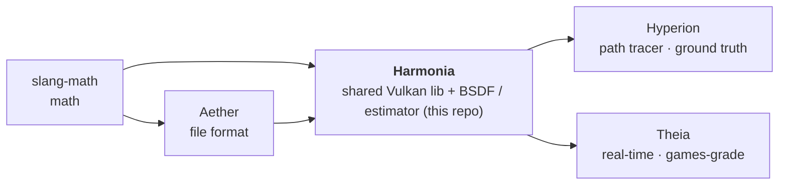

# PLAN — Harmonia

This file lists what is not done, what is a known limitation, what follows next, the
measured values a later change must not regress, and the release history. Finished work
is not tracked beyond the release list; the record of how it was verified is in `git log`
and in `RELEASE_NOTES.md`.

How the family is organized and what every repository contains is in [README.md](README.md).

## Contents

- 1 [Context](#1-context)
- 2 [At a glance](#2-at-a-glance)
- 3 [How to continue](#3-how-to-continue)
- 4 [Quality pillar](#4-quality-pillar) — OpenPBR conformance
- 5 [Performance pillar](#5-performance-pillar) — performance, denoising, interactivity,
  sampling, global illumination, research assessment, parity metrics, Vulkan capabilities
- 6 [Feature pillar](#6-feature-pillar) — node hierarchy, animation, bounding volumes,
  slang-math migration
- 7 [Parity methodology](#7-parity-methodology)
- 8 [Governance](#8-governance)
- 9 [Release history](#9-release-history)

## 1. Context

OpenPBR Surface 1.1.2 is the material standard of the family. Three libraries carry the
shared code: slang-math (mathematics), Aether (file formats and asset loaders) and
Harmonia (this repository: the shared Vulkan library, the OpenPBR BSDF and the path
estimator). Two renderers use them.

| Renderer | API and pipeline | Light transport | Role |
|----------|------------------|-----------------|------|
| Hyperion | Vulkan 1.4 ray-tracing pipeline | Unidirectional path tracing with next-event estimation, MIS, environment importance sampling and full random walks; specular manifold sampling | Offline reference. It defines the ground truth |
| Theia | Vulkan 1.4 mesh shaders and ray queries | Frame accumulation with the shared path integrator, ReSTIR path reuse, specular manifold sampling; denoiser and TAA in the interactive window only | Interactive renderer. It is checked against Hyperion |

**Goal.** Improve both renderers with current algorithms (SIGGRAPH 2025–26 and the
surrounding literature). A technique goes into the shared estimator and BSDF when both
renderers benefit, and into one renderer only where they genuinely differ.

The plans of the sibling repositories are `slang-math/PLAN.md`, `Aether/PLAN.md`,
`Hyperion/PLAN.md` and `Theia/PLAN.md` in the sibling checkouts.

## 2. At a glance

- **Current release:** v1.0.0 (2026-11-26), the stable baseline. The dependencies are
  pinned to the v1.0.0 tags of Aether and slang-math.
- **Implementation work:** two animation-scaling investigations from the dense-scene stress
  test are approved (section 5.1). Other work arrives as defects, as parity failures or from the
  external waits below.
- **Waiting on external releases:** the OpenPBR 1.2 specification (section 4) and a Slang
  compiler that can emit the next-generation shader-model extensions (section 5.8).

## 3. How to continue

Nothing in this repository waits on an implementation. New work comes from three
directions.

1. **A defect or a parity failure.** It is fixed at once, in the code that owns it. When
   an immediate fix is impossible (blocked by a refactoring, an upstream change or an
   unknown cause), the defect is recorded here with its reason and the next action.
   Deferring, classifying an input as unrealistic, or documenting first are not
   resolutions.
2. **An external wait that ends** (sections 4 and 5.8): the capability tables name the
   trigger that reopens each item.
3. **A technique from the research tracks** (sections 5.5 and 5.6). It is adopted only
   when it meets the adoption criterion and improves a measured value.

One tooling item is open in the family: dependency vulnerability scanning of the vcpkg
manifest (osv-scanner or Dependabot) is planned and not wired into the lint job.

### Rules for planning and for estimator work

- **Adoption criterion.** A technique may affect the converging path only when its
  contribution vanishes as the sample or frame count grows, or when it lives in a
  real-time-only layer that is bypassed in capture mode. Anything else is rejected from
  the converging path.
- **One slot, one technique.** Where several papers target the same slot, one is
  tracked and the others are dropped. No opt-in alternatives, no low-end tiers.
- **Measured before adopted.** A technique needs a measured benefit on the family's own
  scenes before it is kept. A technique that was measured and not adopted (section 5)
  is not tried again unless its revisit trigger fires.
- **The estimator is converted or reverted in one verified change.** A half-converted
  shared estimator leaves both renderers broken.
- **Before the first code change of an estimator feature**, record the baseline commit,
  the exact build, test and render commands, the numeric tolerances, the fixed seeds
  and the scope. Verify with kernel tests for solver arithmetic, independent analytic
  references for radiometry and ordinary scene captures for regression. The agreement
  of the two renderers is a consumer check, not an independent oracle.
- **Equal-time comparison.** A sampling improvement is claimed only when the error is
  lower at equal wall time. Wall times within the 5 percent timing tolerance count as a
  tie, and a tie is reported as a tie.
- **Galleries after an estimator change.** When the estimator or the BSDF changes, the
  README galleries of both renderers are rendered again. Each new image is compared
  with the committed one: it is byte-identical, pixel-identical, or it differs at
  speckle level with a mean difference of at most 0.07/255 per image (the last accepted
  refresh measured at most 0.0222/255).
- **Stop conditions** for estimator work: an analytic root or energy fails; ownership or
  support cannot be resolved; reciprocal tails are uncontrolled or the budget policy is
  biased; no independent reference exists; or the cost is impractical after the verified
  simple case. Then keep the last verified commit, record the evidence and present the
  blocker. The answer is never a clamp, a changed BSDF, a looser tolerance or a hidden
  failure.
- **Layering of new features.** A scene feature (hierarchy, animation, deformations)
  starts with the format and the evaluation in Aether; Harmonia conveys the evaluated
  data to the renderers (section 6).
- **Refactoring.** One technique per change, compiled and tested after each. The
  report-only indicators of `tools/check_arch.py` are the progress meter, and a source
  file of 1000 lines or more fails the check. The modules `harmonia` (the shared
  vocabulary) and `app` (the host) are hubs by design.
- **Excluded:** neural network techniques, which need training (section 5.6). Also a
  second rendering API or an interoperability layer (ANARI, code generation for other
  APIs): a second API would be the largest fallback of all. It is reopened only with a
  concrete consumer.
- **Optional tooling**, adopted when a need appears: fuzzing of Aether's parsers,
  Doxygen, a license scanner over vendored code, a Markdown style checker, a PowerShell
  script analyzer.

### Conventions of the quality tracks

- OpenPBR formulas and parameters are mandatory for every BSDF change. MaterialX is the
  reference implementation.
- Conformance to OpenPBR 1.1.2 is reached by implementing established algorithms and
  proven approximations. Verifying a single formula against MaterialX is not a work
  item; such drift shows up in the parity check.
- A newer technique replaces the older one; the old code is deleted, not kept alongside.
  Papers are reference links only; no PDF is redistributed
  ([papers/README.md](papers/README.md)).

## 4. Quality pillar

Physical correctness of the rendered image: conformance to OpenPBR, with Hyperion as the
ground truth and MaterialX as the cross-check, and the agreement of Theia with Hyperion
(section 7).

OpenPBR Surface 1.1.2 is implemented ([README: Material
model](README.md#material-model--openpbr-surface-v112)). No conformance item is open
except the following.

### OpenPBR 1.2 switch-over

The 1.2 specification is not released yet. The delta was read against the ASWF
versioning tool (OpenPBR pull request 307). The patch release 1.1.2 and the minor release
1.2 are separate steps.

| Change in 1.2 | Consequence for this library |
|--------------|------------------------------|
| Default of `emission_weight` and `emission_luminance` moves from 0 to 1000 (issue 231) | Parser default in Aether and the energy scale of emitters |
| `transmission_scatter` changes from a coefficient to an albedo (issue 286) | The formula for the scattering coefficient of both medium walks changes (`transmissionVolumeCoeffs`) |
| `specular_weight` is decoupled from refraction (issue 247) | Dielectric specular lobe |
| New `specular_haze` and `specular_haze_spread` dual-lobe distribution (issue 254) and `specular_retroreflectivity` (issue 255) | New lobes |
| Formula fixes deferred by policy: coat darkening (253), F82 clamps (238, 256), input clamps (277) | Not applied before 1.2 |

### Evaluated and not adopted

| Candidate | Reason |
|-----------|--------|
| Reservoir-based real-time subsurface layer | No measured subsurface defect: the random-walk BSSRDF is shared with Hyperion and `shaderball_subsurface` meets the limits (mean 32.9, SSIM 0.865) |
| Upgrade of the multiple-scattering Smith compensation | No measured defect; metals and coat meet the limits |
| Glint (sparkle) estimator | No measured glint defect and no glint assets |
| Re-checking single formulas against MaterialX (extinction and phase mapping, thin-walled lobe split, Smith masking function) | Belongs to the parity check; the masking function was verified to make no difference |

Worth knowing: bounded visible-normal sampling (Eto and Tokuyoshi 2023)
replaced an earlier port that was biased by up to 35 percent at grazing angles. It is
validated by importance-sampling consistency (the mean of f/p equals π inside the 95
percent confidence interval over 28 roughness and view configurations). The anisotropic
micrograin distribution (Lucas, Ribardière and Pacanowski 2024) is implemented in
`math.slang`.

### Known limitations

| Limitation | Measured state |
|-----------|----------------|
| `--deterministic-replay` and `--rng-debug` do nothing | Both are accepted and passed to the forward shaders of Theia as flag bits; no shader reads them. Hyperion repeats a run exactly without the flag; Theia does on most scenes, but not on every scene (see the known limitations of Theia's `PLAN.md`) |
| The 8-bit capture store is not exact round-to-nearest | On the reference GPU a display value flips to the next byte about 1/32 to 2/32 of a step above the rounding boundary (measured with a sweep across the boundaries). Below a tenth of a step, so invisible; `tests/integration/test_capture_glare.cpp` allows one step of 255 |
| The haze takes its in-scattered light from the environment map | The light is the map blurred to six degrees, the sun disc included. A sun disc with a physical radiance (about 1e5 times the sky) would make everything in its direction white where haze is present. The maps in use have their sun disc clipped to a few hundred times the sky, so the model is right for them and is not ready for a calibrated sun |
| The lens glare is not a lens model | A fixed 13-tap and tent chain with a level weight of 0.8: no ghosts, no anamorphic streak, no dependence on the aperture. Its strength and threshold are set per scene |
| An emitter that is not a light source is black in rough reflections | This follows from the definition of Aether's `emission_as_light_source = false`: visible only, it lights nothing. The shared emission guard adds the emission on a camera ray and after a perfect mirror bounce only. Measured on a probe scene (a 5000-nit panel over a glossy dark floor, one sampled emitter in the scene; Hyperion, 1024 samples per pixel, green channel): seen directly 0.203, reflected 0.000, where the same panel as a light source reflects 0.047. Whether specular lobes of any roughness should see such an emitter, and diffuse lobes never, is a decision about the meaning of the flag; the renderers would then carry it through BSDF sampling only, without next-event estimation for it |
| A `transmission_weight` of 0.5 or more is full transmission | OpenPBR mixes: the weight is the share of the transparent dielectric. `MaterialLibrary` flags a material as glass when its transmission weight is 0.5 or more and its metalness below 0.5, and `computeLobeWeights` then sets the transmission to 1 and drops the diffuse and the specular lobes. Below 0.5 the weight is honored. Aether's `shaderball_transmission` shows the sweep: its ball at 0.25 is a mixture, its balls at 0.5 and 0.75 are the same full glass. The rule dates from the first material library; a partial weight needs the Fresnel split of the glass path beside the opaque lobes |
| Every texture map is sampled at mip level 0 | No renderer derives a level from the ray footprint in a capture: Theia's material-LOD tier, which does, is on in the interactive window only. Fine tiling detail aliases at a distance and turns into variance. A large local test scene keeps its maps low in contrast and large in tile for that reason; a level chosen from the footprint would remove the limit |

## 5. Performance pillar

Frame time in the interactive renderer and convergence speed in the offline renderer.
Techniques that affect the estimator go into the shared estimator when both renderers
benefit.

### 5.1 Performance track

Two follow-ups from the 2026-11-27 dense-scene stress test are approved for investigation:

1. **One evaluated scene per animation instant.** Theia and Hyperion currently call
   `SceneAnimator::evaluateCamera()` and `SceneBase::setAnimationTime()` separately, so both
   evaluate the whole Aether scene. On the local 29,775-object scene the two intervals cost
   72–98 ms and 72–82 ms respectively. Consume one evaluated scene for camera and instances;
   the reusable/sparse evaluator itself is tracked in `Aether/PLAN.md`.
2. **Incremental instance synchronization and TLAS input.** `setAnimationTime()` stamps every
   renderer instance; Theia then rebuilds and uploads all transforms and world bounds, and the
   shared TLAS path recreates its instance upload and scratch buffers before a synchronous
   refit. Track changed instances and retain the buffers, after logging the synchronization and
   actual refit costs separately. The measured 13–23 ms interval currently combines both, so it
   is not yet evidence for a BLAS/TLAS algorithm change.

For scale, Harmonia `d44d55a` already removed repeated ticks inside an output frame: 256
accumulation frames over eight time samples now stamp eight times, not 256, and one output frame
takes 23 s including the 12 s scene load instead of 71 s. Every time sample keeps its instants
and accumulation weight.

**Reusability acceptance.** These changes are scene-independent: no production-scene names, mesh
names, hard-coded object counts or camera paths in the implementation, and no branch keyed to a
particular scene. Correctness means exactly the same evaluated instances and camera pose at each
instant and the same exposure weights. Prove that with deterministic regression tests and
scene-referred Theia/Hyperion EXR comparisons on an existing manifest scene and an independent
animated scene; the local pier scene is a consumer test, never an input to the renderer's design.

The table keeps the measurements that closed the removed techniques.

| Technique | Measurement | Revisit when |
|-----------|-------------|--------------|
| Software ray reordering | At most about 6 percent gain at interactive ray counts; the sort costs two orders of magnitude more than it saves. The hardware reordering of the GPU is used instead | The triggers of the wavefront row |
| Wavefront rendering (the path tracer split into stages) | The first stage measured about twice the cost of the GI pass at 320p and at 1080p, dominated by record traffic; the implementation was reverted | Production scenes with millions of triangles, a new GPU or driver generation, or workloads bound by tracing above 1 ms per million rays |
| Multi-node ray forwarding | Out of purpose: both renderers are single-GPU and local | A multi-GPU or multi-node renderer is adopted |
| Importance-driven acceleration-structure updates | No premise: there is no schedule of per-instance updates to prioritize | — |

The ray reorder probe (`tests/component/test_perf4_reorder_probe.cpp` with
`shaders/perf4_probe.rgen.slang`) stays as the measurement rig for the first row.

In use: the acceleration-structure pipeline (TLAS refit versus rebuild with a periodic
rebuild, and compaction) and material level of detail by ray class (Theia, interactive
only).

### 5.2 Denoising and reconstruction

The shared denoiser is an à-trous filter with a fixed pixel radius. It does not converge
with the sample count, so it is kept off the capture path
([README: Presentation stages](README.md#presentation-stages-and-the-two-tier-output-contract)).
`tools/test_denoiser_contract.py` checks the rule: it renders with and without the
denoiser and requires identical captures.

The pass also contains the converging blend of Denisova et al. (I3D 2024). It estimates
the error of the denoised pixel (SURE, with one perturbed re-filtering), derives a
per-pixel weight from the convergence curve through the last two variance estimates (with
a 1/N fallback), and blends between the denoised and the accumulated input. It engages
from 16 samples and approaches the unfiltered image as the sample count grows.

**Known limitation.** The converging blend is reachable only through the pass setting
`convergingMode`. No command-line flag enables it and neither application turns it on,
so the interactive window uses the constant-weight blend.

**Possible next steps** (not planned): a command-line flag for the converging blend;
the switch to a magnitude strategy when the mean variance falls below the mean SURE
(the paper marks it as unproven); smoothing of the SURE image.

**Not adopted:** NRD as a replacement (a third-party dependency without a measured
defect).

**Measured values** (Rel-MSE against the matching high-sample reference; reproduce
with the test and the script described in [tools/README.md](tools/README.md)):

| Measurement | Value |
|-------------|-------|
| Synthetic pattern, constant-weight blend → converging blend, at 256 samples | 0.0034 → 0.0008 |
| Synthetic pattern, at 4096 samples | 0.0036 → 0.0002 |
| `dragon_teapot`: raw Rel-MSE slope against the sample count (log-log) | −1.024 (theory −1.0) |
| `dragon_teapot`: largest ratio constant-weight / raw at 256 or 1024 samples | 1.443 |
| `dragon_teapot`: constant-weight blend at 4096 samples → converging blend | 2.151e-4 → 2.493e-6 |
| `cornell_classic`: raw slope | −1.057 |
| `cornell_classic`: largest ratio constant-weight / raw | 1.374 |
| `cornell_classic`: constant-weight blend at 4096 samples → converging blend | 6.203e-5 → 2.066e-7 |

Converging blend divided by raw, per sample count:

| Scene | 16 | 64 | 256 | 1024 |
|-------|----|----|-----|------|
| `dragon_teapot` | 1.000 | 0.934 | 0.924 | 0.949 |
| `cornell_classic` | 1.000 | 0.955 | 0.962 | 0.965 |

At 16 samples the converging blend equals raw because there is no previous sample count
to estimate a variance from. The remaining error of the constant-weight blend is a
low-frequency history bias, not a loss of detail: its gradient energy at 4096 samples is
0.998 and 1.0005 times that of the reference.

### 5.3 Interactivity track

No item is open. Two follow-ups remain possible and are not planned:

- Presentation at a target time with `VK_EXT_present_timing`. Only the timing query is
  used; the scheduling feature bits are not enabled.
- The rebuild half of a window resize still waits for the whole device to become idle.
  Relaxing it needs a synchronization contract for the renderer's `onResize`.

Present scaling (`VK_KHR_swapchain_maintenance1`) is not used: the reference GPU
reported no scaling mode.

### 5.4 Sampling track

No item is open. Owen-scrambled Sobol' is the single low-discrepancy sequence of the
library; no deficiency was measured (every scene of the manifest passes). The guiding slot is
unassigned (section 5.5).

### 5.5 Global illumination track

The ReSTIR path reuse of Theia is described in the Theia plan. This repository holds
the shared parts.

- `shaders/path_integrator.slang` carries capture hooks for the path reservoir
  (`NeeEventCapture`, `ReconnectionCapture` and `PathState.captureRe`). They only
  observe; a consumer that leaves `captureRe` at 0 sees no change of the random stream.
- Specular manifold sampling is described in [README: Shared
  shaders](README.md#shared-shaders).

**Measured values for specular manifold sampling** (Theia, on its test scenes):

| Measurement | Value |
|-------------|-------|
| Pooled-energy bias at 8192 frames (limit 2 percent) | 0.15 to 1.2 percent |
| Equal-time MSE on absorption-prefix chains with reuse | 2.5 times better than without |
| Frame-time cost of reuse | about 5 percent |
| Complex dragon and teapot scene: reuse against local-only at 8 s wall time | a tie (0.27 percent, 0.007 standard errors) |
| Same scene, plain path tracing against SMS at 2 s wall time | 26 times lower MSE for plain path tracing; SMS costs 6.4 times more per frame there |

The last two rows say that sampling effort spent on manifold paths does not pay on a
scene whose content is not a caustic regime.

**Evaluated and not adopted** (measured in Theia; recorded here because the decision was
made for the family):

| Candidate | Reason |
|-----------|--------|
| Path guiding with reservoirs | Met the parity limits after a bias fix, but measured flat to negative: farther from the reference when on (2.1, 4.6 and 2.5 percent at 2, 8 and 256 frames), with a worse variance proxy (2.788 against 2.948) |
| Control variates over neighbor and frame differences (ReSTCV) | Cannot be unbiased here: the reference implementation requires pairwise MIS, which Theia does not use, and its temporal part re-selects history |
| World-space light grids for secondary hits | No premise: secondary next-event estimation already uses the global power-proportional selection, and the scenes have few emitters |
| Gradient-domain reconstruction over ReSTIR paths | Watchlist |

In use in Theia: the world-space radiance cache (non-neural, interactive only) and
compatibility-guided neighbor selection.

Ideas without a plan (Theia): the BASIC estimator of RTXDI for the direct-light
reservoir, and tracing the visibility of merged temporal and spatial donors.

### 5.6 Research assessment

Papers are collected for the two active goals, quality (OpenPBR conformance and the
agreement of the two renderers) and speed, across all tracks. Anything outside these
goals (other APIs, code generators, lobes beyond OpenPBR 1.1.2) is parked.

The adoption criterion and the one-slot rule are in section 3. The slot assignments:

| Slot | Technique |
|------|-----------|
| Caustics | Specular manifold sampling |
| Denoiser convergence | The converging blend |
| Low-discrepancy sequence | Owen-scrambled Sobol' |
| Guiding | Unassigned (path guiding was removed) |
| Multiple-scattering Smith compensation | Unassigned |

**Decided conflicts:**

- ReSTIR direct illumination is absorbed by ReSTIR path tracing; the two are mutually
  exclusive and the code enforces it.
- Neural and learned techniques are excluded from the whole family (quality metrics,
  denoising, sampling, global illumination, inference): they carry a risk of bias that
  cannot be reduced and would move Theia away from Hyperion. This is not revisited.
- The denoiser is a presentation stage and is identity in a capture.
- The library carries exactly one low-discrepancy sequence.
- NVIDIA-authored techniques publish CUDA or TensorRT reference implementations. They
  are re-implemented for Vulkan compute and ray queries, without vendor extensions and
  without CUDA. Their code is an algorithm reference, never a dependency.

The individual rendering papers of SIGGRAPH 2026 are assessed once the Transactions on
Graphics issue and the ACM Open Access archive are indexed.

### 5.7 Parity-metric track

The compared metrics and the reported ones are implemented in `tools/compare_renders.py`
and tested by `tools/test_compare_metrics.py` (ctest `test_compare_metrics`). The
sequence comparison is `tools/compare_sequences.py`, tested by
`tools/test_compare_sequences.py` (ctest `test_compare_sequences`). Learned video metrics
are excluded with all neural techniques.

**Measured values** of `tools/check_consistency.py` on captures (denoiser off, no
clamps):

| Scene | Finding |
|-------|---------|
| `cornell_classic` | Pairwise ratio 0.504 (the expected 1/√N); bias floor 1.84 ≤ 4.0 (Theia at 1024 frames against Hyperion at 1024 samples) |
| `openpbr_metals` | Variance rate 0.674, in band; bias floor 27.9, above the limit |

The `openpbr_metals` number does not show a defect: at 1024 samples the sun-lit
environment reference is itself firefly-noisy. A bias-floor reading on a sun or
environment lit scene needs a converged reference (far more than 1024 samples) or a
fixture with a controlled sun strength.

Possible, not planned: FLIP and HDR-FLIP as heavier perceptual checks.

### 5.8 Vulkan capability adoption

**Grounding.** The development GPU is an NVIDIA RTX 5070. With driver 621.40 and SDK
1.4.363.1 (Slang 2026.17) it reports 295 device extensions, 230 of them KHR or EXT, and
158 KHR/EXT names that no document mentions. `tools/check_vk_extensions.py` compares the
driver's inventory with every KHR and EXT name written here and in `AGENTS.md`; the last
run found every doc-named extension present. Vendor extensions (`VK_NV_*`) are outside
the cross-vendor policy and are never candidates. A new SDK brings a new shader compiler:
rebuild all three repositories and run the test suites before adopting anything.

**Adopted capabilities** are listed in [README: Device layer](README.md#device-layer).

**Standing priority.** Every release carries at least one replacement of a legacy API by
a modern one, or the adoption of a verified-present capability, as long as the
development hardware supports it.

**Available is not a candidate.** Admission needs a consumer in the family and a
measured need.

| Capability | Status | Revisit trigger |
|------------|--------|-----------------|
| `VK_EXT_descriptor_heap` | Stay on `VK_EXT_descriptor_buffer` | A `descriptor_buffer` limitation blocks an item; it reaches KHR or core with validation and Slang support (still EXT-only in SDK 1.4.363); a measured performance difference |
| `VK_KHR_unified_image_layouts` | Watchlist | The pass graph grows complex, transition cost shows in timings, or the extension reaches core |
| `VK_KHR_shader_untyped_pointers`, `VK_EXT_shader_replicated_composites`, `VK_EXT_shader_64bit_indexing`, `VK_EXT_shader_long_vector` (next-generation shader model) | Gated on Slang: the 2026.17 compiler exposes none of them | Re-run `tools/check_slang_ngsm.py` on every SDK release; a consumer |
| `VK_KHR_fragment_shading_rate` | Watchlist | A profile blames fragment shading time in Theia's forward pass |
| `VK_KHR_shader_subgroup_rotate` | Enabled; no shader uses it | Slang exposes a rotate intrinsic |
| `VK_KHR_shader_maximal_reconvergence`, `VK_KHR_shader_subgroup_uniform_control_flow`, `VK_KHR_shader_quad_control` | Enabled; no shader relies on them | A consumer |
| Present scheduling with `VK_EXT_present_timing` | Timing query only | Section 5.3 |
| Ray-tracing pipeline binaries in the pipeline binary cache | Created normally when the driver returns no usable key (observed on driver 621.14) | A driver that returns a usable key |
| `VK_KHR_compute_shader_derivatives` | Not adopted | A consumer |
| `VK_KHR_maintenance7` up to maintenance 11 | Nothing actionable (specification clarifications); enabled automatically when advertised | — |
| `VK_EXT_nested_command_buffer` | Watch only: there is no secondary command buffer to replace | — |
| Shader module identifiers | Dropped: modules are transient and their identity rides with the pipeline binary key | A cold-start profile that blames SPIR-V upload |
| `VK_EXT_shader_object` | No: the pipeline binary cache removed the cold-start cost (90.7 ms → about 0.1 ms) | — |
| Mixed precision: `VK_KHR_shader_bfloat16`, `VK_EXT_shader_float8`, `VK_KHR_shader_float16_int8`, `VK_KHR_cooperative_matrix` with `VK_EXT_cooperative_matrix_maintenance1` | No: the renderers are fp32 scene-referred by contract and no kernel has a tensor shape | — |
| `VK_KHR_video_*` | No consumer: captures are frames, encoded by `frames_to_video.py` | — |
| `VK_EXT_descriptor_indexing` | Subsumed: core since Vulkan 1.2 | — |
| NVIDIA ray tracing validation (`VK_NV_ray_tracing_validation`) | Rejected: a vendor extension | A KHR or EXT equivalent, or an explicit exception for a probe that is never released |

**Probe results of `tools/check_slang_ngsm.py`** (slangc 2026.17, re-run on SDK 1.4.363.1):
`vector<uint, 64>` is rejected (error E38206, invalid element count); `Ptr<T>` is
undefined (E30015); C-style local pointers, composite copies and 64-bit indexing
compile but emit only the core capabilities (`Shader`, `Int64`). The SPIR-V capabilities
of the four extensions never appear.

**Names that were renamed or promoted.** The code uses the current name in each case.

| Older name | Current name |
|-----------|---------------|
| `VK_EXT_opacity_micromap` | `VK_KHR_opacity_micromap` (micromaps became acceleration structures) |
| `VK_EXT_host_image_copy` | Vulkan 1.4 core feature `hostImageCopy` |
| `VK_EXT_swapchain_maintenance1` | `VK_KHR_swapchain_maintenance1` |
| `VK_EXT_present_mode_fifo_latest_ready` | `VK_KHR_present_mode_fifo_latest_ready` |
| `VK_KHR_buffer_device_address`, `VK_EXT_buffer_device_address` | Vulkan 1.2 core feature `bufferDeviceAddress` |
| `VK_KHR_dynamic_rendering`, `VK_KHR_synchronization2` | Vulkan 1.3 core features |
| `VK_KHR_device_fault` | The SDK's promotion alias of `VK_EXT_device_fault`; the probe enables the EXT name |
| `VK_EXT_debug_utils` | An instance extension; it is not a device extension |

## 6. Feature pillar

What a scene can represent beyond the core estimator: structure, animation and bounding
volumes. None of these changes the estimator. The format side is planned in
`Aether/PLAN.md`, the render-loop side in `Theia/PLAN.md` and `Hyperion/PLAN.md`.

### 6.1 Node hierarchy

Not a Harmonia task. The renderers always receive a flat list of world-space instances.
The node graph, the compounding of transforms and instanced subtrees are evaluated in
the Aether loader; Harmonia never walks a node tree. The earlier idea of compounding
transforms here was dropped.

### 6.2 Animation

The same division: Aether evaluates the node graph and the animation curves and produces
world-transform updates per instance. Harmonia conveys them as data, and each renderer
decides how to apply an update (TLAS refit or rebuild, motion vectors, scheduling).
Hyperion renders a sequence offline; Theia updates every frame.

Harmonia's parts: the loader keeps the parsed scene for scenes with tracks, skins or
morph targets; `SceneBase::setAnimationTime` stamps the evaluated transforms onto the
instances; `DeformPass` applies morph targets and skinning on the GPU; the shared
animation clock drives the capture flags; `CameraAssembly` places a camera that is bound
to a node; and the sequence capture integrates motion blur with a shutter
(`--shutter`, `--time-samples`, see [README: Animation
capture](README.md#animation-capture)): the clock places each accumulation frame of an
output frame at its own time inside the exposure, and the capture, not the renderer,
owns the restart of the accumulation. A shuttered capture agrees with the reference
within the parity limits on the Aether scene `motion_blur` (shuttered against shuttered:
SSIM 0.82, luminance-histogram correlation 0.81; sharp against shuttered fails both).
No item is open.

### 6.3 Bounding volumes

A mesh can carry an authored object-space bounding box (`bounds` in the scene file,
produced by Aether's `tools/obj_bounds.py`). The loader gives every sub-mesh of the mesh
this box as a conservative bound, and Theia uses it for culling. The consumer in the path
tracer was dropped with the wavefront rendering (section 5.1); it is revisited only with
a wavefront revival.

### 6.4 slang-math migration

Complete. This tree has no hand-written clamp-to-unit-range calls, no duplicate π
constants and no per-component vector trigonometry that a slang-math function could
replace. Scalar `std::` trigonometry on scalars stays as it is.

## 7. Parity methodology

The method, the contract and the limits are described in [README: Parity
methodology](README.md#parity-methodology). This section records how the limits were
measured.

**Method.** Two sets of renders are measured at the budget (320 × 240, 256 samples
against 256 frames):

1. The clean envelope: fresh Theia renders against their Hyperion references, over the
   14 manifest scenes.
2. The "completely different" anchors: pairs of different scenes, an inverted image and
   an image with twice the exposure.

Each limit was placed strictly between the two sets.

| Metric | Clean envelope | Completely different | Limit |
|--------|----------------|----------------------|-------|
| `mean_diff` | ≤ 98.8 | Different scenes ≥ 240.4; inverted 240.7; twice the exposure 133.9 | 120 |
| Rel-MSE | ≤ 174.9 | Different scenes ≥ 27.0; inverted 37.6 | 250 |
| SSIM | ≥ 0.706 | Different scenes ≤ 0.195; inverted 0.098 | 0.6 |
| Luminance-histogram correlation | ≥ 0.869 | Different scenes ≤ 0.117; inverted 0.096 | 0.8 |

Negative controls: an image compared with itself passes; an inverted image and an image
with twice the exposure fail.

**Why the limits cannot be tighter at this budget.** Two independent Theia renders of
the same scene with 256 frames score 0.8206 (SSIM) and 3.558 (`mean_diff`) against each
other; Theia against Hyperion scores 0.8283. Both renderers improve with the square
root of the sample count at the same rate, so the remaining difference is noise.

**Rel-MSE** is dominated by fireflies on glass at this budget. Its limit is a guard
against gross errors; the other three metrics carry the separation.

**Known limitation.** All four metrics are based on luminance. A change that swaps color
channels and keeps the luminance (`mean_diff` 4.7, SSIM 0.79) passes every limit.

**Sequences.** `tools/compare_sequences.py` applies the same limits to every frame pair
of a sequence. On a four-frame animated Cornell sequence the worst frame has an SSIM of
0.886.

Multi-frame Theia captures repeat pixel for pixel between runs, so the bias-versus-noise
check can compare against saved references.

The limits belong to the budget. When the resolution, the samples or the frame count
change, both sets are measured again.

## 8. Governance

### Definition of done

A change is not done until the build is free of warnings and a representative run
produces no validation message.

- **Warning-free build.** All repositories compile with warnings as errors
  (`/W4 /WX /permissive- /fp:strict` with clang-cl, `-Wall -Wextra -Werror -Wpedantic`
  with Clang or GCC, see `cmake/Platform.cmake`). A warning is a build failure; it is
  fixed, not silenced. When a suppression is unavoidable, its reason is written at the
  pragma and named in the commit.
- **Validation-free run.** Every run, headless or in the window, uses the validation
  layers and produces no validation message. Validation surfaces do not depend on the
  sample count, so a small resolution is enough to find them.
- **Per change:** `ctest` passes in each changed repository, a representative headless
  render is free of validation messages, the build is free of warnings.
- **Per release:** the above, plus `verify-full` (build, tests, formatting check,
  clang-tidy, cppcheck), the parity comparison over the manifest
  (`tools/render_and_validate.py` with `tools/validation_manifest.toml`),
  `tools/check_vulkan_validation.py` over both renderers' complete galleries, and
  regenerated screenshots.

**Screenshot gallery** (the PNGs in each renderer's README): 1280 × 720, Hyperion with
64 samples per pixel (fireflies accepted; 256 is too slow for the full set), Theia with
256 frames. **Parity references** are different: a clean Hyperion EXR with 256 samples at
the 320 × 240 parity resolution.

### Guardrails

The rules are stated in [README: Conventions](README.md#conventions) and in
[AGENTS.md](AGENTS.md). The ones that decide roadmap items:

- Hyperion is unbiased in the estimator: no clamp in the render path. The only clamp is
  a neighborhood soft-clamp in the display path, which never reaches the captured EXR.
- The denoiser is a presentation stage. It is not re-enabled on the capture path and is
  not described as converging.
- Theia's path reservoir has no temporal merge. A merge of re-selected history measured
  2.8 percent darker on the indirect light of the Cornell scene at 1024 frames and
  cannot be repaired with a cap on the sample count. Spatial reuse reads the unmerged
  local reservoirs; accumulation integrates over time.
- A technique on the converging path must meet the adoption criterion (section 3).
- The device layer has no fallback for a required feature. An optional capability is
  enabled only when its absence gives the same image.
- Assets come from the fetched copy of Aether. Editing a file in an Aether working tree
  has no effect on a render until the renderer is configured with
  `-DFETCHCONTENT_SOURCE_DIR_AETHER=<path>` or the pin is bumped. Two "different" renders
  with identical metrics are the symptom.
- A reference with few samples is noisy. Environment-lit scenes are compared against a
  Hyperion reference with enough samples.

### Releases

- Commit in each repository separately. Push only when asked.
- Release tags are always pushed, so that GitHub shows the released state. After tagging,
  `git ls-remote --tags origin` must list the same tags as `git tag -l`.
- Release order follows the dependency direction: slang-math, Aether, Harmonia, then
  Theia and Hyperion. Each downstream repository bumps its `FetchContent` `GIT_TAG` pin in
  its own release commit.
- A release is published on GitHub Releases once the CI build has passed on Windows and
  on Linux.
- A renderer rebuild must recompile the shader binaries when a shared Harmonia shader
  changed: the entry shaders depend on the modules listed in the compile rule.
- This is a living document: finished work is removed from the work lists. When the last
  item of a track is done, the track becomes a one-line note.

## 9. Release history

Newest first. The verification numbers of the latest releases are in
[RELEASE_NOTES.md](RELEASE_NOTES.md); everything older is in `git log`.

| Version | Date | What it contains |
|---------|------|------------------|
| Unreleased | — | Motion blur in sequence captures (`--shutter`, `--time-samples`). Scene assets resolve against the scene's directory first, `--scene` accepts a path inside the assets directory, and a sub-mesh is bound by its `usemtl` name (a Blender export with several materials per object). Each pipeline has its own entry in the pipeline binary cache. The validation gate also fails on application warnings, which its pattern did not match. Distance haze of a scene (`[haze]` in Aether; the shared module `haze.slang` applies it in both renderers). Lens glare as a presentation stage (`--glare`, `--glare-threshold`; in the PNG of a capture, never in its EXR), with component and capture tests against a double-precision reference. The validation gate also captures with the glare. The tangent frame of the anisotropy is the tangent of the texture coordinates, as the reference implementation of OpenPBR binds it (before: a frame built from the normal alone, and a coat that inherited a base tangent map), with a shader test that pins the frame and one that measures the direction of the stretch. A shuttered output frame accumulates its frames grouped by time sample, so the scene is given a new time once per time sample and not once per accumulation frame: on 110,000 draw instances an output frame of 256 accumulation frames over 8 time samples takes 10 s instead of 57 s, with the same instants and the same share of frames per instant |
| v1.0.0 | 2026-11-26 | Stable baseline. Family-wide review; removal of deterministic analyzer findings; Aether declared as an external include boundary; strict documentation-reference checks. Pins: Aether and slang-math v1.0.0 |
| v0.12.0 | 2026-11-24 | Shared scene-camera assembly (`renderer::CameraAssembly`) for both renderers. Pins: Aether and slang-math v0.12.0 |
| v0.11.0 | 2026-11-23 | Documentation and roadmap aligned with the code; static-analysis repairs in the host and the animation mapping. Pins: Aether and slang-math v0.11.0 |
| v0.10.0 | 2026-11-20 | Camera-presence contract enforced in the scene loader; specular manifold sampling report complete (variance, stability, equal-time comparison, both galleries); vendored `check_arch` 1.5.1. Pins: Aether and slang-math v0.10.0 |
| v0.9.0 | 2026-11-16 | Skinning (linear blend and dual quaternion) and morph targets end to end (`DeformPass`); camera bound to a node and frame seek (`--frame`); time-based capture (`--capture-every-ms`, `--start-seconds`) with one animation clock; `frames_to_video.py`; parity limits recalibrated to the noise floor. Pins: Aether v0.9.0, slang-math v0.8.0 |
| v0.7.23 | 2026-11-07 | Pipeline binary cache (`VK_KHR_pipeline_binary`) |
| v0.7.22 | 2026-11-06 | Converging denoiser blend in the shared pass; capability surface extracted to `vulkan_init/Capabilities` |
| v0.7.21 | 2026-11-06 | Memory budget, present-timing telemetry, subgroup capability set with the compaction micro-benchmark |
| v0.7.20 | 2026-11-05 | Specular manifold sampling: resumable SMS pass, reservoir format, shared compute support |
| v0.7.19 | 2026-11-03 | Rendering correctness: discrete events no longer expose continuous densities; an accumulation stage that is requested but unavailable stops the scene load; retirement of frame slots, swapchain and images before reuse |
| v0.7.18, v0.7.17 | 2026-10-30 | slang-math pin updates |
| v0.7.16 | 2026-10-27 | Device-lost forensics (`VK_EXT_device_fault`, `VK_EXT_device_address_binding_report`) |
| v0.7.15 | 2026-10-17 | Fail-fast guards at the color-space seams. Pin: Aether v0.7.8 |
| v0.7.14 | 2026-10-16 | Layered CMake targets; the scene module is free of ray-tracing code (new `scene_rt` module); coverage lane |
| v0.7.13 | 2026-10-15 | Architecture check hardened (namespace check, file-level cycles, renderer isolation); `Xform` renamed to `Transform` |
| v0.7.12 | 2026-10-11 | Layering: the `rt` module and the layered namespaces |
| v0.7.11 | 2026-10-10 | Opacity micromap on the KHR acceleration-structure API |
| v0.7.10 | 2026-10-09 | CI on Windows and Linux; refactoring (denoiser parameter objects, shared host image upload, scene loader phases); `--frames-per-flip`; two validation fixes |
| v0.7.9 | 2026-09-26 | Bounded visible-normal sampling fixed (the earlier port was up to 35 percent biased); descriptor buffers with null descriptors; background priority for captures; anisotropic micrograin distribution |
| v0.7.8 | 2026-09-23 | `shaderDemoteToHelperInvocation` enabled; OpenPBR 1.1.1 conformance refresh; render presets; `tools/check_tidy.py`; sanitizer option |
| v0.7.7 | 2026-08-02 | Opacity micromap with the OpenPBR `geometry_opacity` presence weight and transparent shadows |
| v0.7.6 | 2026-08-02 | Pageable device-local memory; calibrated timestamps; host image copy; present pacing extensions |
| v0.7.5 | 2026-08-01 | Parity limits (Rel-MSE, SSIM, histogram correlation; manifest 3 → 14 scenes); `--no-postfx`; denoiser contract test |
| v0.7.4 | 2026-07-30 | Two-tier denoiser output contract |
| v0.7.3 | 2026-07-29 | Refactoring: RAII Vulkan handles, extracted classes, namespace consistency. No change of the rendered image |
| v0.7.2 | 2026-07-29 | Function extraction, shared helpers, latent bug fixes. No change of the rendered image |
| v0.7.1, v0.7.0 | 2026-07-26, 2026-07-25 | OpenPBR conformance work |
