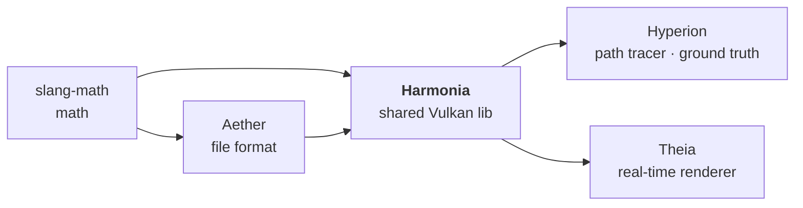
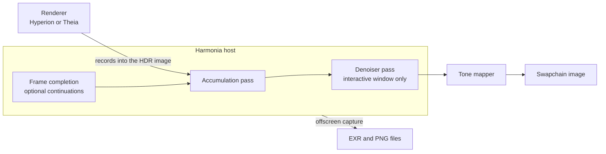

# Harmonia

[](https://github.com/McNopper/Harmonia/actions/workflows/build.yml)

The shared Vulkan foundation for the [Hyperion](https://github.com/McNopper/Hyperion)
(offline path tracer) and [Theia](https://github.com/McNopper/Theia) (real-time path
tracer) renderers. It holds everything the two renderers need except the renderer
itself and the [Aether](https://github.com/McNopper/Aether) file format: the application
host, scene loading, the OpenPBR material model and path-integration shaders, tone
mapping and presentation, and the tools that compare the two renderers.

> *[Harmonia](https://en.wikipedia.org/wiki/Harmonia) is the Greek goddess of harmony
> and concord, who reconciles opposing forces into a unified whole.* The library unifies
> the two renderers on one foundation: Vulkan core, GPU scene upload, color management,
> tonemapping and SDR/HDR presentation.



The repositories live next to each other, and each dependency points to the left:
slang-math is used by Aether and Harmonia, Aether by Harmonia, Harmonia by both
renderers. The renderers never depend on each other.

## Contents

- [Scope](#scope)
- [Repository layout](#repository-layout)
- [How a frame is rendered](#how-a-frame-is-rendered)
- [Command-line flags](#command-line-flags)
- [Scene loading](#scene-loading)
- [Material model — OpenPBR Surface v1.1.2](#material-model--openpbr-surface-v112)
- [Shared shaders](#shared-shaders)
- [Denoiser stage and the two-tier output contract](#denoiser-stage-and-the-two-tier-output-contract)
- [Device layer](#device-layer)
- [Parity methodology](#parity-methodology)
- [Testing](#testing)
- [Building](#building)
- [Consuming Harmonia](#consuming-harmonia)
- [Conventions](#conventions)
- [Where to read more](#where-to-read-more)
- [Dependencies](#dependencies)
- [References](#references)

## Scope

| Area | What it contains |
|------|-----------------|
| Application host | `harmonia::app::App`: window, swapchain, HDR render target, tone-map and present loop, scene loading, offscreen capture. A renderer plugs in through `harmonia::app::IRenderer` |
| Vulkan core | Context and device creation, capability probes, buffers, images, command pools, barriers, shader modules, logging |
| Shared GPU types | `GpuVertex`, `GpuMaterial`, `GpuLight`, `GpuEmissiveTriangle`, `CameraData`, `PushConstants` and the `Tonemapper` / `LightType` enumerations |
| Scene | Loader, material library, textures, procedural geometry, IBL probe, lights, per-frame vertex deformation |
| Ray-tracing scene state | Acceleration structures, opacity micromaps, TLAS build and refit, emissive-triangle collection |
| Render passes | Accumulation, denoiser, specular manifold sampling (SMS), tone mapping |
| Color management and tone mapping | Linear Rec.2020 (default) or Rec.709 working color space; ACES, AgX, Reinhard, Hable |
| Presentation | Swapchain with SDR, Display P3, scRGB, HDR10 and HLG output |
| Shared Slang modules | The OpenPBR BSDF, the path integrator, the medium walk, environment-map sampling, RNG and math helpers |
| Image I/O | PNG and JPEG loading, EXR loading and saving with chromaticities (OpenImageIO) |
| Tools | The comparison, validation and analysis scripts in `tools/` |

Harmonia does not contain a renderer or a renderer's GPU scene. Hyperion's scene is
built around index buffers and a ray-tracing pipeline, Theia's around meshlets and mesh
shaders; each carries its own `Scene` and instance layout. The two applications are
thin subclasses of `harmonia::app::App` that inject their renderer. Only code that both
renderers use identically lives here.

## Repository layout

| Path | Content |
|------|---------|
| `src/harmonia/` | The shared vocabulary: `DeviceContext.hpp`, `GpuTypes.hpp` |
| `src/harmonia/utils/` | Color spaces, tone mapping, math helpers, RNG, output color space |
| `src/harmonia/core/` | Buffers, images, command pools, barriers, shader modules, descriptor-buffer writer, host image upload, logger, pipeline binary cache |
| `src/harmonia/vulkan_init/` | Instance, validation layer, physical-device selection, device creation, capability probes, debug utilities, device-fault reporting |
| `src/harmonia/rt/` | Acceleration structures, TLAS builder, opacity micromaps |
| `src/harmonia/scene/` | Scene loader, material library, textures, meshes, geometry, lights, IBL probe, procedural geometry, deformation pass |
| `src/harmonia/scene_rt/` | The ray-tracing side of a scene: triangle meshes, analytic spheres, TLAS build, refit and update policy, emissive triangles |
| `src/harmonia/renderer/` | Camera, camera assembly, shared descriptors, ray-tracing pipeline helper |
| `src/harmonia/pipeline/` | Render-pass interface, accumulation pass, denoiser pass, SMS pass |
| `src/harmonia/presentation/` | Swapchain, tone mapper, image capture |
| `src/harmonia/app/` | Application host, CLI parser and configuration, offscreen capture, frame synchronization, frame completion |
| `shaders/` | Shared Slang modules and the entry shaders Harmonia compiles |
| `tools/` | Comparison, validation and analysis tools; see [tools/README.md](tools/README.md) |
| `tests/` | Unit, component and integration tests; the SMS fixtures are in `tests/assets/sms` |
| `cmake/` | Platform flags, Vulkan SDK discovery, the Slang compile rule |
| `papers/` | Links to the papers behind the implemented techniques |

The directories form a layer stack. An include may only point to a lower layer and only
along a declared dependency; [ARCHITECTURE.md](ARCHITECTURE.md) is the checked contract.

## How a frame is rendered



1. **Start-up** (`App::run`). The host creates an SDL window (hidden when `--output`
   is set), the Vulkan context with the validation layers on by default, the pipeline
   binary cache, a command pool, the swapchain, the HDR image (`RGBA32F`, scene-referred
   linear values in the working color space), the tone mapper and the frame
   synchronization. It then calls the renderer's `onInitialize()`, loads the scene and
   starts the offscreen capture or the interactive loop.
2. **Scene load** (`App::loadScene`). Described under [Scene loading](#scene-loading).
3. **Render** (`App::renderSceneReferred`). The renderer records its commands into the
   HDR image and leaves it in `VK_IMAGE_LAYOUT_GENERAL`. When the renderer needs more
   than one GPU submission for a frame, it provides a frame-completion adapter: the
   host submits the first part, waits for it and records the continuations until the
   adapter reports that the frame is ready. Only completion and error status are read
   back; workgroup counts stay on the GPU. Then the scene stages run: accumulation
   (a running average over the frames) and, in the interactive window, the denoiser.
4. **Present** (`App::presentFrame`). The tone mapper converts the denoised image, or
   the HDR image when the denoiser is off, into the swapchain's color space and the
   image is presented. The shared order inside a frame is: renderer, scene stages,
   tone map. A resize recreates the swapchain, the images, the passes and the renderer's
   resources.
5. **Capture** (`App::renderOffscreen`). Described under
   [Offscreen capture](#offscreen-capture).

## Command-line flags

Both renderers parse their command line with `CliParser::applyCommonArg` in
`src/harmonia/app/CliParser.cpp`, so every flag below works in Hyperion and in Theia.
Each renderer adds its own flags: Hyperion has `--spp` and `--depth`, Theia has its
renderer switches (for example `--sms-mode`, `--no-restir-pt`, `--no-taa`). An
argument that does not start with a dash also names the scene. A flag that neither
Harmonia nor the renderer knows stops the program with an error (exit code 2).

The defaults are the values of `AppConfig` in `src/harmonia/app/AppConfig.hpp`. The two
renderer applications set the window to 1024 by 768 pixels.

### Scene, output and resolution

| Flag | Default | Effect |
|------|---------|--------|
| `--scene <path>`, `-s <path>` | `cornell_classic` | The scene to load. The path is resolved as described under [Scene loading](#scene-loading) |
| `<path>` (argument without a flag) | | Also names the scene; the last one given wins |
| `--output <file>`, `-o <file>` | none | Headless capture: no window is shown, the image is rendered, written to the file and the program exits. See [Offscreen capture](#offscreen-capture). There is no `--offscreen` flag |
| `--width <n>` | 1920 | Width of the window and of the rendered image, in pixels. A value below 1, or one that does not parse, becomes 1 |
| `--height <n>` | 1080 | Height, handled like the width |
| `--validation` | on | Enable the Vulkan validation layers (the default). Context creation fails when `VK_LAYER_KHRONOS_validation` is not installed |
| `--no-validation` | | Disable the validation layers. The validation layers stay on for every test, tool and parity run; this flag exists for interactive use on a machine without the layer |

### Offscreen capture

These flags take effect together with `--output`.

| Flag | Default | Effect |
|------|---------|--------|
| `--offscreen-frames <n>` | 4 | Number of frames accumulated into one output image. In a sequence this is the count per output frame. Hyperion takes the count from its `--spp` flag instead |
| `--sequence-frames <N>` | 0 | Render N animation frames instead of one image. Each output frame is an independent accumulation. 0 keeps the single capture. See [Animation capture](#animation-capture) |
| `--frame <N>` | 0 | Start the animation clock at frame N. Output frame k of a sequence renders animation frame N + k; the interactive window starts at frame N |
| `--capture-every-ms <ms>` | 0 | Sample the animation every M milliseconds of animation time (M is the value), instead of once per animation frame. Requires `--sequence-frames`; without it the capture stops with an error. Must be greater than 0 |
| `--start-seconds <s>` | derived | First captured time, in seconds (0 or greater). When not given, the time is N divided by the animation frame rate, where N is `--frame` |
| `--shutter <f>` | 0 | Motion blur for a sequence: the fraction of one frame interval during which the shutter is open (0.5 is a 180 degree shutter). Each accumulated frame of an output frame then renders at its own time inside the exposure. Requires `--sequence-frames`, `--time-samples` of at least 2, and at least as many `--offscreen-frames` as `--time-samples`. Values outside 0 to 1 are rejected |
| `--time-samples <n>` | 1 | Number of times per output frame at which the accumulation frames are spread over the open shutter. Each needs one accumulation frame. Values above 1 require `--shutter` greater than 0 |

For `--offscreen-frames`, `--sequence-frames`, `--frame`, `--frames-per-flip`,
`--time-samples`, `--rng-seed`, `--denoiser-iterations`, `--capture-every-ms`,
`--start-seconds` and `--shutter`, a value that does not parse is reported as an error
and the default stays unchanged.

**Offscreen capture.** With `--output`, the host renders the requested number of
frames into the HDR image and saves it:

- A path ending in `.png` writes only the PNG.
- Any other path writes the scene-referred EXR (linear, 32-bit float RGB, tagged with
  the chromaticities of the working color space) and a PNG with the same stem. The PNG
  is 8-bit sRGB and is produced by the same GPU tone mapper the interactive window
  uses; a CPU tone map is used only when the tone-mapper stage is unavailable.
- The denoiser is off for every capture, whatever the `--denoiser-*` flags say.
- The capture runs at below-normal CPU priority so the desktop stays usable. A warning
  is logged when a device-local memory heap is above 90 percent of its budget.
- If a frame fails, the capture stops with exit code 1; frames of a sequence that were
  already written stay on disk.

### Animation capture

An animated scene needs `--sequence-frames` with `--output`. Hyperion warns when an
animated scene is captured without it, because the accumulation restarts at every frame
and the result is a single-sample image of the last animation frame.

For output frame k, all accumulation frames render the same animation state:

| Mode | Animation time of output frame k |
|------|----------------------------------|
| Tick grid (`--capture-every-ms` not given) | (N + k) / animation frame rate, where N is `--frame` |
| Time based (`--capture-every-ms <ms>`) | start + k × ms / 1000 seconds, with start from `--start-seconds` or N / frame rate |
| With `--shutter <f>` | Accumulation frame i renders at a jittered time inside the i-th of `--time-samples` equal parts of the open shutter |

The animation frame rate is the scene's `[animation_clock] fps`. One clock in the host
(`App::animationClock`) supplies this time and a key that changes whenever the time
changes. Scene state, vertex deformation, TLAS updates and the scripted camera all read
the same clock, so they cannot disagree.

The jittered position of a time sample depends on `--rng-seed`, on the output frame and
on the sample's part of the shutter. Two captures with the same seed, in either
renderer, integrate the same instants; with different seeds they are two different
estimates of the same blur. A shuttered frame is therefore compared between the
renderers with the same flags and the same seed.

Files are written as `<stem>_0000.exr` and `<stem>_0000.png`, `<stem>_0001.exr`, and so
on, with a four-digit frame index.

### Interactive window

| Flag | Default | Effect |
|------|---------|--------|
| `--frames-per-flip <n>` | 1 | Accumulation frames rendered per swapchain flip. With 1 every rendered frame is presented. A higher value lets the displayed image converge faster on a still camera, at the cost of flip rate and input latency. Values below 1 become 1. Every 300 rendered frames a `pacing:` log line reports rendered frames and flips |
| `--no-postfx` | off | Turn off every post-processing stage: the shared denoiser here and TAA in Theia. The window then shows the raw estimator result, the same image a capture produces |
| `--display-overlay` | off | Draw the post-tone-mapping display renderer into the window after the tone-mapped image. The only one provided clears the window to flat green, so the flag tests the presentation path without a renderer. A scene can request it with `post_tonemap.renderer = "green_screen"` |
| `--indirect-ambient <f>` | 0.0 | Strength of an indirect ambient term that Theia adds to the displayed image (scene-referred linear units). It changes the image, so it stays at 0 for parity captures. Hyperion does not read it |
| `--ibl-diffuse-resolution <n>` | 256 | Stored in the configuration; no code reads it, the flag has no effect |

### Denoiser

These flags tune the shared denoiser, which runs in the interactive window only.

| Flag | Default | Effect |
|------|---------|--------|
| `--denoiser-strength <f>` | 0.45 | Strength of the spatial filter, clamped to 0 to 1 |
| `--denoiser-iterations <n>` | 2 | Number of filter passes, clamped to 1 to 8 |
| `--denoiser-history-blend <f>` | 0.15 | Weight of the previous frame's result, clamped to 0 to 1 |
| `--denoiser-gradient-alpha <f>` | 0.2 | Weight of the previous frame's gradient estimate, clamped to 0 to 1 |
| `--denoiser-history`, `--denoiser-no-history` | history on | Enable or disable the temporal blend |
| `--denoiser-gradient`, `--denoiser-no-gradient` | gradient on | Enable or disable the adaptive gradient |

A value outside its range is clamped to the range. Theia replaces the default strength
with 0.55 while its ReSTIR PT mode is on, unless another strength was given on the
command line.

### Random numbers

| Flag | Default | Effect |
|------|---------|--------|
| `--rng-seed <n>` | 305419896 (`0x12345678`) | Base seed of the random-number composition (pixel, sample and bounce index) |
| `--deterministic-replay` | off | Sequence the random numbers per frame and sample so that a run repeats exactly with the same seed. Read by Theia |
| `--rng-debug` | off | Switch for Theia's renderer-side random-number visualization and tests |

### Environment variables

| Variable | Effect |
|----------|--------|
| `HARMONIA_FRAME_TIMING=1` | With `--output`: wait for each accumulation frame and log its render time as `frame_timing_ms:<i>:<ms>`. Process start-up and image encoding are not included |
| `HARMONIA_PRESENT_TIMING=1` | Log present-interval statistics every 120 presentation records: `[present-timing] n=<count> mean_interval=<ms> max_interval=<ms> incomplete=<count>`. Needs `VK_EXT_present_timing`; nothing is scheduled from these numbers |
| `HARMONIA_PIPELINE_BINARY_CACHE` | Directory of the pipeline binary cache, or `off` / `0` to disable it. See [Pipeline binary cache](#pipeline-binary-cache) |
| `HARMONIA_DN3M4_DIR` | Tests only: directory of the denoiser convergence test; see [tools/README.md](tools/README.md) |

At configure time CMake reads `VULKAN_SDK` (required) and the `win` preset reads
`VCPKG_ROOT`.

## Scene loading

Aether defines the scene file format (a `.scene.toml` file with material libraries,
meshes, instances, camera, render and tonemap sections). Its parser is described in
`Aether/src/aether/format/SceneParser.hpp`. Harmonia's `SceneLoader` in
`src/harmonia/scene/SceneLoader.cpp` runs that parser and does everything that needs the
file system or the GPU.

### Finding the scene

`--scene` is resolved in this order:

1. A path that exists (absolute, or relative to the working directory) is used as is.
2. Otherwise the argument is taken as a path into a subdirectory of the assets
   directory: a Blender export is one folder. The suffix `.scene.toml` is optional.
3. Otherwise the argument is taken as the name of a scene in the root of the assets
   directory, again with an optional suffix.
4. When nothing matches, the name is still resolved against the assets root and the
   loader reports that the file does not exist.

The assets directory is the renderers' copy of the Aether assets (`assetsDir` in the
configuration).

### Finding the files a scene refers to

Every relative path written in a scene (a mesh, a material library, a texture, an
opacity micromap, the environment map) is searched in the scene file's directory
first, then in the assets directory. An absolute path is used as is. A render preset
named by `[render] reference` is read relative to the scene file's directory; when it
is missing or malformed, a warning is logged and the inline keys are used.

### What the loader does

- Loads the material libraries and converts their colors into the scene's working color
  space.
- Reads the working color space from `[render] working_color_space`. Only
  `lin_rec2020_scene` (the default) and `lin_rec709_scene` are accepted; any other
  value stops the scene load.
- Imports every declared mesh once, in object space: an OBJ file, a box or a sphere.
  Each `o` or `g` group of an OBJ becomes one sub-mesh. Instances of a mesh share its
  geometry and its bottom-level acceleration structure.
- Resolves the opacity micromaps of a mesh. A scene that uses micromaps does not load
  on a device without `VK_KHR_opacity_micromap`.
- Places the instances with their translation, rotation and scale and resolves the
  material of every sub-mesh.
- Binds skins and morph targets to the imported vertices and keeps the parsed scene
  for scenes that have animation tracks, skins or morph targets, so the animation can
  be evaluated every frame.
- Loads the environment map as an IBL probe. The file must be an EXR with linear
  values; any other encoding stops the scene load instead of falling back to a
  procedural sky. When the file cannot be read at all, a warning is logged and the
  procedural sky is used.
- Reads the camera. A scene needs a `[camera]` placement: without both `translate` and
  a rotation the scene load stops. Neither renderer keeps a private default view.
- Applies the stage switches and the tone mapper of the scene.

### Material of a sub-mesh

An instance names its material with `material` for the whole mesh and, optionally, with
a `materials` table for single sub-meshes. The first match wins:

| Order | Key in the `materials` table | Falls back to |
|-------|-------------------------------|---------------|
| 1 | The sub-mesh's `usemtl` name | |
| 2 | The sub-mesh's `o` / `g` group name | |
| 3 | | The instance's `material` |
| 4 | | The material library's default material |

A key that matches no sub-mesh of its mesh is ignored, and a warning names it once
per mesh and key. The `usemtl` name is checked first because a Blender export with
several materials names every sub-mesh after its object; only the `usemtl` names tell
them apart.

### Camera defaults

`harmonia::renderer::CameraAssembly` turns the parsed camera into the shared camera
parameters, so both renderers derive the same values:

| Value | Rule |
|-------|------|
| Position and target | `[camera] translate`, and the forward direction of the rotation |
| Up | The up direction of the rotation, else (0, 1, 0) |
| Vertical field of view | `vertical_field_of_view`, else 39.1 degrees |
| Exposure | `ev100` when the scene gives it, else the default physical camera (f/8, 1/100 s, ISO 100) |
| Near and far plane | Derived from the distance between camera and target |

A camera bound to a node (`[camera] node = "<id>"`) is placed from that node's evaluated
transform at every animation tick.

## Material model — OpenPBR Surface v1.1.2

The shared `shaders/bsdf_shared.slang` implements the full OpenPBR 1.1.2 layer stack,
used by both renderers. This section describes the implementation; the renderer READMEs
link here.

Conductor reflectance uses the OpenPBR generalized-Schlick **F82-tint** model
(`base_color` = F0, `specular_color` = the 82° tint); specular/coat microfacets use GGX
with the spec's anisotropy remapping plus Turquin/Kulla-Conty multiple-scattering energy
compensation on both the reflection **and** the rough-transmission lobes (so rough glass
does not lose energy). The F82 conductor Fresnel carries the
`F90 = saturate(50·F0)` vanishing-interface fade (Lagarde/Frostbite — no lobe-weight gates).

**Layer stacking** follows OpenPBR's directional-albedo coupling rather than a linear
blend: each lower layer is attenuated by the directional albedo of the layer above it
(`R_out = R_top + (1 − E_top)·R_base`). The coat darkens the substrate by
`1 − coat·E_coat` and the dielectric diffuse/subsurface base sits under the specular
layer (`1 − E_spec`); both are applied symmetrically in view/light so the stack stays
reciprocal and energy-conserving. The eight lobe weights (diffuse, subsurface,
specular, metal, transmission, coat, fuzz, diffuse transmission) are computed in
`computeLobeWeights`.

**Thin-film iridescence** is the spec model — a faithful port of MaterialX
`mx_fresnel_airy` (Belcour & Barla 2017): a full s/p-polarized Airy summation with the
spectral Gaussian sensitivity. For metals it uses the true **complex-IOR conductor
phase** (with `(n,k)` recovered from `base_color` + `specular_color` via the Gulbrandsen
2014 artist-friendly mapping), so anodized metals show vivid, physically-correct
interference colour; dielectric bases use the Schlick interface, and the two are blended
by `base_metalness`.

**Fuzz/sheen** is the OpenPBR spec model — a faithful port of MaterialX's Zeltner et al.
2022 "Practical Multiple-Scattering Sheen Using Linearly Transformed Cosines". The LTC
coefficients and the sheen directional albedo are closed-form analytic fits (no lookup
table), and that directional albedo also drives the physically-correct, view-dependent
darkening of the layers beneath the fuzz.

**Subsurface** (bulk, non-thin-walled) is a **real volumetric random walk**, not a
diffusion or tinted-diffuse approximation: light refracts through the dielectric
interface (Fresnel-gated), takes an exponential free-flight walk with Henyey-Greenstein
phase scattering (`subsurface_scatter_anisotropy` = the phase mean cosine), and exits
through the interface with Fresnel-gated transmission / total internal reflection.
Extinction is **chromatic (per-channel)** — derived from `subsurface_radius` ×
`subsurface_radius_scale`, so the default `(1, 0.5, 0.25)` scale gives the characteristic
red-shifted subsurface glow; the single-scatter albedo is `subsurface_color`. A
**hero-wavelength spectral-MIS estimator** samples one channel's mean-free-path per step
and reweights the others, and reduces exactly to the achromatic walk when the extinction
is grey (clear glass behaves exactly as before). The walk runs on its own bounce budget (it does
not starve surface transport). Thin-walled subsurface follows **OpenPBR 1.1.2**: it
degenerates into a diffuse reflection/transmission sheet where `subsurface_color` is
applied **exactly once** to each lobe, `subsurface_radius` / `subsurface_radius_scale`
are **ignored** (the sheet's scattering mean-free path is infinitesimal), and the sheet
splits by the phase anisotropy — reflection ½(1−g), transmission ½(1+g) — both lobes
shaped by `base_diffuse_roughness`.

**Transmission scattering** reuses the same volumetric walk: when `transmission_scatter`
is set, the smooth dielectric interior becomes a genuine scattering medium (milky/cloudy
liquids) rather than a fixed tint, while `transmission_color` / `transmission_depth`
provide the Beer–Lambert absorption. Transmission color follows the MaterialX tint rule:
the surface transmission is tinted by `transmission_color` at `transmission_depth` 0 and
is white for a deeper medium, where the walk realizes the color over the distance
traveled (extinction = −ln(color) / depth).

**Diffuse** is the Fujii model; the specular lobes are sampled with bounded VNDF
sampling (Eto and Tokuyoshi 2023).

`specular_weight` scales the dielectric reflectance. For the dielectric base it moves
the index of refraction toward 1 (`openpbrModulatedEta`, which applies the spec's limit
on the specular reflectance), so a weight of 0 removes the reflection at every angle
and weights above 1 are allowed. For the metal base it is the weight of the metal BSDF.

**Opacity.** `geometry_opacity` is the presence weight of the surface. In the shared
integrator, a ray passes through the surface with probability 1 − opacity and continues
without an interaction that counts as a bounce. Shadow rays return the product of
(1 − opacity) over all crossings, so a partially transparent surface casts a lighter
shadow.

**Dielectric sidedness.** A hit carries the geometric normal as it comes from the
winding of the triangle, pointing outward. It is never turned to face the ray. Shading
works on a local copy turned toward the viewer, and the side test
`dot(view, geometric normal) < 0` selects the exiting branch of the BSDF: the relative
index of refraction is inverted, so Fresnel, Snell refraction and total internal
reflection are correct for a ray leaving the medium. `geometry_thin_walled` is exempt: a
thin film has no interior, so its crossings do not depend on the side and never undergo
total internal reflection.

**Pure absorbers.** A medium whose single-scatter albedo is 0 (for example OpenPBR
transmission with `transmission_scatter = 0` and `transmission_depth > 0`) is not
walked. Its transmittance is the exact Beer–Lambert factor applied at the boundary,
with no sampling and no variance. Scattering media use the chromatic hero-wavelength
estimator.

MaterialX (`mx_*` functions) is the reference implementation of OpenPBR: parameter
names follow OpenPBR, and formulas are cross-checked against MaterialX.

## Shared shaders

| Module | Role |
|--------|------|
| `gpu_types.slang` | GPU struct layouts shared by both renderers (`GpuVertex`, `GpuMaterial`, `GpuEmissiveTriangle`, constants) |
| `common.slang` | Re-exports the GPU types. Each renderer shadows it with its own copy that adds renderer bindings |
| `math.slang` | Sampling, GGX and micrograin helpers, tangent frames, VNDF sampling |
| `rng.slang` | Owen-scrambled Sobol' sampler |
| `bsdf_shared.slang` | OpenPBR layer primitives: lobe weights, Fresnel, thin film, sheen, microfacet energy compensation |
| `bsdf.slang` | Layer assembly: `evalBSDF`, `pdfBSDF`, `sampleBSDF` |
| `surface.slang` | Builds the OpenPBR surface frame at a hit (texture maps, tangent frame, back-face logic) |
| `medium_walk.slang` | Per-event math of the volumetric random walk; each renderer drives its own walk loop |
| `path_integrator.slang` | The shared surface estimator: emission guard, next-event estimation for emissive triangles and the environment, MIS, BSDF continuation, Russian roulette |
| `env_sample.slang`, `env.slang` | Environment-map lookup and importance sampling through a separable CDF |
| `accumulation.slang` | Running average of the HDR image |
| `denoiser.slang` | The A-SVGF denoiser |
| `tonemap.slang`, `tonemap_vert.slang` | The tone-mapping fullscreen pass |
| `deform.comp.slang` | Morph targets followed by skinning, one dispatch per deformed sub-mesh |
| `sms_*.slang` | Specular manifold sampling: manifold geometry and solver, trust regions, priors, the resumable work queue, path ownership |

Each `sms_*` file in `shaders/` has a header comment that states its part.
Test-only entry shaders are also kept here: the subgroup compaction benchmark, the
pipeline binary probe and the ray reorder probe.

All shaders in this directory are compiled from Slang to SPIR-V at build time by the
`compile_slang_shaders` CMake function (`cmake/CompileShaders.cmake`) with
`-matrix-layout-row-major`. The binaries land in the build directory's `shaders` folder
and are loaded through the absolute path in `HARMONIA_SHADER_DIR`, never relative to the
working directory. Entry shaders are listed in `HARMONIA_ENTRY_SHADERS` in
`CMakeLists.txt`. The renderers import the shared modules by adding Harmonia's
`shaders/` directory to their include path.

### Specular manifold sampling

Specular manifold sampling (SMS) finds paths through one or two perfectly specular
events (a mirror, a thin pane of glass) by solving for the positions on the specular
surfaces, and estimates them with the reciprocal-probability method of Zeltner et al.
(2020). Hong et al. (2025) added the trust regions and priors that are implemented in
`sms_partition.slang` and `sms_prior.slang`. The renderers own the scene queries and
supply them through the compute source `sms_compute.slang`; `sms_path.slang` decides
which paths SMS owns and which stay with ordinary path tracing.

Rules that the implementation follows and that a change must keep:

- A path belongs to SMS because of its events (a specular prefix and a first opaque
  receiver), never because a solve happened to succeed. Everything else stays with
  path tracing.
- The trials that estimate the reciprocal probability are not capped. Work that is not
  finished is paused and resumed through `SmsPass` and the frame-completion adapter;
  an image accumulates only completed work.
- The initial and the repeated trials use the same solver and seed rule, and every
  root that contributes has a non-zero chance of being found.
- The reservoir (`SmsReservoir` in `sms_types.slang`) stores its weight and its sample
  count as float bit patterns in integer fields (`asuint` and `asfloat`). A converted
  float value written there instead multiplies the pooled energy by about 2270.

Scattering media, dispersion and chains longer than two specular events are not
handled by SMS; they stay with ordinary path tracing.

## Denoiser stage and the two-tier output contract

The scene pipeline includes a shared **A-SVGF** denoiser stage before tone mapping (when
`stages.denoiser` is enabled): an à-trous wavelet edge-stopping filter with temporal
accumulation and an adaptive per-pixel gradient that reprojects history via motion vectors
(so camera motion does not reset the temporal history). It filters accumulated HDR with
guide buffers (`gNormal`/`gDepth`) and blends history in fixed-view mode.

**Two-tier output contract (presentation vs reference).** The à-trous kernel has a **fixed
pixel radius**, so the structure it destroys scales with render resolution and does **not**
vanish as samples increase — a denoised image is therefore **not** a converging image. The
denoiser is an **interactive presentation stage only**: it is forced off for offscreen capture
(`--output`) and with `--no-postfx`, in **both** renderers (`App.cpp`), so a capture is always
the raw scene-referred estimator result that parity is measured against. Convergence to the
reference comes from accumulation alone, not from the filter. Theia applies the same rule to
its remaining presentation aids: the firefly clamps and the secondary-bounce
roughness regularization switch off for `--output`, and camera jitter is forced on — the
capture integrates the same pixel footprint as Hyperion's per-sample jitter and converges to
the unclamped ground truth.

A scene or render preset that enables the denoiser stage explicitly
(`enable_denoiser_stage`, or `stages.denoiser` in a `[render]` table) cannot be captured:
the scene load stops with an error instead of writing a filtered image.

The runtime flags are listed under [Denoiser](#denoiser).

The pass also contains a converging blend (Denisova et al., I3D 2024) that approaches the
unfiltered image as the sample count grows. It is reached only through the pass setting
`convergingMode`; no command-line flag enables it and neither application turns it on.

## Device layer

**Principle: GPU-driven.** All draw and dispatch parameters are written on the GPU. The
CPU records commands and never reads counts or parameters back to decide what to
dispatch. The one exception is the completion status of a frame, described above.

The device is created in `src/harmonia/vulkan_init/Context.cpp` and
`src/harmonia/vulkan_init/Capabilities.cpp`. Among the devices that pass the checks
below, the one with the highest score is chosen (a discrete GPU before an integrated one,
then the largest supported 2D image size). A dedicated compute queue family is used
for asynchronous compute when the device has one.

### Required Vulkan features and extensions

A device that lacks any of these is not selected. There is no fallback path.

| Feature or extension | What it is used for |
|----------------------|---------------------|
| Vulkan 1.2: `bufferDeviceAddress`, `descriptorIndexing`, `runtimeDescriptorArray`, `descriptorBindingPartiallyBound`, the storage-buffer, sampled-image and storage-image `descriptorBinding*UpdateAfterBind` features, `timelineSemaphore` | Bindless textures; one synchronization primitive (timeline semaphores) for every wait |
| Vulkan 1.3: `synchronization2`, `dynamicRendering`, `maintenance4` | Synchronization 2 barriers; rendering without render passes |
| Vulkan 1.3: `shaderDemoteToHelperInvocation` | The `geometry_opacity` cutout uses `discard`, whose SPIR-V requires this feature |
| Vulkan 1.4: `pushDescriptor`, `maintenance5`, `hostImageCopy` | Push descriptors; 64-bit buffer usage flags; textures are uploaded from host memory straight into an optimally tiled image (no staging buffer) |
| Core: `fragmentStoresAndAtomics`, `independentBlend` | Image stores from fragment shaders; a separate blend state per color attachment |
| `VK_KHR_acceleration_structure` (`accelerationStructure`, `descriptorBindingAccelerationStructureUpdateAfterBind`) | Acceleration structures |
| `VK_KHR_ray_tracing_pipeline` (`rayTracingPipeline`) | Ray-tracing pipeline (Hyperion) |
| `VK_KHR_ray_query` (`rayQuery`) | Ray queries in compute shaders (Theia) |
| `VK_KHR_ray_tracing_maintenance1` (`rayTracingMaintenance1`, `rayTracingPipelineTraceRaysIndirect2`) | Ray dispatch with GPU-written parameters |
| `VK_KHR_device_address_commands` (`deviceAddressCommands`) | Acceleration structures are created from a device address only (`vkCreateAccelerationStructure2KHR`) |
| `VK_KHR_robustness2` (`nullDescriptor`) | An absent optional resource is bound as a null descriptor instead of a dummy image. `robustBufferAccess2` and `robustImageAccess2` are deliberately not enabled |
| `VK_EXT_descriptor_buffer` (`descriptorBuffer`) | Descriptors are written into GPU buffers. The library has no descriptor pools or descriptor sets |
| `VK_KHR_swapchain`, `VK_KHR_deferred_host_operations` | Presentation; asynchronous acceleration-structure driver operations |

Every advertised `VK_KHR_maintenance<N>` extension is enabled as well.

At instance level, `VK_KHR_get_surface_capabilities2` is always requested;
`VK_EXT_swapchain_colorspace` (HDR and wide-gamut swapchains) and `VK_EXT_debug_utils`
(object names, validation messages) are requested when the loader advertises them.

### Optional extensions

Each optional extension is probed and enabled only when the device advertises it and,
where the row says so, the feature bit is supported. The flag is a member of
`DeviceContext` (`src/harmonia/DeviceContext.hpp`).

| Extension | Flag | Used for |
|-----------|------|----------|
| `VK_EXT_ray_tracing_invocation_reorder` | `serSupported` | Shader execution reordering in the renderers' ray-tracing passes |
| `VK_KHR_ray_tracing_position_fetch` | `positionFetchSupported` | Vertex positions of a hit triangle in object space |
| `VK_EXT_mesh_shader` | none | Mesh and task shaders. Theia's rasterizer needs them; the result of the probe is internal to `vulkan_init` |
| `VK_EXT_device_generated_commands` | `dgcSupported` | GPU-generated draw commands (Theia) |
| `VK_KHR_opacity_micromap` | `opacityMicromapSupported` | Per-microtriangle opacity for cutouts. A scene that uses micromaps does not load without it |
| `VK_EXT_pageable_device_local_memory` with `VK_EXT_memory_priority` | `pageableMemorySupported` | The driver may page device-local memory under pressure; the allocator assigns priorities |
| `VK_KHR_calibrated_timestamps` | `calibratedTimestampsSupported` | Correlates the GPU clock with the host clock; logged once at start-up |
| `VK_KHR_present_id` with `VK_KHR_present_id2` | `presentIdSupported` | Each present is tagged with a monotonically increasing ID |
| `VK_KHR_present_wait` with `VK_KHR_present_wait2` | `presentWaitSupported` | Wait until a given present is on screen (`Swapchain::waitForPresent`) |
| `VK_KHR_present_mode_fifo_latest_ready` | `fifoLatestReadySupported` | V-synced presentation of the latest completed image (lower latency) |
| `VK_EXT_device_fault` | `deviceFaultSupported` | After a device loss: logs the fault description, the fault addresses and the vendor entries and writes the vendor blob as `device_fault_<timestamp>.bin` |
| `VK_EXT_device_address_binding_report` | `addressBindingReportSupported` | Logs every buffer and image binding address so that the addresses in a fault report can be matched to resources |
| `VK_KHR_swapchain_maintenance1` | `swapchainMaintenance1Supported` | Present fences and image release on resize, so the old swapchain is retired without waiting for the whole device. Without it the resize path waits for the device to become idle |
| `VK_EXT_memory_budget` | `memoryBudgetSupported` | Logs each heap's budget and usage at start-up; warns before a capture when a device-local heap is above 90 percent of its budget |
| `VK_EXT_present_timing` | `presentTimingSupported` | Past-presentation timing, logged with `HARMONIA_PRESENT_TIMING=1`. Telemetry only |
| `VK_KHR_shader_subgroup_rotate` | `subgroupRotateSupported` | Subgroup rotate operations (enabled through the Vulkan 1.4 feature structure) |
| `VK_KHR_shader_maximal_reconvergence` | `shaderMaximalReconvergenceSupported` | A shader may rely on its subgroup reconverging after divergent branches |
| `VK_KHR_shader_subgroup_uniform_control_flow` | `shaderSubgroupUniformControlFlowSupported` | A shader may declare that its control flow is uniform across the subgroup |
| `VK_KHR_shader_quad_control` | `shaderQuadControlSupported` | Quad operations in compute and ray-tracing shader stages |
| `VK_KHR_pipeline_binary` | `pipelineBinarySupported` | The pipeline binary cache below |

No shader in Harmonia uses these four capabilities. Slang 2026.17 exposes no intrinsic
for the rotate operation.

The memory allocator (VMA) is created with
`VMA_ALLOCATOR_CREATE_BUFFER_DEVICE_ADDRESS_BIT` and
`VMA_ALLOCATOR_CREATE_KHR_MAINTENANCE5_BIT`; with pageable memory
`VMA_ALLOCATOR_CREATE_EXT_MEMORY_PRIORITY_BIT` is added.

### Pipeline binary cache

`core::PipelineBinaryCache` (`src/harmonia/core/PipelineBinaryCache.cpp`) saves the
driver's compiled pipeline binaries to disk and creates pipelines from them in later
runs, so a pipeline is not compiled again after the first run. A measured cold compile
of one small compute pipeline took 90.7 ms; creating it from its saved binary took about
0.1 ms.

- The cache is on by default. Its directory is `pipeline-cache` next to the executable;
  `HARMONIA_PIPELINE_BINARY_CACHE` selects another directory, and the value `off` or
  `0` disables the cache. When `VK_KHR_pipeline_binary` is not available, cache
  creation fails, an error is logged and every pipeline is created normally.
- It is used by the accumulation pass, the denoiser pass, the step pipeline of the
  SMS pass, the deformation pass, the tone mapper and the ray-tracing pipeline in
  `renderer::Pipeline`. Theia routes its own pipelines through the same helper.
- Each pipeline has an entry named after the driver's pipeline key (in hexadecimal) and
  a hash of the pipeline's debug name: `<key>-<hash>.pbinc`. The driver key alone is a
  comparison key: two pipelines with different state can share it while the driver still
  rejects the other's binary. The debug name keeps the entries apart.
- A `globalkey` file holds the driver's global key. When the driver, an enabled layer
  or a feature changes, the global key changes and every entry is deleted; all
  pipelines are captured again on that first run.
- When the driver returns no usable key for a pipeline type (observed with
  ray-tracing pipelines on driver 621.14), that pipeline is created normally. An entry
  that cannot be read, or whose binary the driver rejects, is deleted and captured
  again.

### Acceleration structures

- All bottom-level and top-level acceleration structures are built on the device with
  `vkCmdBuildAccelerationStructuresKHR`. The host-side build function is deprecated by
  Khronos and is not used.
- Acceleration structures are created with `vkCreateAccelerationStructure2KHR` from a
  device address. The legacy creation function is not used.
- A skinned or morphed mesh builds its BLAS so that it can be refit in place
  (`SceneBase::refitDynamicBlases`).
- The TLAS update policy for animated scenes is shared (`updateTlas` in
  `src/harmonia/scene_rt`): the TLAS is refit while it was built for update and a full
  rebuild is done on every 128th update by default; a rebuild changes the device
  address and the renderers rebind it.
- Vertex positions fetched with `VK_KHR_ray_tracing_position_fetch` are in object
  space and must be transformed by the instance matrix before use.

## Parity methodology

Theia must converge to Hyperion. Every change that can alter the rendered image is
checked by comparing captures of both renderers.

### Contract

- The reference is a Hyperion EXR and the candidate is a Theia EXR, both written with
  `--output` (scene-referred linear values; the denoiser is off in a capture). A PNG is
  never compared.
- Both renders use the same resolution and the same working color space (the same
  `[render]` preset).
- The Hyperion reference needs enough samples. At the manifest budget it is rendered
  with `--spp 256`; a reference with few samples is noisy and inflates every difference.

### Budget and limits

The comparison runs at 320 × 240 pixels with 256 samples per pixel (Hyperion)
against 256 accumulated frames (Theia), over the 14 manifest scenes. All four limits
must hold for every scene (a strict AND):

| Metric | Catches | Computed on | Limit |
|--------|---------|------------|-------|
| `mean_diff` | Overall absolute error | Scene-referred luminance, in 1/255 units | ≤ 120 |
| Rel-MSE | HDR error that bright pixels do not dominate | Scene-referred luminance | ≤ 250 |
| SSIM | Structural and contrast differences that a mean misses | Tone-mapped sRGB | ≥ 0.6 |
| Luminance-histogram correlation | A global shift of brightness | Scene-referred luminance | ≥ 0.8 |

The definitions of the metrics and the tools that compute them are in
[tools/README.md](tools/README.md). The limits were measured for this budget: each sits
between the spread of two clean renders of the same scene and the values of renders that
are completely different. They catch a wrong rendering, not Monte-Carlo noise, and they
must be measured again when the budget changes. The measured values and the method are
in [PLAN.md](PLAN.md), section 7.

Known limitation: every compared metric is based on luminance. A swapped color channel that
keeps the luminance is not detected.

### Beyond the limits

- **Bias or noise.** `tools/check_consistency.py` compares Theia with itself at growing
  frame counts and with a converged Hyperion reference. A difference that shrinks with
  more samples is variance; what remains at convergence is bias and is fixed in the
  code that causes it, never tuned away.
- **Where and how it differs.** `tools/compare_renders.py --signed` prints the signed
  difference and writes a diverging heatmap (blue: candidate darker, red: brighter).
- **Looking at the images.** The PNG pairs of the two renderers are also reviewed by
  eye. A scene that meets every limit but looks different is a finding.

### Tools

| Step | Tool |
|------|------|
| Render the manifest scenes with both renderers and compare | `tools/render_and_validate.py` |
| Compare directories of renders that already exist | `tools/validate_renders.py` |
| Compare two images | `tools/compare_renders.py` |
| Compare two animated sequences | `tools/compare_sequences.py` |
| Check that runs produce no validation message and no application error | `tools/check_vulkan_validation.py` |
| Check that a capture never contains denoised pixels | `tools/test_denoiser_contract.py` |

The scene set and the limits are in `tools/validation_manifest.toml`.

## Testing

```text
ctest --test-dir build --output-on-failure      # all tests
ctest --test-dir build -LE analysis            # without the analysis tests
```

| Suite | Executable | Content |
|-------|------------|---------|
| Unit | `harmonia_unit_tests` | CPU only, no Vulkan: color spaces, tone mapping, command-line parsing, camera assembly, math, RNG, geometry, device-fault file names |
| Component | `harmonia_component_tests` | Vulkan objects and passes on one shared device context: buffers, images, command pools, accumulation, denoiser, SMS kernels and queue, deformation, pipeline binary cache, TLAS refit |
| Integration | `harmonia_integration_tests` | Full context creation with a window: context, scene loading, IBL encoding, frame completion, capture failures |
| Analysis (ctest label `analysis`) | scripts | `test_tidy`, `test_arch`, `test_dead`, `test_compare_metrics`, `test_compare_sequences` |

The component and integration suites skip their tests when no Vulkan device is
available; a skipped test is not a pass. Every test is registered with `RUN_SERIAL`, so
`ctest -j` does not run tests in parallel. That covers one `ctest` call only: run one
repository's suite at a time, and never together with a render.

**Discipline.**

- Tests, renders and parity comparisons all use the GPU. Run one, wait for it to finish,
  then start the next. Two concurrent jobs take several times longer and interleave their
  logs.
- The test fixtures create the device with validation on. A validation message is a
  defect: it is fixed before other work continues.
- A change is done when the build is free of warnings, the test suites of the changed
  repositories pass, and a representative headless render produces no validation
  message. A release additionally requires `verify-full`, the parity comparison over
  the manifest scenes and the validation run over both renderers' complete galleries;
  see [PLAN.md](PLAN.md), section 8.
- Defects are fixed in the code that owns them. A tolerance is never loosened to make a
  test pass.
- New tests that need a Vulkan device derive from `VulkanFixture` or `RtFixture` in
  `tests/fixtures/VulkanTestFixture.hpp`.

## Building

**Requirements.** Windows or Linux, the Vulkan SDK 1.4 (it provides the headers, SDL3,
VMA, volk and the Slang compiler `slangc`), CMake 3.28 or newer, Ninja, clang-cl with
the MSVC or Visual Studio build tools (on Linux: GCC), vcpkg (it builds tomlplusplus and
OpenImageIO), and Python 3 for the analysis tools. The `VULKAN_SDK` environment variable
must point at the SDK.

### Windows

```powershell
cmake -S . -B build -G Ninja -DCMAKE_BUILD_TYPE=Release `
      -DCMAKE_C_COMPILER=clang-cl -DCMAKE_CXX_COMPILER=clang-cl `
      -DCMAKE_TOOLCHAIN_FILE="<vcpkg-root>/scripts/buildsystems/vcpkg.cmake"
cmake --build build
ctest --test-dir build --output-on-failure
```

The preset `win` in `CMakePresets.json` sets the same values (Ninja, Release, clang-cl)
and takes the toolchain from `VCPKG_ROOT`:

```text
cmake --preset win
cmake --build --preset win
ctest --preset win
```

### Linux

The Vulkan SDK for Linux does not contain SDL3; the distribution package is linked
into the SDK directory. Ubuntu 26.04 is the tested distribution.

```bash
# Download the SDK from https://sdk.lunarg.com/sdk/download/latest/linux/vulkan_sdk.tar.xz
# and set VULKAN_SDK to <extract>/<version>/x86_64 (the directory with include, lib, bin).
sudo apt-get install -y libsdl3-dev
# The build expects these two entries inside the SDK directory:
ln -s /usr/include/SDL3 "$VULKAN_SDK/include/SDL3"
ln -s /usr/lib/x86_64-linux-gnu/libSDL3.so "$VULKAN_SDK/lib/libSDL3.so"

cmake -S . -B build -G Ninja -DCMAKE_BUILD_TYPE=Release \
      -DCMAKE_C_COMPILER=gcc -DCMAKE_CXX_COMPILER=g++ \
      -DCMAKE_TOOLCHAIN_FILE="$VCPKG_INSTALLATION_ROOT/scripts/buildsystems/vcpkg.cmake"
cmake --build build
ctest --test-dir build --output-on-failure
```

On CI the vcpkg root is `VCPKG_INSTALLATION_ROOT`; locally it is the vcpkg
installation directory.

### Dependencies and working copies

Aether and slang-math are fetched with CMake `FetchContent` at the release tags pinned
in `CMakeLists.txt`. To build against working copies instead, configure with
`-DFETCHCONTENT_SOURCE_DIR_AETHER=<path>` and
`-DFETCHCONTENT_SOURCE_DIR_SLANG_MATH=<path>`. The renderers read their assets from
their own fetched copy of Aether, so editing an asset in a working tree has no effect
until the renderer is configured this way too.

The first configure builds OpenImageIO from source, which takes several minutes; later
configures use the vcpkg binary cache.

### Build targets and options

| Target or option | Effect |
|------------------|--------|
| `verify` | Build, then run all tests |
| `verify-full` | `verify`, the clang-format check, clang-tidy and cppcheck |
| `format`, `format-check` | Apply or check the formatting of all first-party sources |
| `HARMONIA_SANITIZER=address`, `undefined` or `thread` | Build with a sanitizer (Clang or GCC only) |
| `HARMONIA_COVERAGE=ON` | Build with coverage instrumentation; see [tools/README.md](tools/README.md) |

Compilers run with warnings as errors: `/W4 /WX /permissive- /fp:strict` with clang-cl
and `-Wall -Wextra -Werror -Wpedantic` with Clang or GCC. Floating point on the host is
deterministic (`/fp:strict`, `-ffp-contract=off -fno-fast-math`).

### Static analysis and lint

- `python tools/check_tidy.py` runs clang-tidy over the build's compile database. The
  configuration is `.clang-tidy`.
- `python tools/check_dead.py --repo . --family ..` finds unused files.
- `python tools/check_arch.py --repo . --doc ARCHITECTURE.md` checks the layering.
- The continuous integration workflow (`.github/workflows/build.yml`) runs a lint job
  and a build job. The lint job checks the formatting with clang-format 22.1.3 (a
  different version formats differently and fails), runs cppcheck over the sources
  (an `error` severity fails), ruff and bandit over `tools/`, and actionlint and yamllint
  over the workflow file. Run the same commands locally before pushing a change that
  affects them:

```text
ruff check tools/ --output-format=concise
bandit -r tools/ -q --skip B101,B314,B404,B405,B603,B607
clang-format --dry-run --Werror --style=file <source files>
```

### Continuous integration

The workflow runs for pushes to `main`, for pull requests that target `main` and on
manual request. It builds on `windows-latest` and `ubuntu-26.04` with the sibling
checkouts as dependency overrides. The build is a build only: the test suites need a
GPU and run locally.

### Troubleshooting

When `cmake --build` fails inside the GoogleTest test-discovery step with a 5 second
timeout on a freshly linked test executable (a cold DLL load or a virus scan on its first
start), run `cmake --build build` again.

## Consuming Harmonia

Hyperion and Theia fetch Harmonia with CMake `FetchContent` and link the
`harmonia::harmonia` target. It is an alias of the application layer and brings every
lower layer with it. A target that needs only a lower layer can link its alias
instead: `harmonia::vocab`, `harmonia::utils`, `harmonia::core`, `harmonia::low_level`,
`harmonia::rt`, `harmonia::scene`, `harmonia::scene_rt` or `harmonia::passes`.

An application derives from `harmonia::app::App` and implements these hooks:

| Hook | Called |
|------|--------|
| `renderer()` | Every frame; returns the `IRenderer` that records into the HDR image |
| `sceneBuilder()` | During every scene load; returns the `ISceneBuilder` that receives meshes, materials, textures and instances |
| `onInitialize()` | Once after the host is set up; creates pipelines and passes |
| `onSceneLoaded(sceneConfig)` | After the geometry was streamed into the scene builder; builds renderer-side scene state |
| `onSceneUnload()` | Before a scene is reloaded; after the device is idle |
| `offscreenFrameCount()` | By the capture; the number of frames accumulated per output image (default: `--offscreen-frames`) |
| `sceneFrameCompletion()` | Every frame when the renderer needs continuations; defaults to the renderer's adapter |
| `onBeforeSceneStages(cmd)` | After `renderer().record()`; may split the frame onto an asynchronous compute queue |
| `onSceneFrameReady(cmd)` | After the producer work is complete and before the scene stages; records renderer-owned post passes |
| `onUpdate(dt)` | Every interactive frame |
| `onEvent(event)` | For window input; return true when the event was consumed |
| `onResized(extent)` | After a resize was handled |

The renderer implements `harmonia::app::IRenderer`: `record()` writes a scene-referred
linear image into the HDR target, `onResize()` recreates its resources, and the optional
`gNormalView()`, `gDepthView()` and `motionVectorView()` expose guide buffers to the
shared denoiser. Harmonia's own `GreenScreenRenderer` is the smallest example.

Shader binaries are found through the `HARMONIA_SHADER_DIR` compile definition; the
variable `HARMONIA_SHADER_SOURCE_DIR` holds the path of the shared Slang sources for the
consumer's include path.

## Conventions

- **Shared or renderer-specific.** Code that both renderers use in the same form lives
  here. Code that differs between them stays in the renderer.
- **No hacks.** A defect is fixed in the code that owns it. A failure is never covered
  by a looser tolerance, a special case, a clamp or scene-specific behavior.
- **Parameter driven.** Behavior is selected through parameters: feature and ownership
  bits, light and material parameters, configuration structures, the `HARMONIA_*`
  environment variables and the command-line flags. A fix extends these surfaces
  instead of hard-coding a path, and every parameter is documented where it lives.
- **Vulkan.** The latest stable Vulkan, with core features and KHR or EXT extensions
  only. No vendor extension (`VK_NV_*`, `VK_AMD_*`, `VK_INTEL_*`): the library must run
  on any vendor. A newer API replaces the older one; the old path is deleted, not kept
  as a fallback. A required feature that is missing stops at device selection. An
  optional capability may only be enabled when its absence gives the same image.
- **Logging.** `Logger` prefixes each line with an application tag. An application sets
  it once at start-up with `Logger::setTag` (Hyperion: `HYPERION`, Theia: `THEIA`);
  without it the tag is `HARMONIA`. A line has the form `[TAG][LEVEL] message`, with
  the levels `INFO`, `WARNING` and `ERROR`. Tags are uppercase to match the level.
- **Color.** The working color space is scene-referred linear (for example
  `lin_rec2020_scene`). Assets are converted into it when they are loaded.
- **Shaders.** Matrices are multiplied on the left of column vectors (`mul(M, v)`), which
  is why every shader is compiled with `-matrix-layout-row-major`. A new entry shader is
  added to `HARMONIA_ENTRY_SHADERS`; a shared module that entry shaders import is added
  to the dependency list in `compile_slang_shaders`, so that a change recompiles every
  entry.
- **Layers.** Each directory under `src/harmonia/` is a module with its own namespace
  (`harmonia::core`, `harmonia::scene`, ...). An include points only to a lower layer
  along a declared dependency; headers open the namespace of their module. Nothing in
  Harmonia includes a renderer. The ray-tracing modules stay separable: `scene` does not
  depend on `rt`, so a rasterizer can use a scene without ray tracing.
- **Commits.** Commit in each repository separately. Push, and create release tags, only
  when asked for.

## Where to read more

| Document | Content |
|----------|---------|
| [AGENTS.md](AGENTS.md) | Short orientation for coding tools |
| [ARCHITECTURE.md](ARCHITECTURE.md) | The layer contract and how it is checked |
| [PLAN.md](PLAN.md) | Outstanding work, measured baselines, governance, release history |
| [tools/README.md](tools/README.md) | Reference of every tool |
| [RELEASE_NOTES.md](RELEASE_NOTES.md) | Notes of the latest releases |
| [papers/README.md](papers/README.md) | Papers and specifications behind the implemented techniques |
| [tests/assets/sms/README.md](tests/assets/sms/README.md) | The SMS test scenes |

The file format of scenes, materials and presets is documented in
[Aether](https://github.com/McNopper/Aether/blob/main/README.md); the renderers are
documented in [Hyperion](https://github.com/McNopper/Hyperion/blob/main/README.md) and
[Theia](https://github.com/McNopper/Theia/blob/main/README.md).

## Dependencies

| Library | Purpose |
|---------|---------|
| [Aether](https://github.com/McNopper/Aether) | Scene, material and preset file formats (TOML, OBJ) and the CPU-side asset loaders; GPU-independent data |
| [slang-math](https://github.com/McNopper/slang-math) | Vector, quaternion and matrix types and math functions; header-only |
| [Vulkan SDK](https://vulkan.lunarg.com/) | Vulkan 1.4 headers and loader, Slang compiler (`slangc`), SDL3, volk, VMA |
| vcpkg | [tomlplusplus](https://github.com/marzer/tomlplusplus) for TOML files; [OpenImageIO](https://openimageio.readthedocs.io/) for PNG, JPEG and EXR input and output (with EXR chromaticities) |
| [Google Test](https://github.com/google/googletest) | The test framework; taken from vcpkg when installed, otherwise fetched |
| [Slang](https://shader-slang.com/) | The shader language of the shared modules (compiled to SPIR-V) |

## References

The specifications, standards, and papers the shared `bsdf_shared.slang`, `path_integrator.slang`,
color management, and tonemapping stages are based on:

### Material model — OpenPBR Surface

| Resource | Relevance |
|----------|-----------|
| [OpenPBR Surface Specification v1.1.2](https://academysoftwarefoundation.github.io/OpenPBR/) | Authoritative layer stack, parameter names, and closure algebra — the ground-truth `bsdf_shared.slang` targets |
| [MaterialX `open_pbr_surface` / `mx_fresnel_airy`](https://github.com/AcademySoftwareFoundation/MaterialX) | Reference node graph and shader implementations; `mx_*` function/parameter naming is used verbatim (no aliasing) |

### Surface BSDF closures

| Resource | Relevance |
|----------|-----------|
| [Walter, Marschner, Li & Torrance — "Microfacet Models for Refraction through Rough Surfaces" (EGSR 2007)](https://www.cs.cornell.edu/~srm/publications/EGSR07-btdf.pdf) | GGX (Trowbridge-Reitz) NDF and Smith G; foundation of the specular/coat/transmission microfacet lobes |
| [Heitz — "Understanding the Masking-Shadowing Function in Microfacet-Based BRDFs" (JCGT 2014)](https://jcgt.org/published/0003/02/03/) | Height-correlated Smith G2 masking-shadowing used in the GGX lobes |
| [Heitz — "Sampling the GGX Distribution of Visible Normals" (JCGT 2018)](https://jcgt.org/published/0007/04/01/) | VNDF importance sampling for specular/coat microfacets |
| [Eto & Tokuyoshi — "Bounded VNDF Sampling for Smith–GGX Reflections" (SIGGRAPH Asia 2023)](https://doi.org/10.1145/3610543.3626163) | Bounded visible-normal sampling used for the GGX lobes; the same expected value as unbounded sampling with a normalized density |
| [Kulla & Conty — "Revisiting Physically Based Shading at Imageworks" (SIGGRAPH 2017)](https://blog.selfshadow.com/publications/s2017-shading-course/imageworks/s2017_pbs_imageworks_slides.pdf) | Multiple-scattering energy compensation and directional-albedo layering |
| [Turquin — "Practical Multiple Scattering Compensation for Microfacet Models" (2019)](https://blog.selfshadow.com/publications/turquin/ms_comp_final.pdf) | GGX multiple-scattering (Turquin/Kulla-Conty) compensation term |
| [Lucas, Ribardière, Pacanowski — "A Reflectance Model for Anisotropic Micrograin BSDF" (SIGGRAPH Asia 2024)](https://doi.org/10.1145/3658224) | Anisotropic micrograin normal distribution used by the OpenPBR flake lobe |
| [Gulbrandsen — "Artist Friendly Metallic Fresnel" (JCGT 2014)](https://jcgt.org/published/0003/04/03/) | Recovering complex IOR `(n,k)` from `base_color` + `specular_color` for the F82 / thin-film conductor phase |
| [Belcour & Barla — "A Practical Extension to Microfacet Theory for the Modeling of Varying Iridescence" (SIGGRAPH 2017)](https://belcour.github.io/blog/research/publication/2017/05/01/brdf-thin-film.html) | Airy-summation thin-film iridescence (`mx_fresnel_airy`) |
| [Zeltner, Burley & Chiang — "Practical Multiple-Scattering Sheen Using Linearly Transformed Cosines" (SIGGRAPH 2022)](https://tizianzeltner.com/projects/Zeltner2022Practical/) | Analytic LTC fuzz/sheen and its directional-albedo layer darkening |
| [Heitz, Dupuy, Hill & Neubelt — "Real-Time Polygonal-Light Shading with Linearly Transformed Cosines" (SIGGRAPH 2016)](https://eheitzresearch.wordpress.com/415-2/) | Linearly Transformed Cosines foundation for the sheen closure |

### Volumetric & spectral transport

| Resource | Relevance |
|----------|-----------|
| [Henyey & Greenstein — "Diffuse Radiation in the Galaxy" (1941)](https://articles.adsabs.harvard.edu/pdf/1941ApJ....93...70H) | Henyey-Greenstein phase function for the subsurface / transmission random walk |
| [Wilkie, Nawaz, Droske, Weidlich & Hanika — "Hero Wavelength Spectral Sampling" (EGSR 2014)](https://cgg.mff.cuni.cz/publications/hero-wavelength-spectral-sampling/) | Hero-wavelength spectral-MIS estimator used for chromatic (per-channel) subsurface / transmission media |
| [Novák, Georgiev, Hanika & Jarosz — "Monte Carlo Methods for Volumetric Light Transport Simulation" (Eurographics STAR 2018)](https://cs.dartmouth.edu/~wjarosz/publications/novak18monte.html) | Free-flight distance sampling, collision estimators, and transmittance for the medium walk |

### Light transport

| Resource | Relevance |
|----------|-----------|
| [Physically Based Rendering: From Theory To Implementation, 4th ed.](https://www.pbrt.org/) (Pharr, Jakob, Humphreys) | Path-integrator estimator, BSDF sampling, MIS, area-light NEE, environment importance sampling |
| [Veach — "Robust Monte Carlo Methods for Light Transport Simulation" (1997)](http://graphics.stanford.edu/papers/veach_thesis/) | Multiple Importance Sampling (balance heuristic) used in `path_integrator.slang` |
| [Hanika — "Hacking the Shadow Terminator" (Ray Tracing Gems II, Ch. 4, 2021)](https://jo.dreggn.org/2021_terminator.pdf) | Position-lift terminator fix — evaluated; superseded here by the parameter-free Chiang factor (a lift needs a per-object offset to avoid over-lifting flat surfaces) |
| [Chiang, Li & Burley — "Taming the Shadow Terminator" (SIGGRAPH 2019 Talks)](https://disneyanimation.com/publications/taming-the-shadow-terminator/) | Smooth geometric-horizon shadowing factor `smoothstep(-sinγ, 0, cosNgL)` used in `path_integrator.slang` NEE — parameter-free, a no-op on flat surfaces, eliminates the dark band on smooth-shaded meshes |

### Sampling

| Resource | Relevance |
|----------|-----------|
| [Zeltner, Georgiev & Jakob — "Specular Manifold Sampling for Rendering High-Frequency Caustics and Glints" (SIGGRAPH 2020)](https://doi.org/10.1145/3386569.3392408) | Specular manifold sampling: the Newton solve and the reciprocal-probability estimator in `shaders/sms.slang` and `shaders/sms_geometry.slang` |
| [Hong et al. — "Sample Space Partitioning and Spatiotemporal Resampling for Specular Manifold Sampling" (SIGGRAPH Asia 2025)](https://doi.org/10.1145/3757377.3763927) | Trust regions, conditional weights and priors in `shaders/sms_partition.slang` and `shaders/sms_prior.slang` |
| [Burley — "Practical Hash-Based Owen Scrambling" (JCGT 2020)](https://jcgt.org/published/0009/04/01/) | The Owen-scrambled Sobol' sampler in `shaders/rng.slang` |

### Denoising

| Resource | Relevance |
|----------|-----------|
| [Schied et al. — "Spatiotemporal Variance-Guided Filtering" (HPG 2017)](https://doi.org/10.1145/3105762.3105770) | À-trous wavelet edge-stopping filter + temporal accumulation (shared `denoiser.slang`) |
| [Denisova, Manetti, Bocchi & Iadanza — "Converging Algorithm-Agnostic Denoising for Monte Carlo Rendering" (I3D 2024)](https://doi.org/10.1145/3675384) | The converging blend in the denoiser pass |

### Color science & display standards

| Resource | Relevance |
|----------|-----------|
| [ITU-R BT.2020](https://www.itu.int/rec/R-REC-BT.2020/) | Linear Rec.2020 primaries — default scene-referred working color space |
| [ITU-R BT.709](https://www.itu.int/rec/R-REC-BT.709/) | Linear Rec.709 primaries — alternative working color space |
| [ITU-R BT.2100](https://www.itu.int/rec/R-REC-BT.2100/) | PQ/ST2084 (and HLG) transfer functions for HDR10 / HDR display output |
| [IEC 61966-2-1 (sRGB)](https://www.color.org/srgb.xalter) | sRGB EOTF for SDR display output |
| [OpenColorIO](https://opencolorio.org/) | Color-space transform and ACES RRT/ODT nomenclature |
| [AgX by Troy Sobotka](https://github.com/sobotka/AgX) | AgX tone-mapping matrices and sigmoid (MIT) |
| [Reinhard, Stark, Shirley & Ferwerda — "Photographic Tone Reproduction for Digital Images" (SIGGRAPH 2002)](https://www.cs.utah.edu/docs/techreports/2002/pdf/UUCS-02-001.pdf) | Reinhard luminance tone-mapping operator |
| [Hable — "Filmic Tonemapping" / Uncharted 2 (GDC 2010)](http://filmicworlds.com/blog/filmic-tonemapping-operators/) | Hable / Uncharted-2 filmic tone-mapping curve |
